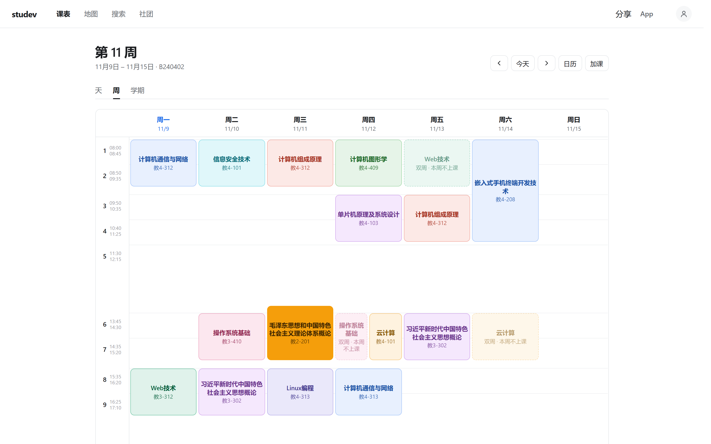
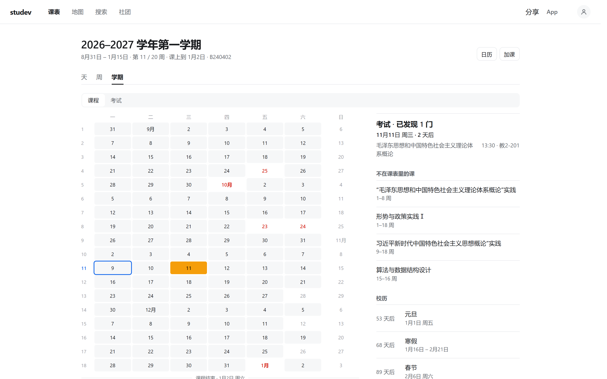
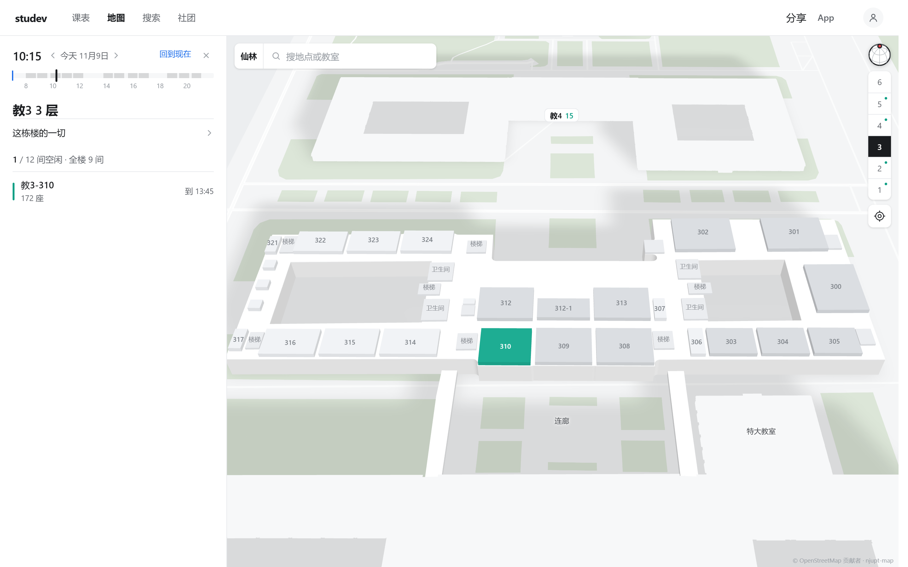
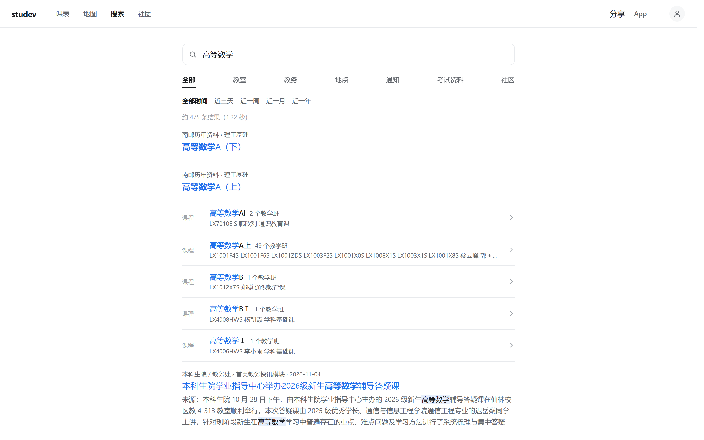
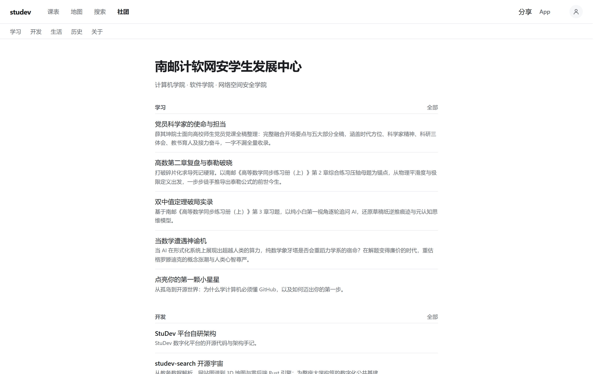
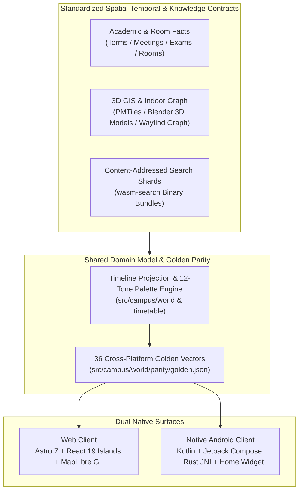

<div align="center">

# StuDev

**Local-First Digital Campus & Spatial-Temporal Twin for Universities — One Domain Model Across Web and Native Android**

[](https://studev.hicancan.top/)
[](https://studev.hicancan.top/download/)
[](https://astro.build/)
[](https://react.dev/)
[](https://www.typescriptlang.org/)
[](https://developer.android.com/compose)
[](https://www.rust-lang.org/)
[](https://maplibre.org/)
[](#development--verification)
[](./LICENSE)

[简体中文](./README.md) · **English**

[**Live Site (studev.hicancan.top)**](https://studev.hicancan.top/) · [**Download Android App**](https://studev.hicancan.top/download/) · [**Architecture & About**](https://studev.hicancan.top/about/) · [**Club Portal**](https://studev.hicancan.top/club/) · [**Terms of Service**](https://studev.hicancan.top/terms/) · [**Privacy Policy**](https://studev.hicancan.top/privacy/)

</div>

---

**StuDev** is an open-source digital campus platform and student engineering portal developed by the **Student Development Center of the Schools of Computer Science, Software, and Cyberspace Security at Nanjing University of Posts and Telecommunications (NJUPT)**. It also serves as the real-world campus spatial-temporal digital twin and dynamic occupancy testbed for *"Carbon to the Fullest — AI-Driven Zero-Carbon Campus Energy Management System"*, a finalist flagship project in the 28th NJUPT "Innovation Cup" Extracurricular Academic and Technological Competition.

<table>
  <tr>
    <td width="50%">
      
      <p align="center"><sub><b>Weekly Timetable</b>: Collision-free 12-tone color wheel, 50/50 odd-even week split, and in-place off-week course preview</sub></p>
    </td>
    <td width="50%">
      
      <p align="center"><sub><b>Full-Term Panorama</b>: 20-week academic progression, amber exam tiles, statutory holidays, and makeup classes in one unified grid</sub></p>
    </td>
  </tr>
  <tr>
    <td width="50%">
      
      <p align="center"><sub><b>3D Campus & Free Classrooms</b>: 129 3D buildings, 564 indoor classroom occupancy cutaways at any timestamp, and offline turn-by-turn routing</sub></p>
    </td>
    <td width="50%">
      
      <p align="center"><sub><b>Client-Side Wasm Search</b>: Rust + WebAssembly BM25 engine fetching content-addressed shards on demand via HTTP Range</sub></p>
    </td>
  </tr>
</table>

---

## Why StuDev?

Across most universities, everyday academic and campus life is fragmented across disconnected legacy portals: checking timetables or exam rooms requires navigating nested HTML tables, finding an empty study room means walking floor by floor, locating syllabus attachments requires digging through dozens of departmental websites, and student organization knowledge disappears into chat logs every time leadership rotates.

StuDev unifies these fragments under a single **Campus Spatial-Temporal Domain Model**:

1. **Local-First & Zero-Tracking by Default**: Timetables, exam schedules, academic calendars, real-time free classrooms, 3D building maps, and full-text search work **without registration or sign-in**. Selected classes, custom lessons, morning workout check-ins, and reminders live strictly on the user's device (`localStorage` on Web, `SharedPreferences` on Android). The server never receives or logs personal query trajectories.
2. **One Unified Timeline Across the Term**: Lectures, final exams, practical weeks, public holidays, makeup days, sports meets, university anniversaries, and morning exercises are projected onto a single continuous timeline—scalable across **Day, Week, and 20-Week Term** views and exportable to native system calendars in one tap.
3. **Real-Time Spatial-Temporal Cutaways**: Dragging the time scrubber to any minute of the day immediately updates 3D floor cutaways across campus buildings, highlighting available classrooms in emerald green alongside seat capacities and free-until timestamps, paired with an on-device Rust routing engine for indoor-outdoor pedestrian navigation.
4. **Git-Backed Student Organization Memory**: Study guides, engineering postmortems, community essays, and leadership archives are maintained as strongly typed Markdown collections inside the repository, turning student contributions into permanent, searchable institutional memory.

---

## Product Tour

### 1. Timetables, Exams & Full-Term Calendar (`/`)

Enter a class code—or jump directly from search to any instructor, course, or classroom schedule—to switch seamlessly between **Day, Week, and Term** views.

- **Collision-Free 12-Tone Palette**: Courses within a timetable are jointly assigned hues spaced 30° apart around the color wheel, guaranteeing adjacent same-day courses never collide and reusing hues only across courses that never meet on the same day.
- **Odd/Even Split & In-Place Off-Week Lessons**: Odd-week and even-week courses share a 50/50 split cell; courses within their active week span that do not meet in the current week remain in place in muted gray—tapping jumps straight to the next active week.
- **Native Exam & Academic Calendar Integration**: Final exams render as amber blocks inside both the weekly timetable and the 20-week term panorama, complete with countdowns, room numbers, and provenance from academic affairs bulletins.


### 2. 3D Campus Map, Real-Time Free Classrooms & Offline Navigation (`/map/`)

A full-scale digital twin built on vector tiles, 129 hand-modeled Blender 3D buildings, and the spatial topology of 564 classrooms.

- **Indoor Floor Cutaways at Any Timestamp**: Scrub the `07:00–22:00` time ruler to inspect floor-by-floor room availability in 3D, with exact seat counts and next-occupied times.
- **On-Device Pedestrian Routing & Voice Guidance**: Powered by [`wayfind`](https://github.com/hicancan/wayfind), a stateless Rust routing kernel running via WebAssembly on Web and CMake/JNI on Android, supporting cross-building, cross-floor pathfinding, off-route recalculation, and background voice prompts.


### 3. Zero-Backend WebAssembly Full-Text Search (`/search/`)

Driven by [`wasm-search`](https://github.com/hicancan/wasm-search), a custom Rust full-text search engine running entirely on the client.

- **Unified Multi-Source Ranking**: One query simultaneously searches courses, instructors, classes, live classroom availability, official notices, deep text inside Word/Excel/PDF attachments, past exam archives, and student survival guides.
- **Content-Addressed Range Fetching**: Tokenization, synonym expansion, and BM25 ranking execute in local memory via WebAssembly, fetching only the required inverted-index byte ranges from static CDN storage. Search queries never leave the device.


### 4. Student Development Center Portal & Zero-Trust Collaboration (`/club/` · `/forms/` · `/account/`)

- **Four Editorial Collections**: Spanning **Study** (Party Member Scientist profiles, calculus & frontier mathematics), **Develop** (architecture notes & open-source engineering), **Life** (volunteer teaching chronicles & campus humanities), and **History** (semester timelines & member rosters), with build-time dual-theme Mermaid SVG compilation, MathJax SVG equations, and per-page WenKai font subsetting.
- **Zero-Trust Club Operations**: Authenticated club workflows and volunteer errata submissions backed by `scrypt` password hashing, `RFC 6238` TOTP two-factor authentication (`AES-256-GCM` identity-bound encryption), single-use rotating refresh tokens, and presigned object-storage uploads.



---

## System Architecture



### Technology Stack

| Layer | Technologies | Engineering Role |
| :--- | :--- | :--- |
| **Web Surface** | Astro 7 · React 19 Islands · TypeScript 6 · Tailwind CSS 4 | Zero-JS static editorial pages, `< 40 KB` initial shell script budget, on-demand interactive islands, offline-capable PWA |
| **Android Surface** | Kotlin · Jetpack Compose · Material 3 · Glance Widget | 100% native declarative UI, home-screen next-lesson widget, incremental sync with Android `CalendarContract` |
| **3D GIS & Map** | MapLibre GL · PMTiles · Blender 3D · QGIS | 129 3D campus buildings, 564 indoor room geometries, real-time floor cutaway coloring tied to the timeline |
| **On-Device Compute** | Rust · WebAssembly · Android NDK (CMake / JNI) | [`wasm-search`](https://github.com/hicancan/wasm-search) client-side BM25 search & [`wayfind`](https://github.com/hicancan/wayfind) offline pedestrian routing |
| **Identity & Forms** | Edge Functions · KV / Blob · `@noble/hashes` (`scrypt`) | Optimistic concurrency control (OCC), single-use refresh token rotation, TOTP 2FA, campus NAT-aware rate limiting |
| **Publishing Pipeline** | MathJax 3 SVG · Dual-Theme Static Mermaid · `subset-font` | Build-time light/dark SVG diagrams and physics math rendering, per-page glyph extraction into lightweight WOFF2 subsets |

### Three Engineering Invariants

1. **One Model, Two Native Surfaces (36 Golden Parity Vectors)**  
   The Web client (TypeScript) and native Android client (Kotlin) never drift apart. [`src/campus/world/parity/golden.json`](./src/campus/world/parity/golden.json) freezes 36 real-world input/output vectors covering timetable grids, holiday & sports-meet projections, off-week jumps, 12-tone color assignments, free-room checks, and exam reminders. Both `parity.test.tsx` (Vitest) and `ParityTest.kt` (JUnit) assert against the exact same file.
2. **Stateless Rust Kernels Across Wasm and JNI**  
   Compute-heavy full-text search and multi-floor pedestrian routing are written once in Rust, compiled to WebAssembly for browsers and `arm64-v8a` shared libraries via CMake/NDK for Android—eliminating backend search servers altogether.
3. **83 Security & Concurrency Invariants**  
   [`src/platform/`](./src/platform/) implements optimistic concurrency control, token-family replay detection, atomic form quota reservation, and presigned attachment verification directly over edge KV/Blob primitives, verified by 83 automated security and race-condition tests.

---

## Repository Layout

```text
studev/
├── src/
│   ├── campus/            # Campus spatial-temporal core (Timetable, Map, Search, Me panel)
│   │   ├── timetable/     # Day / Week / Term views, 12-tone color allocator & ICS export
│   │   ├── map/           # MapLibre 3D building/floor cutaways, free-room timeline & routing
│   │   ├── search/        # Wasm full-text search client & multi-facet filters
│   │   └── world/         # Domain contracts (facts.ts), timeline engine & 36 golden vectors (parity/)
│   ├── platform/          # Identity auth (scrypt / TOTP), form engine & 83 security tests
│   ├── site/              # Static publishing layout, dual-theme Mermaid, per-page font subsetting
│   ├── content/           # Markdown collections for Study, Develop, Life, History & About
│   └── pages/             # Astro routes (including /terms/ and /privacy/)
├── android/               # Native Android app (Kotlin, Compose, MapLibre Native, Rust JNI, Widget)
├── design/                # Shared design tokens (tokens.json -> CSS & Kotlin) & map generators
├── campus.config.ts       # Search synonyms, notice categories & study room type rules
└── product.json           # Site metadata, campus coordinates, filings & client versions
```

---

## Bring StuDev to Your University

**StuDev is architected from the ground up as a reusable, general-purpose open-source digital campus blueprint for universities everywhere.**

Every university shares the same fundamental spatial-temporal primitives: academic calendars, daily period bells, odd/even week schedules, final exam rosters, multi-floor classroom buildings, and departmental bulletins. StuDev cleanly decouples its **universal spatial-temporal engine** from **institution-specific data and configuration**:

1. **Populate the Standardized Facts Contract ([`src/campus/world/facts.ts`](./src/campus/world/facts.ts))**  
   Convert your university's public term calendar (`TeachingTerm`), bell schedule (`TeachingPeriod`), class meetings (`TeachingMeeting`), exam schedule (`Exam`), and room directory (`Room`) into the static JSON schema defined in `facts.ts` to immediately power both the Web and Android clients.
2. **Customize Declarative Campus & Search Configs ([`product.json`](./product.json) & [`campus.config.ts`](./campus.config.ts))**  
   - Update [`product.json`](./product.json) with your institution name, domain, campus list, and center coordinates (`campus.centre`);
   - Configure campus-specific synonyms, bulletin categories, and study room types in [`campus.config.ts`](./campus.config.ts);
   - Compile your search shards and GeoJSON pedestrian graph using [`wasm-search`](https://github.com/hicancan/wasm-search) and [`wayfind`](https://github.com/hicancan/wayfind).
3. **Sync Cross-Platform Design Tokens ([`design/tokens.json`](./design/tokens.json))**  
   Adjust brand and semantic palettes in [`design/tokens.json`](./design/tokens.json) to automatically regenerate both Web CSS variables and Android Compose `Tokens.kt`.

**We warmly welcome student developers, university tech clubs, and open-source contributors everywhere to fork StuDev, adapt it for your campus, or contribute upstream!**

---

## Development & Verification

Requirements: **Node.js >= 22.13.0** (building the native Android client requires **JDK 21** and **Android SDK 36+**).

```powershell
# 1. Install dependencies
npm install

# 2. Start local dev server (http://localhost:4321)
npm run dev

# 3. Run the full verification suite (177 automated tests)
npm run typecheck      # Strict Astro & TypeScript type checking
npm run test:campus    # Domain model, 36 cross-platform golden vectors & PWA tests (76 tests)
npm run test:platform  # Zero-trust auth, concurrency quotas, TOTP & replay tests (83 tests)
npm run test:site      # Built HTML, dual-theme Mermaid, MathJax & link integrity tests (18 tests)
```

---

## Disclaimer, Filings & License

- **Non-Official Disclaimer**: **StuDev is an independent student-run open-source project and is not an official administrative or academic system of Nanjing University of Posts and Telecommunications (NJUPT).** All timetables, exam rooms, calendar dates, and classroom states are compiled from publicly released university teaching schedules for personal study reference only. **Always refer to official notices from the Academic Affairs Office and your school for authoritative schedule or exam changes.**
- **Notice & Takedown**: For errata or removal requests, please contact `studev@hicancan.top`.
- **Filings**: [苏ICP备2026038426号-1](https://beian.miit.gov.cn/) · [苏公网安备32011302323214号](https://beian.mps.gov.cn/#/query/webSearch?code=32011302323214) · [Terms of Service](https://studev.hicancan.top/terms/) · [Privacy Policy](https://studev.hicancan.top/privacy/)
- **License**: Licensed under the [GNU Affero General Public License v3.0](./LICENSE) (`AGPL-3.0`).  
  Copyright © 2026 StuDev Studio.
