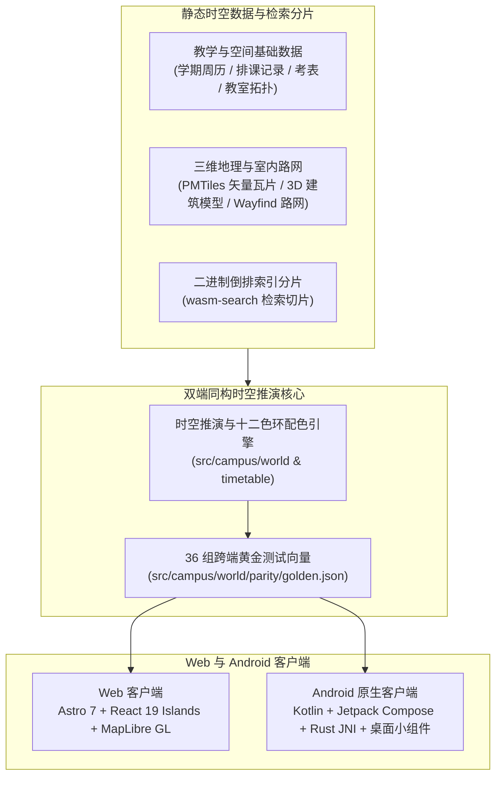

<div align="center">

# StuDev

**南邮计软网安学生发展中心官网与社团平台 · 时空联动的开源数字校园**  
*中心官网 · 社团协作 ｜ 时空联动 · 聚合搜索 · 数字孪生*

[](https://studev.hicancan.top/)
[](https://studev.hicancan.top/download/)
[](https://astro.build/)
[](https://react.dev/)
[](https://www.typescriptlang.org/)
[](https://developer.android.com/compose)
[](https://www.rust-lang.org/)
[](https://maplibre.org/)
[](https://github.com/NJUPT-CS-StuDev/studev)
[](#本地开发与质量门禁)
[](./LICENSE)

**简体中文** · [English](./README.en.md)

[**在线访问 studev.hicancan.top**](https://studev.hicancan.top/) · [**下载 Android 客户端**](https://studev.hicancan.top/download/) · [**站内架构全景**](https://studev.hicancan.top/about/) · [**学生发展中心专栏**](https://studev.hicancan.top/club/) · [**用户协议**](https://studev.hicancan.top/terms/) · [**隐私政策**](https://studev.hicancan.top/privacy/)

</div>

---

**StuDev**（**Stu**dent **Dev**elopment）是**南京邮电大学计软网安学生发展中心**（计算机学院 · 软件学院 · 网络空间安全学院）自研并开源的平台。它有两重身份：

1. **学生发展中心的官网与社团平台**：我们是谁、学习 / 开发 / 生活 / 历史四大专栏、历届成员与活动、招新入口，以及成员账号、表单收集与审核、管理后台，让中心的日常运转和知识沉淀都在一个地方完成。
2. **中心为全校同学做的数字校园**，由三根支柱撑起：
   - **时空联动**：课表、考场、校历与三维校园在同一条时间轴上推演，拨到任意时刻，哪间教室空着、下一节课在哪、怎么走过去一眼可见；
   - **聚合搜索**：课程、教师、班级、教室、通知、附件正文与学习资料，一次输入全部搜到，搜索词不离开本地设备；
   - **数字孪生**：3 校区、129 栋三维建筑与 564 间教室的空间底座，与姊妹开源仓库 [**碳迹未来 · CARBENTRA Campus（`hicancan/carbentra-campus-platform`）**](https://github.com/hicancan/carbentra-campus-platform) 共用，共同构成南京邮电大学第二十八届“创新杯”大学生课外学术科技作品竞赛终审决赛重点培育项目 **《碳尽其用——AI驱动的零碳园区碳能管控系统》** 的校园时空数字孪生工程体系。

> **为什么数字校园与零碳园区共用同一套时空数字孪生底座？**  
> 在高校园区中，教学楼与公共场馆的照明、空调及新风占建筑碳排放的大头，而决定每一间教室实时用能需求的根本变量，正是全校的教学排程与教室占用状态。我们围绕同一套**校园三维空间包（3 校区、129 栋三维建筑模型、室内分层教室单元）与全学期排课考务时间轴**构建了双模态开源体系：
> - **面向全校师生（本仓库 `studev`）**：将 20 周教学周历、课表考务、节假日调休与三维教学楼剖面实时联动，提供零门槛、免登录的日常**课表查询、实时空教室定位与室内外步行导航**；
> - **面向 AIoT 智慧能碳管控（[`carbentra-campus-platform`](https://github.com/hicancan/carbentra-campus-platform)）**：复用同一套校园三维空间基准与排课维护约束，结合边缘网关与智能插座、毫米波存在传感、三路照明开关等硬件遥测，在房间与回路粒度上完成**能碳独立核算、负荷预测、策略评估与受控调度**。

<table>
  <tr>
    <td width="50%">
      
      <p align="center"><sub><b>周课表视图</b>：十二色环无碰撞配色、单双周等宽并排，非本周课程原位淡灰呈现</sub></p>
    </td>
    <td width="50%">
      
      <p align="center"><sub><b>学期全景网格</b>：20 周教学进程、琥珀色期末考表、法定节假日与调休补课同屏展示</sub></p>
    </td>
  </tr>
  <tr>
    <td width="50%">
      
      <p align="center"><sub><b>三维校园与空教室</b>：129 栋三维建筑、564 间教室实时空闲剖面与室内外步行导航</sub></p>
    </td>
    <td width="50%">
      
      <p align="center"><sub><b>端侧全文检索</b>：Rust + WebAssembly 驱动，按需加载索引分片，搜索词不上传服务器</sub></p>
    </td>
  </tr>
</table>

---

## 为什么构建 StuDev

在绝大多数高校里，日常教学与校园生活信息长期散落在彼此孤立的系统中：查课表与期末考场需要翻阅层层教务表格，找一间自习空教室需要逐层推门碰运气，查一份培养方案或通知附件需要遍历十几个二级网站，而学生社团历年沉淀的技术文章与学业经验则随着换届散落在群聊与网盘里。

StuDev 用两重身份回应这些问题：学生发展中心的官网与社团平台，以及一套**时空联动的数字校园模型**：

1. **学生发展中心的官网与协作平台，知识代代相传**：学生发展中心的学习专栏、开发手记、活动纪实与骨干档案全部以结构化 Markdown 托管于 Git 仓库，每一次修订公开可查，让每一届学生的思考与作品可检索、可传承。 成员账号、表单报名与审核也在同一个平台完成，社团事务不再散落在群聊与网盘。
2. **免登录即用，个人数据留在本地**：查课表、看考场、翻校历、找空教室、看三维地图与搜全校通知**均无需注册登录**。用户选定的班级、自定义加减课、早锻炼打卡与提醒设置全部保存在终端本地，服务器不接收、不记录任何个人查询轨迹。
3. **教学、考务与校历同轴推演**：日常课程、期末考试、集中实践周、法定节假日、调休补课、运动会、校庆日与早锻炼在同一时间轴上统一计算，支持按“天 / 周 / 学期”三级尺度自由切换，并可一键写入手机系统日历。
4. **三维校园数字孪生与教学状态时空联动**：拨动时间刻度尺至任意时刻，三维教学楼剖面图即刻映射出每一层、每一间教室的实时空闲与课程占用状态，并可通过端侧寻路引擎一键发起跨楼栋、跨楼层步行导航。

---

## 核心功能全景

### 1. 学生发展中心官网与社团平台 (`/club/` · `/forms/` · `/account/`)

- **四大内容专栏**：涵盖**学习**（党员科学家精神、高数与前沿数学推导）、**开发**（平台自研架构与开源工程手记）、**生活**（西部支教纪实与校园人文）与**历史**（历年时间线与社团骨干档案），构建期自动编译双主题 Mermaid 矢量图表与 MathJax 数学公式，并按页面字符集对本地霞鹜文楷字体生成精简子集；
- **社团成员认证与内务协作**：面向社团内部事务填报与在校生志愿勘误，提供基于 `scrypt` 单向加盐散列、`RFC 6238` TOTP 动态口令（`AES-256-GCM` 加密存储）、设备会话管理与对象存储预签名直传的完整工作流。


### 2. 时空联动：课表、考务与学期全景日历 (`/`)

输入班级代码，或从搜索中打开任意教师、课程、教室课表，即可在**天视图、周视图、学期全景网格**之间自由切换。

- **十二色环无碰撞配色**：同一张课表内的课程按 30° 等距色环联合分配色彩，保证同日相邻课程色调分明，仅在不在同一天上课的课程之间复用色号；
- **单双周与非本周课程同格呈现**：单周与双周课程以 50% 等宽并排对照；处于开课周期内但本周不上课的课程保留原位淡灰呈现，点击即可跳转至下次上课周次；
- **考务与校历同屏呈现**：期末考试以醒目的琥珀色卡片直接嵌入周课表与 20 周学期全景网格，清晰标注考场、倒计时及教务通知来源。

### 3. 数字孪生：三维校园地图、空教室与步行导航 (`/map/`)

基于矢量瓦片、Blender 建模的 129 栋三维建筑与 564 间教室室内平面构建的数字孪生校园。

- **教学楼逐层剖切与实时空教室**：拨动左上角 `07:00–22:00` 时间标尺，三维楼层剖面实时高亮当前空闲教室（翡翠绿）与上课中教室（浅灰），并列出每间教室的座位数与空闲截止时刻；
- **端侧离线寻路与语音导航**：内置由 Rust 编写的 [`wayfind`](https://github.com/hicancan/wayfind) 寻路内核（Web 端运行于 WebAssembly，Android 端经 CMake/JNI 原生调用），支持步行路线规划、偏航实时重算与息屏语音引导。

### 4. 聚合搜索：端侧 WebAssembly 毫秒级全文检索 (`/search/`)

由自研 Rust 检索引擎 [`wasm-search`](https://github.com/hicancan/wasm-search) 驱动的无后端搜索系统。

- **多源统一检索**：一次输入即可同时检索全校公开课程、任课教师、班级、教室实时状态、教务通知、Word/Excel/PDF 附件正文、历年课程资料与校园生活指南；
- **索引分片按需加载**：浏览器与手机客户端通过 WebAssembly 在本地内存完成中文分词、同义词扩展与 BM25 相关性排序，仅通过 HTTP Range 按需加载命中的倒排索引分片，搜索词不离开本地设备。

---

## 系统架构与工程设计



### 技术栈一览

| 架构层级 | 核心技术选型 | 工程职责与关键设计 |
| :--- | :--- | :--- |
| **Web 客户端** | Astro 7 · React 19 Islands · TypeScript 6 · Tailwind CSS 4 | 静态内容零 JS 直出，首屏脚本体积严控于 `< 40 KB`；交互视图按需挂载，支持完整离线 PWA |
| **Android 原生端** | Kotlin · Jetpack Compose · Material 3 · Glance Widget | 原生声明式界面、桌面下一节课小组件、系统日历 `CalendarContract` 增量同步 |
| **三维空间与地图** | MapLibre GL · PMTiles · Blender 3D · QGIS | 129 栋校园建筑三维模型、564 间教室室内剖面、楼层与时间轴联动染色 |
| **端侧检索与寻路** | Rust · WebAssembly · Android NDK (CMake / JNI) | [`wasm-search`](https://github.com/hicancan/wasm-search) 无后端 BM25 全文检索与 [`wayfind`](https://github.com/hicancan/wayfind) 离线步行寻路 |
| **社团协作平台** | Edge Functions · KV / Blob · `@noble/hashes` (`scrypt`) | 乐观并发控制、防重放单次轮转刷新令牌、TOTP 双因素认证、校园网共享 NAT 精细化限流 |
| **出版与编译工具链** | MathJax 3 SVG · Mermaid 双主题预渲染 · `subset-font` | 构建期静态生成亮/暗双色矢量图表与数学公式，按页提取字符集生成轻量 WebFont |

### 核心工程设计

1. **双端逻辑同源与 36 组黄金测试向量**  
   Web 端（TypeScript）与 Android 原生端（Kotlin）共享同一套业务规则。[`src/campus/world/parity/golden.json`](./src/campus/world/parity/golden.json) 锁定了真实课表网格、节假日与运动会推演、非本周课程跳转、十二色环配色、空教室判定与考试提醒等 36 组标准输入输出。Web 端 `parity.test.tsx` 与 Android 端 `ParityTest.kt` 共同校验同一份基准——任何一端计算结果不一致，构建即刻阻断。
2. **Rust 驱动的端侧检索与寻路内核**  
   将计算密集型的全文检索与校园路网寻路全部放在无状态的 Rust 内核中执行，在浏览器端编译为 WebAssembly 模块，在 Android 端通过 NDK 编译为 `arm64-v8a` 原生动态库，无需维护后端检索服务器。
3. **83 项平台安全与高并发竞态测试**  
   社团协作平台层（[`src/platform/`](./src/platform/)）基于边缘键值与对象存储实现了乐观并发控制、刷新令牌单次轮转、表单名额原子扣减与预签名附件校验，由 83 项端到端安全与高并发竞态测试完整覆盖。

---

## 仓库目录结构

```text
studev/
├── src/
│   ├── campus/            # 校园时空核心（课表、考务、校历、3D 地图、Wasm 搜索、个人面板）
│   │   ├── timetable/     # 天 / 周 / 学期三级视图、12 色环配色器与 ICS 日历导出
│   │   ├── map/           # MapLibre 3D 建筑与楼层室内剖面渲染、时间轴空教室与步行导航
│   │   ├── search/        # Wasm 全文检索客户端与多维分面筛选器
│   │   └── world/         # 时空数据接口 (facts.ts)、推演算法与 36 组跨端黄金测试向量 (parity/)
│   ├── platform/          # 社团身份认证（scrypt / TOTP）、专项表单引擎与 83 项安全测试
│   ├── site/              # 静态出版布局、双主题 Mermaid 编译、本地字体按页子集化与构建契约测试
│   ├── content/           # 计软网安学生发展中心学习、开发、生活、历史与关于专栏 Markdown
│   └── pages/             # Astro 路由入口（含 /terms/ 用户协议与 /privacy/ 隐私政策）
├── android/               # 原生 Android 客户端（Kotlin, Compose, MapLibre Native, Rust JNI, 桌面小组件）
├── design/                # 跨端共享设计变量（tokens.json -> CSS & Kotlin）与地图图层生成器
├── campus.config.ts       # 检索同义词词典、频道分类规则与空教室场地类别配置
└── product.json           # 站点元数据、校区坐标、备案号与双端版本配置
```

---

## 点亮你的大学 · 全国高校时空共建指南

**StuDev 从架构设计之初就不仅局限于单一高校，而是致力于成为全国高校开源数字校园的通用底座。**

每一所中国高校都拥有高度相似的时空要素：学年周历、节次作息、单双周排课、期末考表、教学楼层与校园通知。StuDev 在底层将**通用高校时空推演引擎**与**本校数据配置**进行了彻底解耦，任何高校的学生开发者或技术社团均可通过三步完成适配迁移：

1. **准备标准化的教学与空间数据（[`src/campus/world/facts.ts`](./src/campus/world/facts.ts)）**  
   无论贵校采用哪套教务或场馆系统，只需将公开的教学周历（`TeachingTerm`）、作息节次（`TeachingPeriod`）、排课记录（`TeachingMeeting`）、考场安排（`Exam`）与教室列表（`Room`）转换为 `facts.ts` 定义的轻量静态 JSON 结构，即可直接驱动 Web 与 Android 双端课表、考务与空教室系统。
2. **修改校区坐标与检索配置（[`product.json`](./product.json) & [`campus.config.ts`](./campus.config.ts)）**  
   - 在 [`product.json`](./product.json) 中配置学校与社团名称、正式域名、校区列表及中心经纬度坐标（`campus.centre`）；
   - 在 [`campus.config.ts`](./campus.config.ts) 中配置贵校常用的检索同义词、通知分类规则与自习教室场地类别；
   - 使用 [`wasm-search`](https://github.com/hicancan/wasm-search) 与 [`wayfind`](https://github.com/hicancan/wayfind) 编译贵校的检索分片与 GeoJSON 校区步行路网。
3. **定制学校主题色板（[`design/tokens.json`](./design/tokens.json)）**  
   在 [`design/tokens.json`](./design/tokens.json) 中调整品牌主色与明暗色板，构建脚本会自动同步生成 Web 端 CSS 变量与 Android Compose `Tokens.kt` 源码。

**我们热忱欢迎全国各高校的学生开发者、技术社团与开源爱好者 Fork 本仓库或参与上游共建，为你的母校构建一座零广告、重隐私、极速纯净的数字校园平台！**

---

## 本地开发与质量门禁

环境要求：**Node.js >= 22.13.0**（构建 Android 原生客户端需 **JDK 21** 与 **Android SDK 36+**）。

```powershell
# 1. 安装依赖
npm install

# 2. 启动本地开发服务器 (http://localhost:4321)
npm run dev

# 3. 运行全套质量门禁与自动化测试 (共 177 项测试)
npm run typecheck      # Astro & TypeScript 全量严格类型检查
npm run test:campus    # 校园时空模型、36 组跨端黄金测试向量与 PWA 单元测试 (76 项)
npm run test:platform  # 身份安全、并发配额、TOTP 与防重放攻击测试集 (83 项)
npm run test:site      # 静态构建产物、双主题图表、数学公式与全站链接契约校验 (18 项)
```

---

## 合规声明、备案信息与开源协议

- **非官方系统声明**：**StuDev 不是南京邮电大学的官方行政或教务系统，与学校及其各职能部门不存在行政隶属或官方授权关系。** 平台所呈现的课表、考场、校历与教室状态均整理自学校面向全体在校学生公开的教学安排，仅供日常学习规划参考；**一切调课、停课及考务安排均以学校教务处及所在学院发布的最新正式通知为准。**
- **纠错与下线响应**：若学校相关部门、教师或同学认为某项信息存在偏差或不宜展示，请发送邮件至 `studev@hicancan.top`，我们在核实后将及时予以更正或下线。
- **合规备案**：[苏ICP备2026038426号-1](https://beian.miit.gov.cn/) · [苏公网安备32011302323214号](https://beian.mps.gov.cn/#/query/webSearch?code=32011302323214) · [用户协议](https://studev.hicancan.top/terms/) · [隐私政策](https://studev.hicancan.top/privacy/)
- **开源许可证**：本项目源代码采用 [GNU Affero General Public License v3.0](./LICENSE)（`AGPL-3.0`）协议开源。  
  Copyright © 2026 StuDev Studio.
