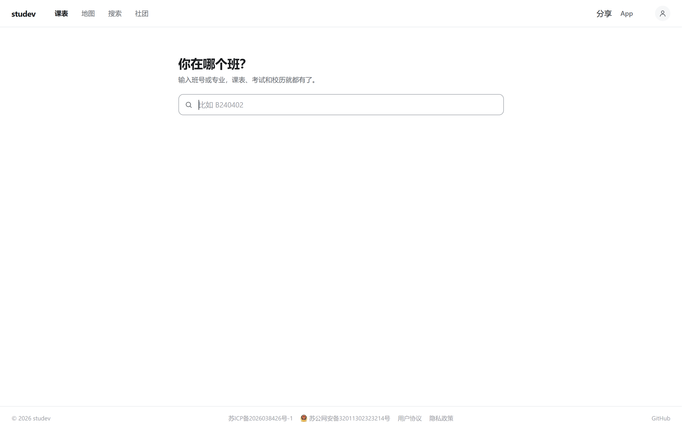
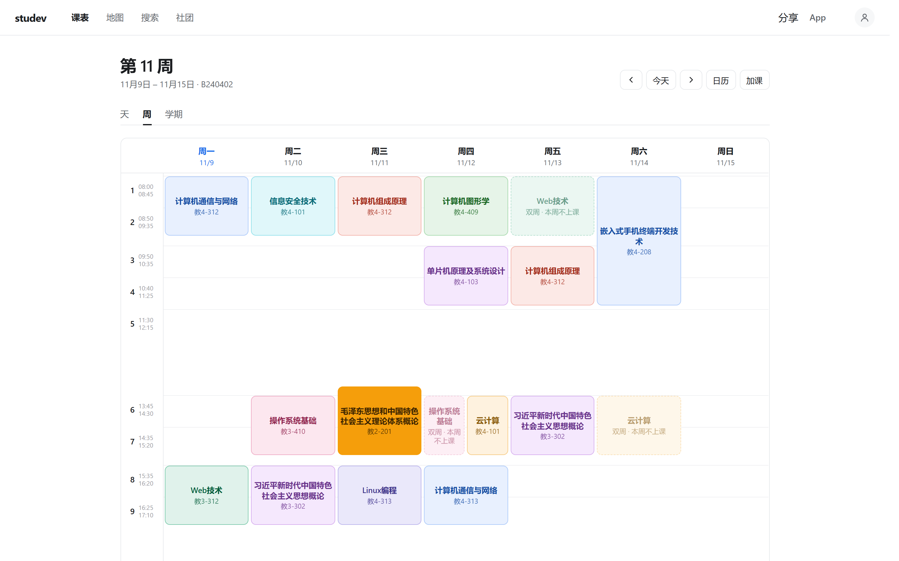
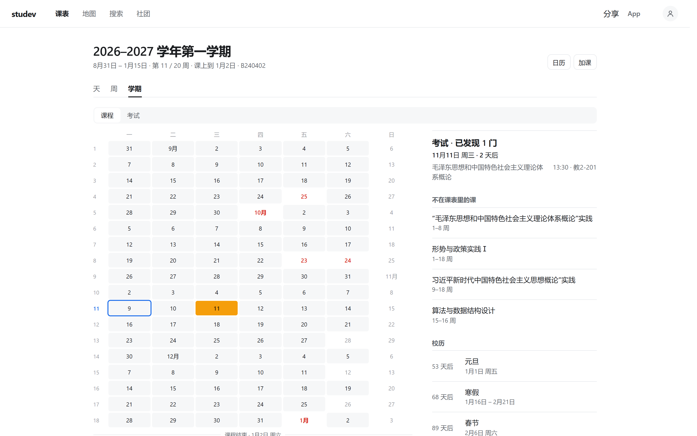
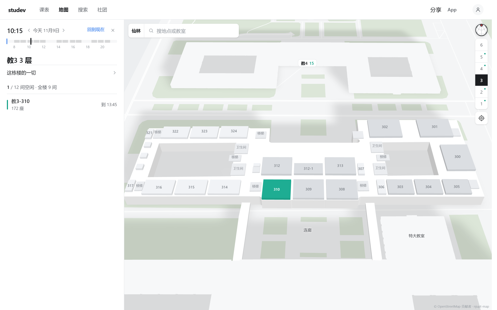
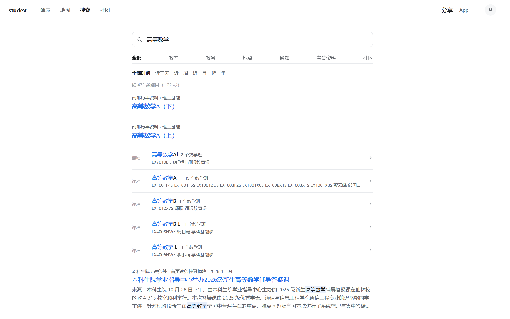
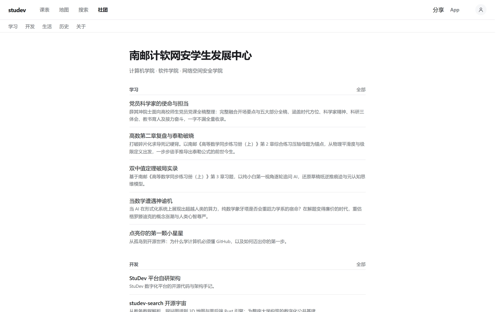
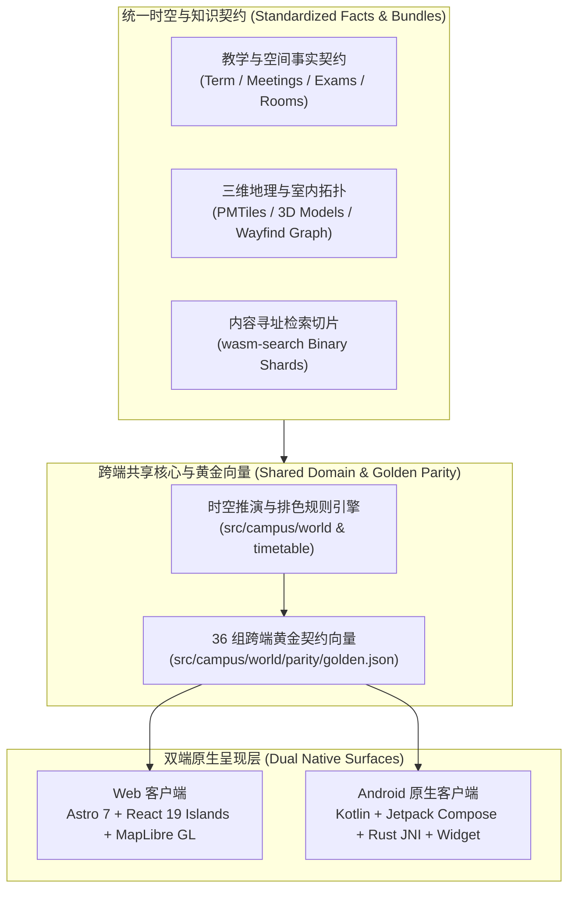

# StuDev

**Local-first digital campus and spatial-temporal twin for universities — one domain model across Web and native Android.**

**StuDev** 是由**南京邮电大学计软网安学生发展中心**（计算机学院 · 软件学院 · 网络空间安全学院）研发并开源的数字校园与社团协作基建，同时作为南京邮电大学第二十八届“创新杯”大学生课外学术科技作品竞赛终审决赛重点培育项目 **《碳尽其用——AI驱动的零碳园区碳能管控系统》** 的校园时空数字孪生与人流负荷动态感知实证底座。

[**在线访问 studev.hicancan.top**](https://studev.hicancan.top/) · [**下载 Android 客户端**](https://studev.hicancan.top/download/) · [**学生发展中心专栏**](https://studev.hicancan.top/club/) · [**用户协议**](https://studev.hicancan.top/terms/) · [**隐私政策**](https://studev.hicancan.top/privacy/)



---

## 为什么构建 StuDev？ (Why StuDev?)

在绝大多数高校里，日常教学与校园生活的信息往往散落在彼此割裂的系统中：查课表与考场需要穿过层层教务表格，找一间自习空教室需要逐层推门碰运气，查一份培养方案或通知附件需要翻遍十几个二级网站，而学生社团历年沉淀的技术与学业经验则随着换届消失在群聊与网盘里。

**StuDev 用一套统一的“校园时空模型（Campus Spatial-Temporal Model）”将这些碎片重新缝合：**

1. **本地优先与隐私至上（Local-First & Zero-Tracking）**：课表、考试安排、校历、空闲教室、三维校园地图与全文检索**无需注册登录即可使用**。用户选定的班级、自定义加减课、早锻炼打卡与提醒设置全部保存在终端设备本地（`localStorage` / Android `SharedPreferences`），服务器不接收、不记录任何个人查询轨迹。
2. **一条时间线贯穿全学期（Unified Timeline）**：课程、期末考试、实践周、法定节假日、调休补课、运动会、校庆日与早锻炼在同一条时间轴上精密推演。支持按“天 / 周 / 学期”三级尺度无缝缩放，并可一键同步至手机系统日历。
3. **三维空间与教学状态实时咬合（Spatial-Temporal Twin）**：拖动时间刻度尺至任意时刻，三维教学楼剖面图即刻映射出每一层、每一间教室的实时空闲与课程占用状态，并通过端侧寻路引擎一键发起跨楼栋、跨楼层步行导航。
4. **开源自治的社团知识资产（Git-Backed Club Knowledge）**：学生发展中心的学习专栏、工程手记、活动历史与组织档案全部以结构化 Markdown 沉淀于代码仓库，让每一届学生的思考与作品可检索、可传承。

---

## 核心界面与功能全景 (Product Tour)

### 1. 课表、考务与学期全景日历 (`/`)

输入班级代码（或从搜索中打开任意教师、课程、教室课表），即可在**天视图、周视图、学期全景网格**之间自由切换。

- **十二色环无碰撞分配**：同一张课表内的课程按 30° 等距色环联合分配色彩，保证同日相邻课程色调分明，仅在从不同日相逢的课程间复用色调；
- **单双周与非本周课程同格呈现**：单周与双周课程以 50% 等宽并排对照；处于开课周期内但本周不上课的课程保留原位淡灰呈现，点击即可直达下次上课周次；
- **考务与校历原生融合**：期末考试以醒目的琥珀色色块直接嵌入周课表与 20 周学期网格，精确标注考场、倒计时及教务通知发布溯源。





### 2. 三维校园地图、实时空教室与实景导航 (`/map/`)

基于矢量瓦片、Blender 129 栋建筑三维资产与 564 间教室空间拓扑构建的全尺寸数字孪生校园。

- **任意时刻的室内外教室剖面**：拨动左上角 `07:00–22:00` 时间标尺，三维楼层切面实时高亮当前空闲教室（翡翠绿）与在用教室（浅灰），并精确列出每间教室的座位数与空闲截止时刻；
- **端侧离线寻路与语音导航**：内置由 Rust 编写的 [`wayfind`](https://github.com/hicancan/wayfind) 寻路核心（Web 端运行于 WebAssembly，Android 端经 CMake/JNI 原生调用），支持步行路线规划、偏航实时重算与息屏语音引导。



### 3. 纯端侧 WebAssembly 毫秒级全文检索 (`/search/`)

由自研 Rust 检索引擎 [`wasm-search`](https://github.com/hicancan/wasm-search) 驱动的零后端搜索系统。

- **多源同屏混排**：一次输入即可同时检索全校公开课程、任课教师、班级、教室实时状态、教务通知、Office/PDF 附件深层文本、历年课程资料与校园生活指南；
- **内容寻址分片按需拉取**：浏览器与手机客户端通过 WebAssembly 在本地内存完成中文分词、同义词扩展（如 `四六级`、`大创`）与 BM25 相关性排序，通过 HTTP Range 仅按需拉取命中的倒排索引切片，搜索词永不上传服务器。



### 4. 学生发展中心专栏与零信任协作平台 (`/club/` · `/forms/` · `/account/`)

- **四大内容专栏**：涵盖**学习**（党员科学家精神、高数与前沿数学推导）、**开发**（平台架构与开源工程手记）、**生活**（支教纪实与校园人文）与**历史**（学期时间线与社团骨干档案），内置编译期双主题 Mermaid 图表与 MathJax 数学公式渲染；
- **高安全标准社团协作**：面向社团内部事务填报与在校生志愿勘误，提供基于 `scrypt` 单向加盐散列、`RFC 6238` TOTP 动态验证码（`AES-256-GCM` 身份绑定加密）、设备会话管理与受控对象存储预签名附件上传的完整闭环。



---

## 系统架构与工程支柱 (Engineering Architecture)



1. **双端同构与黄金契约（One Model, Two Native Surfaces）**  
   Web 端（TypeScript / React 19）与 Android 原生端（Kotlin / Jetpack Compose）绝不各自为政。`src/campus/world/parity/` 下的 `golden.json` 冻结了真实课表网格、节假日与运动会推演、非本周课程跳转、12 色环分配、空教室判定与考试提醒等全套输入输出向量。`parity.test.tsx` 与 Android `ParityTest.kt` 共同读取同一份黄金向量——任何一端规则偏离，测试即刻阻断。
2. **Rust 赋能的端侧算力底座（Rust -> Wasm & Android JNI）**  
   将计算密集型的全文检索（[`wasm-search`](https://github.com/hicancan/wasm-search)）与多模式校园路网寻路（[`wayfind`](https://github.com/hicancan/wayfind)）全部下沉至 Rust 编写的无状态内核，在 Web 端编译为紧凑的 WebAssembly 模块，在 Android 端通过 NDK CMake 编译为 `arm64-v8a` 原生动态库。
3. **零信任级身份与表单安全不变量（83 Security & Concurrency Invariants）**  
   平台层（`src/platform/`）不依赖任何笨重的第三方 ORM 或黑盒鉴权框架，基于边缘 KV/Blob 原语实现了乐观并发控制（OCC）、防重放单次轮转刷新令牌（Refresh Token Rotation）、共享校园网 NAT 精细化限流与幂等附件提交流水线，由 83 项端到端安全与高并发竞态测试完整覆盖。

---

## 代码仓库拓扑 (Repository Layout)

```text
studev/
├── src/
│   ├── campus/            # 校园时空核心（课表、考务、校历、3D 地图、Wasm 搜索、个人面板）
│   │   ├── timetable/     # 天 / 周 / 学期三级视图、12 色环排色器与 ICS/系统日历生成
│   │   ├── map/           # MapLibre 3D 建筑/楼层室内渲染、时间轴空教室与步行导航
│   │   ├── search/        # Wasm 全文检索客户端与多维分面筛选器
│   │   └── world/         # 领域事实接口 (facts.ts)、时空推演算法与跨端黄金契约 (parity/)
│   ├── platform/          # 社团身份认证（scrypt / TOTP）、专项表单引擎与 83 项安全审计测试
│   ├── site/              # 静态出版布局、双主题 Mermaid 编译、本地 WenKai 字体按页子集化
│   ├── content/           # 计软网安学生发展中心学习、开发、生活、历史与关于专栏 Markdown
│   └── pages/             # Astro 路由入口（含 /terms/ 用户协议与 /privacy/ 隐私政策）
├── android/               # 原生 Android 客户端（Kotlin, Compose, MapLibre Native, Rust JNI, 桌面小组件）
├── design/                # 跨端共享设计令牌（tokens.json -> CSS & Kotlin）与地图图层生成器
├── campus.config.ts       # 检索同义词词典、频道分类规则与空教室场地类别配置
└── product.json           # 站点元数据、校区坐标、备案号与双端版本配置
```

---

## 点亮你的大学 · 全国高校时空共建指南 (Bring StuDev to Your University)

**StuDev 从诞生之初，就不仅为单一学校而写，而是致力于成为中国高校开源数字校园的通用标准底座。**

每一所中国高校都拥有高度同构的时空要素：学年周历、节次作息、单双周排课、期末考表、教学楼层与校园通知。StuDev 在架构底层将**“通用高校时空推演引擎”**与**“校本数据配置”**进行了彻底解耦：

1. **标准化的高校事实契约（[`src/campus/world/facts.ts`](src/campus/world/facts.ts)）**  
   无论你们学校使用的是哪套教务或场馆系统，只要将公开的教学周历（`TeachingTerm`）、作息节次（`TeachingPeriod`）、排课记录（`TeachingMeeting`）、考场安排（`Exam`）与教室列表（`Room`）转换为 `facts.ts` 定义的轻量静态 JSON 结构，即可直接驱动 Web 与 Android 双端课表、考务与空教室系统。
2. **声明式的校区与检索配置（[`product.json`](product.json) & [`campus.config.ts`](campus.config.ts)）**  
   - 在 [`product.json`](product.json) 中修改学校/社团名称、域名、校区名称与中心经纬度坐标（`campus.centre`）；
   - 在 [`campus.config.ts`](campus.config.ts) 中配置贵校常用的检索同义词、通知分类关键词与自习教室场地类型；
   - 配合 [`wasm-search`](https://github.com/hicancan/wasm-search) 与 [`wayfind`](https://github.com/hicancan/wayfind) 编译贵校的检索切片与 GeoJSON 校区路网。
3. **跨端设计令牌一键同步（[`design/tokens.json`](design/tokens.json)）**  
   修改 `design/tokens.json` 中的品牌主色与语义色板，构建脚本会自动同步生成 Web CSS 变量与 Android Compose `Tokens.kt` 源码。

**我们热忱欢迎全国各高校的学生开发者、技术社团与开源爱好者 Fork 本仓库或参与上游共建，用现代工程美学为你的母校构建一座零广告、重隐私、极速纯净的数字校园基建！**

---

## 本地开发与质量门禁 (Development & Verification)

环境要求：**Node.js >= 22.13.0**（Android 客户端构建需 **JDK 21** 与 **Android SDK 36+**）。

```powershell
# 安装依赖
npm install

# 启动本地开发服务器 (http://localhost:4321)
npm run dev

# 运行全套质量门禁与自动化测试 (共 177 项测试)
npm run typecheck      # Astro & TypeScript 全量严格类型检查
npm run test:campus    # 校园时空领域模型、36 组跨端黄金契约与 PWA 单元测试 (76 tests)
npm run test:platform  # 身份安全、并发配额、TOTP 与防重放攻击测试集 (83 tests)
npm run test:site      # 静态构建产物、双主题图表、数学公式与全站链接契约校验 (18 tests)
```

---

## 合规声明、备案信息与开源协议 (Compliance & License)

- **非官方系统声明**：**StuDev 不是南京邮电大学的官方行政或教务系统，与学校及其各职能部门不存在行政隶属或官方授权关系。** 平台所呈现的课表、考场、校历与教室状态均整理自学校面向全体在校学生公开的教学安排，仅供日常学习规划参考；**一切调课、停课及考务安排均以学校教务处及所在学院发布的最新正式通知为准。**
- **纠错与下线响应**：若学校相关部门、教师或同学认为某项信息存在偏差或不宜展示，请发送邮件至 `studev@hicancan.top`，我们在核实后将第一时间予以更正或下线。
- **合规备案**：[苏ICP备2026038426号-1](https://beian.miit.gov.cn/) · [苏公网安备32011302323214号](https://beian.mps.gov.cn/#/query/webSearch?code=32011302323214) · [用户协议](https://studev.hicancan.top/terms/) · [隐私政策](https://studev.hicancan.top/privacy/)
- **开源许可证**：本项目源代码采用 [GNU Affero General Public License v3.0](LICENSE) (`AGPL-3.0`) 协议开源。  
  Copyright © 2026 StuDev Studio.
