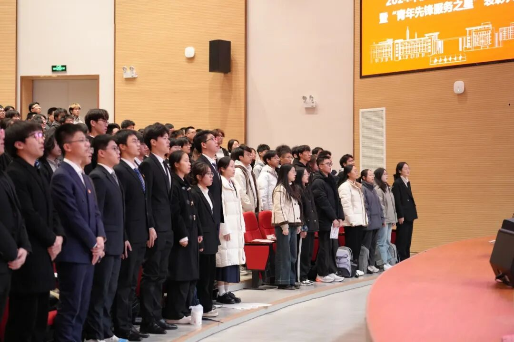
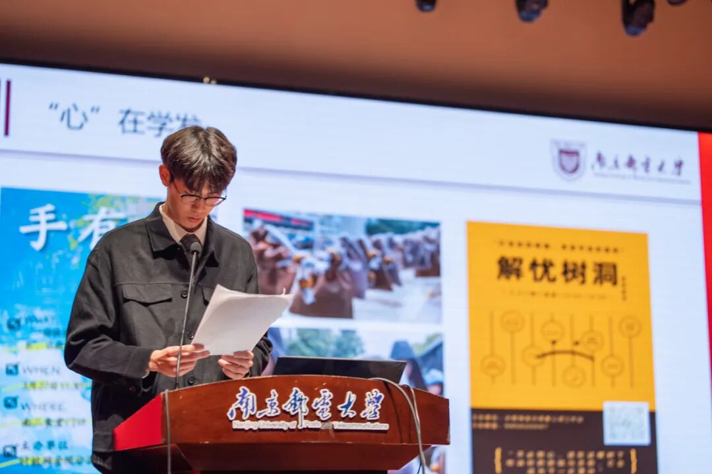
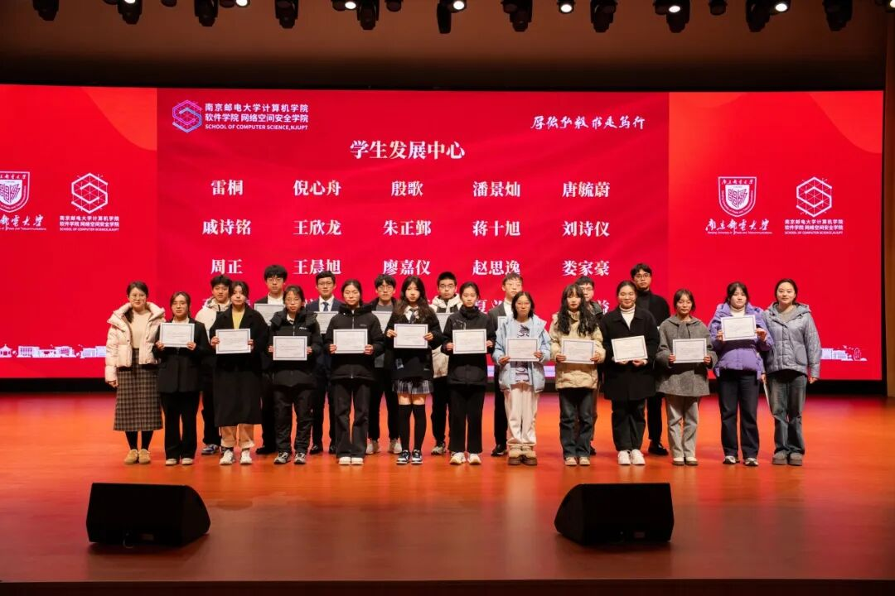
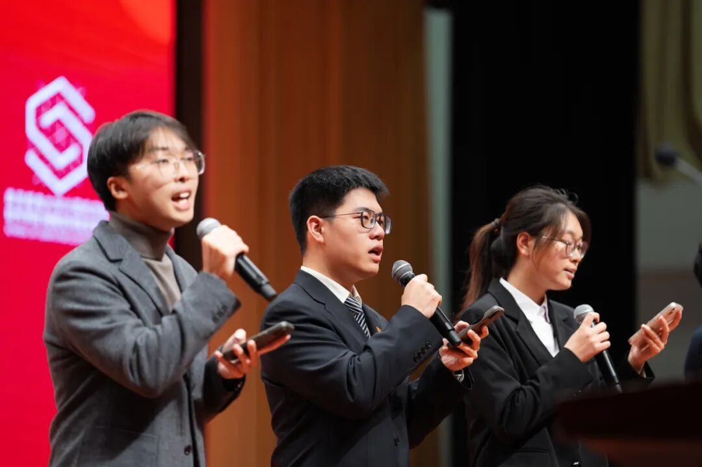
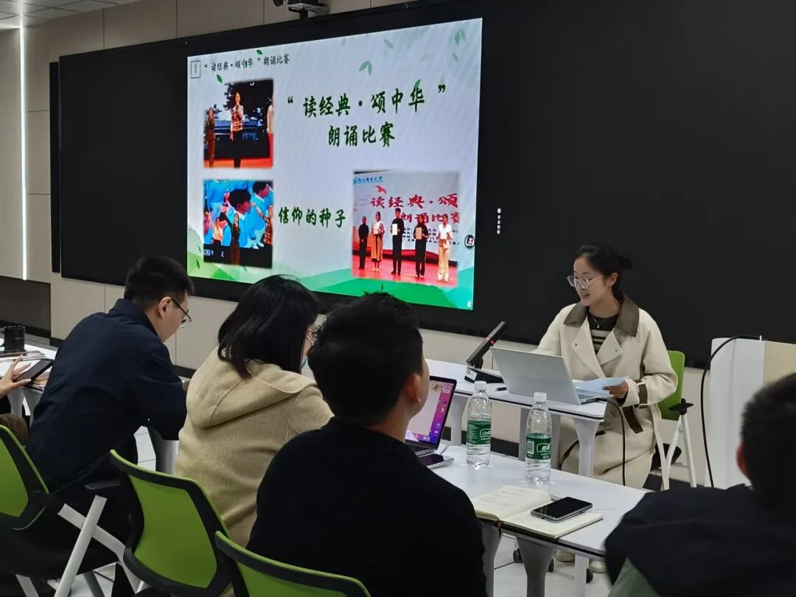
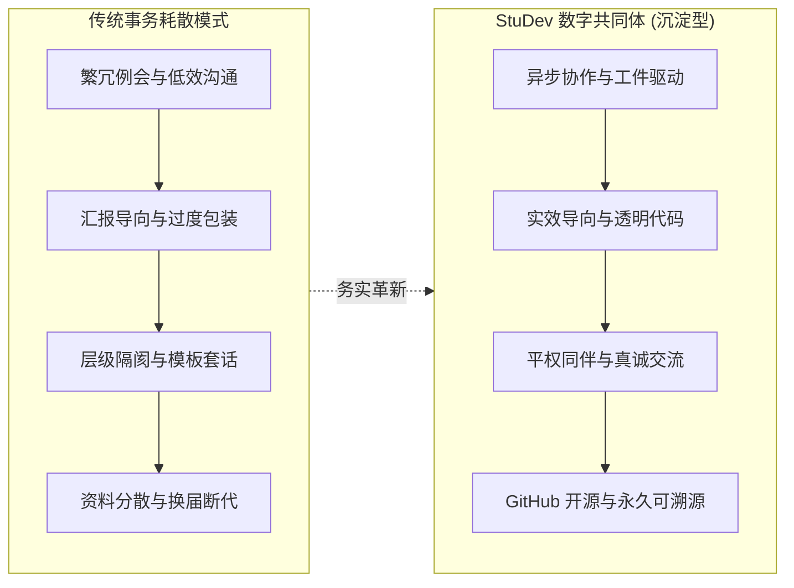
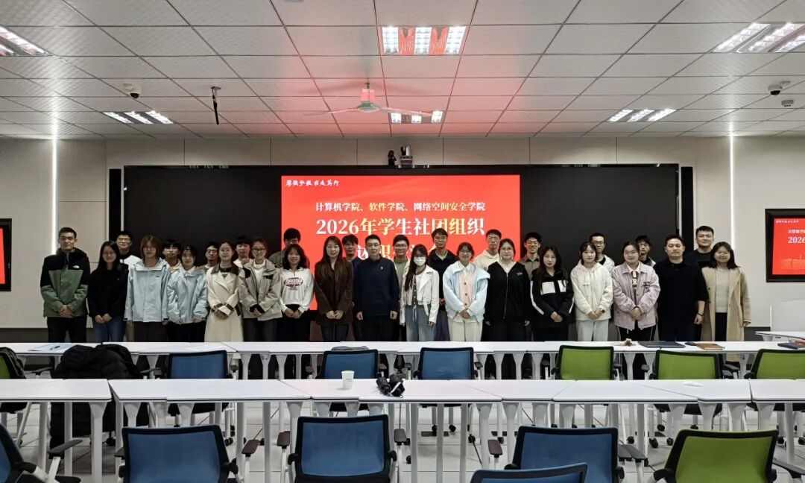
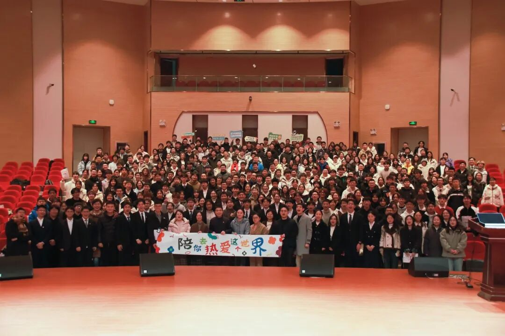

## 序章 · 聚光灯熄灭之后的剧场切片

每年岁末，南京邮电大学安恒青春剧场的舞台总会迎来它一年中最耀眼的时刻。

台上的追光灯打在鲜红的地毯上，大屏幕上滚动着各学生组织、社团精心打磨的年度汇报 PPT；西装领带整理得一丝不苟的学生骨干依次登台，熟练地切换着幻灯片，语调激昂地列举着一个个漂亮的百分比、柱状图，以及字斟句酌的“闭环思维”、“全方位矩阵”与“多维赋能”。

*庄严肃穆的大会现场：在宏大的仪式感背后，藏着数百名青年骨干一整年的付出与热忱。*

在这场由学院团学组织共同参与的年度总结大会中，学生发展中心的执行主席周正也站在了汇报席前。

大屏幕上清晰地映照出一年来中心在学业服务、心理支持、网络阵地与校园文化中走过的每一个脚印。台下响起热烈的掌声，评委老师们微微点头，颁奖环节上大家接过“青年先锋服务之星”的荣誉奖状，与会师生并肩合影，定格下一张张真诚的笑容。

*周正同学代表学生发展中心作年度述职汇报：大屏幕上的每一张数据图表，背后都是无数个夜晚的敲击与沟通。*

*学生发展中心获评“青年先锋服务之星”表彰合影：沉甸甸的荣誉证书，既是肯定，也是促使我们不断反思工作实效的起点。*

大会的尾声，各组织主席团并肩站在舞台中央，齐声合唱了一曲《入海》。

> “时间会回答成长，成长会回答梦想，梦想会回答生活……”

*剧场尾声主席团合唱《入海》：歌声穿透了空旷的剧场，但在旋律落下之后，对组织初心的思考依然留在每个人心底。*

然而，当大幕缓缓合上、剧场的顶灯骤然熄灭，真实的生活却在几分钟内露出了疲惫的原貌：

脱下并不合身的西装，许多同学揉了揉布满红丝的眼睛，口袋里的手机在静音模式下频繁振动——几个工作群里，各年级还在催要明天的表格、核对后天的报销发票、催促下周例会的考勤签到。

站在微风拂过的剧场台阶上，一个挥之不去的深切问题开始在心底浮现：

==如果一个学生组织的绝大部分心力，最终都耗散在了制作繁复的汇报材料、排练舞台走位、填报繁琐表格和字斟句酌模式化的通告套话上，那么我们最初聚在一起的那份纯粹热爱，究竟被稀释到了哪里？==

---

## 01 · 探索：学生组织提升服务实效的三重思考

在高校环境中，学生组织承担着连接师生、服务同学的重要纽带职能。然而在日常运转中，由于沟通习惯、汇报压力与资料交接不畅，大家有时会在不知不觉中陷入沟通成本较高与事务繁琐的困扰。这种现象并非源于任何个人的疏忽，更多是源于缺乏好工具与好流程时的路径依赖。

### 困境一：套话堆砌遮蔽了真诚平等的青年表达

在许多活动推文或总结中，常常能看到一些千篇一律的辞藻堆砌。一段长文读下来，除去客套的排比与模式化的结构，同学们真正关心的实用信息——*具体的活动流程、真实的参与收获、有价值的经验总结*——往往被淹没其中。

青年人原本拥有最蓬勃生动的表达欲。当学生组织的文字回归朴素、坦诚与清晰，它才能真正走进同学的心里，成为有信息密度的真诚交流。

---

### 困境二：汇报繁复取代了对服务实效的关切

在每学期的总结交流会上，幻灯片与述职是梳理工作的重要工具。然而，如果过度把精力花在调字号、做动效、编织高深莫测的名词上，就容易让形式本末倒置。

*述职交流会现场：台上的认真分享与台下的专注聆听。每一次汇报不仅是成果的展现，更是促使我们深入复盘服务质量的契机。*

在做完一场活动或完成一次服务后，我们更需要时常回到最质朴的问题：

==“参与其中的同学们，是否真正感受到了帮助与陪伴？他们的学业压力或实际困惑，是否得到了哪怕一点点缓解？”==

比起单方面的表面展示，大家真实的获得感与被倾听的体验，永远是检验一项工作成效的真正标尺。

---

### 困境三：资料分散带来的经验断代与重复造轮子

在许多学生组织中，历年积累下来的经验与材料往往处于散落状态：

上一届同学整理的场地借用指南、宣发设计源文件、技术调试经验，随着换届常常散落在个人电脑或聊天记录里，容易随着毕业离校而淡出视野。

新一届同学接手后，不得不重新踩一遍前人踩过的坑、重新摸索基础流程。这种知识资产的流失，让大家的大量精力被消耗在重复摸索中，难以把时间集中在更有价值的服务创新上。

---

## 02 · 突围与重构：StuDev 的务实探索与工程实践

计软网安学生发展中心在经历过多次研讨、复盘与实践后，逐渐达成了共识：**我们要把有限的精力，用在最能给同学带来滋养的地方。**

工科学生的时间极其宝贵——编译原理、操作系统、算法竞赛每一门都需要整块的深度专注时间。学生组织应当成为给青年成长提供能量的充电站与温暖港湾，而不是消耗精力的地方。

因此，从周正主持的工作汇报，到新团队推动 StuDev 平台诞生，我们努力探索一套更加务实、轻盈、透明的协作范式。

---

### 法则一：崇尚务实高效，以“作品”说话

> [!NOTE]
> **注重协作实效：异步协作与精简沟通**  
> 
> 在 StuDev，我们倡导轻量化的协作方式，尽可能减少“无实质议题却耗费数小时”的冗长会议。
> 
> 能在 GitHub Issue、PR 讨论区或协同文档里说清楚的事，绝不占用任何人的线下休息时间；能用 Markdown 清晰列出 Checklist 的任务，绝不搞层层口头请示传话。
> 
> 我们更看重你是不是==真正做成了一件具体的事==：你提交的代码是否修复了页面 Bug？你写的科普随笔是否讲透了一个技术难点？你策划的解忧树洞是否真正给新生递出了温暖？

---

### 法则二：以开源打破壁垒，社团资产全量透明沉淀

为什么我们要把整个社团的官方网站和数字化系统，开源在 GitHub（[`NJUPT-CS-StuDev/studev`](https://github.com/NJUPT-CS-StuDev/studev)）上？

因为代码和 Git 提交记录是全世界最诚实、最能对抗遗忘的载体：

> [!TIP]
> **开放沉淀：告别资料断代**  
> 
> 1. **历史不再属于某个人**：每一次活动、每一届成员、每一份规章，都化为清晰的 Git Commit，永久沉淀在公共广场上，任何后来者都可以拉取查看；
> 2. **人人平等参与**：任何人只要发现了网站的错别字或样式缺陷，都可以直接 Fork 并提交 Pull Request。在代码面前，大家都是平等的学习者与共建者；
> 3. **知识长效复用**：从部署环境、Astro 架构到 Markdown 排版模板，全部透明公开，下一届学弟学妹不用再到处求资料，整个平台就是他们最好的脚手架。

---

### 法则三：做减法而不是做加法，守护青年最柔弱的情绪角落

一个合格的学生组织，应当充当大学繁忙课业缝隙里的**缓冲气垫**与同伴守望者。

我们尽量精简那些流于形式的琐碎环节，把精力聚焦在那些小而美、真正有温度的事情上：

*述职交流会师生合影：洗尽铅华之后，真正的组织生命力在于真实的彼此守望。*

- 暮春时节在南区大草坪上铺开防潮垫，让吉他和民谣融化期中考试的焦虑；
- 在教二楼安静的角落设立“解忧树洞”，让工科生无处安放的心事能换来一张写满字迹的真诚明信片；
- 当新同学在深夜机房里因为编译报错茫然无措时，学长学姐可以在技术沙盒里随时敲开对话框提供指引。

> [!IMPORTANT]
> **务实服务的终极旨归**  
> 
> 学生组织的根本归宿，不是为了向外界交出一份挑不出毛病的完美报告，而是为了让身处其中的每一个具体的人——无论参与者还是组织者——在这四年里感到被尊重、被倾听、被点亮。

---

## 03 · 价值坐标：传统协作困境 vs StuDev 的务实探索

为了让大家在面对日常工作时时刻保持清醒，我们将常见的协作痛点与 StuDev 的探索对照如下：

| 评估维度 | 常见协作困境 | StuDev 的务实探索 |
| :--- | :--- | :--- |
| **沟通方式** | 多群反复通知、层层转达、耗时例会 | 异步协作、GitHub Issue、平权即时讨论 |
| **核心产出** | 重形式包装、套话堆砌的文本 | 结构化 Markdown、可运行代码、具体线下服务 |
| **资产归属** | 散落在个人电脑与聊天记录中，换届易流失 | 托管于 GitHub 开源仓库，全校公共共享、长久可溯 |
| **同伴氛围** | 层级拘谨、客套繁琐 | 平等同行、并肩造物与日常互助 |
| **组织追求** | 重形式完成度、追求表面数据 | 为广大学子提供成长支点、沉淀长效文化资产 |

---

## 尾声 · 在代码与人间烟火之间

安恒青春剧场的舞台大合影里，站在聚光灯下的面孔或许年年都在更替。

*年末总结大会全体大合影：人海终将散入社会，但在校园里的这一程，我们选择不虚度。*

走出剧场，穿过鼎山湖畔微凉的夜风，回到宿舍打开笔记本电脑，终端里跳动的依然是那行熟悉的命令提示符。

当我们在大学里谈论学生组织时，我们在守护什么？

我们守护的，是二十岁时那颗**愿意毫无保留为同伴搭一把手的赤诚之心**；我们守护的，是在快节奏的大学生活里，保留一个真诚坦荡、不说空话、能够专注把一件具体小事做踏实的小小绿洲。

PPT 的光影终会暗淡，台上的掌声也终将沉寂。但你在开源仓库里提交的一行行代码、在树洞里写下的一句句安慰、在迎新帐篷下递出的一瓶矿泉水，都将作为真实的体温，恒久地留在那些被你照亮的人的记忆深处。

这就是我们坚持务实深耕的全部理由。
