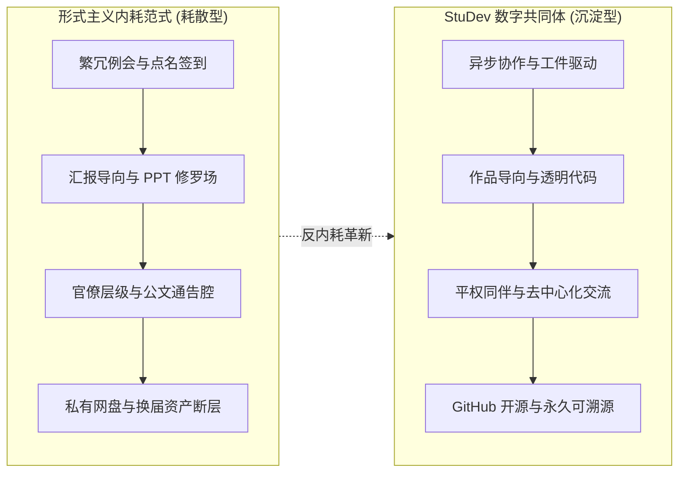

## 序章 · 聚光灯熄灭之后的剧场切片

每年岁末，南京邮电大学安恒青春剧场的舞台总会迎来它一年中最耀眼的时刻。

台上的追光灯打在鲜红的地毯上，大屏幕上滚动着各学生组织、社团精心打磨的年度汇报 PPT；西装领带整理得一丝不苟的学生骨干依次登台，熟练地切换着幻灯片，语调激昂地列举着一个个漂亮的百分比、柱状图，以及字斟句酌的“闭环思维”、“全方位矩阵”与“多维赋能”。

*庄严肃穆的剧场开幕：在宏大的仪式感背后，藏着数百名青年骨干一整年的疲惫与热忱。*

在这场由学院团学组织共同参与的年度总结大会中，学生发展中心的执行主席周正也站在了汇报席前。

大屏幕上清晰地映照出一年来中心在学业服务、心理支持、网络阵地与校园文化中走过的每一个脚印。台下响起热烈的掌声，评委老师们微微点头，颁奖环节上大家接过“青年先锋服务之星”的荣誉奖状，与会师生并肩合影，定格下一张张看似完美的笑容。

*周正同学代表学生发展中心作年度述职汇报：大屏幕上的每一张数据图表，背后都是无数个无眠夜晚的敲击与沟通。*

*学生发展中心获评“青年先锋服务之星”表彰合影：沉甸甸的荣誉证书，既是肯定，也是促使我们反思形式的起点。*

大会的尾声，各组织主席团并肩站在舞台中央，齐声合唱了一曲《入海》。

> “时间会回答成长，成长会回答梦想，梦想会回答生活……”

*剧场尾声主席团合唱《入海》：歌声穿透了空旷的剧场，但在旋律落下之后，真实的困惑依然留在每个人心底。*

然而，当大幕缓缓合上、剧场的顶灯骤然熄灭，真实的生活却在几分钟内露出了疲惫的原貌：

脱下并不合身的西装，许多同学揉了揉布满红丝的眼睛，口袋里的手机在静音模式下疯狂振动——几个微信工作群里，各年级还在催要明天的表格、核对后天的报销发票、催促下周例会的考勤签到。

站在冷风瑟瑟的剧场台阶上，一个挥之不去的尖锐问题开始在心底浮现：

==如果一个学生组织的绝大部分心力，最终都耗散在了制作精美的述职PPT、排练舞台走位、填报繁琐表格和字斟句酌虚无的通告套话上，那么我们最初聚在一起的那份纯粹热爱，究竟被稀释到了哪里？==

---

## 01 · 剖析：大学学生组织的“行政化内耗”三部曲

在今天的高校环境里，很多学生组织在不知不觉中患上了一种慢性的“组织异化症”。这种异化往往不是源于任何人的恶意，而是源于制度惯性与对成人职场官僚作风的低幼模仿。

### 症状一：无病呻吟的“体制通告腔”

在很多学生组织的推文与总结里，你几乎看不到任何属于青年人真实的语言灵气：

整篇推文充斥着“高度重视、周密部署、深入贯彻、圆满召开、谱写新篇”等堆砌词汇。一段两千字的长文读下来，除去客套的寒暄和排比句，真正有价值的信息量可能只有区区两句话：*某月某日几点，在哪个教室办了一场活动，讲了什么。*

当年轻的大学生开始用老气横秋的公文腔遮蔽真实表达，他们实际上是在用语言的平庸，掩饰自己思维与实践的懒惰。

---

### 症状二：“PPT 表演艺术家”与虚假闭环

在每学期例行的社团述职会上，往往演变成一场幻灯片设计技能的修罗场。

*述职交流会现场：台上是光影绚烂的幻灯片，台下是陷入思索的青年面孔。*

一场原本只有十几个同学到场的自习分享会，在汇报者的 PPT 里被重构成了“全链路贯通”、“矩阵式赋能”、“闭环驱动”的宏大叙事。大家花费一个星期的时间调整字体间距、抠图转场、编织高深莫测的英文缩写，却很少有人愿意坐下来老老实实地问一句：

==“那天来的十几个同学，他们真的在这场活动里学到东西了吗？他们的焦虑被抚平了吗？”==

**为了证明自己在做事，而制造出更多无意义的事**——这正是形式主义最深层的荒谬。

---

### 症状三：“祖传 U 盘”与换届归零的资产黑洞

由于缺乏现代化的公共知识管理工具，绝大多数学生组织的知识资产都处于极度脆弱的游离状态：

上一届骨干辛辛苦苦积累下来的场地借用避坑流程、宣传海报源文件、技术调试脚本，往往随着换届，永远封存在了某位毕业生的私人百度网盘或微信群过期文件里。

新一届干部接手后，一切又只能从零开始踩坑：重新手忙脚乱地到处打听财务报销单据格式，重新摸索推文排版规则。年年换届，年年都在重新发明轮子，年年都在同一个坑里跌倒。

---

## 02 · 突围与重构：StuDev 是如何向形式主义动刀的？

计软网安学生发展中心在经历过多次述职、复盘与深谈之后，逐渐达成了共识：**我们不能再这样自我消耗下去了。**

工科学生的时间极其宝贵——编译原理、操作系统、算法竞赛每一门都需要整块的深度专注时间。如果学生组织不能成为给同学带来滋养的充电站，反而成了压榨青年精力的抽水机，那么这个组织便失去了存在的道德合法性。

因此，从 2024 年底周正主持的工作汇报，到 2026 年新团队推动 StuDev 平台诞生，我们掀起了一场针对形式主义内耗的**降维反击**。

---

### 法则一：不为开会而开会，以“工件”而非“空谈”论英雄

> [!NOTE]
> **消灭空转例会：异步协作优先原则**  
> 
> 在 StuDev，我们彻底废除了那种“所有人围坐在一起轮流念上周流水账”的冗长例会。
> 
> 能在 GitHub Issue、PR 讨论区或协同文档里说清楚的事，绝不占用任何人的线下休息时间；能用 Markdown 清晰列出 Checklist 的任务，绝不搞层层口头请示传话。
> 
> 我们不看你在例会上发言多么动听，我们只看你是不是==真正做成了一件具体的事==：你提交的代码是否修复了页面 Bug？你写的科普随笔是否讲透了一个技术难点？你策划的解忧树洞是否真正给新生递出了温暖？

---

### 法则二：以开源消解特权，社团资产全量透明上链

为什么我们要把整个社团的官方网站和数字化系统，开源在 GitHub（[`NJUPT-CS-StuDev/studev`](https://github.com/NJUPT-CS-StuDev/studev)）上？

因为代码和 Git 提交记录是全世界最诚实、最能对抗遗忘的载体：

> [!TIP]
> **开源即防腐：告别私人黑盒**  
> 
> 1. **历史不再属于某个人**：每一次活动、每一届成员、每一份规章，都化为清晰的 Git Commit，永久沉淀在公共广场上，任何后来者都可以拉取查看；
> 2. **没有官僚壁垒**：任何人只要发现了网站的错别字或样式缺陷，都可以直接 Fork 并提交 Pull Request。在代码面前，社团负责人与刚进大一的新部员完全平等；
> 3. **知识可复用**：从部署环境、Astro 架构到 Markdown 排版模板，全部透明公开，下一届学弟学妹不用再求人要资料，整个平台就是他们最好的脚手架。

---

### 法则三：做减法而不是做加法，守护青年最柔弱的情绪角落

一个合格的学生组织，绝不应该扮演高高在上的“监管者”，而应该充当大学冰冷制度缝隙里的**缓冲气垫**。

我们坚决砍掉了那些为了“刷参与人次”而强行摊派、打卡记学分的伪活动。相反，我们把精力聚焦在那些小而美、真正有人性温度的事情上：

*述职交流会师生合影：洗尽铅华之后，真正的组织生命力在于真实的彼此守望。*

- 暮春时节在南区大草坪上铺开防潮垫，让吉他和民谣融化期中考试的焦虑；
- 在教二楼安静的角落设立“解忧树洞”，让工科生无处安放的心事能换来一张写满字迹的真诚明信片；
- 当新同学在深夜机房里因为编译报错茫然无措时，学长学姐可以在技术沙盒里随时敲开对话框提供指引。

> [!IMPORTANT]
> **反行政化的终极旨归**  
> 
> 学生组织的根本归宿，不是为了向上一级组织交出一份挑不出毛病的完美报告，而是为了让身处其中的每一个具体的人——无论参与者还是组织者——在这四年里感到被尊重、被倾听、被点亮。

---

## 03 · 价值坐标：形式主义组织 vs 真实服务共同体

为了让大家在面对日常工作时时刻保持警惕，我们将两种截然不同的组织形态对照如下：

| 评估维度 | 形式主义组织（行政异化型） | StuDev 共同体（服务沉淀型） |
| :--- | :--- | :--- |
| **沟通方式** | 微信大群反复通知、截屏打卡、层层请示 | 异步协作、GitHub Issue、平权即时讨论 |
| **核心产出** | 华而不实的汇报 PPT、堆砌套话的推文 | 结构化 Markdown、可运行代码、具体线下服务 |
| **资产归属** | 散落在骨干个人网盘与U盘中，换届即流失 | 全量托管于 GitHub 开源仓库，全校公共共享 |
| **人际关系** | 官僚层级森严、充满职场模仿的虚伪客套 | 去中心化同伴同行、机房并肩造物与饭友 |
| **终极目标** | 应付上级考核、为少数人包装综测履历 | 为工科青年提供成长支点、沉淀长效文化资产 |

---

## 尾声 · 在代码与人间烟火之间

安恒青春剧场的舞台大合影里，站在聚光灯下的面孔或许年年都在更替。

*年末总结大会全体大合影：人海终将散入社会，但在校园里的这一程，我们选择不虚度。*

走出剧场，穿过鼎山湖畔微凉的夜风，回到宿舍打开笔记本电脑，终端里跳动的依然是那行熟悉的命令提示符。

当我们在大学里谈论学生组织时，我们在守护什么？

我们守护的，是二十岁时那颗**还没有被世俗功利磨平棱角的、愿意毫无保留为同伴搭一把手的赤诚之心**；我们守护的，是在庞大复杂的现代大学机器里，保留一个可以不装、不说空话、能够专注把一件具体小事做踏实的小小绿洲。

PPT 的光影终会暗淡，台上的掌声也终将沉寂。但你在开源仓库里提交的一行行代码、在树洞里写下的一句句安慰、在迎新帐篷下递出的一瓶矿泉水，都将作为真实的体温，恒久地留在那些被你照亮的人的记忆深处。

这就是我们拒绝形式主义的全部理由。
