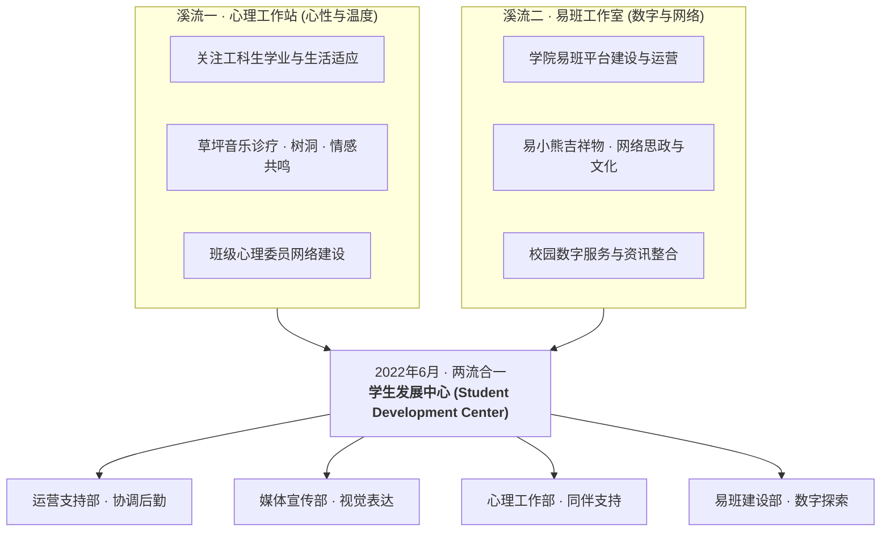
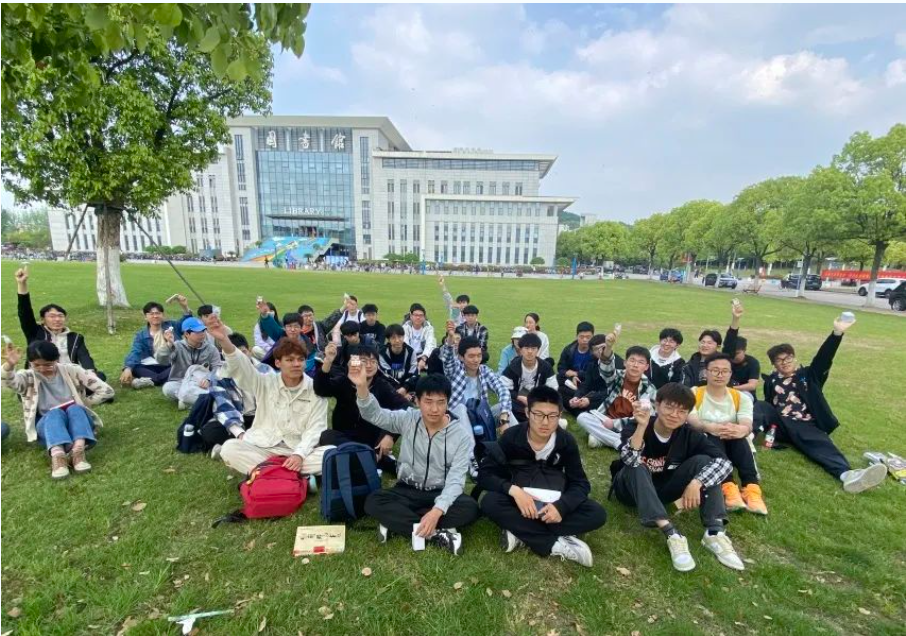
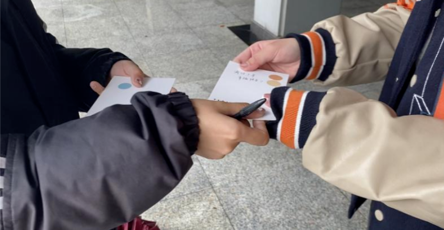
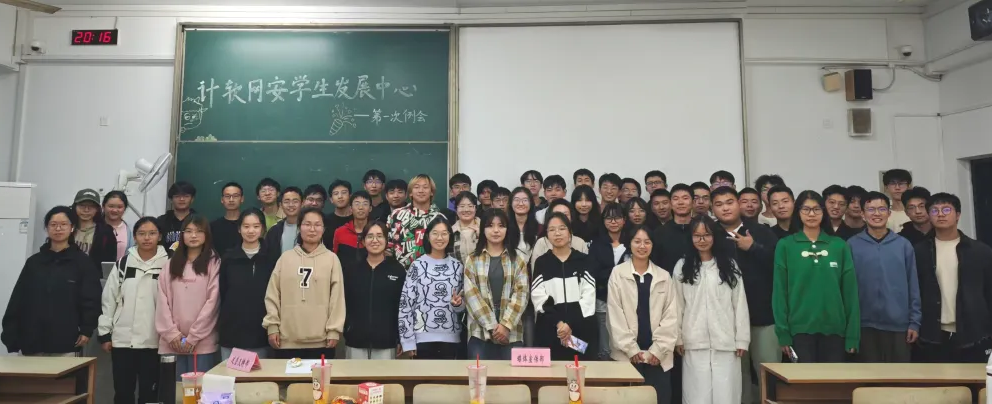
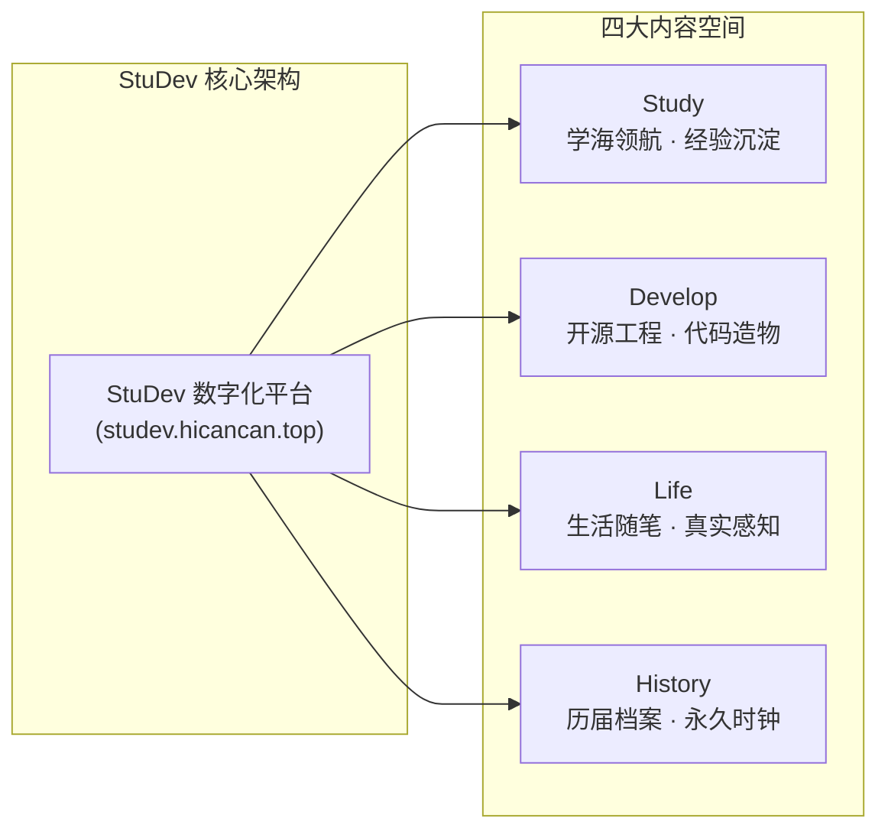
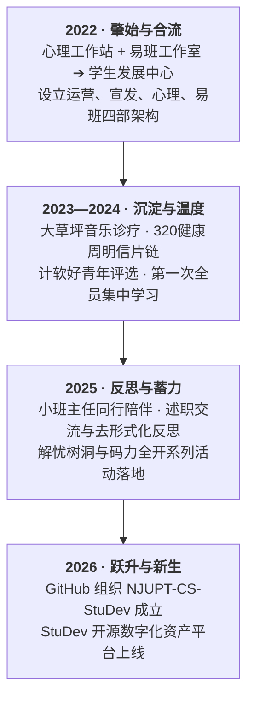

## 序章 · 提交记录里的四载回响

在 GitHub 组织的提交历史里，有一条看似平淡无奇的时间戳：

> `commit 98a82f5` · *2026-09-22 22:45:12 +0800*  
> **Repository**: `NJUPT-CS-StuDev/studev`  
> **Message**: `feat: initialize studev core layout and content collections`

对于一个刚进入开源世界的旁观者而言，这或许只是南京邮电大学计算机学院某个深夜里，又一个寻常的网页项目初始化记录。

但只要你顺着这条提交记录向上回溯，将目光投向更深远的时空，便会发现：==这一行行干净的 Astro 架构与 Markdown 字符背后，奔涌着整整四年的组织脉搏与人文回响。==

它记录着从南区大草坪上吉他拨动的微风，到易班吉祥物“易小熊”在屏幕上的跃动；从手绘白板上写下的四个部门名称，到如今全球代码广场上任何人都可以审阅、克隆的开源知识资产。

这不是一段凭空诞生的神话，而是一个高校学生组织为了对抗遗忘、破除形式主义内耗，在泥土与代码之间摸索前行的**数字化进化史**。

---

## 01 · 2022：草坪、易小熊与两道溪流的合流

如果翻开 2022 年秋天的档案，在学院印发的迎新推文合集里，有一段平实却至关重要的文字记录：

> *“学生发展中心前身为心理工作站，2022年6月与易班工作室合并并更名为学生发展中心。中心下设运营支持部、媒体宣传部、心理工作部和易班建设部……”*

在这段行政命名的背后，实际上是两股原本各具特色的校园青年文化水流的交汇：



### 易小熊与爱心树的初遇

在 2022 年那篇名为《“邮”此起航2022 | 学生发展中心欢迎你的到来！》的招新推文里，至今还完好地保存着当年的视觉切片：


*2022年易班建设部吉祥物“易小熊”：最初的数字化尝试，带着工科青年朴素而可爱的探索欲。*


*2022年运营支持部徽标：从那一刻起，组织开始尝试搭建起规范化的内部运转中枢。*


*2022年心理工作部“爱心树”插图：工科院校最珍贵的资产，永远是人心之间柔软的理解与连接。*

那时的易班建设部，抱着那只笨拙可爱的“易小熊”，在移动端探索着搭建学生学习中心与个人简历功能；而心理工作部则小心翼翼地浇灌着那棵手绘的“爱心树”，为刚跨入大学校门、面对晦涩算法和陌离人际的新生提供情绪锚点。

两者的合并，蕴含着一个极为前瞻的直觉：==技术与人文从来不是对立的两极。懂代码的工科青年，同样需要最深切的心理关照；而最温暖的情感守望，终究需要借助现代化的数字基础设施才能长久扎根。==

---

## 02 · 2023—2025：在泥土与代码之间沉淀真实温度

合并后的三年里，学生发展中心逐渐走出了纯事务性机构的狭隘定义，开始在校园里留下一批极具辨识度的品牌印记。

### 草坪音乐与 32 张明信片的善意长链

2023 年春天的“320心理健康周”，鼎山湖旁的南区大草坪上出现了一场特殊的“音乐诊疗”。

没有高高的舞台，没有领导讲话，同学们席地而坐围成一圈。吉他声在晚风中轻轻飘荡，几位平时在机房里沉默寡言的同学，在暖洋洋的春光里抱着膝盖，跟着旋律轻轻哼唱。


*2023年春天的南区大草坪：当琴弦拨动，繁重的课业压力在阳光与笑声中被悄然瓦解。*

与此同时，教学楼的走廊里立起了一面展板——32 张明信片呼应着 320 健康周，构成了一条“祝福传递链”。

每一张明信片都承载着一个素未谋面的陌生人的字迹：“愿你的代码没有 Bug”、“无论今天过得怎样，晚霞都很美”。这串纸质的链条在几百位同学手中流转，给冰冷的期中考试周注入了一抹难以忘怀的亮色。


*“用信传递爱”明信片祝福展板：在数字化浪潮里，手写卡片的墨迹依然有着穿透屏幕的温热。*

---

### 从“码力全开”到四部门例会的思辨

随着时间的推移，团队的工科特质与组织建设开始深度融合：

2024 年 11 月 11 日，学生发展中心在教学楼举行了第一次全员集中学习。那张著名的四部门席卡照片，见证了组织分工的真正成熟：


*2024年秋天集中学习的席卡：心理工作部、运营支持部、媒体宣传部、易班建设部各司其职。*


*2024年秋天全体大合影：新老骨干齐聚一堂，探讨如何让服务更贴近工科同学的真实痛点。*

随后的“码力全开 沐光同行”心理嘉年华与“解忧树洞——情绪交换计划”，更把计算机专业特有的“Debug（调试）”隐喻推向了高潮：

代码写错了可以抛出 Exception，人生遇到了坎坷同样可以打上断点、重新审视。


*“码力全开”主题活动：将计算机极客精神融入心理健康，解锁快乐的“源代码”。*


*“解忧树洞”情绪交换计划：为每一个在深夜独行的灵魂，保留一扇可以倾诉的窗口。*

然而，也正是在这个阶段，更深层次的制度性困惑开始浮出水面：

微信公众号的推文再好看，发出去三天后就被算法信息流淹没无踪；活动材料存留在不同部员的微信聊天记录与个人电脑里，一旦大四毕业离校，这些珍贵的历史档案就彻底断代。易班原有的功能模块日渐陈旧，无法跟上新一代计算机学生对工程实践与开源技术的渴望。

**我们难道要永远在一个封闭、易失的生态里年年打转吗？**

---

## 03 · 2026：为什么必须是开源？StuDev 的数字新生

2026 年初秋开学季，吴双灿正式当选并接任学院学生发展中心主席。

在接任主席后，吴双灿与骨干团队（杨庭益、李雅婷、杨婉露等）面对往届留存下来的活动照片、推文记录与厚重的文件袋，深刻意识到一个长期困扰高校学生组织的宿命问题：过去几年中心沉淀下来的大量宝贵资产——从心理辅导的经验信件、草坪音乐会的记录，到优秀学长学姐的求职保研指南——长期分散在不同届别的个人电脑与微信历史消息中，极易随着部员毕业离校而彻底断代遗失。


*图注：翻阅往届学生发展中心留存的照片档案。如何打破“毕业即断代”的宿命，促成了新一届团队在本学期对 StuDev 平台的创立。*

面对这一挑战，作为新任主席的吴双灿在本学期亲自主导发起并动手搭建了一个全新的开源数字化平台，定名为 `StuDev`，将往届散落的历史资料全面整理数字化，并以开源仓库的方式永久托管在 GitHub 上。

### 名字里的双重隐喻

`StuDev` 这个名字，蕴含着对组织初心最洗练的数学定义：

```math
\text{StuDev} = \text{Student Development} \equiv \text{Study} + \text{Develop}
```

- **Student Development**：这是学院学生发展中心的本职担当；
- **Study + Develop**：工科青年的两翼——既要有扎实的学术与通识输入（Study），更要有亲自动手造出可用作品的工程实践（Develop）。



---

### 为什么坚持用开源（GitHub + Astro）管理社团资产？

在这个平台上，我们确立了三条不容妥协的工程与文化底线：

> [!NOTE]
> **01 · 对抗遗忘的分布式时光机**  
> 
> 在传统的学生组织里，历史是由少数人的口头记忆维系的；而在 StuDev，所有内容都是纯文本 Markdown，每一次修改、每一个活动节点的记录，都必须通过 Git Commit 写入版本树。
> 
> 哪怕五年后、十年后，今天参与建设的同学早已毕业远行，任何一个刚踏入仙林校门的大一新生，依然可以通过一条 `git log`，清晰地看清前人是如何一步步思考、一步步把这个小天地搭建起来的。==历史不再会被某一个人的离去而带走。==

---

> [!TIP]
> **02 · 绝对透明对抗官僚垄断**  
> 
> 在封闭的系统里，信息是不对称的，特权由此滋生。
> 
> StuDev 的所有源码、页面样式、内容审核流程完全托管在 [GitHub 组织](https://github.com/NJUPT-CS-StuDev/studev) 下。任何人如果对网站排版不满意，或者发现某篇随笔有错别字，不需要写申请、找领导，直接提交一个 PR（Pull Request）。代码跑通、审阅合并，你的贡献就会永久留在主干上。==开源是最好的去中心化解药。==

---

> [!IMPORTANT]
> **03 · 从看客到造物者的第一块试验田**  
> 
> 大多数计算机学生在大学四年里，只扮演着工业软件的被动消费者。
> 
> 我们把 StuDev 搭建成一个现代化的生产级静态站点（使用 Astro 7、TypeScript、Shiki、MathJax 与 Mermaid）。
> 
> 每一个加入学生发展中心易班建设部或媒体宣传部的同学，从撰写第一篇 Markdown 随笔、调整第一个 CSS 变量、配置第一套自动化部署流水线开始，就直接浸润在了工业界最前沿的现代软件工程工作流之中。它不仅是一个社团门户，更是所有南邮极客迈出单机小黑框的**第一块新手村沙盒**。

---

## 04 · 四载时空全景：一个组织的进化跃迁

从 2022 到 2026，四载光阴在仙林校区留下了清晰的跃迁轨迹：



---

## 尾声 · 历史不是纪念碑，而是一条活着的河流

四年前在大草坪上围坐弹唱吉他的学长学姐，如今或许已经在产业界成为挑大梁的工程师，或者在科研院所探寻知识的边界；而当年坐在台下懵懂倾听的大一新生，如今已然接过了接力棒，在教二楼的机房里敲击着 StuDev 网站的最新代码。

组织的历史，从来不是供奉在玻璃柜里的荣誉证书，也不是述职 PPT 里冷冰冰的数字闭环。

它是一条**活着的河流**。

它流经草坪上晨露未干的泥土，流经微信推文里真诚的文字，最终汇聚成了今天这个代码透明、思想自由、向所有南邮同学敞开怀抱的数字空间。

无论未来技术如何迭代，我们始终相信：

==认认真真敲代码，踏踏实实做实事，温温柔柔守望每一个同伴。==

这条河流还在奔涌向前，而你的故事，就是它的下一道波澜。
