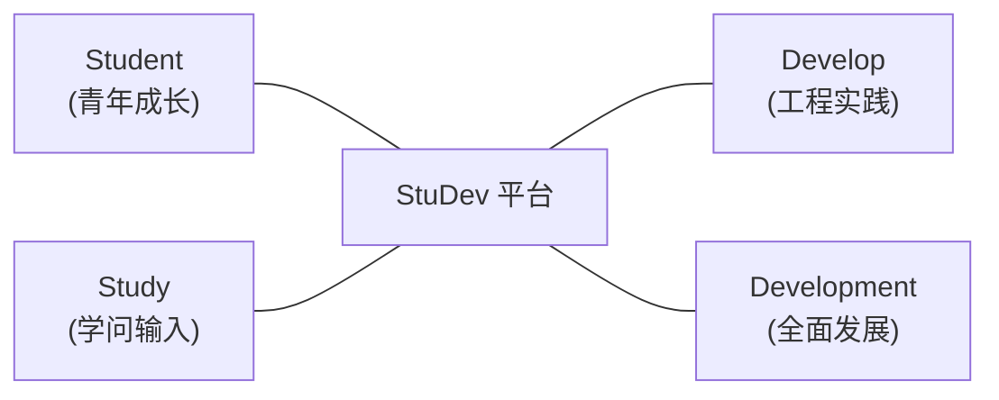
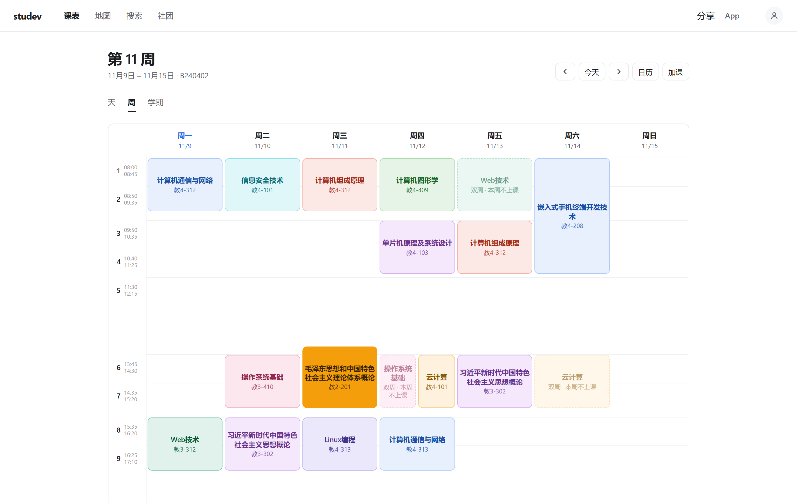
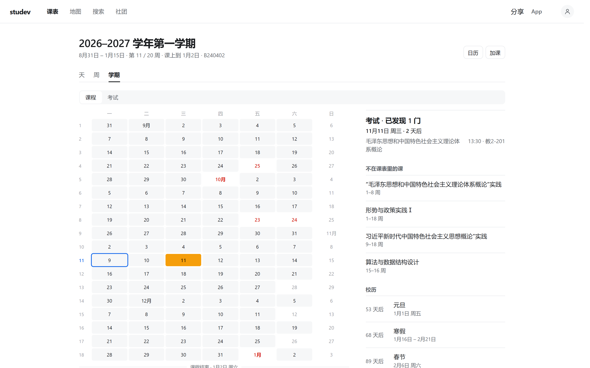
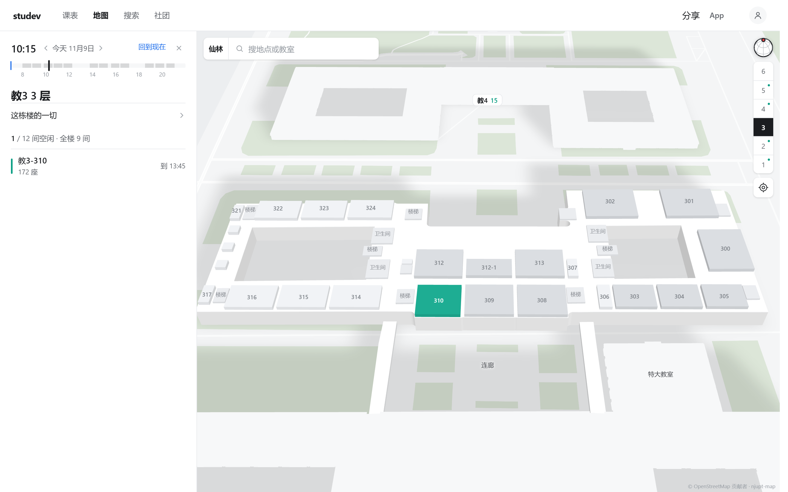
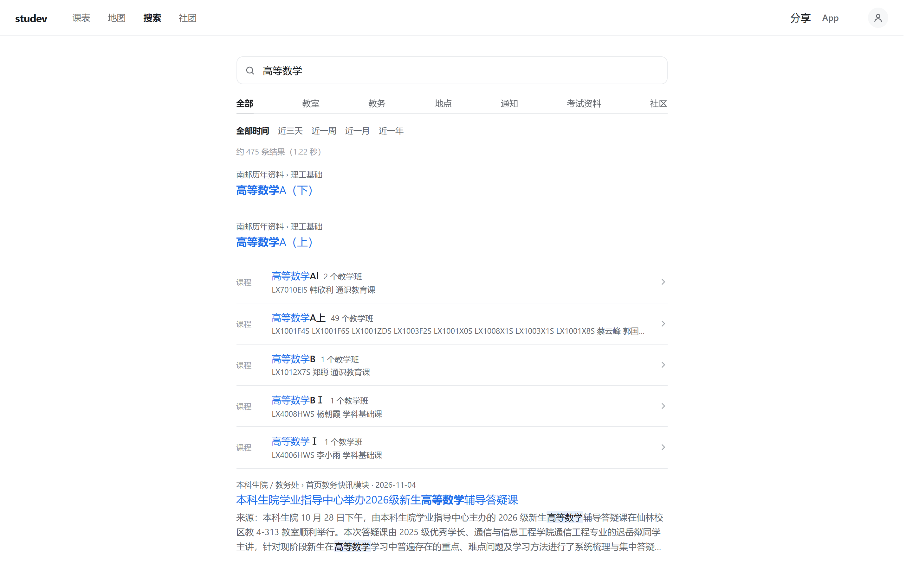

## 名字里的双重隐喻

StuDev 这个名字，包含了两层最直接的含义：

- **Student Development**：南京邮电大学计算机学院、软件学院、网络空间安全学院学生发展中心的本职；
- **Study + Develop**：学习知识，动手做出真实可用的工程作品。

我们不希望这里只是一个传达通知、统计表格的事务性机构。我们致力于搭建一个==透明、公共、本地优先的数字校园与社团知识空间==，既为全校师生提供日常高频使用的课表、考务、三维校园地图与全文检索工具，也把南邮同学在大学里沉淀下来的好代码、好经验、好想法长久留存下来。

StuDev 由 **hicancan 发起，和南邮计软网安学生发展中心的同学们一起为爱发电、持续完善**。有人提出建议，有人采集数据、参与测试，一起把它做得更好。域名、存储和免费 AI 额度等运行费用目前由 hicancan 个人承担。我们不收费、不放广告、不卖数据。

课表和清单不登录也能使用；登录后，清单与课表设置会同步到同一账号的其他设备。**AI 对话记录和自己的 API Key 始终只保存在当前设备，不参与同步**。使用免费 AI 需要登录；也可以填写自己的 API，从设备直接连接所选模型服务，无需登录 StuDev。

## 致谢

感谢参与建议、数据采集、勘误与测试的同学。具体名单将在核对本人意愿后补充。

```math
\text{StuDev} = \text{Student Development} \equiv \text{Study} + \text{Develop}
```



---

## 为什么构建 StuDev 数字校园

高校日常教学与校园生活信息长期散落在彼此孤立的系统中：查课表与考场需要翻阅层层教务表格，找一间自习空教室需要逐层推门碰运气，查一份培养方案或通知附件需要遍历十几个二级站点，而学生社团历年沉淀的技术文章与学业经验则随着换届散落在群聊与网盘里。

StuDev 通过一套**时空联动的高校数字孪生与数字校园模型**，在 [网页端](/) 与 [原生 Android 客户端](/download/) 提供一致的本地优先体验，并与姊妹开源仓库 [**碳迹未来 · CARBENTRA Campus（`hicancan/carbentra-campus-platform`）**](https://github.com/hicancan/carbentra-campus-platform) 共同构成南京邮电大学第二十八届“创新杯”大学生课外学术科技作品竞赛终审决赛重点培育项目 **《碳尽其用——AI驱动的零碳园区碳能管控系统》** 的校园时空数字孪生工程体系：

> **为什么数字校园与零碳园区共用同一套时空数字孪生底座？**  
> 在高校园区中，教学楼与公共场馆的照明、空调及新风占建筑碳排放的大头，而决定每一间教室实时用能需求的根本变量，正是全校的教学排程与教室占用状态。我们围绕同一套**校园三维空间包（3 校区、129 栋三维建筑模型、室内分层教室单元）与全学期排课考务时间轴**构建了双模态开源体系：面向全校师生，`studev` 提供零门槛、免登录的日常**课表查询、实时空教室定位与室内外步行导航**；面向 AIoT 智慧能碳管控，[`carbentra-campus-platform`](https://github.com/hicancan/carbentra-campus-platform) 复用同一套三维空间基准与排课维护约束，结合边缘网关与智能插座、毫米波存在传感、三路照明开关等硬件遥测，在房间与回路粒度上完成**能碳独立核算、负荷预测、策略评估与受控调度**。

1. **免登录即用，本地优先**：查课表、看考场、翻校历、找空教室、看三维地图与搜全校通知均无需注册登录。清单、选定班级、自定义课程、实验取舍、图层顺序、早锻炼记录与考试提醒偏好保存在终端设备本地；登录后保留云端副本，方便在自己的设备间同步。AI 对话记录与 API Key 不参与同步。
2. **教学、考务与校历同轴推演**：日常课程、期末考试、集中实践周、法定节假日、调休补课、运动会、校庆日与早锻炼在同一时间轴上统一计算，支持按**天 / 周 / 二十周学期全景**三级尺度自由切换，并可一键导出 `.ics` 日历或写入手机系统日历。
3. **三维校园数字孪生与教学状态时空联动**：基于 MapLibre GL 与 129 栋三维建筑模型构建教学楼分层室内平面。拨动时间刻度尺至任意时刻，三维教学楼剖面图即刻映射每一层、每一间教室的实时空闲与课程占用状态，并支持跨楼栋、跨楼层步行路径规划。
4. **端侧 Rust + WebAssembly 毫秒级检索**：无需后端搜索服务器，在浏览器与客户端本地毫秒级同时检索全校课程、教师、班级、教室、公开通知及附件正文。


*周课表视图：同一张课表内的课程按 30° 等距色环联合分配色彩，单双周非上课周就地保留并以灰度标注。*


*二十周学期全景：课程、考试、实践周与法定节假日调休同轴展示，底部附带已核验的考务通知来源。*


*三维校园地图：点击任意教学楼即可逐层剖切（1F–6F），绿色房间代表当前空闲自习教室，蓝色代表正在上课。*


*端侧全文检索：基于 Rust 编译的紧凑二进制倒排索引，在本地毫秒级检索课程、教师、教室、通知附件与社团文章。*

---

## 四个部门在做什么

学生发展中心由四个部门和统筹协调的学长学姐组成，每个方向都有明确的着力点：

- **运营支持部**：社团运转的后勤枢纽。负责场地借用、物资协调、会议统筹，以及跨学院、跨社团的活动对接，确保大家的想法能够平稳落地；
- **易班建设部**：工程与技术实践方向。负责研发与维护 [StuDev 开源平台](/develop/platform-studev-core/) 本身，探索好用的 AI 与工程工具流，把零散的学习资料整理成可复用的数字资产；
- **媒体宣传部**：文字与视觉表达。负责推文撰写、活动摄影、视觉设计与视频记录，用干净有美感的方式，把同学们做的事情传播出去；
- **心理工作部**：同伴支持与校园交流。关注大家在学业压力、人际交往和大学适应期的真实困惑，组织草坪音乐节、5·25 心理树洞等轻松真挚的线下交流与解压活动。

---

## 我们的共识与开源共建

> [!NOTE]
> **StuDev 的核心工作准则**
> 
> 1. **求真务实**：专注于切实的同伴支持与学业互助，把精力倾注在对同学成长有实际帮助的具体行动上；
> 2. **代码与内容透明**：StuDev 的全栈源码与社团文章完全开源在 [GitHub (`NJUPT-CS-StuDev/studev`)](https://github.com/NJUPT-CS-StuDev/studev) 上，接受所有人的审阅、勘误与共建；
> 3. **以作品为导向**：比起头衔和资历，我们更看重你是不是==真正动手做成过一件具体的事情==。

StuDev 的底层架构被设计为**学校无关的通用高校数字校园引擎**。全校作息节次、教学周历、建筑平面与地图边界全部解耦在配置文件与静态快照格式中，欢迎全国各高校的学生团队与开发者 Fork 复用或参与共建。

---

## 深度阅读与相关链接

- [《时空联动的高校数字孪生：StuDev 单源双端同构架构手记》](/develop/platform-studev-core/)：深入了解五元时空模型、单源双端同构、跨语言黄金测试向量与构建期静态排版管道；
- [《从三维空间测绘到端侧 Rust 内核：南邮开源数字校园与零碳孪生基建矩阵》](/develop/campus-open-source-matrix/)：全景解析 `njupt-map`、`wasm-search`、`wayfind`、`sitegraph`、`njupt-net` 与 `carbentra-campus-platform` 六大开源工程矩阵；
- [《从草坪与易班走来：StuDev 数字化平台的历史回响》](/about/organizational-genesis/)：2022 至 2026 年，从心理工作站、易班工作室到学生发展中心与开源平台的演进史；
- [下载 Android 客户端](/download/) · [用户协议](/terms/) · [隐私政策](/privacy/) · [GitHub 开源仓库](https://github.com/NJUPT-CS-StuDev/studev)。
