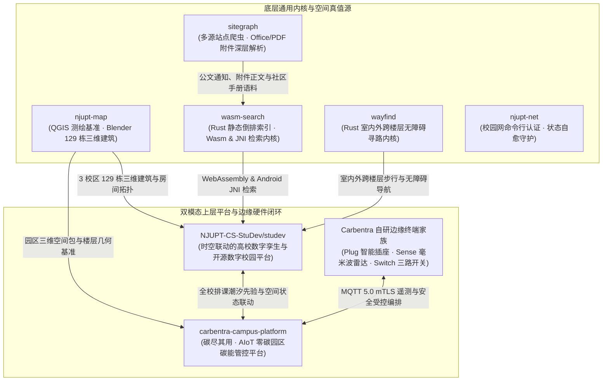
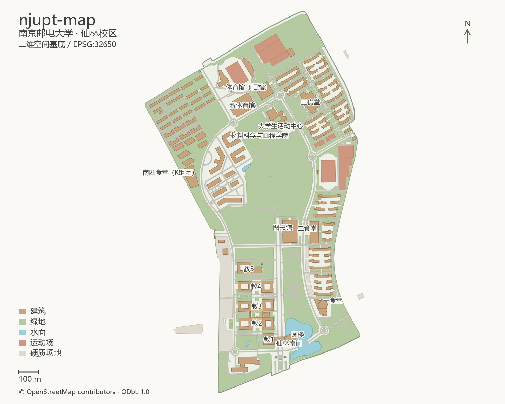
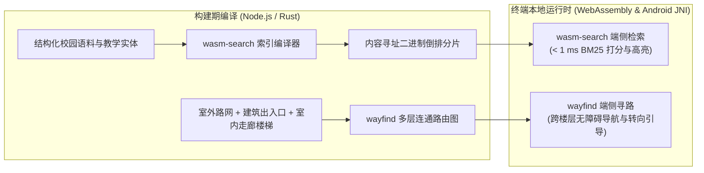

## 序幕 · 用造操作系统的标准，重造一座大学的数字化基建

在大学校园里，学生团队开发校园工具最常见的路径往往是：租一台云服务器，搭一套前后端耦合的传统应用，把爬虫、数据库、地图和页面塞进同一个代码仓。然而，一旦期末周并发流量暴涨，或者核心开发者毕业离校、服务器续费中断，整套系统便会迅速陷入瘫痪。

在构建 [StuDev 数字校园](/) 与 [Carbentra 零碳园区平台](https://github.com/hicancan/carbentra-campus-platform) 的过程中，我们选择了一条截然不同的工程路线——**把一座大学的数字基建拆解为职责正交、接口严密、可独立复用的开源底座与端侧计算内核**：

1. **计算向终端下沉**：全文检索与室内外跨楼层寻路全部用 **Rust** 编写为纯函数内核，同时编译为浏览器 WebAssembly 与 Android NDK JNI 原生库，消除常驻应用服务器与隐私泄露风险；
2. **空间唯一真值源**：全校三维建筑模型、室内分层平面与室外道路拓扑在独立的测绘仓库中统一校准，按不可变语义化版本发布；
3. **一套时空底图，双模态赋能**：同一份三校区 129 栋建筑三维空间包与排课时间线，向上同时驱动面向全校师生的数字校园（`studev`）与面向智慧后勤的 AIoT 零碳园区碳能管控平台（`carbentra-campus-platform`）。

---

## 01 · 六大开源工程矩阵全景

整个数字校园与零碳孪生工程体系由六个公开开源的主干仓库（及三款自研边缘硬件开源仓）精密咬合而成：

### 开源仓库矩阵一览

| 开源仓库 | 核心技术栈 | 架构职责与工程边界 | 源码与在线入口 |
| :--- | :--- | :--- | :--- |
| **[`studev`](https://github.com/NJUPT-CS-StuDev/studev)** | Astro 7 · React 19 · Kotlin Compose · C++ OpenGL ES | 时空联动的高校数字孪生与开源数字校园平台，单源模型同时驱动 Web 与原生 Android 客户端 | [GitHub ↗](https://github.com/NJUPT-CS-StuDev/studev) · [站内架构手记 →](/develop/platform-studev-core/) |
| **[`njupt-map`](https://github.com/hicancan/njupt-map)** | QGIS · Blender 3D · Python · PMTiles | 校园空间唯一真值源：仙林、三牌楼、锁金村三校区矢量底图、129 栋三维建筑模型与 564 个室内空间拓扑 | [GitHub ↗](https://github.com/hicancan/njupt-map) · [三维地图 /map/ →](/map/) |
| **[`wasm-search`](https://github.com/hicancan/wasm-search)** | Rust · WebAssembly · Android NDK JNI | 零后端静态全文检索内核：编译期生成内容寻址二进制倒排分片，端侧 `< 1 ms` 完成分词、BM25 打分与摘要高亮 | [GitHub ↗](https://github.com/hicancan/wasm-search) · [全校搜索 /search/ →](/search/) |
| **[`wayfind`](https://github.com/hicancan/wayfind)** | Rust · TypeScript · Android NDK JNI | 室内外一体化步行与骑行寻路引擎：跨楼栋、跨出入口、跨楼层楼梯与无障碍电梯拓扑路由及转向引导 | [GitHub ↗](https://github.com/hicancan/wayfind) |
| **[`sitegraph`](https://github.com/hicancan/sitegraph)** | Rust · TypeScript · Office/PDF 解析 | 声明式校园站点抓取与非结构化附件解构器，将公文通知、Word/Excel/PDF 附件与社区手册编译为标准语料包 | [GitHub ↗](https://github.com/hicancan/sitegraph) |
| **[`carbentra-campus-platform`](https://github.com/hicancan/carbentra-campus-platform)** | FastAPI · PostGIS · React 19 · Three.js · MQTT mTLS | 零碳校园数字孪生与 AIoT 碳能管控平台（含 [Plug](https://github.com/hicancan/carbentra-smart-plug) / [Sense](https://github.com/hicancan/carbentra-presence-sensor) / [Switch](https://github.com/hicancan/carbentra-smart-switch) 自研硬件开源仓） | [GitHub ↗](https://github.com/hicancan/carbentra-campus-platform) |
| **[`njupt-net`](https://github.com/hicancan/njupt-net)** | Go · Rust · CLI | 极简跨平台校园网命令行认证工具，支持多运营商拨号、账单查询、心跳探测与断线自愈 | [GitHub ↗](https://github.com/hicancan/njupt-net) |

---

## 02 · [`njupt-map`](https://github.com/hicancan/njupt-map)：从 QGIS 实地测绘到 Blender 129 栋三维建筑孪生

在数字校园与智慧园区系统中，最难啃的硬骨头永远是**空间基准的统一**。如果二维地图、三维建筑外观、教学楼室内平面图与排课系统各自使用一套名称与编号，上层应用就会沦为充斥着硬编码映射表的泥潭。

[`njupt-map`](https://github.com/hicancan/njupt-map) 作为全校空间实体的唯一真值源，确立了严格的地理与拓扑规范：

*通过 QGIS 精确校准的仙林校区二维矢量地图：地理坐标、道路网、水体与建筑轮廓共享同一测量基准。*

1. **统一空间身份与层级拓扑**：每一处空间实体均拥有稳定的规范化标识（如 `仙林/教3`、`仙林/教3/4`、`仙林/教3-401`），严格遵循“校区 → 楼栋 → 楼层 → 房间单元”的四级包含关系，改名或装修不破坏历史空间引用；
2. **Blender 129 栋建筑精细建模**：我们在 Blender 中基于局部米制坐标为校区手工构建了 **129 栋三维建筑资产**，涵盖建筑体块、屋顶结构、水景地貌以及教学楼、图书馆的分层室内剖面；
3. **面向端侧 GPU 的极简产物分发**：地图构建流水线自动将矢量底图打包为单文件 `basemap.pmtiles`，并将三维建筑几何烘焙为紧凑的二进制顶点缓冲，让浏览器 WebGL 2 与 Android 原生 OpenGL ES 3.0 无需任何三维模型加载器即可在首帧直接绘制。

*南邮图书馆三层空间的数字孪生切面：自习区、走廊与柱网布局在统一空间坐标下被精准重构。*

*Blender 原生渲染的南门校名墙与水景，模型严格对应现实局部米制坐标。*

全校 **564 个室内教学与公共空间单元**的拓扑被完整归档。当你在 [StuDev 校园地图](/map/) 中点击任意教学楼、拨动时间刻度尺时，系统即可将实时空闲教室、当前课程占用与精确的楼层几何融于一屏。

---

## 03 · [`wasm-search`](https://github.com/hicancan/wasm-search) 与 [`wayfind`](https://github.com/hicancan/wayfind)：端侧 Rust 双核驱动

为了彻底摆脱传统后端检索与路径规划服务的运维负担，我们将最核心的计算逻辑沉淀为两个零外部服务依赖的 **Rust** 通用内核：

### 1. [`wasm-search`](https://github.com/hicancan/wasm-search)：内容寻址的端侧全文检索引擎

- **双端同源编译**：同一套 Rust 核心代码，在 Web 端编译为 `wasm32-unknown-unknown` 供浏览器直接调用，在 Android 端通过 `cargo-ndk` 编译为原生 `.so` 动态库并经由 JNI 暴露给 Kotlin；
- **二进制切片按需加载**：构建期将分词词典、BM25 倒排表与正文字段切片为带 SHA-256 摘要的静态二进制块。用户输入查询词时，客户端在本地内存中毫秒级完成多词交并、字段权重打分、分类筛选与高亮摘要生成，**零网络追踪、零服务器算力消耗**。

### 2. [`wayfind`](https://github.com/hicancan/wayfind)：室内外一体化跨楼层寻路内核

- **室外道路与室内楼层无缝缝合**：传统地图导航往往止步于教学楼大门，而高校学生真正的痛点是“从宿舍出发，从教三哪扇门进、走哪侧楼梯上四楼最快到达 `教3-402`”；
- **无障碍与多策略路由**：`wayfind` 将校区步行路网、楼栋多个出入口、室内走廊、楼梯与电梯统一编码为三维有向图，支持“最快步行”与“无障碍电梯优先”模式，并输出逐段中文转向指令（如*“由西门进入教三 1 层，沿北侧走廊直行 28 米，乘电梯至 4 层”*）。

---

## 04 · [`sitegraph`](https://github.com/hicancan/sitegraph) 与 [`njupt-net`](https://github.com/hicancan/njupt-net)：知识图谱采集与底层网络守护

- **[`sitegraph`](https://github.com/hicancan/sitegraph)（声明式校园文档图谱引擎）**：高校大量关键信息（如保研细则、竞赛报名表、实验室安全规范）往往以 `.docx`、`.xlsx`、`.pdf` 附件形式挂在各二级网站通知末尾。`sitegraph` 通过声明式 YAML 规则遍历公开站点，自动深入提取 Office 与 PDF 附件的结构化正文，并与《南邮生存手册》等学生社区共建知识库统一打包为标准语料快照；
- **[`njupt-net`](https://github.com/hicancan/njupt-net)（极简校园网命令行与自愈守护）**：针对实验室工作站、无头服务器与开发终端脱离浏览器认证校园网的需求，提供纯命令行一键登录、多运营商切换、实时流量账单查询与断线自动重连能力。

---

## 05 · [`carbentra-campus-platform`](https://github.com/hicancan/carbentra-campus-platform)：当校园时空底图注入零碳园区 AIoT 闭环

这套开源数字校园基建不仅服务于日常教学查询，更在南京邮电大学第二十八届“创新杯”大学生课外学术科技作品竞赛终审决赛重点培育项目 **《碳尽其用——AI驱动的零碳园区碳能管控系统》** 中展现出强大的跨领域延展性。

在高校建筑能耗中，教学楼与实验楼的照明、空调及插座待机负荷高度依赖**全校排课时间表与室内真实人流**。传统的楼宇自控系统由于缺乏教学排程先验与房间级存在感知，往往只能采取“全楼定时一刀切”或“全凭人工巡检”的粗放模式。

[**`hicancan/carbentra-campus-platform`**](https://github.com/hicancan/carbentra-campus-platform) 直接复用了 [`njupt-map`](https://github.com/hicancan/njupt-map) 的三校区三维空间底图与 [`studev`](https://github.com/NJUPT-CS-StuDev/studev) 的全学期排课时间轴，构建起软硬一体的零碳校园数字孪生闭环：

1. **排课潮汐先验 + 毫米波存在感知融合**：将课表与考务排程作为房间占用的先验基线，叠加自研 **Carbentra Sense**（[`carbentra-presence-sensor`](https://github.com/hicancan/carbentra-presence-sensor)，24 GHz 毫米波雷达 + 温湿度光照传感）的实时存在检测，精准识别“课后空置未关灯/未关空调”与“自习低密占用”场景；
2. **范围一 / 范围二碳排放核算与溯源账本**：基于 PostgreSQL 16 + PostGIS 时空数据库，按校区、楼栋、楼层、房间四级空间粒度实时核算电耗与分时碳排放因子，每一笔读数均显式标注数据来源（`SIMULATED` 仿真推演 / `REPLAYED` 历史回放 / `REAL` 真实硬件遥测）；
3. **三级风险门禁与自研硬件安全编排**：通过边缘网关（MQTT 5.0 over mTLS + BLE 容灾）联动自研 **Carbentra Plug**（[`carbentra-smart-plug`](https://github.com/hicancan/carbentra-smart-plug)，STM32G071 + BL0942 计量智能插座）与 **Carbentra Switch**（[`carbentra-smart-switch`](https://github.com/hicancan/carbentra-smart-switch)，三路磁保持继电器智能照明开关），在严格执行实验室设备保护锁、消防安全锁与课前预冷预热保护的前提下，完成可审计、可回滚的节能减碳控制闭环。

---

## 06 · 极致的工程克制与开放共创

回顾这六个开源仓库的演进历程，我们始终坚守三条朴素的工程铁律：

> [!IMPORTANT]
> **南邮开源校园基建的三条铁律**
> 
> 1. **正交解耦，拒绝缝合怪**：通用检索归 [`wasm-search`](https://github.com/hicancan/wasm-search)，三维寻路归 [`wayfind`](https://github.com/hicancan/wayfind)，空间真值归 [`njupt-map`](https://github.com/hicancan/njupt-map)，双端体验归 [`studev`](https://github.com/NJUPT-CS-StuDev/studev)，能碳管控归 [`carbentra-campus-platform`](https://github.com/hicancan/carbentra-campus-platform)。每个仓库只做一件事，并把它做到极致；
> 2. **零隐藏状态与可复现验证**：从跨端黄金测试向量、静态编译期排版管线到 AIoT 三态数据源标注，未知或离线绝不伪装成正常读数，所有构建产物均可由自动化测试门禁独立核验；
> 3. **把工具留给每一届后来者**：用清晰的代码结构与完整的开源文档替代口口相传的维护经验，让每一届热爱工程的同学都能站在前人的肩膀上继续向前。
