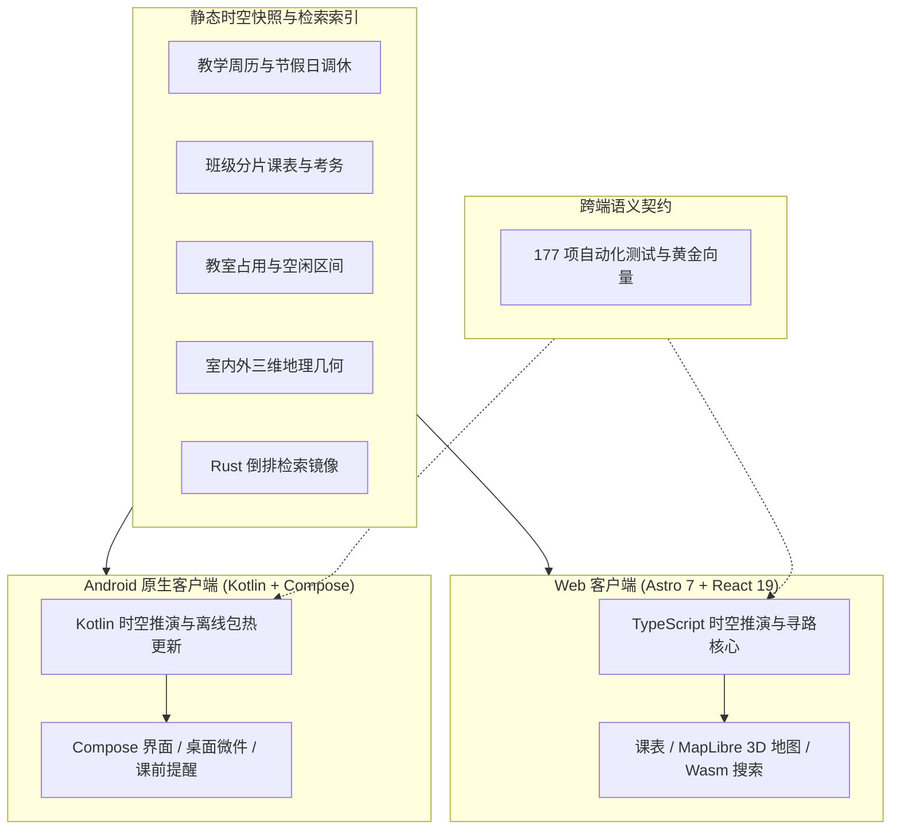

StuDev 是南京邮电大学计软网安学生发展中心的官方网站，也是一套面向高校的**本地优先数字校园时空引擎**（覆盖 [Web 端](/) 与 [原生 Android 客户端](/download/)）。全栈源码在 GitHub（[`NJUPT-CS-StuDev/studev`](https://github.com/NJUPT-CS-StuDev/studev)）以 AGPL-3.0 协议完整开源。

## 为什么要做这个项目？

高校日常教学与社团协作往往面临两类信息割裂：

1. **教学与空间割裂**：查课表、查考场、找自习空教室、看三维地图与搜通知附件分散在不同入口，且每次查询都依赖缓慢的传统后端表单请求；
2. **社团资产随换届流失**：传统的学生组织往往把资料散落在微信推送、群文件和个人网盘里，一年换届之后，前人的经验大多遗失殆尽。

StuDev 用一套统一的工程架构同时解决这两个问题：

- **本地优先的校园时空模型**：将全校课表、考务、校历、三维教学楼室内平面与全文检索编译为紧凑的静态签名快照，在终端设备本地直接完成周次推演、空闲教室计算、室内外跨楼层寻路与毫秒级检索；
- **单信源的社团知识资产**：所有专栏文章、成员档案、历届大事记全部以结构化 Markdown 保存在 Git 仓库中，任何修改都在 GitHub 留下公开可查的提交记录。

---

## 单源双端同构架构

Web 端（Astro 7 + React 19 Islands）与 Android 原生客户端（Kotlin + Jetpack Compose）共同消费同一份静态时空数据包，并由同一组**跨语言黄金测试向量（Golden Test Vectors）**严格锁定计算语义一致性：



### 核心工程模块

| 模块 | 核心技术选型与设计细节 |
| :--- | :--- |
| **Web 框架与首屏预算** | [Astro 7](https://astro.build/) + React 19 Islands + TypeScript 5.9。首页初始 JavaScript 体积严格受自动化测试门禁约束（`< 40 KB`）。 |
| **十二色环无碰撞图着色** | 同一张课表内的课程按 30° 等距色环联合分配色彩，保证同日相邻课程色调分明，仅在从不同日出现的课程间复用色号。 |
| **室内外三维校园地图** | MapLibre GL 5 驱动全校三维建筑挤压与教学楼逐层剖切（1F–6F），实时渲染空闲自习教室与端侧 Dijkstra 跨楼层无障碍寻路。 |
| **Rust + Wasm 全文检索** | `crates/wasm-search/` 编译紧凑二进制倒排索引，前端通过 `wasm32-unknown-unknown` 运行时在 `< 1 ms` 内完成课程、教师、教室、通知附件与社团文章的 BM25 检索。 |
| **Android 原生客户端** | Kotlin + Jetpack Compose（Material 3）+ Glance 桌面小组件 + `AlarmManager` 精确课前提醒，支持全量离线秒开与静默增量热更新。 |
| **构建期静态排版管道** | 集成 MathJax 4 公式静态 SVG、Mermaid 亮暗双主题预渲染、Shiki 双主题代码高亮、字体本地子集化与 WebP 响应式图像生成，零外部 CDN 依赖。 |

---

## 本地运行与测试验证

如果你想在自己的电脑上运行、调试或将 StuDev 适配到你的学校，只需以下几步：

```bash
# 1. 克隆代码到本地
git clone https://github.com/NJUPT-CS-StuDev/studev.git
cd studev

# 2. 安装项目依赖
npm install

# 3. 启动本地开发预览（http://localhost:4321）
npm run dev
```

提交代码前，可运行全量自动化质量门禁：

```bash
# 类型检查 + 校园核心测试 (76项) + 平台服务测试 (83项) + 生产构建与全站产物契约测试 (18项)
npm run typecheck
npm run test:campus
npm run test:platform
npm run build
npm run test:site
```

> [!TIP]
> 全校作息节次、教学周历、楼栋坐标与地图边界均解耦在根目录的 `campus.config.ts` 与 `design/tokens.json` 中。欢迎提交 Issue 或 Pull Request 参与共建。
