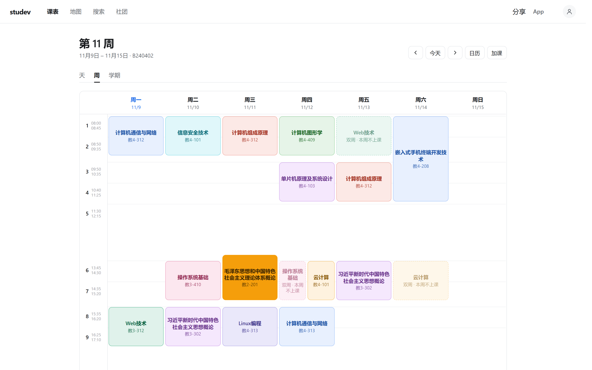
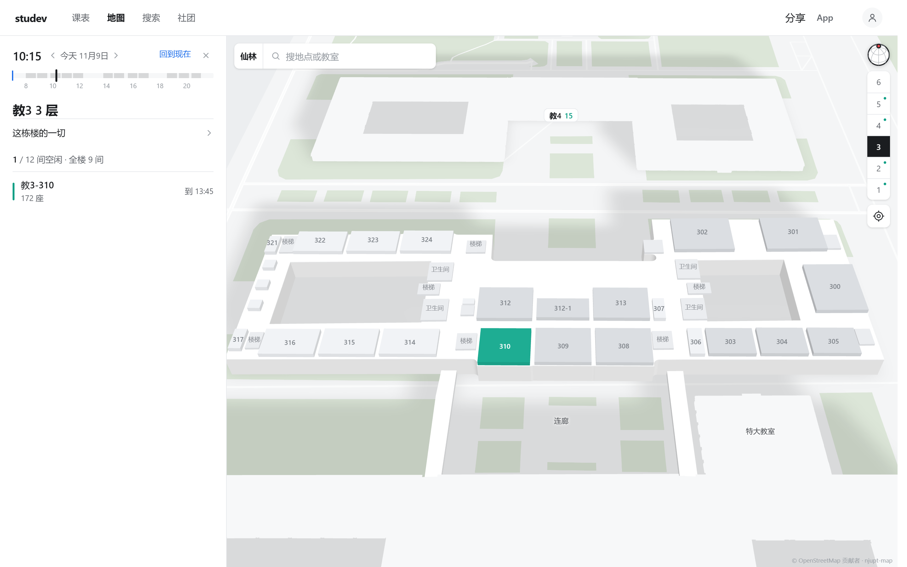
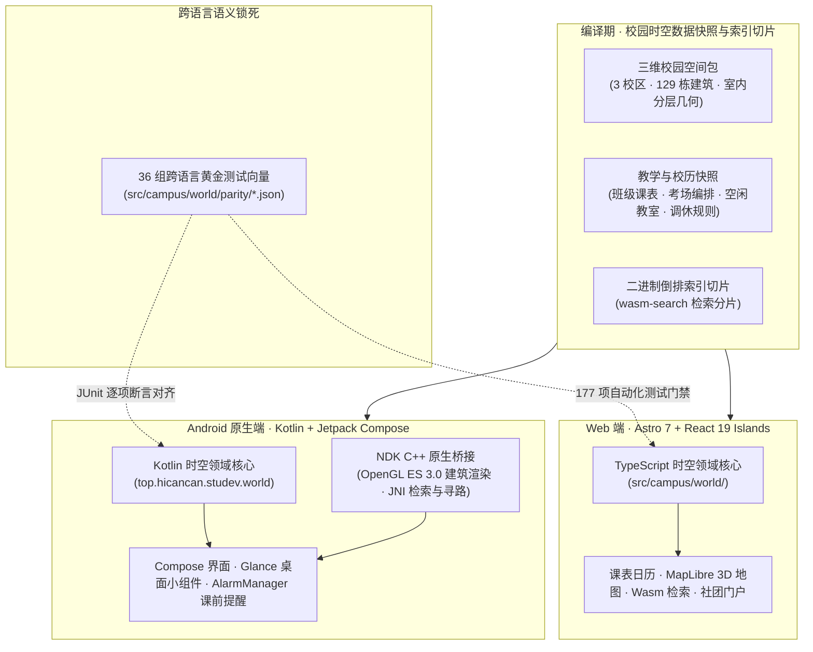
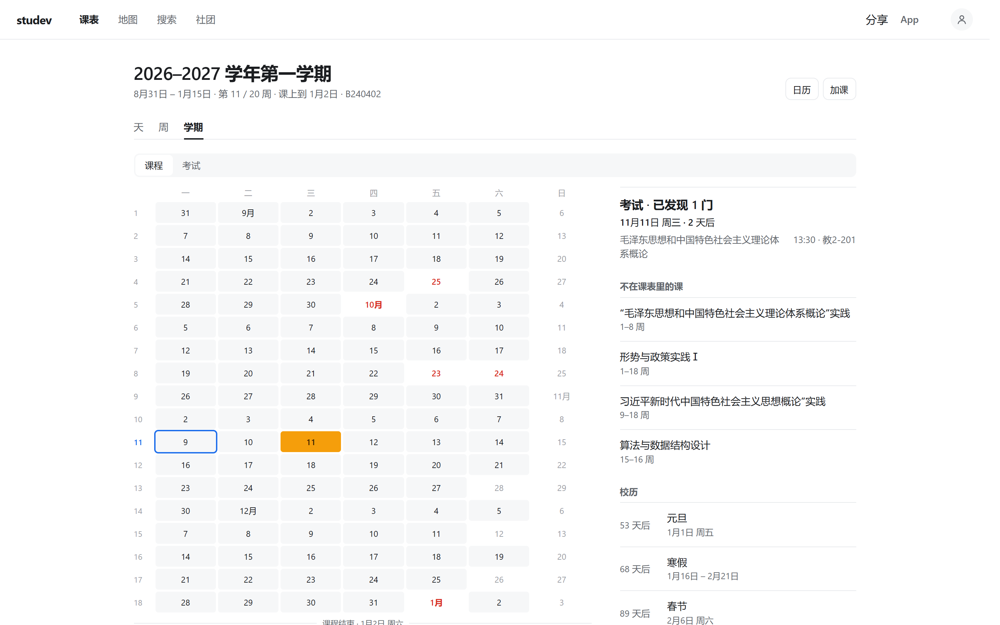
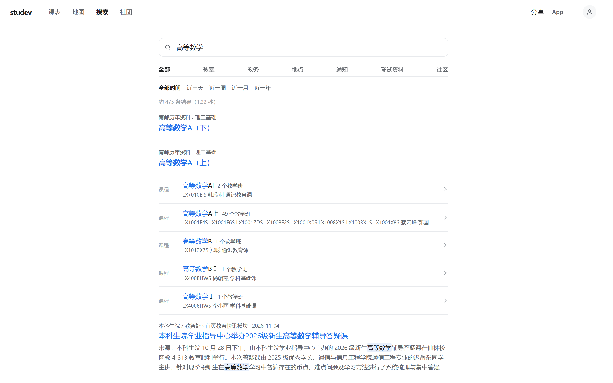

## 01 · 为什么重新设计一座数字校园？

高校日常教学与校园协作长期面临四重信息孤岛：

1. **课表、考务与校历彼此割裂**：日常排课、期末考场编排、集中实践周、法定节假日调休与早锻炼分散在不同通知与表格中，缺乏一条统一推演的时间线；
2. **教学时间与物理空间脱节**：课表上的一个教室编号，无法直观映射为教学楼某一层的真实房间，更无法直接回答“此刻这栋楼哪间教室空着可以自习”；
3. **校内通知与附件检索困难**：培养方案、竞赛规程与办事细则往往藏在二级站点的 `.docx`、`.xlsx`、`.pdf` 附件深处，传统站内标题搜索难以触达；
4. **学生组织知识随换届流失**：社团历年沉淀的技术文章、学习笔记与活动档案散落在群聊和个人网盘里，换届之后便难以检索与传承。

**StuDev**（[`NJUPT-CS-StuDev/studev`](https://github.com/NJUPT-CS-StuDev/studev)）是南京邮电大学计算机学院、软件学院、网络空间安全学院学生发展中心自研并开源的**高校数字孪生与开源数字校园平台**。我们用一套统一的领域模型，同时驱动 [Web 端](/) 与 [原生 Android 客户端](/download/)，将全校教学排程、室内外三维地图、端侧毫秒级全文检索与社团知识库融为一体。


*周课表视图：同一张课表内的课程按 30° 等距色环联合分配色彩，单双周课程 50% 等宽并排，非本周课程原位灰阶留痕。*


*三维校园地图：点击任意教学楼即可逐层剖切（1F–6F），绿色房间代表当前空闲自习教室，蓝色代表正在上课。*

---

## 02 · 五元时空领域模型与单源双端同构

StuDev 不把课表、地图和搜索当成三个独立页面，而是建立在同一套**校园五元时空领域模型**之上：

- **五类核心实体**：**空间**（校区、楼栋、楼层、房间、出入口与道路节点）、**时间**（教学周历、每日 12 节次作息、节假日调休与开放时段）、**事件**（课程、期末考试、集中实践周与早锻炼）、**主体**（教学班、教师与学生社团成员）、**信息**（公开通知、Office/PDF 附件正文与社团专栏文章）；
- **六种拓扑关系**：**包含**（校区 ⊃ 楼栋 ⊃ 楼层 ⊃ 房间）、**连通**（室外步道 ↔ 建筑出入口 ↔ 室内走廊与楼梯电梯）、**发生于**（课程与考试绑定空间坐标与时间窗口）、**参与**（班级与教师关联教学事件）、**规定**（校历调休规则改写指定日期的教学周序）、**引用**（排课、考务与通知共同指向唯一标准空间 ID）。



为了保证 Web 端（TypeScript）与 Android 原生端（Kotlin）在周次换算、调休补课映射、12 色环分配与教室空闲判定上**零偏差**，我们在 `src/campus/world/parity/` 下构建了 **36 组跨语言黄金测试向量**。TypeScript 参考实现生成的标准输入输出快照，直接作为 Android 端 JUnit 单元测试的强制断言基准——任何一端修改规则代码而未同步另一端，持续集成门禁即刻拦截。

---

## 03 · 四大核心工程子系统深度拆解

### 1. 十二色环无碰撞图着色与二十周全景时间轴

传统课表工具常采用哈希取模随机配色，极易导致同一天上下午相邻课程撞色。StuDev 实现了**全局联合图着色算法**：

- **30° 等距色环分配**：提取当前课表内的全部课程集合，在 12 色环上按最小色相角间距联合分配，优先保证同日相邻节次色调分明；仅当课程总数超过 12 门时，才在从不同日出现的课程间复用色号；
- **单双周原位留痕**：同一时间槽若存在单双周轮换课程，自动以 50% 等宽并排展示；非本周执行的单双周课程不隐藏消失，而是原位保留并以柔和灰阶呈现，彻底杜绝“漏看下周实验课”的隐患；
- **全学期事件同轴推演**：日常课程、期末考试（琥珀色高亮并附带原始考务通知出处）、集中实践周、法定节假日、调休补课（自动将指定日期映射为对应周几的排课）、运动会、校庆日与早锻炼打卡在同一时间轴上精确合流，支持一键导出标准 `.ics` 日历或直接写入 Android 系统日历。


*二十周学期全景：课程、考试、实践周与法定节假日调休同轴展示，底部附带已核验的考务通知来源。*

### 2. 预烘焙三维建筑缓冲与教学楼逐层剖切

要在浏览器与手机端同时流畅渲染仙林、三牌楼、锁金村三校区 **129 栋三维建筑模型** 与教学楼室内分层平面，传统的运行时 glTF 解析器会带来巨大的包体积与首屏解析延迟。

StuDev 采用了**编译期几何烘焙 + 原生图形管线直绘**方案：

- **零解析开销的 `models.bin` 顶点缓冲**：在构建期将全校三维建筑网格直接烘焙为紧凑的二进制顶点与法线缓冲；Web 端通过 MapLibre GL 5 自定义 WebGL 2 图层直接送入 GPU，Android 端则通过 `android/app/src/main/cpp/` 下的 C++ OpenGL ES 3.0 原生着色器与地图相机矩阵同帧绘制；
- **1F–6F 教学楼剖切与时空咬合**：点击任意教学楼即可切换楼层剖面，实时渲染每间教室的当前占用详情（课程名称、任课教师、上课班级、节次时段）或全天各节次空闲绿标；
- **跨楼层无障碍步行寻路**：由底层 Rust 寻路内核 [`wayfind`](https://github.com/hicancan/wayfind) 驱动，将室外校园路网、教学楼出入口与室内走廊、楼梯、电梯统一建模为三维连通图，支持一键开启“无障碍电梯优先”跨楼层导航。

### 3. 端侧 Rust + WebAssembly / JNI 毫秒级检索

校园搜索覆盖全校课程、教师、班级、教室、公开通知及 `.docx` / `.xlsx` / `.pdf` 附件正文，以及《南邮生存手册》与历年学业资料。


*端侧全文检索：基于 Rust 编译的紧凑二进制倒排索引，在本地毫秒级检索课程、教师、教室、通知附件与社团文章。*

依托通用检索内核 [`wasm-search`](https://github.com/hicancan/wasm-search)，所有语料在构建期被编译为内容寻址的紧凑二进制倒排分片。检索过程在浏览器 WebAssembly 或 Android NDK JNI 本地内存中于 **`< 1 ms`** 内完成分词、BM25 相关性打分、多维分面过滤与正文高亮摘要回填。**用户输入的每一个检索词均留在终端本地，无需任何后端搜索服务器。**

### 4. 构建期静态排版管道与 `< 40 KB` 首屏预算

作为学生发展中心的知识门户，[`/study/`](/study/)、[`/develop/`](/develop/)、[`/life/`](/life/)、[`/history/`](/history/)、[`/about/`](/about/) 五大专栏全部采用 Git 驱动的结构化 Markdown 协作流，并在 Astro 7 构建期完成全静态预渲染：

| 构建期管线模块 | 核心工程实现 |
| :--- | :--- |
| **首屏体积硬门禁** | 自动化测试强制校验首页初始 JavaScript 总体积 `< 40 KB`，零外部 CDN 运行时脚本。 |
| **静态双主题图表** | `rehype-static-mermaid.mjs` 在编译期将 Mermaid 源码预渲染为亮色与暗色双套内联 SVG，彻底消除客户端布局抖动。 |
| **数学公式与代码高亮** | MathJax 4 编译期直出矢量公式 SVG；Shiki 双主题（`github-light` / `github-dark`）零客户端开销代码着色。 |
| **中文字体按页子集化** | `local-fonts.mjs` 扫描全站每个构建页面的真实字符集，将霞鹜文楷动态切分为跨页共享集与单页增量集（`.woff2`）。 |
| **响应式图像与图注契约** | 自动生成多倍率 WebP `srcset`，并由测试门禁强制校验全站所有图片均具备显式宽高比与配对 `<figcaption>`。 |

---

## 04 · 与“创新杯”零碳园区数字孪生底座的双向赋能

StuDev 不仅服务于全校师生的日常教学与生活，同时也是南京邮电大学第二十八届“创新杯”大学生课外学术科技作品竞赛终审决赛重点培育项目 **《碳尽其用——AI驱动的零碳园区碳能管控系统》** 的校园时空数字孪生实证底座。

```math
\text{Campus Digital Twin} = \underbrace{\text{StuDev (师生高频数字校园)}}_{\text{空间底图沉淀 + 全校排课潮汐先验}} \Longleftrightarrow \underbrace{\text{Carbentra (零碳园区碳能管控)}}_{\text{分项碳核算 + 边缘硬件受控减碳编排}}
```

在高校园区中，教学楼与公共场馆的空调、照明及新风占建筑碳排放的绝大部分，而决定每一间教室用能需求的根本变量正是**教学排程与室内人流潮汐**。`StuDev` 与姊妹开源仓库 [**`hicancan/carbentra-campus-platform`**](https://github.com/hicancan/carbentra-campus-platform) 共用同一套**三校区 129 栋建筑三维空间包与全学期排课时间线**：

- **`StuDev` 向零碳管控输送高精时空先验**：全校 564 个教室区域的课表排程、考试占用与空闲窗口，直接作为 `carbentra-campus-platform` 的房间级负荷预测先验与安全排程约束；
- **想要深入了解支撑这两大平台的底层 Rust 内核、QGIS/Blender 三维测绘与 AIoT 硬件开源矩阵**，请继续阅读本专栏第二篇长文：[《从三维空间测绘到端侧 Rust 内核：南邮开源数字校园与零碳孪生基建矩阵》](/develop/campus-open-source-matrix/)。

---

## 05 · 本地开发、质量门禁与多校适配指南

如果你想在本地运行调试 StuDev，或将这套数字校园引擎适配到你的学校，只需以下几步：

```bash
# 1. 克隆仓库并安装依赖
git clone https://github.com/NJUPT-CS-StuDev/studev.git
cd studev
npm install

# 2. 拉取最新公开发布的校园空间与教学快照，生成本地数据包与检索分片
npm run digest

# 3. 启动本地开发服务器（http://localhost:4321）
npm run dev
```

提交代码前，可运行全量 **177 项自动化质量门禁**：

```bash
# TypeScript 严格类型检查
npm run typecheck

# 校园时空核心测试（76 项：时间轴、12色环、空间合并、跨端黄金向量）
npm run test:campus

# 社团平台服务测试（83 项：学号鉴权、三级权限 RBAC、表单生命周期与安全边界）
npm run test:platform

# 生产环境构建与全站产物契约测试（18 项：首屏 <40KB 预算、断链扫描、静态图表与 Sitemap 校验）
npm run build
npm run test:site
```

> [!TIP]
> **面向全国高校开放复用**：学校名称、域名备案、校区中心坐标、每日作息节次、教学周历与检索分面全部解耦在根目录的 `product.json` 与 `campus.config.ts` 中。只需替换这两份配置并接入贵校空间与排课数据，即可快速部署一套专属的本地优先数字校园平台。
