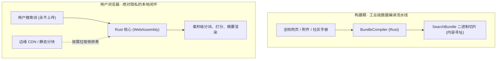
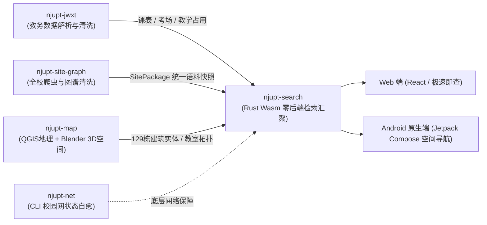
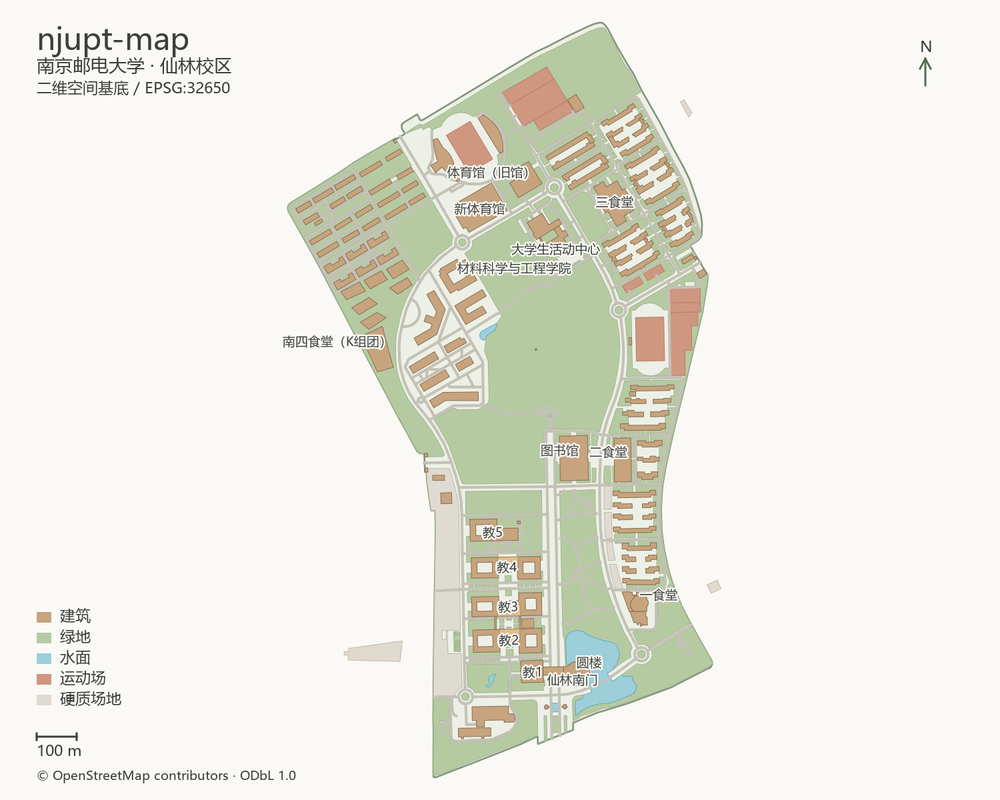

## 序幕 · 信息孤岛与“数字重力”缺失的校园

在大学里生活久了，每一个南邮学生都会逐渐习惯一种微妙的荒诞感：

- 查一次期末考场，需要先穿过教务系统缓慢的验证码，再在多层嵌套的表格里搜寻自己的班级；
- 找一份转专业或保研通知，往往要翻遍学院官网、教务处、学工处乃至研究生院几十个各自为战的二级站点，最后发现核心细则被塞在一个 `附件1_关于202x年工作安排.docx` 或扫描版 PDF 里；
- 赶去教二楼或中兴报告厅自习，推开门才发现里面正进行着临时调课或社团答辩；
- 哪怕只是手机连上校园网，隔三差五也会遭遇认证页弹不出来的白屏。

这些散落在不同系统、不同服务器和不同格式里的碎片，构成了大学里无处不在的“信息摩擦力”。

大多数人选择了默许与忍受，把这当成大学生活不得不支付的摩擦成本。但对于热爱工程与实践的学生开发者而言，**碎裂的信息孤岛，本身就是等待被改善的系统痛点**。

这就是 `njupt-search` 及其开源生态诞生的原点。

---

## 01 · 激进的立意：零后端、隐私至上与本地化正义

在做校园搜索这件事上，业界和学生开发者最顺理成章的路径通常是：租一台云服务器，搭一个 Spring Boot 或 Python 后端，挂上 Elasticsearch 或 MySQL，然后把所有前端请求打向服务器。

但这种常规架构往往会带来新的隐患与成本：

1. **隐私泄露的隐患**：中心化服务器意味着每一个同学搜了什么词、在查哪个班级的课表、在关注哪位老师的考试，都会在后台数据库留下明文日志。在校园网络环境下，这种中心化数据存储在无形中增加了学生隐私与检索记录外泄的风险；
2. **脆弱的可用性**：一旦期末周查成绩、查考场流量并发暴涨，或者开发者毕业后服务器欠费停机，整个系统便会瞬间瘫痪；
3. **沉重的运维负担**：学生组织或个人开发者不得不常年贴钱维护云主机，最终往往因精力不济而黯然下线。

**`njupt-search` 做出了一个极度硬核且激进的选择：彻底消灭后端（Zero-Backend Client-Side Search）。**



用户在输入框里敲下的每一个字符，**永远只留在本地浏览器的内存中，绝不会向任何服务器发送一行搜索日志**。

它在构建阶段将海量校园语料预编译为高度紧凑的自定义二进制切片（`SearchBundle`）。当用户打开网页时，浏览器通过 WebAssembly 加载用 **Rust** 纯手工打磨的分词与 BM25 检索核心，仅在需要时通过 HTTP Range 异步拉取对应的倒排表分块。

无论是 Native 命令行工具还是 Web 前端，调用的都是同一套完全一致的 Rust 代码。==将计算下放给终端，将隐私还给个人，将稳定性依托于无状态的静态边缘节点==——这不仅是一种技术选型，更是一种关于数据正义的工程哲学。

---

## 02 · 五星联动：一个闭环的赛博校园宇宙

`njupt-search` 绝不是悬在半空中的孤立产物。在它的背后，是五个各司其职、精密咬合的开源代码仓库构成的工程星系：



### 南邮开源矩阵与在线直达

| 矩阵模块 | 核心技术栈 | 职责与数据流向 | 开源仓库与在线入口 |
| :--- | :--- | :--- | :--- |
| **`njupt-search`** | Rust (Wasm) + React + Kotlin | 核心零后端检索枢纽、内容寻址二进制切片分发、全平台搜索与空间拓扑呈现 | [github.com/hicancan/njupt-search ↗](https://github.com/hicancan/njupt-search)<br/>🌐 **[站内直达 /search/ →](/search/)** |
| **`njupt-jwxt`** | Python / 数据接口解析 | 规范化解析教务数据，自动化清洗班级课表、期末考场、教室占用并导出 ICS 日历 | [github.com/hicancan/njupt-jwxt ↗](https://github.com/hicancan/njupt-jwxt) |
| **`njupt-site-graph`** | Rust / Node.js 爬虫引擎 | 遍历抓取全校通知、深入解构 Office/PDF 附件深层文本，并将学生社区手册图谱化 | [github.com/hicancan/njupt-site-graph ↗](https://github.com/hicancan/njupt-site-graph)<br/>[爬虫底层 static-site-graph ↗](https://github.com/hicancan/static-site-graph) |
| **`njupt-map`** | QGIS 测绘 + Blender 3D | 仙林校区 129 栋建筑数字孪生、564 个教室拓扑空间建模，完成地理与教学物理映射 | [github.com/hicancan/njupt-map ↗](https://github.com/hicancan/njupt-map) |
| **`njupt-net`** | Rust / CLI 命令行 | 极简命令行校园网认证，脱离臃肿浏览器页面，提供网络状态心跳探测与断线自愈 | [github.com/hicancan/njupt-net ↗](https://github.com/hicancan/njupt-net) |

---

### 1. [`njupt-jwxt`](https://github.com/hicancan/njupt-jwxt)：教务数据的高效清洗与日历同步
负责解析教务网页的公开课表与考场页面，将多层嵌套的 HTML 表格规范化清洗为强类型的结构化数据。全校班级课表、期末考试编排以及课程教室占用，全部支持一键导出为标准 ICS 日历格式，方便同学直接导入手机或电脑系统日历进行统一日程管理。

### 2. [`njupt-site-graph`](https://github.com/hicancan/njupt-site-graph) 与 [`static-site-graph`](https://github.com/hicancan/static-site-graph)：校园知识的统一图谱
不仅抓取学校主站与各学院通知，更自动深入解析 Word、Excel 与 PDF 附件的深层文本。同时，它将南邮学生社群历年积淀的《南邮生存手册》（`NJUPT-Survival-Guide`）与《南邮历年资料》（`NJUPT-General-Free-Exams`）无缝编织进索引边界，真正做到了“校方公文、学生经验、学业资料”的三位一体。

### 3. [`njupt-map`](https://github.com/hicancan/njupt-map)：从 QGIS 测绘到 Blender 3D 数字孪生
如果说搜索解决了“信息在哪”的问题，[`njupt-map`](https://github.com/hicancan/njupt-map) 则解答了“物理世界如何映射”的命题。


*通过 QGIS 精确校准的仙林校区二维矢量地图：地理坐标、道路与水体基准。*

工程不仅仅停留在平面图层。开发者在 **Blender** 中为仙林校区手工建立了 **129 个建筑资产**，包括外观、材质、景观乃至复杂的室内空间剖切：


*南邮图书馆三层空间的数字孪生切面：自习区、走廊与柱网布局在统一空间坐标下被精准重构。*


*Blender 原生渲染的南门校名墙与水景，模型严格对应现实局部米制坐标。*

全校 **564 个教室区域**的身份拓扑被统一归档。当你在 `njupt-search` 中查询某个教室时，它不仅能告诉你空闲状态，更能将课表、考场占用与精确的楼层示意几何融合在同一屏中展示。

### 4. [`njupt-net`](https://github.com/hicancan/njupt-net)：极简纯粹的底层网络守护
校园网认证失败往往是一切数字体验的终结点。[`njupt-net`](https://github.com/hicancan/njupt-net) 用轻巧的 CLI 命令行工具，彻底替代了笨重的前端认证网页，支持自动化拨号、心跳保持与网络状态自愈。

### 5. `njupt-search` 多端延伸：Web 极速即查与 Android 空间导航
除了基于 [njupt.hicancan.top](https://njupt.hicancan.top) 的浏览器端极致秒开，针对移动端的原生 Android 客户端采用 Kotlin + Jetpack Compose 打造，承担起校园现实场景中的传感器融合、设备定位与室内导航职责：
- 🔍 [校园搜索直达](/search/) · 检索校方通知与红头文件附件
- 📖 [社区经验搜索](/search/community/) · 《南邮生存手册》办事与生活指南
- 📚 [历年资料搜索](/search/materials/) · 课程课件、试卷与笔记
- 📅 [班级课表查询](/search/timetable/) · 周次课表与 ICS 日历同步
- 🏫 [教室占用拓扑](/search/classrooms/) · 楼层地图、空间拓扑与课程考试占用
- 📝 [期末考试安排](/search/exam/) · 一键检索考场时间与座位安排

---

## 03 · 极致的工程克制：拒绝成为“缝合怪”

很多校园开发项目在堆砌功能的过程中，往往沦为未经推敲的“代码大杂烩”。但翻阅 `njupt-search` 的架构文档与源码，扑面而来的是一种令人肃然起敬的**工程洁癖与契约精神**：

> [!NOTE]
> **njupt-search 的架构铁律**
> 
> 1. **严格的单向依赖**：领域代码绝不依赖任何 UI 框架或特定操作系统脚本；Web 与 Android 共享产品领域事实，但严禁共享脆弱的平台 UI 胶水代码；
> 2. **事实绝不二次污染**：源码中坚决不硬编码任何抓取到的真实语料或未经授权的平面图；部署物完全依赖内容寻址的哈希校验，杜绝任何“脏数据”入库；
> 3. **视觉拒绝跳动**：为了达成极致的速度，搜索结果瞬时渲染标题和来源，正文切片到达后异步补充高亮摘要，且严禁导致列表重排，保护用户的视觉锚点。

```math
\text{Architecture Elegance} = \frac{\text{Domain Truth}}{\text{Platform Glue Code}}
```

从 Rust 底层的零拷贝内存切片，到构建系统在 GitHub Actions CI 中的严密基准测试，这个项目处处体现着工业级软件设计的严谨性。

---

## 04 · 尾声 · 一封写给母校的赛博情书

在大学的评价体系里，人们常常习惯于用比赛名次、专利证书或各种奖状来衡量一个计算机系学生的“成功”。

但在 StuDev（学生发展中心）看来，**最动人的力量，永远来自于这种纯粹的“造物冲动”**。

它完全依托现代边缘计算与静态架构轻量运行；静静地陈列在 GitHub 上，被成百上千名赶着找教室、查考场、做复习的南邮同学加入书签与日常工具箱。

一个优秀的工程师，不需要等待世界变好之后再去生活。你只需要打开终端，敲下第一行代码，把那些原本冰冷、杂乱、相互隔绝的系统，亲手缝合成一个有秩序、有美感、有温度的数字世界。

这就是 `njupt-search` 留给每一个南邮后继者的最好见证。
