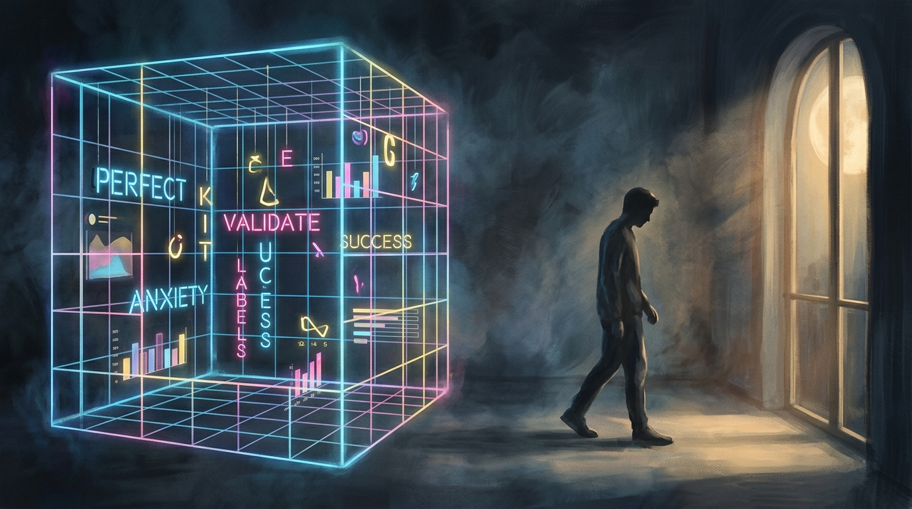
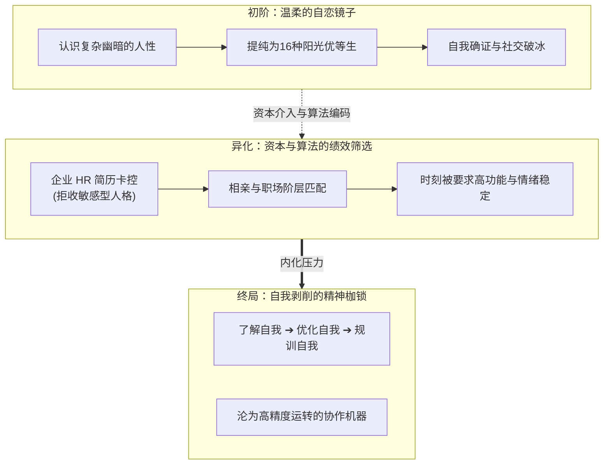
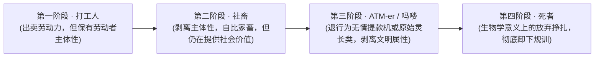
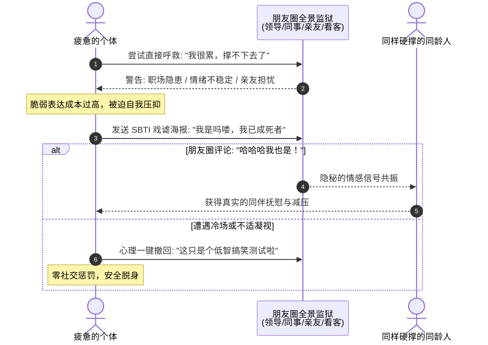
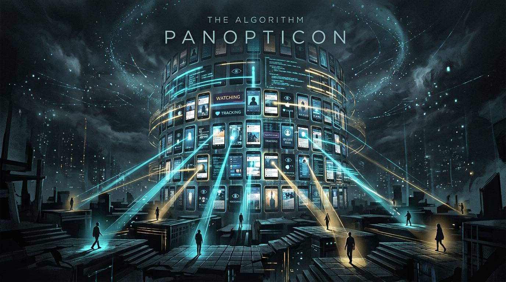
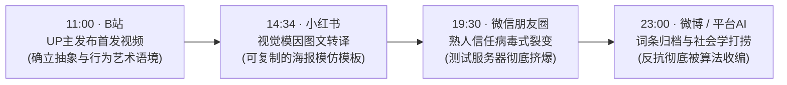

> **文 / hicancan**  
> *写于 2026 年 4 月 9 日 · 仙林*

*图注：在由算法与绩效指标编织的霓虹牢笼里，当完美人设的标签越来越重，一次看似荒诞的“向下看齐”，成为了现代人最本能的赛博越狱。*

4 月 9 日的傍晚，中文互联网经历了一场短暂而剧烈的情绪海啸。

如果你在那个时间段打开朋友圈，会发现平时那些在格子间里维持着体面、在社交场上展现着高情商的成年人们，突然开始排队进行一场集体的==“赛博裸奔”==。

他们乐此不疲地转发着一张张画风粗糙、甚至带着脏话的海报，并在上面公然认领诸如“CTRL（拿捏者）”、“SHIT（愤世者）”、“ATM-er（送钱者）”、“吗喽”或是“死者”这样的离谱标签。

因为涌入的人数太多，承载这个名为“SBTI”测试的简陋服务器一度被彻底挤崩。

在信息更迭以分钟计算的今天，一个毫无技术含量、逻辑经不起任何推敲的“草台班子”网页游戏，凭什么能在短短几个小时内击穿所有的圈层壁垒？

如果只把它看作年轻人图一乐的“抽象跟风”，我们便轻易放过了这个时代抛给我们的一块切片。SBTI 的爆火，绝不是人格心理学领域的又一次通俗化下沉，而是一场蓄谋已久的文化反叛：==它标志着那套曾被我们奉为圭臬的、以 MBTI 为代表的“精英化人格叙事”，终于在普遍的社会疲怠中，走向了彻底的破产==。

---

## 一、 绩效主体的黄昏：MBTI 是如何走向反面的？

要理解 SBTI 为什么好笑，必须先理解 MBTI 为什么让人窒息。

回望过去几年，MBTI（迈尔斯-布里格斯性格分类法）几乎成为了统治现代人社交与职场的绝对语法。它曾是互联网给予原子化个体的一份极其温柔的礼物：它将复杂多变、充满幽暗面的人性，提纯为十六种整洁、明亮、且极具成长性的人格模型。

在 MBTI 的世界里，没有“坏人”，只有“不同质感的优等生”。即便你是极度内向、敏感怯懦的，它也会将你包装成“拥有深邃内心世界的 INFP（调停者）”；即使你专横跋扈、缺乏同理心，它也能为你戴上“天生领导者 ENTJ（指挥官）”的桂冠。

它太体面了。它满足了现代人在高度不确定的社会中，对“确立自身价值”的极度饥渴。

然而，德国哲学家韩炳哲在《倦怠社会》中曾提出一个令人毛骨悚然的论断：现代社会的个体，已经从“被剥削的客体”变成了**“自我剥削的绩效主体”**。我们不再是被强迫劳动的奴隶，而是心甘情愿、甚至充满激情地压榨自己，以追求更高的效率和更完美的自我展现。

MBTI 的异化，正是这一理论的完美注脚。

最初，它是我们认识自我的桥梁；但很快，资本与算法敏锐地嗅到了它的价值，将其改造成了一套全新的“绩效考核标准”。企业 HR 开始用它来筛选简历（“本岗位拒收 INFP”），相亲市场用它来匹配阶层，连我们在自我介绍时，都在小心翼翼地挑选那个看起来情绪最稳定、执行力最强的字母组合。

> [!NOTE]
> **韩炳哲《倦怠社会》的深层注脚**  
> 21 世纪的社会不再是一个规训社会，而是一个绩效社会。其中的居民也不再是“顺从的主体”，而是“绩效的主体”。过度的积极性转化为自我攻击与无尽的内耗。当“成为更好的自己”变成一种无休止的义务，抑郁与疲惫便成为普遍的时代症候。

当“了解自我”变成“优化自我”，MBTI 就成了一种精神枷锁。它时刻规训着年轻人：你必须是一个高功能的、情绪稳定的、时刻准备投入协作的现代机器。

就在这种“永远要求你变得更好、更成熟”的结构性窒息中，SBTI 像一个手持利刃的野蛮人，一脚踹开了精致的玻璃门。它不再问你“具备何种卓越特质”，它只问了一个大逆不道的问题：

> **“别装了，你最近被生活折磨成了什么鬼样子？”**

---

## 二、 词汇的退行：从“打工人”到“吗喽”的心理图谱

仔细审视 SBTI 提供的那些结果标签，你会发现一条令人心惊的**“词汇退行”路线**。

曾经，我们用“打工人”来自嘲。这个词虽然带着辛酸，但依然保留着社会化大生产中的主体性——我至少是一个在出卖劳动力的“人”。

后来，我们变成了“社畜”。人的属性被剥离，我们自比为被驯化的家畜，但依然在为某个组织提供价值。

而在 SBTI 的宇宙里，标签变成了“ATM-er（无情的提款/支付机器）”、“吗喽（原始的灵长类动物，彻底剥离了社会文明属性）”，甚至是“死者（生物学意义上的放弃挣扎）”。

这绝不仅仅是互联网烂梗的简单堆砌，这实际上是一代人社会心理极度疲劳后的==“主体性解体”==。

| 叙事维度 | MBTI 精英主义绩效叙事 | SBTI 荒诞自毁式越狱叙事 |
| :--- | :--- | :--- |
| **底层心智** | 优化自我、追求卓越、确立阶层坐标 | 放弃挣扎、向下看齐、解除道德负担 |
| **对待缺陷** | 包装为“潜在优势”（如内向=深邃） | 坦然承认“我已报废”（如已成死者） |
| **社交成本** | 极高（需要维持情绪稳定的人设） | 极低（用反讽和自黑化解社交防线） |
| **面对评价** | 害怕被系统判定为“不合格” | “我都烂成这样了，你不能再规训我” |
| **社会角色** | 齿轮、协作模块、职场精英 | 吗喽、ATM 提款机、赛博难民 |

在无穷无尽的 KPI、高昂的居住成本、算法的严密监视以及情感劳动的过度消耗下，年轻人发现：个体的努力，已经很难再撬动坚固的结构。既然“上进”无法带来承诺的回报，既然维持一个“ENTJ”的精英人设并不能阻止被裁员的命运，那么，体面的自我叙事就失去效用了。

$$
\text{Subjectivity Collapse} = \lim_{\text{Fatigue} \to \infty} \frac{\text{Emotional Labor} \times \text{Institutional Surveillance}}{\text{Individual Agency} + \varepsilon}
$$

SBTI 的狂欢，本质上是一场盛大的“向下看齐”。人们通过认领这些极具贬损意味、甚至反人类的标签，完成了对主流成功学叙事的消极抵抗：

> “我已经烂成这样了，我已经把自己贬低到尘埃里了，你就不能再用任何社会标准来规训我、要求我了。”

这是一种极其悲壮，又极具当代互联网特色的精神胜利法。

---

## 三、 薛定谔的求救：熟人全景监狱里的“可撤回脆弱”

然而，既然大家都这么痛苦，为什么不直接在朋友圈写下“我很累，我快撑不下去了”，而是要大费周章地发一张搞怪的测试截图？

这就触及了现代社交网络最冰冷的底色——==微信朋友圈，早就沦为了一座全景敞视的数字监狱==。

在这里，有随时可能给你派活的老板，有暗自比较生活水平的前同事，有极度关心但又无法理解你压力的父母，还有那些点赞之交的看客。在这样的凝视下，真实地表达负面情绪，成本是极其高昂的：

- 太沉重，显得你情绪不稳定，是个职场隐患；
- 太赤裸，会给亲友带来心理负担；
- 太频繁，又会沦为别人眼里的“祥林嫂”。

**现代人的脆弱，是不合时宜的奢侈品。**

> [!TIP]
> **福柯“全景敞视监狱”（Panopticon）的赛博形态**  
> 边沁设计的全景监狱里，囚徒不知道监视者何时在看，因而将监视目光内化为自我监控。在高度熟人化与职场化的朋友圈里，每一次公开发布都在接受全方位目光的审查。我们变成了审判自己言行的狱警。

SBTI 提供了一种天才般的社交解决方案：==“可撤回的脆弱”==。

它的核心机制在于“模棱两可”。当你发出那张写着“我是吗喽，我有点死了”的海报时，它披着一件名为“幽默”和“玩梗”的防弹衣：

1. **如果评论区里是朋友们齐刷刷的“哈哈哈我也是”**：你便在这短暂的共振中，获得了一次真实的情感抚慰——原来在这座城市里，不止我一个人在硬撑；
2. **如果无人问津，或者引来了不必要的侧目**：你随时可以在心理上（甚至在物理上）撤回这次表达：“害，这就是个低智商的搞笑测试，大家图一乐而已。”

它将一次严肃的“心理求救”，降级、包装成了一次轻松的“数字社交互动”。人们在评论区里的每一次调侃，本质上都是在给彼此那根濒临绷断的神经，做一次极其轻柔的按摩。

这不是发疯，这是极其克制、极其懂事的成年人，在夹缝中为自己寻找的一块情绪自留地。

---

## 四、 平台的吞噬：一场玩笑被收编的惊魂四个小时

如果我们跳出情绪的维度，重新以媒介观察的视角审视 SBTI 的传播路径，会看到一幅令人生畏的现代技术图景。

*图注：算法全景敞视塔。在这个由数据与屏幕构筑的高塔面前，年轻人的反叛与荒诞，以惊人的速度被格式化为新的词条与流量资产。*

根据梳理出的时间线：

- **11:00**，B 站 UP 主发布首发视频，设定了“抽象、行为艺术”的原初语境；
- **14:34**，小红书出现图文转译，将其变为可模仿的视觉模因；
- **19:30**，在微信完成基于人际信任的病毒式裂变；
- **23:00**，微博与平台 AI 将其作为社会事件进行打捞与归档。

这仅仅发生在一个半天之内。

最令人后背发凉的，是最后那个环节。当 SBTI 在热搜爆火后的极短时间内，各大平台的“AI 智能搜索”和百科系统，已经迅速为其生成了详尽的词条：包含阅读量走势、讨论量统计，甚至煞有介事地总结出了“热门人格类型大全（含拼音缩写解释）”。

它原本是为了反抗 MBTI 那种刻板的“分类学”而诞生的恶作剧，却在短短几个小时内，被互联网平台的算法引擎强行吞噬、消化，变成了一套全新的、被整齐编目的“知识条目”。

> [!IMPORTANT]
> **居伊·德波与景观社会的“收编机制”（Recuperation）**  
> 景观社会拥有一种可怕的胃口：它能够将针对体制的一切激进批判、嘲讽与挑衅，吸收转化为体制自身的商品与符号。年轻人试图用 SBTI 逃离标签的定义，但在算法眼里，你只不过是从一个名为“INFP”的数据库，迁徙到了另一个名为“吗喽”的数据库里而已。你反抗体制的姿势，最终成为了体制运转的燃料。

---

## 结语：退潮后的疲惫，与不可言说的默契

4 月 10 日的早晨，阳光照常升起。那个崩溃的 SBTI 服务器或许已经修复，但在朋友圈里，已经很难再看到新的截图了。

互联网的遗忘曲线比任何时候都要陡峭。这场狂欢像一阵来历不明的妖风，迅速刮过，然后了无痕迹。打工人们依然会挤上早高峰的地铁，在钉钉或飞书上回复“收到”，继续扮演一个情绪稳定的成年人。

那么，这场只有二十四小时寿命的闹剧，到底留下了什么？

它没有改变任何实质性的生存困境。它不能帮你涨薪，不能帮你对抗内卷，也不能帮你摆脱那些消耗你的社会关系。

但它像一道突如其来的闪电，短暂地照亮了这座庞大的数字铁屋。在那个网络拥堵的傍晚，成千上万原本孤独、疲惫、在各自的轨道上咬牙硬撑的人，通过一个粗糙的网页，在赛博空间里完成了一次短暂而隐秘的确认：

> **“原来，你也被生活搞得这么狼狈啊。”**  
> **“是啊，你也是。”**

在越来越难以发出真实声音的今天，这样一次心照不宣的群体叹息，或许已经是我们能获得的，最大的安慰。
