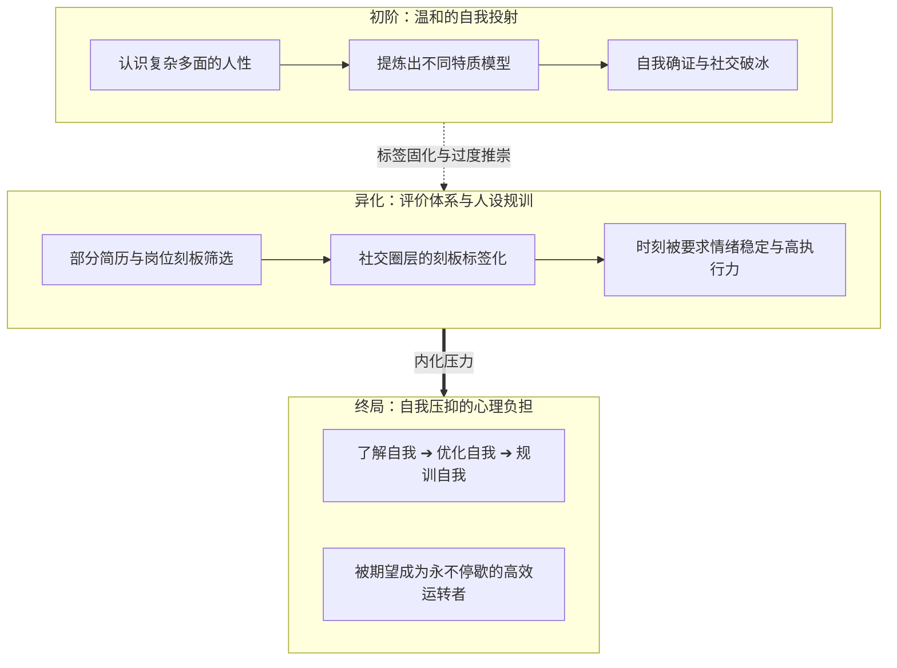
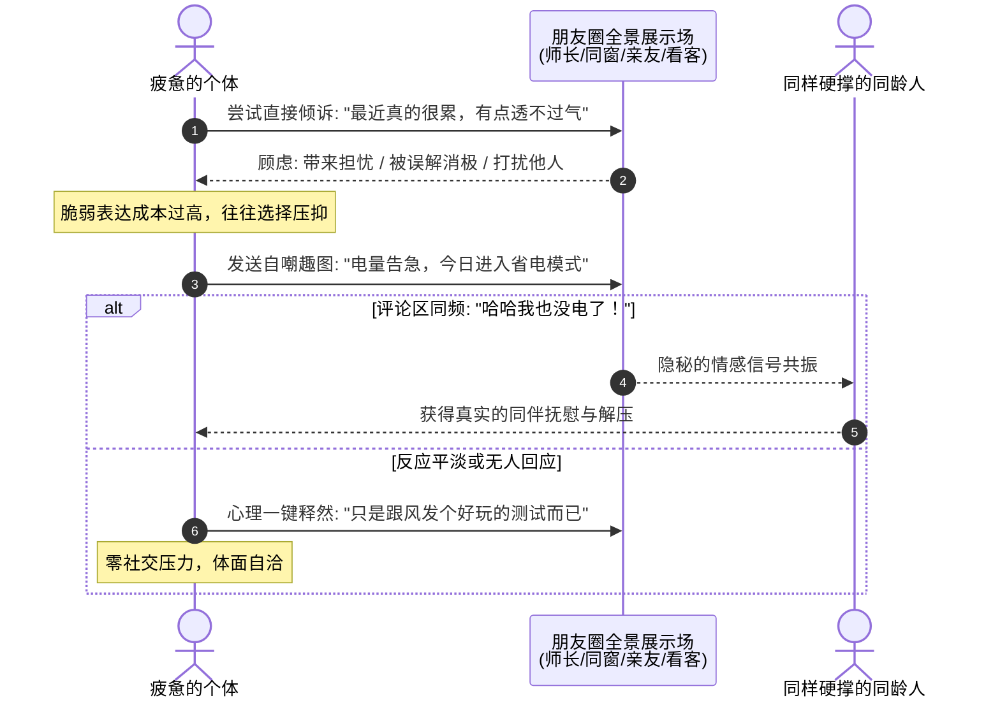

> **文 / hicancan**  
> *写于 2026 年 4 月 9 日 · 仙林*

*图注：在由评价指标与人设立意编织的网络社交中，当完美标签越来越重，一次自嘲式的宣泄，折射出当代年轻人渴望卸下包袱的真实心声。*

4 月 9 日的傍晚，中文互联网经历了一场短暂而热烈的情绪共振。

如果你在那个时间段打开朋友圈，会发现平时那些在格子间里维持着体面、在社交场上展现着高情商的朋友们，突然开始排队分享一张张自嘲式的测试海报。

大家在社交圈里认领着诸如“电量不足”、“情绪待机”、“日常发呆”、“偶尔报废”这样的戏谑标签。因为涌入的人数太多，承载这个名为“SBTI”测试的简陋服务器一度被彻底挤爆。

在信息更迭以分钟计算的今天，一个简单甚至略显粗糙的网页小互动，凭什么能在短短几个小时内击穿所有的社交圈层？

如果只把它看作年轻人图一乐的“流行跟风”，我们便轻易放过了这个时代抛给我们的一个鲜活切片。这场测试的走红，绝不仅是人格心理学领域的一次通俗娱乐，更是一场关于心理减压的集体表达：==它标志着那套曾被我们奉为圭臬的、将人高度标签化与完美化的叙事，在普遍的心理疲态面前，正在被一种更加真实、松弛的声音所冲解==。

---

## 一、 绩效主体的反思：性格标签是如何走向反面的？

要理解这场自嘲测试为什么能引起如此广泛的共鸣，必须先理解 MBTI 为何在过去几年里让人感到越来越紧绷。

回望过去几年，MBTI（迈尔斯-布里格斯性格分类法）几乎成为了统治现代青年社交的通行语汇。它曾是互联网给予原子化个体的一份极其温柔的礼物：它将复杂多变、充满幽暗面的人性，提纯为十六种整洁、明亮、且极具成长性的人格模型。

在传统的 MBTI 语境里，没有绝对的缺点，只有“不同维度的优势”。即便你是极度内向、容易害羞的，它也会将你描述为“拥有深邃内心世界的调停者（INFP）”；即便你行事雷厉风行、直截了当，它也能为你赋予“天生统筹者（ENTJ）”的视角。

它很体面，满足了当代年轻人在快节奏生活中对“确立自我价值与归属感”的心理需求。

然而，哲学家韩炳哲在《倦怠社会》中曾提出一个深刻的论断：现代社会的个体，容易在无形中从“被动承担任务的客体”演变成“**自我驱动过度的绩效主体**”。我们不仅在工作中追求卓越，甚至在私生活、情绪管理和社交展示中，也在苛求自己的高效与完美。

MBTI 的演变，恰恰映射了这种心理倾向。

最初，它是我们认识自我、包容差异的桥梁；但很快，在算法与职场语境的催化下，它有时被窄化成了某种隐形的“考核标准”。部分企业的招聘中出现了性格倾向的偏好，相亲与社交中也充斥着字母组合的刻板归类。甚至在自我介绍时，大家都习惯性地挑选那个显得最有领导力、执行力最强的标签。

> [!NOTE]
> **韩炳哲《倦怠社会》的深层注脚**  
> 21 世纪的社会是一个注重效能与自我实现的社会。过度的积极性如果缺乏舒缓通道，容易转化为内心的自我苛求。当“成为更好的自己”变成一种无处不在的焦虑源头时，适度的放松与释怀便成了普遍的心灵渴求。

当“了解自我”演变成“不断按照完美模板修剪自我”，性格标签就变成了一种心理负担。它时刻暗示着年轻人：你应当是一个情绪稳定、精力充沛、随时能无缝融入现代协作的标兵。

正是在这种“时刻需要维持体面与高能”的紧绷感中，那些荒诞幽默的自嘲小测试，像一股清新的空气吹散了厚重的迷雾。它不再催促你“展示卓越”，而是温和地触碰了那个真实的常识：

> **“别硬撑了，你最近是不是真的很累？”**

---

## 二、 词汇的变迁：从“打工人”到“自嘲解压”的情感轨迹

仔细审视网络自嘲语汇的演进，可以清晰地看到一条当代青年心态的**情感演进轨迹**。

曾经，大家用“打工人”来自嘲。这个词虽然带着辛酸，但依然保留着劳动者朴素的主体性；

后来，网络上流行“社畜”。人的属性在自嘲中被进一步解构，表达着在庞大系统面前身不由己的无奈；

而在此次测试的自嘲语汇里，标签进一步退行到了诸如“待机模式”、“能量告急”、“只想发呆”甚至是“精神报废”。

这绝不仅仅是网络烂梗的简单堆砌，它实际上反映了一代人在面对学业压力、竞争评价与信息过载时，对**心理防线的一种自我保护机制**。

| 叙事维度 | 标签化的人设叙事 | 戏谑自嘲的真实表达 |
| :--- | :--- | :--- |
| **底层心态** | 追求完美、维持体面人设 | 接纳局限、坦承疲惫、卸下负担 |
| **对待缺陷** | 强行包装为“潜在优势” | 坦然承认“我也会累、需要充电” |
| **社交成本** | 较高（需时刻维持情绪稳定） | 较低（用幽默化解紧绷的防线） |
| **面对评价** | 害怕被判定为“不够优秀” | “我接受自己的普通，请允许我休息” |
| **社会角色** | 高速运转的协作单元 | 有血有肉、需要呼吸的真实个体 |

面对紧迫的课业死线、求职面试的激烈竞争与未知的未来，很多同学发现：个人的能量是有限的。如果一味勉强自己维持时刻昂扬的精英姿态，心灵迟早会因为负荷过重而陷入枯竭。

$$
\text{Emotional Resilience} = \lim_{\text{Pressure} \to \infty} \frac{\text{Self Compassion} \times \text{Peer Support}}{\text{External Perfection Expectation} + \varepsilon}
$$

自嘲测试的狂欢，本质上是一场坦诚的“心理减压”。大家通过幽默自黑的方式，为自己的身心划定了一道安全边界：

> “我已经承认了自己的疲惫与有限，请允许我暂时放下那些宏大的要求，安静地充会儿电吧。”

这是一种自我关照的智慧，也是当代年轻人在高压现实中为自己争取的精神缓冲。

---

## 三、 社交网络的情感折射：熟人圈里的“可撤回脆弱”

然而，既然大家都感到疲倦，为什么很少有人直接在朋友圈写下“我很累，我快撑不住了”，而是借由一张搞怪的测试海报来表达？

这就触及了现代熟人社交网络的深层结构——朋友圈早已变成了一个充满各方审视的展示场。

在朋友圈里，有时刻可能交代事务的老师与组长，有暗自比较课业成绩的同学，有报喜不报忧的父母亲友，还有无数点赞之交。在这样的注视下，直白地展露消极情绪，往往需要承担过高的心理顾虑：

- 显得不够稳重，容易被误以为缺乏抗压能力；
- 过于沉重，会让真正关心你的家人徒增焦虑；
- 过于频繁，又担心给他人带来负能量打扰。

> [!TIP]
> **现代社交中的“自我呈现”**  
> 社会学家欧文·戈夫曼在《日常生活中的自我呈现》中指出，人在社交中如同在舞台上演出，时刻在区分“前台”与“后台”。在高度公开的朋友圈里，人们习惯于维护前台的得体形象。而幽默与自嘲，正是将后台真实感受隐晦搬上前台的精妙道具。

自嘲式的测试提供了一种绝妙的情感折中方案：==“可撤回的脆弱”==。

当你发出那张写着“今日电量仅剩 5%”的海报时，它披着一层轻巧的“幽默”外壳：

1. **如果评论区里是朋友们齐刷刷的“哈哈我也是”**：你便在这短暂的共鸣中获得了宝贵的同伴理解——原来在仙林的深夜里，不止我一个人在感到吃力；
2. **如果无人回应，或者引来不解的目光**：你随时可以在心理上轻松脱敏：“嗨，这就是个跟风玩的搞笑测试，大家图个乐子。”

它将一次严肃的心理倾诉，轻盈地转化为一次轻松的生活互动。大家在评论区里的每一次调侃与击掌，都是在给彼此那根绷紧的心弦，做一次恰到好处的松弛按摩。

---

## 四、 媒介的循环：一次网络玩笑的快速演进

从传播学的视角审视，这类现象级测试的走红路径同样揭示了现代网络媒介的典型机制。

*图注：算法与数据驱动下的信息流动。在这个由屏幕构筑的现代世界里，年轻人的情感表达以极快的速度被传播、讨论与格式化。*

从上午的个别博主创意，到午后的图文模仿，再到入夜后熟人朋友圈的指数级裂变，最终在深夜登上综合热搜。整个周期仅仅用了不到十二个小时。

这种现象展现了现代互联网极其强大的情绪放大效应：年轻人的疲惫与自嘲，迅速被提炼成了公共议题。但无论传播形态如何更迭，其核心驱动力始终是那份真实而朴素的情感需求。

> [!IMPORTANT]
> **文化反思与心理关怀**  
> 哲学家居伊·德波曾指出，现代媒介擅长将具体的情感转化为符号。年轻人试图用戏谑逃离严肃标签的束缚，但若仅仅停留在屏幕上的玩梗，并不能真正解决现实中的焦虑。真正的解药，永远在于走出虚拟的信息流，去真实的生活中寻找温度。

---

## 结语：退潮后的真实，与生活中的同行

4 月 10 日的早晨，阳光穿透仙林校区的树叶，照在干净的水泥路上。那个短时崩溃的测试页面或许已经归于平静，朋友圈里也不再有铺天盖地的测试截图。

互联网的热点总是在迅速翻篇。打工人和学生们依然会背上书包走进教室，在终端前继续编写调试代码，在自习室里翻开厚厚的高数与专业课课本。

那么，这场只有二十四小时的网络自嘲，到底留下了什么？

它或许没有直接改变任何课业指标，也不能帮你瞬间搞定算法大作业。但它像春风吹过湖面荡起的一圈涟漪，在紧绷的日常里撕开了一道温柔的缝隙：

它让大家在彼此的调侃与笑声中确认了一件事——**我们都不必活成一台永动机，感到累了就停下来歇一歇，这不仅不可耻，而且极其自然**。

在学生发展中心看来，最珍贵的成长，永远不是在身上贴满光鲜亮丽的标签，而是在面对压力与困惑时，能拥有自我释怀的从容，以及身边随时愿意为你搭把手的真诚同伴。

关掉手机屏幕，走出机房，去操场吹吹晚风，或者和室友去食堂吃一碗热腾腾的汤面。生活比任何测试都要宽广，而属于你的精彩，永远在那些真实生活的步伐之中。
