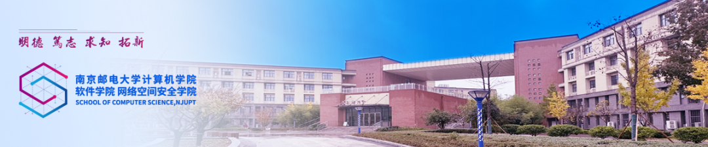
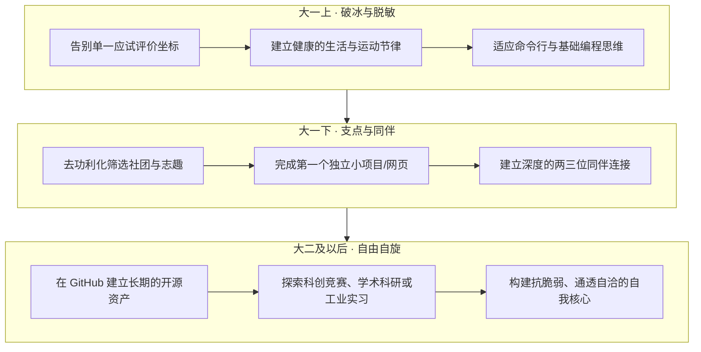

## 序章 · 仙林九月的车辙与初见

每年的九月初，仙林中心地铁站通往南京邮电大学南门的林荫路上，总会准时响起行李箱滑轮摩擦地面的隆隆声。

穿过写着“信达天下，自强不息”的校门，鼎山湖的水面在初秋温润的阳光下泛着碎金般的光泽；教二楼赭红色的外墙沉静地伫立在绿树掩映之间，远处二食堂和金鹰商圈升腾起充满烟火气的生活热浪。

*计软网安学院校园横幅：初秋的仙林校区，新的故事正从这里悄然落笔。*

对于每一个刚刚告别高中题海与封闭式作息的 2025 级“小柚子”来说，拖着沉甸甸的包裹站在宿舍楼下时，心中往往交织着两种截然相反的情绪：一半是对未被定义的自由的无限神往，另一半则是面对庞大陌生的大学系统时，难以名状的慌张与茫然。

高中老师曾反复许诺“上了大学就轻松了”，但在你拿到课表、看到高等数学、离散数学、C语言程序设计那一长串硬核课名时，这个美丽的童话便瞬间瓦解了。

班级群里消息闪烁不停：选课怎么抢？晨跑如何打卡？大一到底要不要买电脑？代码报错了该去哪里问？如果周围的同学看起来都在“疯狂内卷”，我该如何自处？

*“柚”遇新友：在高年级学生的视线里，每个新生的到来都映照着他们自己当年的模样。*

在这个关键的人生十字路口，最先向新生走来的，往往是活跃在迎新一线的“**小班主任**”（新生班级助理）。

小班是小班，学生发展中心是学生发展中心。小班主任是学院深入到各个新生班级的生活引路人，陪伴大家度过最懵懂的报到周；而学生发展中心（StuDev），则是面向全院青年提供长期心理韧性、学术研学、数字基建与心灵缓冲的公共成长空间。两者的角色不同，但对新同学的善意与守望是一致的。

这篇指南，是从迎新一线高年级学长学姐走过弯路、经历过深夜机房的困惑与豁然开朗中，提炼出的一份**真诚注脚与同行备忘录**。

---

## 01 · 寄语深处：撕下标签后的同伴体温

翻阅历届迎新档案中高年级学长学姐留给新生的手记与寄语，你会发现一个共同的特质：他们没有一个人摆出高高在上的“管理者”姿态，反而千方百计地用各种生活化的细节，试图向你传递一份平等而松弛的善意。

### 吴双灿（计科02班）：去功利化的知识分享与生活留白

在新生手记里，吴双灿写道：他喜欢听音乐、弹吉他、打羽毛球，喜欢 Python，个人独立博客是 [hicancan.top](https://hicancan.top)；他最倡导的学习与相处方式，是==“去功利化地分享知识”==。

而在所有字斟句酌的新生寄语中，他写下的只有一句轻盈却极有分量的话：

> **“好好生活哦，四年的时光呢！”**

这句话击中了大学生活中最容易被遗忘的本质：学计算机固然重要，敲代码固然关键，但千万不要在刚进大学的第一天，就把自己活成一台时刻紧绷、满载运行的服务器。四年的时光很长，足以容纳无数次试错，更需要你留出空间，好好吃饭、好好睡觉、认真感知具体的每一天。

---

### 张证凯（计科03班）：大学没有唯一标准答案

来自计科 3 班的张证凯，喜欢篮球、乒乓球、阅读与 R&B 音乐。在很多新生急于寻找“如何成为绩点第一”的所谓捷径时，张证凯递过来的却是一剂解压良药：

> “在大学里，你们不用急着找‘标准答案’——社团可以试错，成绩不是唯一。不用害怕迷路，我们这些学长学姐就在前面，随时能搭把手。慢慢走，好好看，这四年，值得你们认真折腾，也值得偶尔慢下来。”

从高中以“标准答案”为绝对坐标的应试轨道，切换到大学四面开阔的旷野，最需要卸下的就是对“走错一步就全盘皆输”的心理恐惧。==大学不是一条独木桥，而是一片允许多向探索的森林。==

---

### 华珂菲、李沁阳与孔源：照亮自己的灯与避坑联络员

在其他学长学姐的文字里，同样跳动着这份真诚的心思：

- **华珂菲（计科09班）**：喜欢旅行和发呆的她写道：==“希望你们在追逐星光时，也能成为照亮自己的灯，收获更丰盈的自我。”==
- **李沁阳（计科03班）**：直率地将自己定位为新生的“避坑指南与联络员”，提醒大家不必害怕迷茫，“所有探索都是成长的养分”；
- **孔源（计科01班）**：在校龙狮团挥洒汗水、热爱手作与绘画的他，认为好的班助绝不是发布指令的传声筒，而是“新生最重要的引路人与倾听者”。
- **殷宇宸**：提醒大家“大学并非想象中的理想国，而是需要高度自律的练兵场”；
- **陆赛赛**：引用“风起于青萍之末，浪成于微澜之间”，鼓励新生脚踏实地。

这些高年级同伴之所以愿意在繁重的专业课之余伸出援助之手，正是因为他们清醒地知道：**当年拉自己一把的那只手有多温暖，今天自己伸出的掌心就有多坚定。**

---

## 02 · 避坑指南：写在大学起跑线上的四个反直觉真相

结合计软网安各专业的培养特点与历届新生的真实经历，我们整理了四条给新同学的真诚建议，帮助大家在大学开局建立从容清晰的节奏。

### 坑位一：单一应试惯性与“唯绩点论”的视角局限

很多刚进大学的同学，依然保留着高中的思考范式：认为只要把期末考卷刷到95分，大学就圆满了。

> [!NOTE]
> **绩点很重要，但它绝不是大学的唯一度量衡**  
> 
> 在计算机与软件的世界里，教务系统里的好成绩证明了你的学习自律性，但**期末高分绝不天然等同于工程造物能力**。
> 
> 很多同学期末背熟了 PPT 考了高分，但一打开终端连 Git 分支都不会切，遇到从未见过的编译报错就手足无措。别为多争 0.1 的绩点而把自己整整四年的周末都锁死在应试复习资料里。==尽早亲手写出有体温的代码、做出可运行的实际作品（Proof of Work）==，才是支撑你走向远方的坚固脊梁。

---

### 坑位二：收藏夹仓鼠症与本地单机的“孤岛困境”

在刚接触编程的大一阶段，几乎人人都会患上一种叫“教程囤积癖”的心理防御机制：B站收藏了200个教学视频、网盘里存了50G网课资料、知乎关注了上百个“程序员必读清单”。

仿佛把链接存进收藏夹，里面的知识就自动注入了自己的大脑。

> [!TIP]
> **走出单机孤岛：立刻敲下第一行真实代码**  
> 
> 1. **看十小时视频，不如动手调通一个 Bug**：知识是调试出来的，不是看视频看出来的；
> 2. **尽早放弃单机小黑框思维**：不要在桌面上存 `main_最终版2.c`。早点学会用 Git 管理版本，早点注册 GitHub 建立你的开发者坐标；
> 3. **拥抱官方英文文档与终端环境**：不要过度依赖中文二手二手翻译博客。原汁原味的官方文档，永远是最准确的灯塔。

---

### 建议三：精力分配与校园活动的自主选择

开学初期的百团招新热闹非凡，很多新生出于热情一口气报名单位过多、活动排期过满，反而容易让课余生活失去重心，导致专业学习与精力分配顾此失彼。

> [!TIP]
> **专注热爱，量力而行：找到真正滋养自己的圈子**  
> 
> - **少即是多**：大学里的课外活动贵在精而不在多。选择一两个真正契合自己兴趣、能够学到实在技能或获得温暖同伴的组织深耕，远比盲目赶场更有收获；
> - **真诚同伴**：在大学里，认识很多泛泛之交，远不如找到两三个==能在机房并肩探讨技术、在鼎山湖边散步谈心、在遇到难关时能相互支撑==的志同道合之友；
> - **学业为先**：任何课外活动的前提，都是守好专业课学业的基石。学会合理规划时间、主动设立精力边界，是迈向大学成熟的第一步。

---

### 坑位四：完美主义神话与“冒名顶替综合征”

计软网安学院每届都有不少高中就有竞赛基础的“技术大牛”。开学第一堂课，当老师随口问起某个算法，台下有人对答如流时，零基础的新生很容易瞬间陷入深度的自我怀疑（Impostor Syndrome）：*“我是不是选错专业了？我是不是根本不适合学计算机？”*

请一定要记住：==工程技术的本质不是比谁更有天赋，而是比谁能在千百次代码崩溃和程序段错误（Segmentation Fault）面前，依然愿意坐下来重新检查排查日志。==

所有你现在仰望的优秀学长学姐，在大一配环境、装编译器的时候，都曾在屏幕前抓狂过、绝望过。允许自己暂时“不会”，允许自己当一个笨拙的初学者。

---

## 03 · 成长罗盘：大学四年的节奏跃迁模型

为了帮你厘清大学四年的节奏，我们把从被动接受到自主成长的演进路径，梳理为如下模型：

---

## 04 · 当你感到疲惫与下坠时：这里永远留有缓冲带

大学生活的另一面，是真实存在的学业重压与情绪波动。

期中考砸了、实验课报告死活调不出预期波形、和室友产生了习惯磨擦、在深夜的走廊里突然想家……这些微小却尖锐的痛苦，都是成长过程中必然伴随的裂纹。

请记住，南京邮电大学计软网安学生发展中心的前身，正是**学院心理工作站**。关照每一个工科年轻人在冰冷逻辑代码之外的情感起伏，始终刻在我们的骨子里：

- 学院有“**解忧树洞**”和情绪交换计划，你可以把无处安放的心事悄悄写下；
- 每年春天的南区大草坪上，有“**草坪音乐诊疗**”和温暖的破冰小游戏；
- 更重要的是，你随时可以在微信上敲一敲你的**小班主任**。

他们也许给不出包治百病的万能灵药，但他们一定会安静地听你倾诉，告诉你他们当年也是这样一步步熬过来的，并在你情绪下坠时，稳稳地递过一只温热的手。

---

## 尾声 · 在鼎山湖畔，吹吹属于自己的晚风

走下教二楼长长的阶梯，天色往往已经擦黑。鼎山湖畔的路灯一盏盏亮起，倒映在波光粼粼的水面上；晚风穿过树梢，吹散了机房里积攒了一整天的代码热气。

大学不是一场与同龄人贴身肉搏的百米冲刺，它是一场漫长而开阔的漫游。

去二食堂尝尝热气腾腾的瓦罐汤，去图书馆四楼的自习区挑一本自己一直好奇却没时间读的历史随笔，在耳机里放一首单曲循环的舒缓纯音乐，或者就在操场的看台上坐一坐，看看头顶变换的云彩。

正如吴双灿写下的那句朴素的叮咛一样：

==“好好生活哦，四年的时光呢！”==

前方的路还很长。放平呼吸，慢慢走，学长学姐一直就在这里，与你同行。
