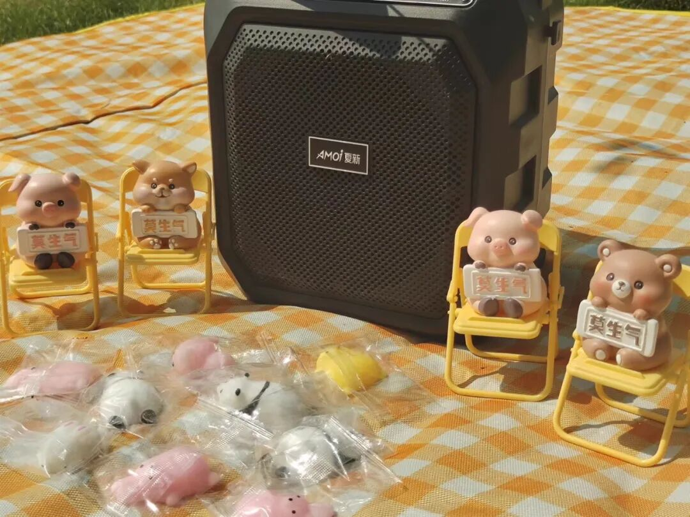
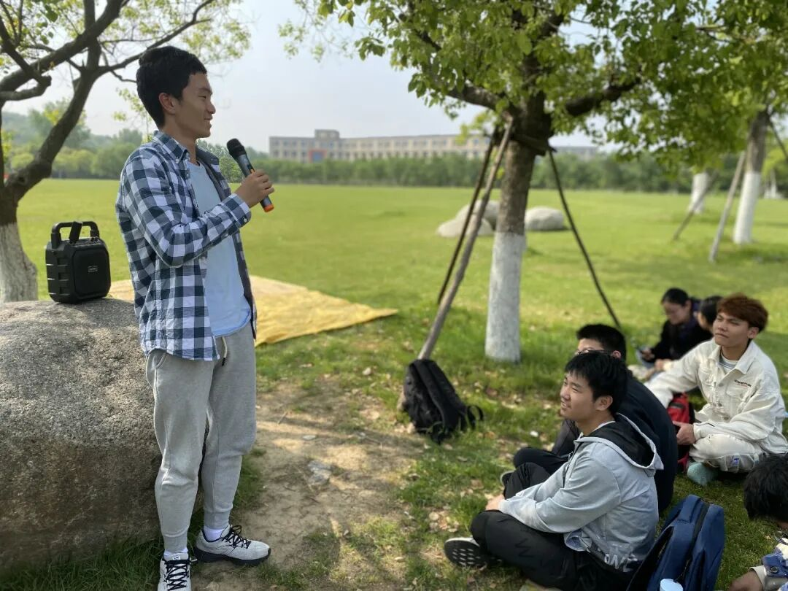
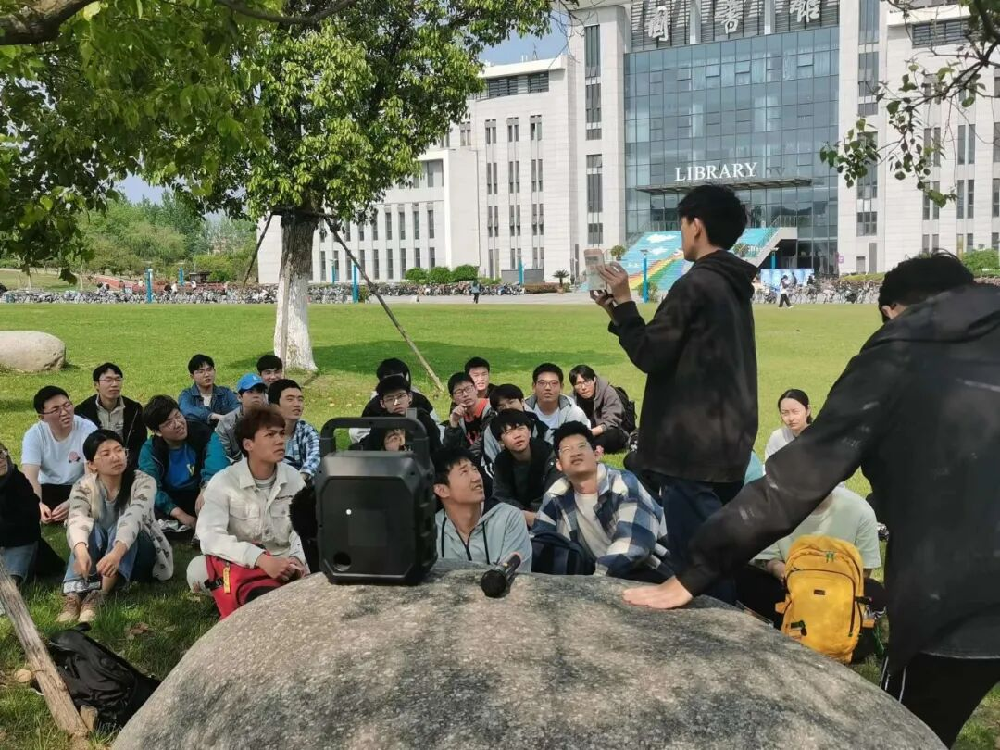
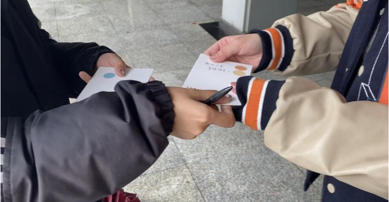
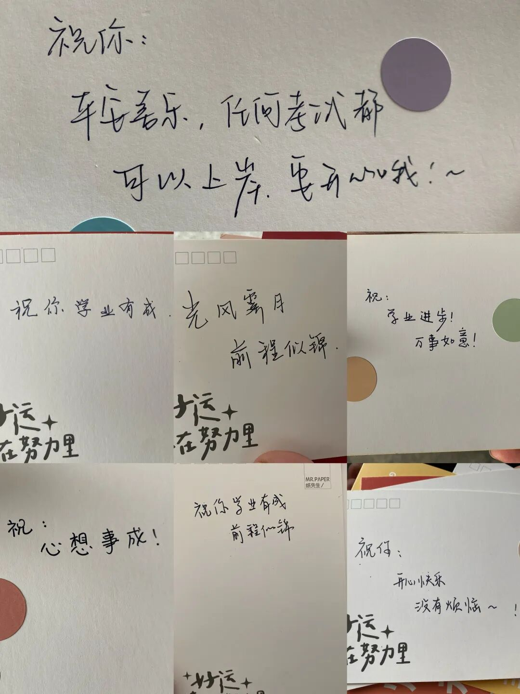

## 序章 · 待机模式的合法性

在计算机学科的语汇里，“空闲”（Idle）往往是一个带有隐蔽焦虑意味的词。

操作系统调度器时刻盯着 CPU 的利用率计数器，内存清理机制警惕着未被释放的缓冲区，而身处其中的工科生们，则习惯了把自己的日常精细切片：课程大作业的死线、实验室项目的阶段验收、刷题打卡的连续天数、开源仓库里密密麻麻的绿色小方块。在一种高度绩效化的默契中，我们把自己的大脑当成一台高并发服务器，生怕任何一个线程出现停滞。

然而，3月下旬的仙林，草坪上的泥土刚刚泛出湿润的青绿。鼎山脚下的缓坡上，有人铺开了一块黄白相间的格纹野餐垫。

没有投影仪，没有签到二维码，也没有任何关于“提升能力”的议程。在春分刚过的柔和日光下，这块野餐垫如同一块微小却坚定的飞地，向路过的人们发出邀请：==在高负荷运转的系统里，你被完全允许发一次呆==。

---

## 一、 草坪上的微小静物：夏新音响与“莫生气”

*初春草坪上的野餐垫、小夏新音响、四把黄色折叠椅与袋装捏捏乐。在庞大严谨的工科校区里，这些微小而略带童趣的物件构筑了一方柔软的防空洞。*

走近这块野餐垫，映入眼帘的不是任何高深莫测的技术设备，而是一组让人哑然失笑的微小静物。

正中央端坐着一台黑色的便携手提音响，方方正正的塑料外壳上嵌着一行略显复古的白色车标体：**Amoi 夏新**。它不是什么声学实验室里动辄上万的监听音箱，也没有沉重的低音炮支架，塑料提手在初春的微光下反射着温润的光泽。

围绕着夏新音响排开的，是四把巴掌大小的明黄色折叠小椅子。每把椅子上都“正襟危坐”着一只胖嘟嘟的树脂玩偶——粉色小猪、柴犬、小熊，怀里一律捧着一块工整的白色小牌，上面写着三个手写体汉字：“**莫生气**”。

野餐垫前沿散落着一堆巴掌大的透明塑料小袋，里面封装着手感软糯的“捏捏乐”：有趴着的熊猫幼崽、粉嫩的小猪，还有圆滚滚的黄色小雏鸡。阳光透过薄膜照在硅胶表皮上，折射出半透明的柔光。

> [!NOTE]
> **微物之神**  
> 现代心理学常提及“过渡客体”（Transitional Object）的概念：当成年人在宏大结构与高压现实中感到失控时，那些柔软、小巧、无害的具象物件，能以最温和的触感将神经系统重新拉回安全区。这几把黄色折叠椅和捏捏乐，恰是校园日常里不起眼却不可或缺的心灵解压阀。

平日里，计算机学科楼周围的一切都是规整的直角：钢筋水泥立柱、玻璃幕墙、整齐划一的机房机柜、黑底白字的终端命令行。唯独在这块垫子上，形状是圆钝的，色彩是明黄与浅粉的，诉求是“莫生气”这种近乎儿戏的质朴愿望。

许多脚步匆匆、背着厚重电脑包的同学在路过时都不自觉地放慢了步伐。有人蹲下身，伸出那双刚刚在键盘上敲完上千行代码的手，轻轻捏了捏小猪软糯的脸颊。那种毫无阻力的回弹感，瞬间化解了手指关节因长时间握持鼠标而积攒的酸胀。

---

## 二、 鼎山脚下的琴台：听一首歌需要多少理由？

在野餐垫的不远处，静卧着一块椭圆形的灰褐色景观石。在南邮校园里，这样的石头散落在草坪各处，平时只是一处静默的景观节点，但在这个下午，它成了一座天然的琴台。

*蓝白格子衬衫少年站在景观石旁握着麦克风轻唱，周围的同伴散坐在树荫下，目光落在他身上，也落在微风吹拂的草尖上。*

一位穿着蓝白细格子衬衫、浅灰运动裤的男生站上石旁的缓坡，手里握着一支无线麦克风。那台小巧的夏新音箱被挪到了巨石表面，麦克风开启时的轻微电流声在开阔的草地上散开。

没有华丽的伴奏，没有修音设备，也没有聚光灯。他微微偏着头，唱起了一首旋律舒缓的民谣。他的声线并不完美，甚至偶尔带着一点换气时的轻微顿挫，但那歌声顺着微凉的初春空气流淌开来，纯净得像刚刚解冻的溪流。

草坪四周，原本只是驻足张望的同学们陆陆续续席地坐下。

*香樟树影斑驳地洒在草地上，同学们围坐成一圈，视线越过绿茵，望向远处熟悉的图书馆大楼与彩虹台阶。*

三月的阳光穿过初展新绿的香樟树冠，在深绿的草地上投下细碎晃动的树影。坐在树影里的年轻人们姿态各异：
- 有人抱着双膝，下巴抵在膝盖上，眼神放空地望向远方；
- 有人把沉甸甸的书包垫在腰后，整个人后仰靠在微斜的草坡上；
- 有人低头拨弄着身边的草叶，嘴唇跟着麦克风里的旋律无声地合唱；
- 还有人抬起头，视线越过开阔的绿茵场，望向远处那座巍峨的南京邮电大学图书馆大楼，以及大门前那道平日里走过无数遍的七彩阶梯。

平日里，进入图书馆是为了争分夺秒地抢占靠窗座位、查阅文献、刷完下一套模拟卷；而此刻，隔着数百米的草坪远眺那栋大楼，建筑的压迫感退去了，它变回了仙林天际线下的一处安静注脚。

> [!TIP]
> **自然光与注意力恢复**  
> 环境心理学中的“注意力恢复理论”（Attention Restoration Theory）指出，长期专注于人造符号与屏幕会导致定向注意力严重疲劳。而大自然的“无意注意”刺激——如风吹树叶的沙沙声、树影的晃动、鸟鸣与草木气息——具有极高的疗愈价值，能让过度消耗的认知资源重新恢复弹性。

在这里坐着的半个小时里，没有人催促进度，没有人在意你刚才写出的代码是否通过了所有单元测试。==在歌声与树影里，每一个发呆的瞬间都是完全免罪的==。

---

## 三、 教二楼的过堂风：32封手写信里的纸面余温

如果说大草坪的音乐与微风是一次向外的呼吸，那么教学二号楼（教二楼）走廊里的另一幕，则是一场向内的触碰。

在数字化的大学里，信息传递的速度以千兆以太网和5G毫秒计算。微信群消息此起彼伏，未读红点像催缴通知单一样不断累加，“收到请回复”成了最普遍的社交口癖。而在高密度的即时通讯中，人与人之间的温度反而被稀释成了冰冷的比特流。

这天下午，教二楼明亮通透的走廊里，摆开了一张小桌。32张素雅的空白明信片整齐码放——恰好呼应着“3·20”这个特别的心理健康周节点。

*教二楼走廊的花岗岩地砖映着午后光线，两双手在微风中传递着明信片。没有屏幕的隔膜，纸张的厚度与墨水的重量重新回到指尖。*

活动规则极其纯粹：写下一段真诚的寄语，投进信箱，再随机抽取一张由另一位陌生同学留下的明信片。

照片里定格了一个极富动感的瞬间：
一位穿着黑色防风夹克的同学手握黑色水笔，手指因为用力而微微泛白；对面是一位穿着拼色棒球服的同学，袖口带着鲜明的橙色与藏青条纹。两双手在半空中交汇，两张素白的卡片在指尖完成交接。卡片右上方贴着莫兰迪色系的圆形贴纸，字迹尚带墨润。

走廊两端灌过微凉的过堂风，书页与衣角轻轻掀动。在屏幕背后隐匿了太久的年轻人，第一次这样毫无防备地面对面，将一份毫无功利企图的心意递到另一个陌生人的手心里。

*展开的明信片上写满工整真挚的祝福笔迹：“平安喜乐，任何考试都可以上岸”、“光风霁月，前程似锦”。每一笔划都是对另一个灵魂的温柔托举。*

翻开那些被定格的卡片，纸面上的笔迹千姿百态，却无一例外饱含诚挚：

> “祝你：平安喜乐，任何考试都可以上岸，要开心哦！～”  
> “祝你学业有成，光风霁月，前程似锦。好运在努力里。”  
> “祝：心想事成！”  
> “祝你：开心快乐，没有烦恼～！”

没有套话，没有官腔，甚至没有写信人的署名。在字迹的顿挫与连笔之间，你可以清晰地读出那个写字人当时的呼吸：也许是刚结束了一场令人精疲力竭的高数期中考，也许是刚刚被某个调试了三天的段错误（Segmentation fault）折磨得两眼干涩。然而当笔尖触碰到纸张的那一刻，他选择把最纯粹的祝福留给另一个素未谋面的同路人。

> [!IMPORTANT]
> **延迟满足的温存**  
> 键盘打字是瞬时的、可抹除的、不留痕迹的；而纸笔书写是物理性的、不可逆的。墨水渗入纸浆的纤维，每一个连笔和轻重缓急都记录着当事人的心跳。这种“慢下来”的表达，恰恰击中了被即时反馈规训得疲惫不堪的心灵。

---

## 尾声 · 晚霞漫过鼎山

太阳渐渐西斜，天边泛起仙林初春特有的粉紫色晚霞。

草坪上的夏新音响关掉了电源，最后一段吉他旋律消散在晚风里。同学们站起身，拍打掉裤脚粘着的草屑，拎起书包，重新走回通往食堂、图书馆和机房的沥青路上。

生活并没有发生奇迹般的逆转：待处理的代码分支依然挂在本地，明天的早八课程依然准时开讲，复杂的算法题依然需要花费几个小时冥思苦想。

但在那个草坪的午后，当你的手掌抚过微凉的草尖，当你听着夏新音箱里传来的散调歌声，当你把那张写着“光风霁月”的明信片小心翼翼夹进背包内侧——某种沉淀在系统底层的紧绷感，已经悄然松动了一寸。

我们终究不是无休止运转的机器。在这座庞大而高效的现代大学里，==允许自己发一次呆，不是逃避，而是给灵魂擦拭灰尘的时刻==。晚风吹过香樟树顶，夜色渐深，而明天依然会如约升起。
