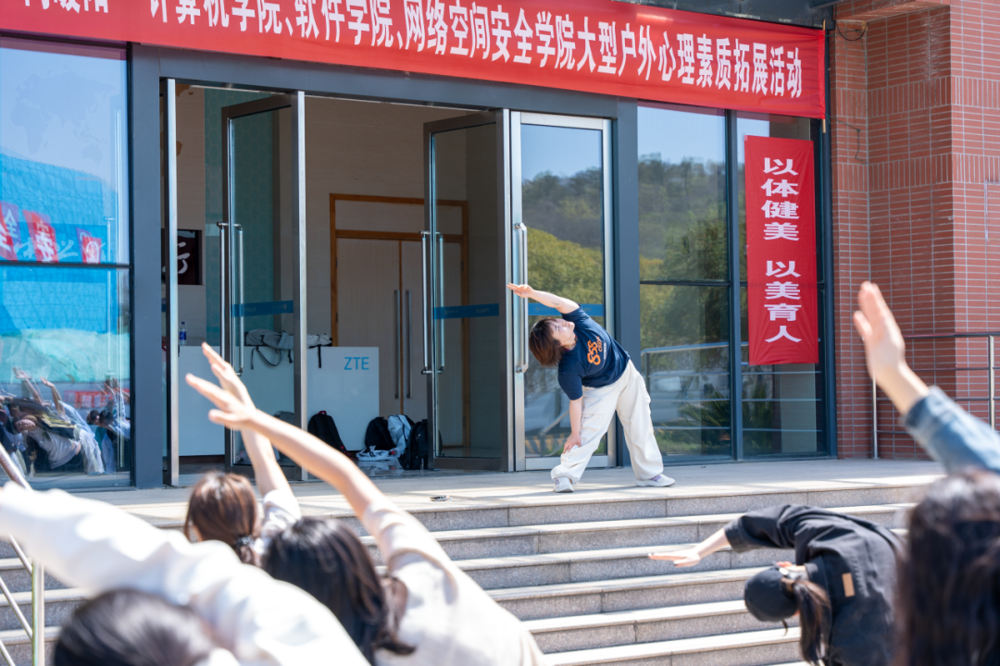
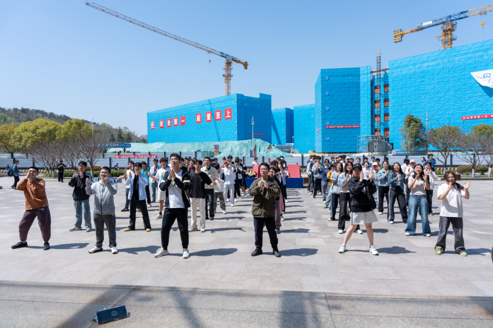
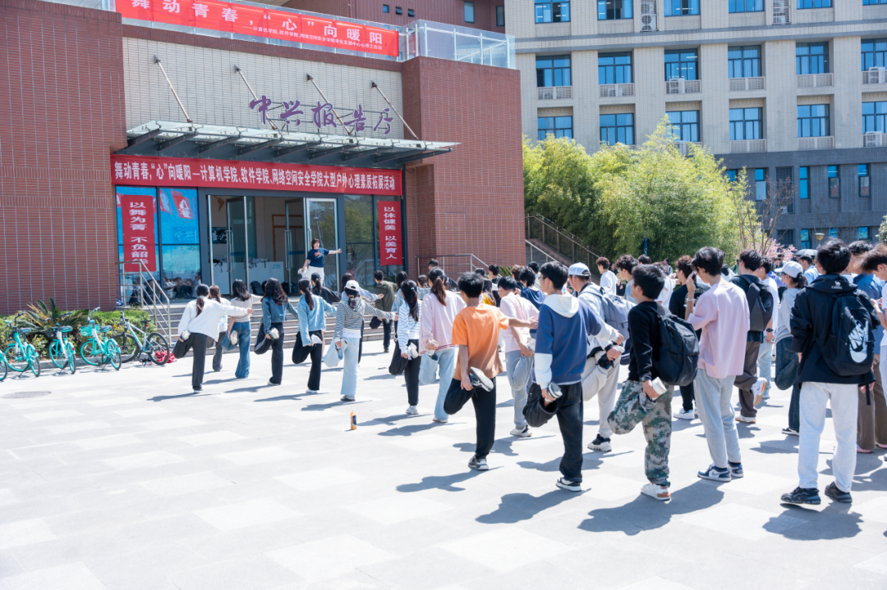
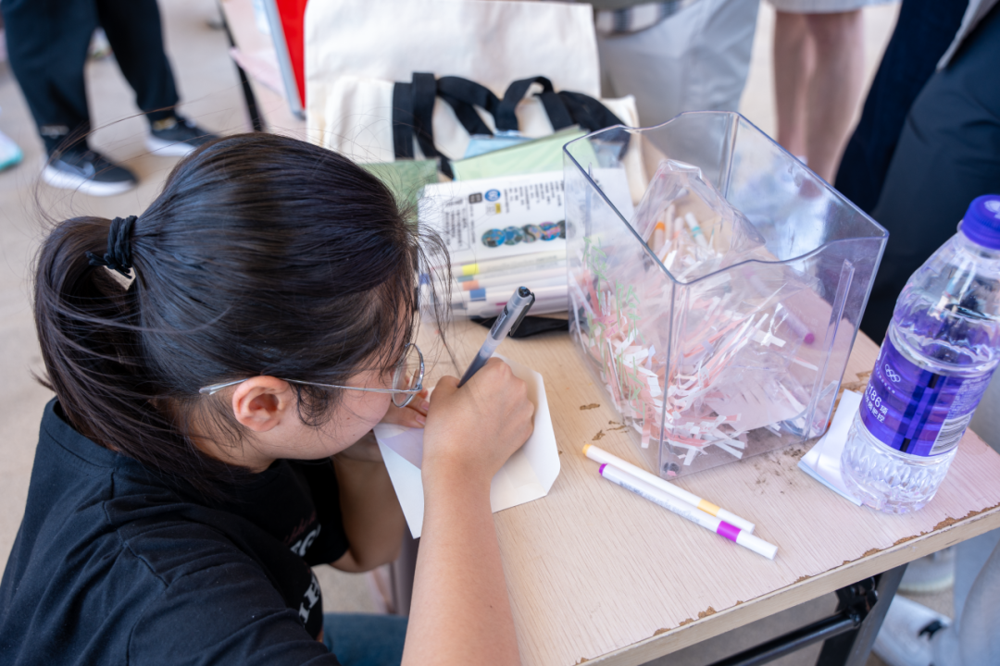
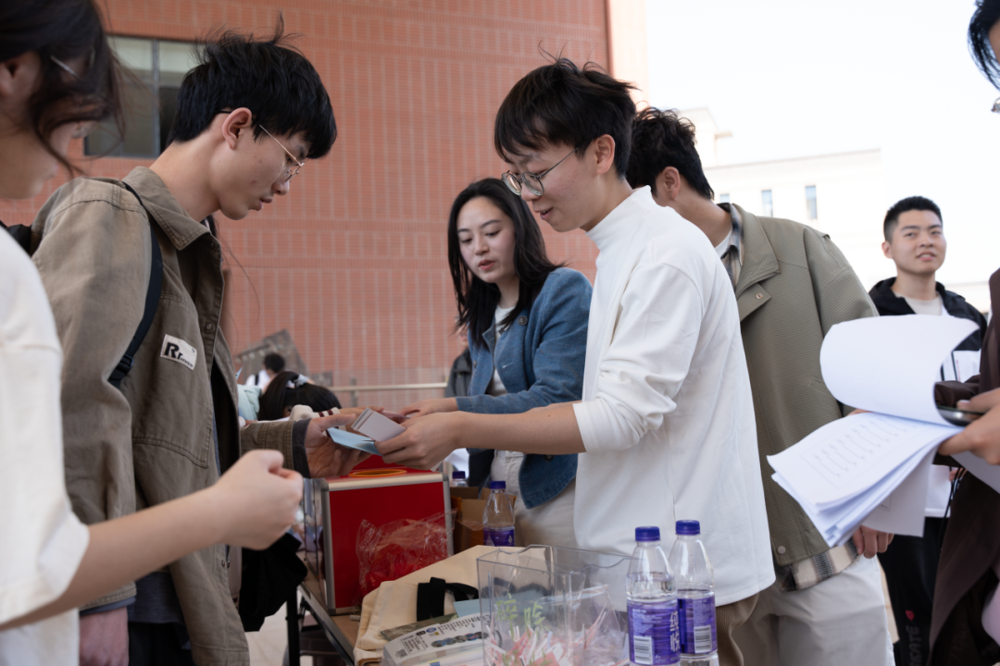
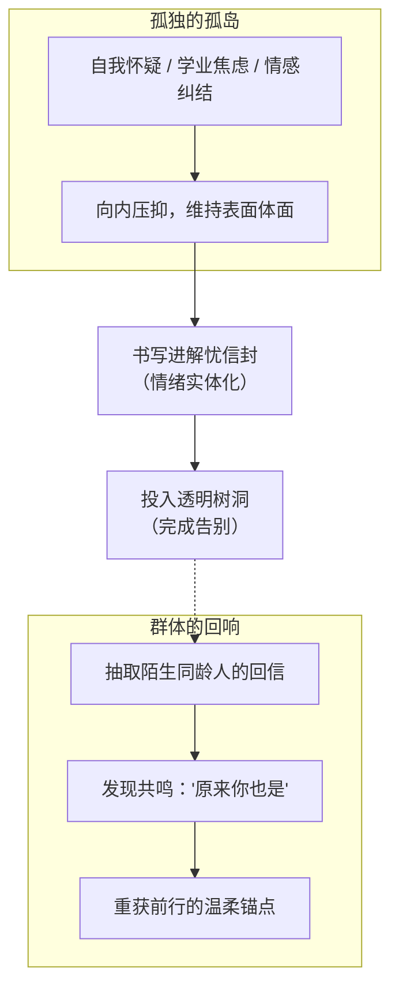
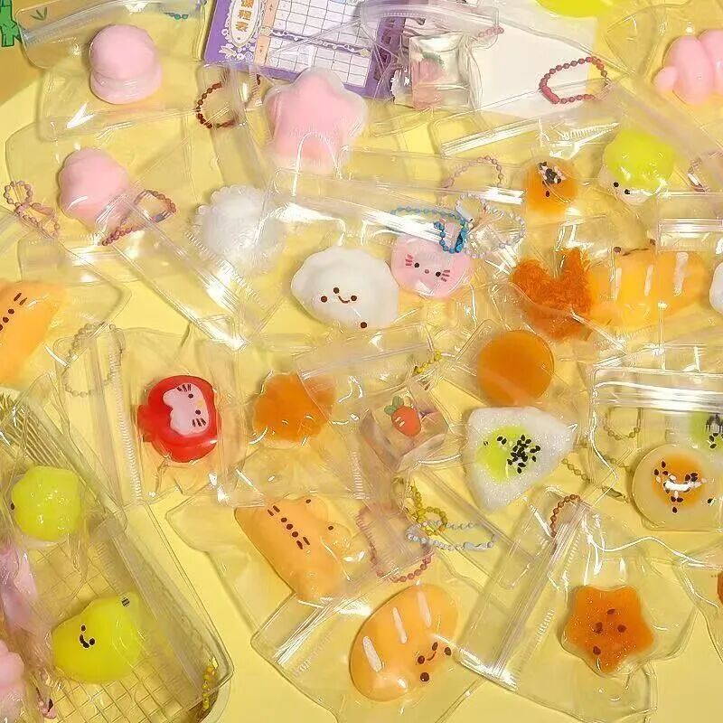

## 序章 · 屏幕是坚硬的护甲，也是沉默的消音器

在工科生的日常经验里，最让人感到踏实的是“确定性”。

输入一组参数，得到确定的返回值；触发一个逻辑分支，执行既定的回调函数。当现实世界的不确定性与人际摩擦让人疲惫时，电脑屏幕就成了一堵安全的防火墙。我们习惯了把焦虑压缩成深更半夜在编辑器里反复敲下的 Backspace，把迷茫伪装成浏览器标签页里密密麻麻的技术文档，把对未来的恐慌折叠进未曾推送的草稿箱。

屏幕接纳了所有的静默，却也无声地吞没了所有呼救。

每年五月下旬，初夏的燥热开始在仙林校园里蔓延。伴随着期末临近的课业重压、大三同学对升学与求职的迷茫、大四毕业生行将离校的惘然，年轻人的情绪缓冲区往往在这个时节逼近极限。5月25日——在这个谐音为“我爱我”的日子里，中兴报告厅周围悄然支起了几处不一样的摊位。

这是一场没有代码评审、不考察项目架构的聚会。它只是温和地向每一位习惯了戴着坚硬外壳生活的同学递出一句轻声询问：==有些话如果无法对屏幕倾诉，是否愿意在阳光下交托给真实的人？==

---

## 一、 广场上的破冰：在阳光下笨拙地舒展四肢

初夏的午后，阳光把中兴报告厅门前的浅灰色花岗岩广场晒得微微泛热。

平日里，这里是通往机房与实验楼的交通要道，同学们往往低着头、戴着降噪耳机，步履匆匆地掠过门前的红砖立柱。但在这个中午，广场上响起了轻快且富有律动的节拍。

*阳光穿透初夏澄澈的空气，中兴报告厅台阶上的红色标语醒目。老师侧身下腰、手臂舒展，台下的年轻人们齐刷刷抬臂仰望晴空。*

最先打破沉默的是身体的律动。

在马骞老师的带领下，平日里习惯了在椅子上弓背含胸、十指如飞的计算机系同学们，被“赶”到了开阔的台阶前。没有人在乎舞姿是否标准，也没有人苛求动作的协调。

照片定格的瞬间极具张力：红砖外墙前高悬着“以体健美 以美育人”的竖幅，玻璃门反射着对面白桦树与碧蓝的天空。站在最前方的老师身穿藏青短袖与白裤，侧身弯腰，手臂轻盈地划过半空；而台阶下的学生们背对着镜头，一只只手臂或高或低、齐刷刷地向着晴朗的穹顶延展。那些在工位上蜷缩了太久的肩胛骨与颈椎，在直射的日光下第一次毫无顾忌地舒展开来。

*在广阔的天空与远处的建筑塔吊之下，少年们合掌起舞。原本疏离的个体，在统一的节拍中找回了群体的共振。*

退后几步远眺，画面更显开朗与真实：
远处的工地上，蓝色的防护网与高耸入云的起重机塔吊勾勒出大学城飞速生长的轮廓；而在这片平整的广场上，三四十名年轻学子站成规整的队列。他们身着各色常服——白T恤、墨绿夹克、牛仔裤、球鞋——双手在胸前合十，目光专注而明亮。

*中兴报告厅前，学生们单腿独立、手握脚踝进行肌肉拉伸。左侧整齐停放着青绿色的共享单车，阳光把年轻的影子斜斜拉在地面。*

最富生活趣味的莫过于那张“金鸡独立”的拉伸特写：
左侧是倚着花坛整齐排开的一列青绿色哈啰单车，背后是静谧的翠竹丛；广场中央，所有人都试图把一只脚后跟扳向臀部，单腿立在花岗岩地面上保持平衡。有人重心不稳、左摇右晃地轻呼出声；有人笑着抓住身旁同伴的肩膀借力；长长的斜阳把每个人摇晃的影子清晰地烙印在石砖地上。

> [!TIP]
> **躯体化缓解与多巴胺**  
> 神经生物学研究证实，久坐与过度用脑会导致皮质醇（压力激素）水平持续偏高。通过大肌肉群的拉伸与身体节律运动，能迅速打破“大脑高负荷、身体低耗能”的代谢失衡，促使内啡肽释放。当你为了不摔倒而全力维持重心时，纠缠在脑海中的思维反刍会被物理性地打断。

---

## 二、 露台上的解忧树洞：被纸笔接住的暗夜思绪

如果说广场上的舞蹈是一次身体的释放，那么沿着楼梯走上中兴报告厅三楼的平台，空气则瞬间切换成了另一种静谧的质感。

这里设立了“解忧树洞——情绪交换计划”的现场摊位。

*短发女生伏在小木桌前认真书写信件，微风吹拂发梢。身旁透明亚克力箱里堆叠着各色手折便签，矿泉水瓶与荧光笔散落桌角。*

镜头俯拍下的那一幕极为动人：
一个梳着利落马尾辫、戴着细黑框眼镜的女生，整个人伏在木纹贴皮的小课桌上。五月的微风从露台围栏掠过，掀乱了她额角细软的碎发。她的右手紧紧捏着一支黑色中性笔，笔尖深嵌在白色信纸的折痕处，左手小心翼翼地护着信封边缘。

桌面上立着一只透明亚克力立方箱，里面已经堆了半箱淡粉、嫩绿与鹅黄色的裁切纸条。箱体表面用马克笔歪歪扭扭写着“碎碎念念”。桌上随意摆着几支双头荧光笔、一叠空白信封，以及半瓶喝剩下的紫盖矿泉水。

很难猜出她在那一刻究竟写下了什么：
- 也许是考研复习进度落后于预期的深深自责；
- 也许是某次面试中被问及底层架构细节时哑口无言的挫败感；
- 也许是同寝室友之间欲言又止的隔阂与委屈；
- 亦或是对遥远家乡某个亲人的思念与报喜不报忧的隐忍。

但在那个瞬间，她写得那么用力，以至于笔尖在木桌表面发出清晰的沙沙声。在透明的亚克力盒面前，她不需要假装情绪稳定，也不需要扮演一个独当一面的技术精英。==文字变成了最柔软的绷带，替她承接住那些沉重的叹息==。

*中兴报告厅三楼露台，身穿白色高领衫的志愿者双手递出信封，对面的工装外套男生微微躬身接纳，眼神专注而诚恳。*

在摊位的另一端，情绪的闭环正在发生。

穿着白色高领衫与卡其长裤的志愿者同学，正双手托着一只封好的淡蓝色信封，递给前来参与的工装夹克男生。红色的收纳盒敞开着，周围立着几位等待的同龄人。男生的视线落在信封上，嘴角带着一抹释然的浅笑。

根据规则，你留下的一封匿名烦恼，将被投递给未来的“解忧人”；而你此刻带走的，则是前一天另一位同学留下的真实回信。

> [!NOTE]
> **普适性治愈力量**  
> 心理学家欧文·亚隆（Irvin Yalom）在团体心理治疗中提出了著名的“普遍性”（Universality）概念：人们常常以为自己的痛苦、自卑与脆弱是世界上独一无二的怪物，因而感到深深的孤立。当人们发现“原来那么优秀的人也在失眠”、“原来他也在怀疑自己是否适合学计算机”时，病态的羞耻感便会瞬间瓦解。

---

## 三、 软萌微物：捏在手心里的反向缓冲

在嘉年华的另一侧，还有一个挤满了年轻人的小摊位——解压文创盲盒区。

*明黄色托盘上铺满了各式软糯微物：小柴犬、粉白猫爪、小吐司、金黄星星与三角饭团，每一只都等待着被一双疲惫的手掌攥紧。*

照片里的黄色托盘被各种硅胶捏捏乐挤得满满当当：
有带着粉红肉垫的白色猫爪、点缀着黑芝麻海苔的三角寿司饭团、两眼弯弯的烤吐司片、晶莹剔透的水果软糖造型、还有顶着两抹腮红的小柴犬。每一个都装在小小的透明自封袋里，配着细细的金色珠链。

许多同学领到这些小物件后的第一反应，就是毫不客气地用大拇指和食指狠狠凹陷下去。

那是一种奇妙的物理体验：无论你在上面施加多么剧烈的压迫，几秒钟后，它总会慢吞吞地、固执地恢复成最初那个浑圆可爱的模样。

> [!IMPORTANT]
> **触觉与情绪调节**  
> 触觉是人类最原始的感知通道。键盘的机械轴反馈是干脆、冰冷且不可妥协的；而慢回弹硅胶的触感却是包容、迟滞且完全接纳的。它不抗拒任何变形，并以无声的韧性化解所有突兀的冲力。

一位大三的同学把捏捏乐挂在了自己的黑色电脑包拉链上。在机房里每当程序跑崩、思绪陷入死胡同时，伸手捏一捏那个软乎乎的猫爪，似乎成了他应对焦躁的一种全新仪式。

---

## 尾声 · 操场夜风吹过未眠的仙林

黄昏退去，夜晚的凉风漫过了仙林校区的西区操场。

嘉年华的展板与小摊位已经收起，中兴报告厅的露台重新归于安静。但有些东西已经悄悄改变了。

操场的看台上，几个同学并排坐着，塑料袋里装着刚才兑换的微萌小挂件。跑道上夜跑的人影交错，塑胶跑道在夏夜蒸腾出淡淡的气味。大家有一搭没一搭地聊着天，手里把玩着白天从树洞里抽到的手写信笺。

“原来大家都在迷茫啊。”  
“是啊，我还以为只有我一个人天天失眠呢。”

笑声在夜风里轻轻荡开，没有经过扬声器的放大，却格外清晰。

我们所生活的时代，总是鼓励我们更快、更稳、更无懈可击。我们被要求像一块精密的芯片一样耐高温、抗干扰、永不宕机。然而，==承认自己的软弱，不是崩溃的开始，而是真正接纳自我的起点==。

操场上空的夏夜夜风吹动着额前的发丝，远处的鼎山在暗夜中如巨兽般静卧。手机屏幕在口袋里轻轻震动了一下，但这一次，你没有急着拿出来查看。在这片温柔的夜色里，你终于能踏实地吐出一口长气。
