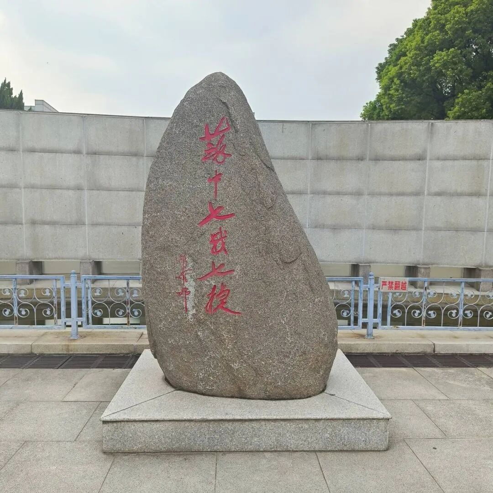
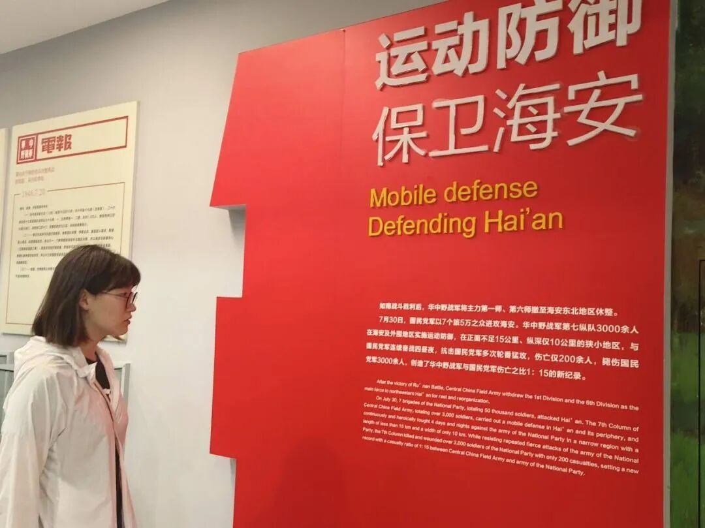
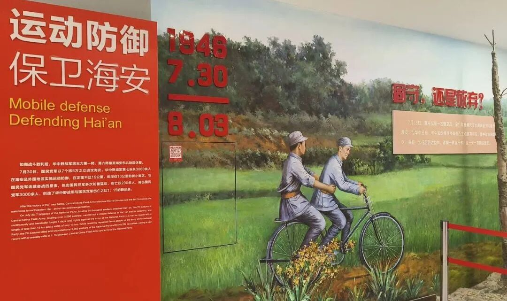
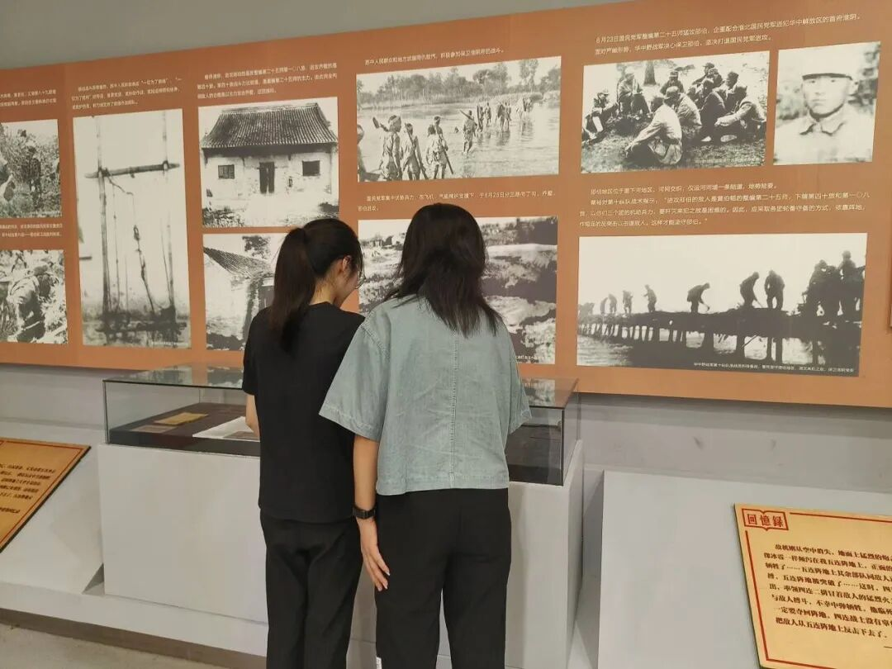
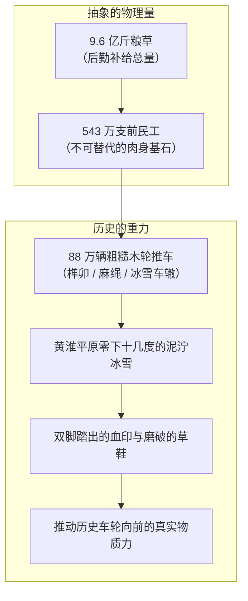
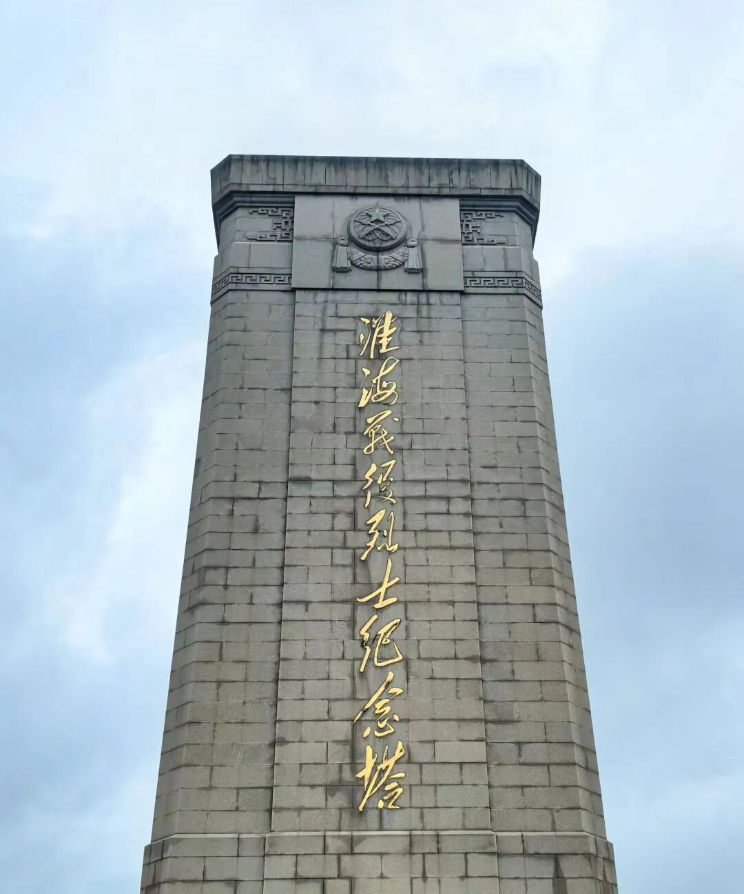
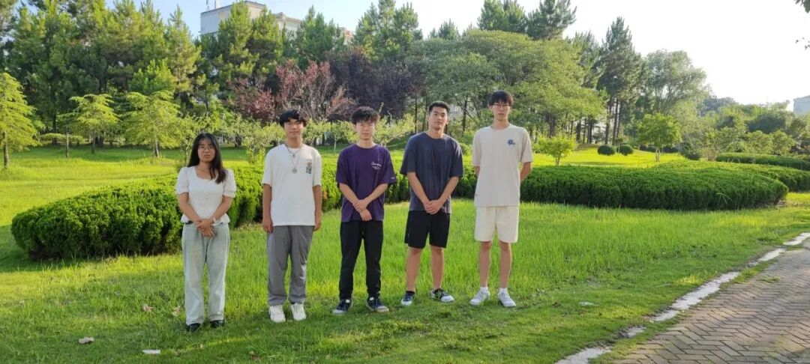

## 序章 · 符号世界的失重感

当代计算机学科的学生，往往生活在一个被高度符号化与抽象化的洁净世界里。

在这个世界里，“连接”是光纤与路由器之间纳秒级的数据交换，“运力”是一串衡量带宽吞吐量的浮点数，“调度”是几行优雅而冰冷的负载均衡算法。我们习惯了把手掌搭在温热平滑的人体工学键盘上，习惯了指尖划过电容触摸屏时的无阻尼触感，也习惯了在恒温恒湿的空调机房里，隔着玻璃窗俯瞰外面的风雨。

然而，技术的过度抽象，常常会给心灵带来一种不易察觉的“失重感”：当我们所经手的一切都在内存与晶体管中生灭，我们该如何锚定自己与真实土地、历史和劳动之间的血肉关联？

盛夏八月，炎阳将苏中平原与黄淮大地烤得滚烫。南京邮电大学计算机学院、软件学院、网络空间安全学院的学生发展中心实践团，背上行囊，从仙林校区出发，一路北上，先后走进了海安的“苏中七战七捷纪念馆”与徐州的“淮海战役纪念馆”。

这不是一次走马观花式的打卡游历。当那双敲惯了虚拟代码的双手，在昏暗的历史展厅里抚过那一辆辆粗糙斑驳的木轮推车时，==历史与劳动的真实物质性，如同一记沉重的钝响，击碎了符号世界的轻盈与悬浮==。

---

## 一、 苏中水网间的运动防御：泥泞中的行军与抉择

实践的第一站是南通海安。

八月的海安骄阳似火，纪念馆园区中央伫立着一块巨大的原石纪念碑。

*海安苏中七战七捷纪念碑石伫立在花岗岩基座上，粗粝的花岗岩肌理在阴天漫射光下呈现出深沉的青灰色，“苏中七战七捷”六个红漆大字深凿入石。*

整座石碑未经多余的人工雕琢，保留着天然巨石嶙峋的棱角与风化裂纹。它如同一位沧桑的守望者，静静立在水泥护栏与常青乔木之间。

走进陈列展厅，冷气驱散了室外的热浪，但展厅内部浓重的历史气息却让人心神一凛。

*展馆鲜红的“运动防御 保卫海安”标语高耸立于白墙前。戴眼镜的短发女生微微躬身，视线穿透展柜玻璃，凝视着1946年7月30日那份字迹细密的泛黄电报。*

在“运动防御 保卫海安”的红色立面展墙前，实践团的同学停下了脚步。

照片里，一位戴着红黑框眼镜的短发女生俯下身子，目光久久停留在那份泛黄发脆的历史电报前。展板上的文字平实却惊心动魄：
> “如南战斗胜利后，华中野战军将主力第一师、第六师撤至海安东北地区休整……7月30日，国民党军以7个旅5万之众进攻海安。华中野战军第七纵队3000余人在海安及外围地区实施运动防御，在正面不足15公里、纵深仅10公里的狭小地区，与敌昼夜连续奋战四昼夜……”

5万对3000。在数字逻辑的二元世界里，这是一个胜率为零的算法死局。

然而在1946年夏天的苏中大地上，胜负的变量从来不只写在兵力账面上。展厅拐角处是一幅巨大的历史写实油画。

*油画中苏中平原的稻田与灌木丛生，战士推着二八大杠自行车疾驰，后方乡亲们拉着木板车运送弹药。泥泞的车辙深陷在黄土路面，传递出逼人的重力感。*

油画细腻地还原了当年的运输场景：
没有柏油公路，没有机械化卡车，战士和乡亲们推着沉重的“二八大杠”自行车与独轮车，车架两旁挂满了装有小米、弹药和绷带的麻袋。泥泞的稻田小径将车轮死死咬住，推车人的小腿肌肉紧绷，青筋暴起，草鞋深陷在黑褐色的烂泥里。

苏中九百万人民，用摇橹的木船、用磨破鞋底的脚步、用自家门板拆下的木材，在密如蛛网的水网沟壑间构筑起了一条打不烂的补给线。

> [!NOTE]
> **物质性的重量**  
> 在现代战争与信息战的推演中，人们习惯了卫星制导与无人机航迹等高维视角。但唯有走进历史展馆，触摸那一张张布满褶皱的手令、看到被水汽浸透的草鞋，你才会明白：任何战略构想的落地，都依赖于物质在物理空间中的真实位移，依赖于千千万万副血肉之躯在烂泥里的跋涉。

---

## 二、 淮海的独轮车：八十八万辆木轮碾出的历史引力

从海安向西北行进数百公里，实践团抵达了徐州凤凰山东麓的淮海战役纪念馆。

这里的建筑体量更加雄浑壮阔。

*徐州淮海战役纪念馆正门。绛红色的砂岩墙体在斜照的日光下泛着厚重的赭石色，“淮海战役纪念馆”七个金字沉稳凝练，头顶是通透的钢构玻璃穹顶。*

步入展厅，光线逐渐暗淡下来。在长达数十米的历史长廊两侧，黑白历史照片如同一卷沉默的胶片，无声地向两侧延展。

*两位女同学静静伫立在历史影像墙前。墙面上是黑白泛黄的涉水行军与战壕抢修照片，下方的白色展柜里陈列着泛黄的《回忆录》，记录着当年支前前线的真实心声。*

实践团的两位女同学在展柜前伫立了很久。

玻璃展柜里静静躺着一页手抄的《回忆录》，红色的边框里用毛笔蝇头小楷记录着当年阻击战的残酷细节：
> “敌机则从空中俯冲，地面上连低凹的地面……五连阵地被敌人的猛烈炮火撕裂……这一仗，四连第二排只有二排长活了下来，其余人全部壮烈牺牲……”

而在回忆录的旁边，正是那辆举世闻名的支前小推车。

车身完全由北方的硬杂木手工榫卯拼成，车架两旁已经被数千斤粮食的摩擦打磨得发亮，但车轮外沿却布满了深刻的伤痕与木刺。车轴处由于缺乏润滑油，常年用蓖麻油或动物油脂浸润，散发出一股混合着尘土与汗水的沉重气息。车辕两端磨出了两个深深的凹窝——那是支前民工常年用手掌死死扣住、用肩膀上的麻绳背带拼死拉扯留下的印记。

陈毅元帅曾感慨：“淮海战役的胜利，是人民群众用小推车推出来的。”

那一刻，展板上的这串数字不再是教材里的枯燥统计：
- 支前民工：**543万人**
- 随军担架：**30.5万副**
- 大小车辆：**88万辆**
- 运送粮食：**9.6亿斤**

那是怎样的场景？在1948年那个滴水成冰的寒冬，八十八万辆木制独轮车，车轴发出“吱呀、吱呀”的刺耳尖鸣，车轮压碎黄淮平原上的坚冰与冻土。没有内燃机，没有充气橡胶轮胎，只有粗布棉袄、破烂草鞋和冻得开裂淌血的脚后跟。

> [!IMPORTANT]
> **劳动的物质性与技术伦理**  
> 现代程序员的工作常常是“免于摩擦”的（Frictionless）：代码可以通过网络瞬间分发到全球各地的服务器上。然而，正是这种极度的便利，容易让人产生一种认知错觉，误以为世界是轻飘飘的、纯粹由信息构成的。淮海战役的独轮车像一记重锤敲响了警钟：人类社会最根本的生存与变革，从来都扎根在最原始、最沉重、充满血汗的物质劳动之中。

---

## 三、 纪念塔下的长夏：当目光从大地投向苍穹

走出纪念馆幽暗的陈列厅，夏日的强烈日光骤然洒在脸上，让人有些睁不开眼。

穿过参天的雪松与侧柏林荫道，淮海战役烈士纪念塔巍然耸立在凤凰山顶。

*苍灰色的石砌塔身笔直刺入青天，金色的“淮海战役烈士纪念塔”题字在苍穹下熠熠生辉。塔顶的红五星徽记在流云中沉静肃穆。*

整座纪念塔由成千上万块规整的花岗岩石条砌筑而成。塔身高耸入云，四周回荡着风吹过松针的沙沙声。石碑基座处，每一块石料的接缝处都被岁月风雨侵蚀出细微的痕迹，但整体结构却坚固如初。

实践团的五位年轻人在纪念塔下的草坪旁留下了合影。

*五位实践团成员并肩立在盛夏的草坪前。背后的松柏郁郁葱葱，正午的阳光透过树叶在白色与深色T恤上留下跳动的光斑。没有造作的摆拍，每个人的面容平静而坦荡。*

照片中的五个年轻人并肩站在林荫道旁：
一个女生穿着白衬衫和淡灰长裤，四个男生穿着各色T恤与运动鞋。阳光斜斜地穿过浓密的树冠，在他们的肩头和草地上投下跳跃的金色光斑。他们的脸上没有浮夸激昂的表情，唯有一种经历过历史洗礼后的沉静与坦然。

在这趟行程的起点，大家或许只是把它当成暑期社会实践的一项规定课题；但在亲手触摸过苏中的战地电报、在淮海的小推车前凝视过车辕上的凹槽之后，某种关于“真实感”的种子已经在心中悄然生根。

> [!TIP]
> **从虚拟回归具身经验**  
> 认知科学中的“具身认知”（Embodied Cognition）理论指出，人类的高阶智慧并非脱离身体的独立算力，而是深度根植于身体与物理世界的互动。走出机房、在烈日下行走万步、亲临历史现场的实践，不仅是一次精神洗礼，更是对工科青年具身感知力的一次深刻重构。

---

## 尾声 · 手掌的重量

返回南京的高铁在傍晚的高架桥上飞驰。

车窗外，苏北平原连绵不绝的夏日田野在暮色中飞速后退，远处村落的炊烟在粉紫色的晚霞中渐渐弥散开来。

车厢里很安静，实践团的同学靠在椅背上闭目养神。有人把笔记本电脑放在小桌板上，屏幕上跳动着待整理的实践日志与问卷分析图表；但在键盘上方悬停片刻后，他的手指并没有立刻敲击下去。

他低下头，看了看自己的掌心。

那是一双典型的当代大学生的手：白皙、纤细、指腹因为长年敲击机械键盘而带有轻微的平滑磨损，手腕内侧因为摩擦鼠标垫而留有一抹淡淡的暗红。

但就在几个小时前，这双手曾隔着防护栏，隔空抚摸过那辆布满木刺与深深刻痕的独轮推车。

世界终究会朝着更高级的自动化与智能化演进，代码会越来越简洁，算法会越来越强大，网络吞吐量会越来越惊人。==但那些真正托举起一个民族、改变历史走向的力量，永远不是漂浮在云端的幻象，而是无数双粗糙的手、无数双沾满泥巴的草鞋，以及对脚下这片土地最深沉的托付==。

窗外暮色四合，高铁平稳地驶入仙林站。走出车厢的瞬间，迎面扑来南邮夏夜熟悉的湿热晚风。手掌插进裤兜，脚步落在站台坚实的水泥地面上，每一步都踏得格外安稳。
