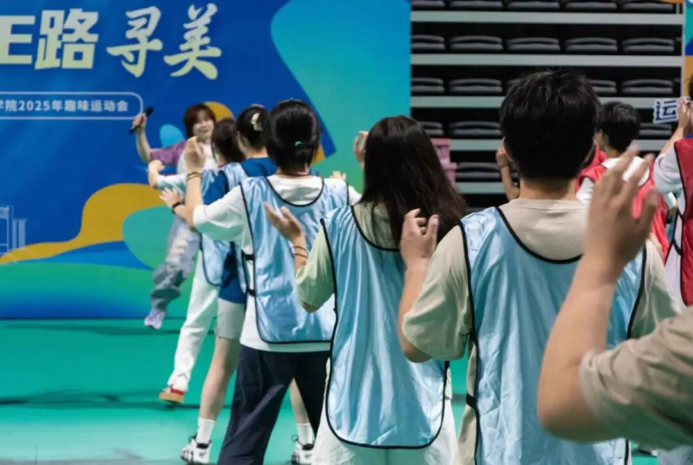
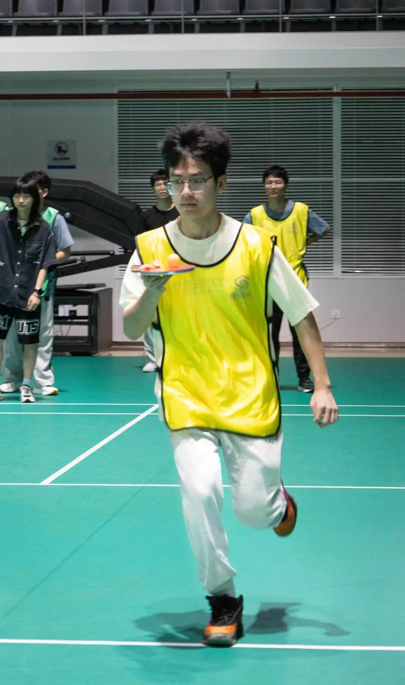
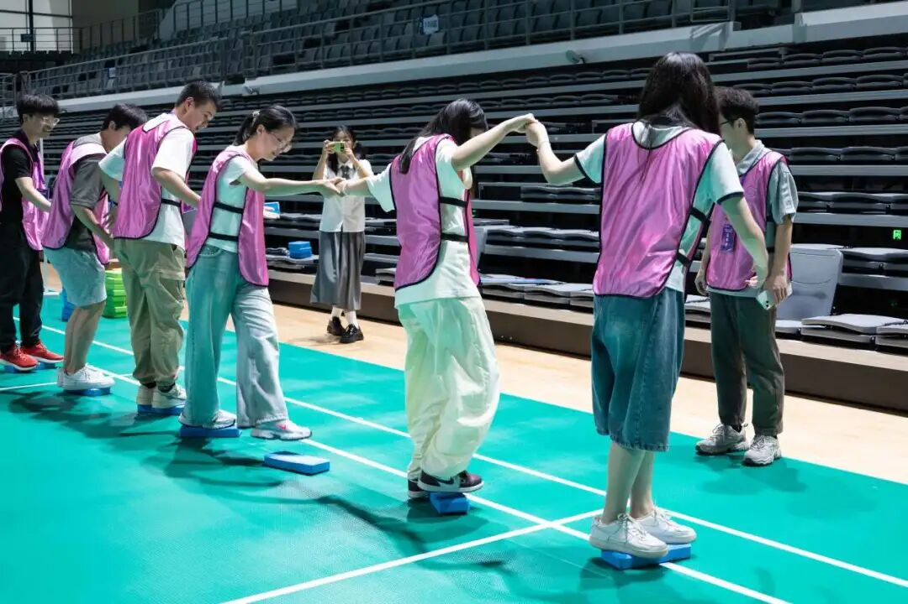
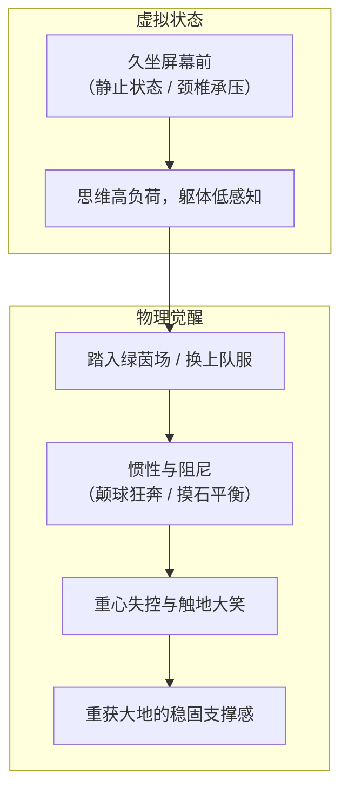
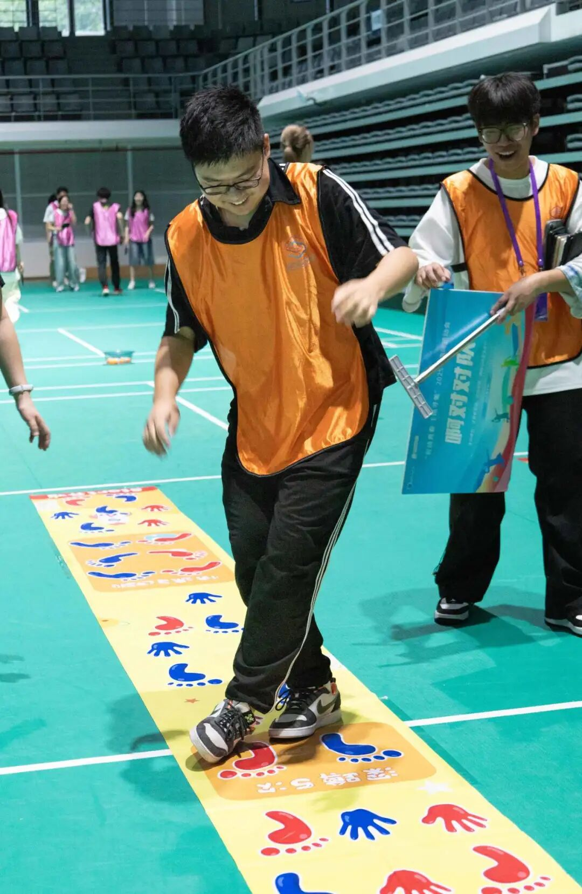
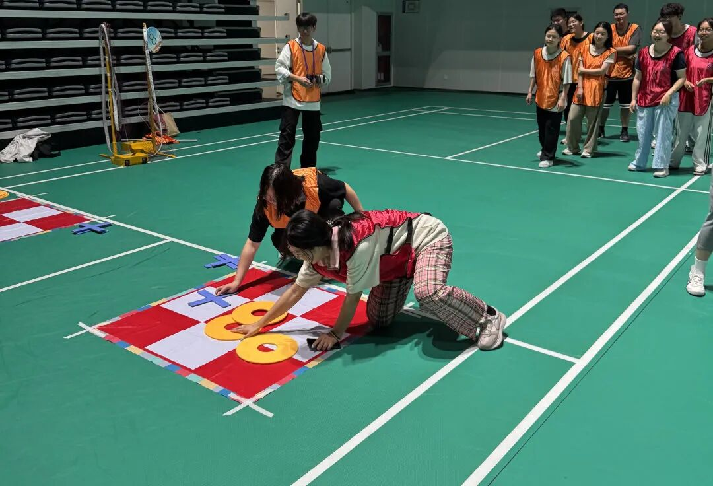
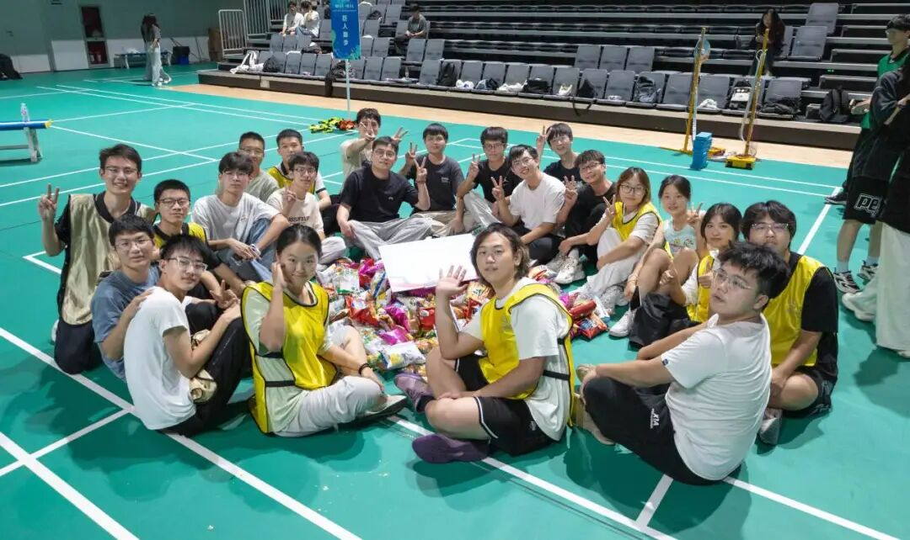

## 序章 · 被忽略的物理躯体

在大学里学计算机与网安，生活空间往往会被极度压缩：

物理空间被折叠在寝室椅子与机房工位之间，感知维度被收拢在24寸4K显示器的发光像素里，连日常运动量也被精准简化为食堂窗口与电梯门之间的几百步。

长时间的伏案编码塑造出一种独特的“工科生理特征”：向前倾斜的颈椎、发僵的手腕神经、习惯于低能耗运作的呼吸，以及一具仿佛仅仅为了“把大脑运送到下一间教室”而存在的肉身。我们在虚拟逻辑的赛道上跑得极快，现实世界里的身体却在重力的遗忘中渐渐钝化。

6月初的仙林，初夏的暑气已经开始在露天柏油路上蒸腾。在南京邮电大学的体育馆里，十支队伍顶着各色解构严肃的滑稽队名聚在了一起——“打饭不被插队”、“马导说的都队”、“啊对对队”、“研来是我们”。

没有刻板的比分榜，没有严苛的体能考核。当这群终日与符号为伴的年轻人们踩上带有弹性的塑胶场地时，一场==找回重力、重心与失控大笑的身体实验==正式拉开了帷幕。

---

## 一、 笨拙的启程：当肢体摆脱静止状态

*体育馆的绿地胶泛着清凉的反光。背对着镜头的同学们身着天蓝色背心，跟着前方领操老师的口令扬起手臂。平日习惯敲击键盘的僵硬肩背，在第一组开合跳中逐渐舒展开来。*

运动会的开场热身操，是一次充满喜感的“系统唤醒”。

平日里在讲台上神情严肃的辅导员与专业老师，在欢快的舞曲前奏中带头做起了扩胸与跳跃。台下几十号平时习惯了安静自习的同学，神态各异地跟着扭动：
- 有人四肢僵硬，像一台刚刚冷启动、关节还未润滑的机器；
- 有人左右手同手同脚，自己还没察觉，身后的队友已经笑得前仰后合；
- 有人略带拘谨地随着节拍轻轻颠动脚尖，直到几轮大动作的热身过后，额头上沁出了微细的汗珠。

那种长久以来凝固在机房里的矜持与疏离感，在第一支音乐的高潮处被笑声彻底冲散了。

> [!NOTE]
> **本体感觉的再激活**  
> 生理学上的“本体感觉”（Proprioception）指人体对各部分位置与运动状态的内在感知。久坐的人，大脑皮层体感区的输入信号长期被抑制在键盘与鼠标的方寸之间。全身体育运动的本质，是强迫神经系统重新测量四肢的重量与空间的界限。

---

## 二、 极限重心：在失控与平衡的刀刃上

接下来的项目，彻底将工科生们“算无遗策”的理智抛进了物理重力的混沌中。

最令人屏息凝神的是“极速传递”。

*蓬松微卷的黑发在奔跑中飞扬，黑框眼镜后的双眼凝视着球拍中央。橘红色乒乓球在胶皮上急剧颤动，少年压低重心全力冲刺，每一步都在与惯性极限博弈。*

照片抓拍到了一个极具张力的动态切片：
一个戴着黑框眼镜、身着白T恤和荧光黄号码背心的清瘦男生，正跨着大步从羽毛球场地一端疾驰而来。奔跑带起的逆风将他蓬松的头发全部吹得倒竖起来，额头上的汗水在吸顶灯下闪着光。

他的右手平平地横托着一块红黑双面的乒乓球拍，球拍正中央，一枚橘红色的小球正处于剧烈弹跳的边缘。他的目光紧紧锁死在那个微小的球体上，身躯略微前倾，膝盖弯曲以吸收脚步落地时的每一下冲击。

在那个瞬间，没有多余的杂念。他既不能跑得太慢以免落后赛程，又不能冲得过急以防小球脱轨抛飞。==所有的注意力从浩瀚的虚拟抽象中抽离出来，全部凝聚在掌心与那一颗小球的毫厘平衡之间==。

而在隔壁场地上，另一种关于“平衡与协作”的滑稽博弈正在上演——“摸石头过河”。

*身穿亮粉色背心的队员们紧紧攥住身旁同伴的双手，双脚踮在巴掌大的蓝色泡沫砖上。身体向一侧倾斜的瞬间，本能的抓握代替了所有语言。*

规则极其刁钻：队员们只能踏在几块有限的蓝色高密度泡沫砖上横穿半场，脚底一旦触碰绿地胶就算出局。

照片里，四个穿粉色罩衫的女孩子排成一行，双脚紧紧并拢踩在巴掌大小的蓝方块上。为了不失去平衡摔倒在地，她们两两十指相扣，手臂绷得笔直，身体像风中的麦穗一样同步倾斜。原本互不相熟的同系同学，在重心摇摇欲坠的千钧一发之际，毫无保留地把自己的全部重量挂在了身旁人的胳膊上。

跌倒与惊呼此起彼伏，而紧随其后的就是毫无顾忌的大笑。

---

## 三、 地面上的摔倒与狂欢：卸下一切体面

真正的运动会高潮，属于那些让人完全放弃“偶像包袱”的瞬间。

*黄色地垫上印满了错综复杂的红色脚印与蓝色手印。男生交叉双腿拧成了麻花状，脸颊涨得通红却笑得见牙不见眼，右侧同伴高举着“啊对对队”的队旗笑弯了腰。*

在“手脚并用”这一关，一条印满了红黄蓝三色手印脚印的长条地垫铺在场地正中。参赛者必须按照垫子上的指示，手脚严格踩对相应的掌印图案向前推进。

照片上的男生穿一件橙色背心与黑白阿迪达斯运动裤，双腿几乎拧成了一根麻花。左脚踩在右侧的蓝脚印上，右脚别扭地跨到了身体外侧，上身前弓，双手在半空扑腾以防摔倒。戴眼镜的面庞上洋溢着一种毫无掩饰的纯粹快乐——那是孩童在泥巴地里打滚时才会有的神情。

一旁拿着写有“啊对对队”队旗的队友已经笑得直不起身，手里的文件夹险些脱手。

而在“极速三子棋”的赛场上，竞争的火药味与喜感更是达到了顶峰。

*羽毛球场地中央铺着红白格简易棋盘。两位女生双膝跪地、飞扑上前，手指死死按住金黄色的圆环道具，全力以赴地封堵对手的连线。*

平日里在自习室轻声细语的姑娘们，在倒计时的催促下完全顾不上衣服蹭上灰尘。她们飞奔到场地中央，整个人顺势跪滑在地胶上，双手各自握着鲜黄色的塑料圈，在红白棋格前展开争分夺秒的布局与围堵。膝盖撞击地胶的闷响、周围拉拉队扯着嗓子的尖叫、棋子落定那一刻的欢呼，交织成一曲充满野性生命力的合奏。

> [!TIP]
> **游戏感与无目的性快乐**  
> 荷兰文化史学者约翰·胡伊青加在《人：游戏者》中写道：真正的游戏必须是自愿的、脱离日常功利的、能够让人完全沉浸其中的。现代大学生承受着过多关于“产出”（Output）与“效用”（Utility）的拷问，而一场规则荒诞、输赢都好笑的趣味运动会，赋予了年轻人沉浸于“无用之欢”的正当权利。

---

## 四、 零食山与席地而坐：最原始的群体归属

两个小时的高强度折腾接近尾声，哨声吹停了最后的抢零食大战。

没有人急着清点奖项与积分，大家带着满身淋漓的大汗，毫无顾忌地顺势瘫坐在了场地中央。

*羽毛球场的绿地胶上堆成了一座零食小山。二十余位满头大汗的同学席地盘腿围坐一圈，比着剪刀手、挥着掌心，汗水把额前的刘海粘在皮肤上，眼角全是被逗乐的笑意。*

场地中央的白板周围，堆起了一座由薯片、膨化脆角、海苔和小蛋糕拼成的“零食山”。

二十几双球鞋散乱地蹬在绿地胶上，大家盘腿围成了一个巨大的圆圈：
- 跑得两颊通红的女孩一边擦汗，一边顺手撕开一包薯片塞给旁边的队友；
- 刚刚在三子棋里拼得面红耳赤的对手，此刻坐在一起碰着手里的电解质饮料；
- 有人对着镜头比出帅气的剪刀手，有人则毫无包袱地咧着大嘴冲着镜头做鬼脸。

在这一刻，你看不出谁绩点第一，谁刚刚斩获了算法竞赛金牌，谁正在为毕业去向彻夜难眠。

汗水顺着脸颊滑落进领口，微咸的汗味与体育馆橡胶地坪的特有气息混合在一起。平日里隔着网线和屏幕的那层看不见的隔阂，在这场剧烈的肢体碰撞与气喘吁吁中，被彻底融化得干干净净。

> [!IMPORTANT]
> **接地的重力**  
> 哲学家韩炳哲曾提醒人们警惕数字时代身体的退场：当一切交往都变成轻盈的屏幕滑动，人就会失去与大地的阻抗与摩擦，陷入悬浮的虚无感。只有当你真实地在地面上摔过一跤、肌肉感到酸痛、肺部吸进大口冷空气时，你才会笃定地确认：自己真实而热烈地活着。

---

## 尾声 · 走出场馆的晚风

中午时分，阳光正烈。

体育馆的大门被推开，年轻人们三五成群地走出来，手里提着分发完的零食包装袋。阳光穿过仙林道旁的绿树，明晃晃地落在被汗水打湿的发梢上。

大腿前侧的肌肉微微泛起酸痛，膝盖上还留着地胶摩擦出的浅淡红印，但胸腔里的每一次呼吸，都比清晨坐在机房里时要绵长、深沉得多。

代码是严密的、逻辑是抽象的、网络是轻盈的，==但承载这一切的，终究是这具会疲倦、会奔跑、会笨拙跌倒又会肆意大笑的血肉身躯==。

微风吹起被汗浸透的T恤衣角，走出场馆的少年们并肩走向食堂，步履轻快得像刚刚卸下了一整车沉重的包袱。
