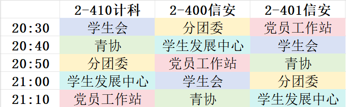
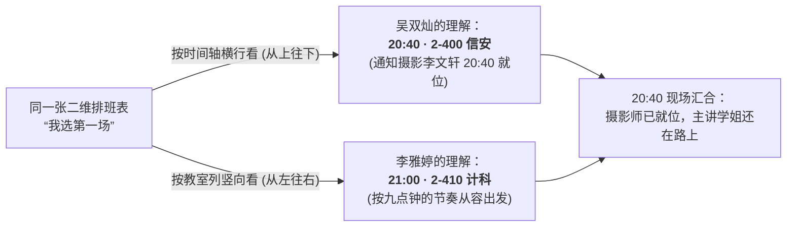

## 01 · 晚自习走廊里的十分钟齿轮

2026 年 10 月 12 日晚八点半，仙林校区教二楼四层的走廊里比平日更加热闹。

按照学院迎新招新的统一协调，这一晚的 20:30 至 21:20 之间，**学生会、分团委、青年志愿者协会（青协）、党员工作站与学生发展中心**五个团学组织，需要在 `2-410 计科`、`2-400 信安` 与 `2-401 信安` 三间晚自习教室里，以每十分钟为一格的节奏，完成高密度的错峰穿插宣讲。

*十月十二日晚间宣讲排班表：三间教室、五个组织、每十分钟一次的精密咬合。谁也没想到，这张看似一目了然的彩色表格，会在当晚酿出两场让人忍俊不禁的乌龙。*

在此前九月初面向计科与软工的大场宣讲中，主要由执行主席**吴双灿**与媒体宣传部分管主席**李雅婷**搭档完成。面对十月中旬这场三教室轮转的晚自习专场，最初的设想是由四位主席共同分担。

排班前夕，当吴双灿在群里征询大家的时间时，心理工作部分管主席**杨婉露**恰好在当晚有一门线上专业直播课。得知排班紧迫，她第一时间主动表示：“如果实在太缺人，你和我讲，我去请个假。”

吴双灿当即婉拒了让她请假的提议。在学生发展中心内部，始终有一条朴素的默契：**专业课业永远排在社团事务之前**——把课听好、把本专业知识学扎实，学长学姐自己保持优秀，本身就是给大一新生最好的引路示范。

于是，当晚的阵容很快敲定：易班建设部分管主席**杨庭益**认领 21:10 的压轴场，吴双灿与李雅婷负责前面的场次，媒体宣传部的**李文轩**同学则背上相机，负责在三间教室之间跟进拍摄记录。

一切看似安排得妥帖周全，直到那张二维排班表开启了它奇妙的“视角玩笑”。

---

## 02 · 第一场乌龙：横看是 20:40，竖看是 21:00

仔细端详上面那张 5 行 × 3 列的排班表，会发现代表“学生发展中心”的三个浅蓝色格子，恰好散落在不同的行列坐标上：

- **20:40** · `2-400 信安`（第二列、第二行）
- **21:00** · `2-410 计科`（第一列、第四行）
- **21:10** · `2-401 信安`（第三列、第五行）

在杨庭益定下最后一场后，吴双灿把排班表截图发给李雅婷：“前面两场你愿不愿意选一个？”

李雅婷看了一眼表格，爽快地回答：“**第一场吧！**”

戏剧性的错位，就在这短短四个字里悄然埋下了伏笔：

- 在**吴双灿**的视野里，表格自然是**按时间先后（从上往下横着看）**：排在最前面的那场是 **`20:40` 的 `2-400 信安`**。于是他特意叮嘱负责摄影的李文轩在 20:40 准时到场对接拍摄；
- 而在**李雅婷**的视野里，表格则是**按教室顺序（从左往右竖着看）**：排在第一列（`2-410 计科`）里的“学生发展中心”，左侧对应的时间清清楚楚写着 **`21:00`**！

当晚临近开场，吴双灿发消息提醒李雅婷：“你 8:40 开始的时候，和李文轩联系下，她来帮我们拍照。”

屏幕那头的李雅婷顿时一头雾水：“**提前了是吗？……哦哦，意思我是信安那一场吧？我之前看的是竖列的，以为是九点的那场！**”

此时，背着相机的李文轩已经在教二楼准备就绪，而“以为九点才开场”的主讲学姐还在赶来的路上。核对清楚“横行与竖列”的来龙去脉后，几个人在手机屏幕前笑得前仰后合，当即灵活调整节奏，由李雅婷直接衔接 21:00 的 `2-410 计科` 场次。

---

## 03 · 第二场乌龙：两行粉笔字与提前散场的 2-401

如果说第一场乌龙源于二维坐标系的阅读差异，那么二十分钟后的第二场乌龙，则充满了始料未及的现场喜剧感。

负责 21:10 压轴场（`2-401 信安`）的杨庭益，在出发前曾与吴双灿讨论过一个相当“极客”的宣讲方案：

当晚自习的时间推进到九点十分，教室里的大一新生已经连续听完了四个团学组织的轮番宣讲，注意力早已接近饱和。在这个时间点上，与其再照本宣科地播放一套冗长的幻灯片，不如做一次彻底的减法——

> **最省事也最真诚的版本**：走上讲台，在黑板上端端正正写下两行字——今年刚刚上线的开源数字化平台网址 **`studev.hicancan.top`** 与招新群号，再用两三句话告诉大家“我们是一个用作品说话的同伴组织”，两分钟干脆利落地把时间还给同学。

对于计软网安的新生而言，一个可以直接在浏览器里打开审阅源码、查看学长学姐真实文章与项目的网站，本身就是最好的名片。

然而，当时间指向 **21:10**，揣着这套“两行粉笔字极简方案”的杨庭益与摄影师李文轩准时走到 `2-401` 教室门口时，眼前的景象却让两人同时愣住了：

**教室里空空荡荡，后排的灯已经熄灭——原来这间教室的晚自习早已提前结束，新生们在几分钟前就已经收拾书包散场回宿舍了。**

排在轮转表最后一格的 21:10 压轴场，就这样在秋夜微凉的走廊里，迎面撞上了一出真实的“空城计”。

---

## 尾声 · 比完美流程更珍贵的真实体温

21:20 分，教二楼四层的走廊重归安静。

复盘这一整晚的动线，最奔波的莫过于媒体宣传部的**李文轩**同学——为了帮学长学姐拍下宣讲现场的画面，她早早赶到教学楼，先是在 20:40 陪着大家经历了“横列竖列看错”的时间差，紧接着又在 21:10 见证了“全班提前下课”的空教室。

当吴双灿在群里向她道谢、不好意思地感慨“今天辛苦你了，闹了两个乌龙”时，屏幕那头很快跳出了几个大笑的表情和一句轻快的“没事”。

在许多正式的总结材料里，人们习惯于只记录流光溢彩的宏大场面与严丝合缝的完美闭环。但在真实的大学生活里，学生组织是由一个个鲜活、具体、要赶晚课、会看错表格行列的普通同学组成的。

没有互相埋怨，也没有紧绷的焦虑。那张五彩斑斓的十分钟排班表、那两行没来得及在 `2-401` 黑板上写下的网址，以及散场后同伴之间毫无包袱的笑声，共同构成了 2026 年秋天最真实、也最让人怀念的组织切片。
