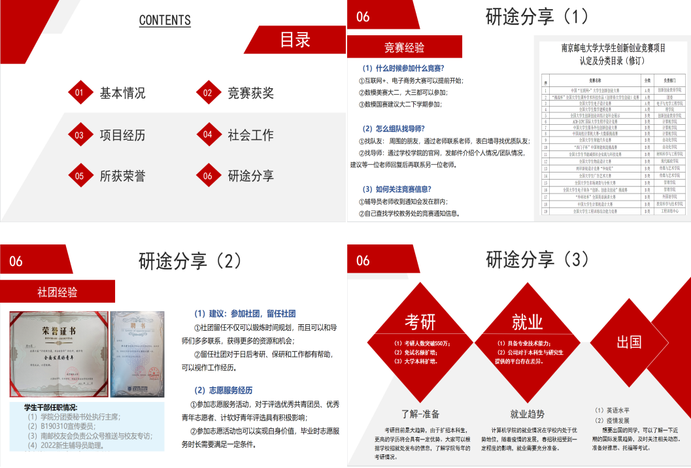
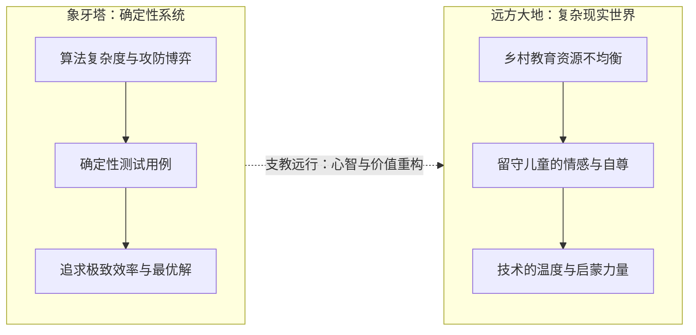
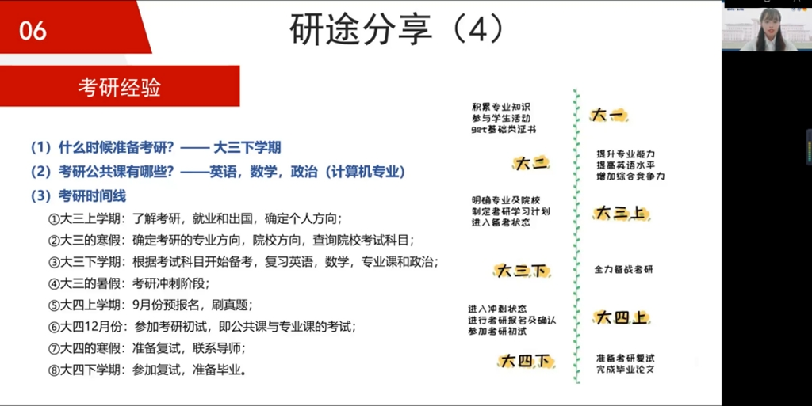
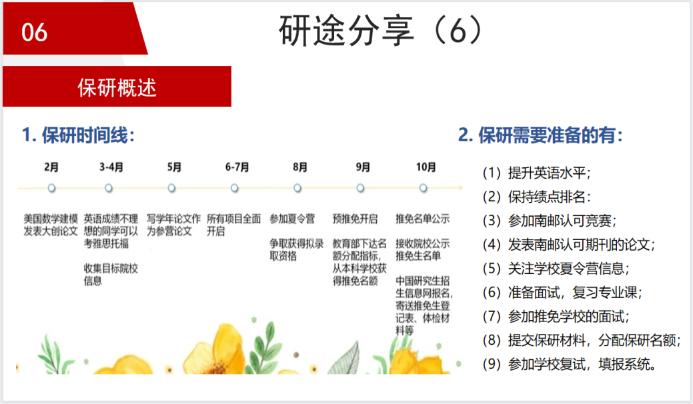
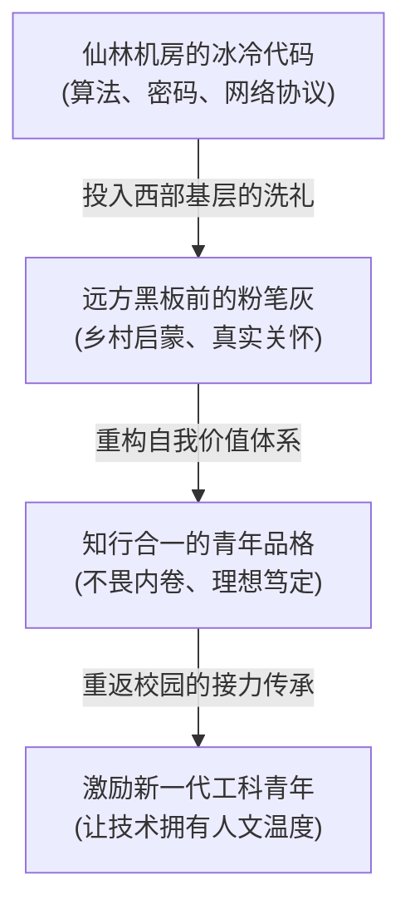

## 序幕 · 两个世界的引力场

在南京仙林校区的机房里，工科生习惯了一种极其纯粹的物理秩序：

恒温恒湿的空调出风口吐着微风，交换机与服务器的风扇发出低沉有力的蜂鸣。屏幕上，终端命令行以毫秒为单位滚动着封包抓取日志，指针在内存地址之间精准跳跃，公钥密码学体系（RSA、ECC）在散列函数与数论群论的严密庇护下，构筑起不可逾越的数字防线。

这是 2019 级信息安全专业学生**李子君**曾经最为熟悉的世界。

而在两千公里之外的中国西部黄土高原与西南群山之间，存在着另一个截然不同的重力场：

冬季清晨刺骨的山风吹过简陋平房的窗棂，黑板漆面斑驳脱落，粉笔灰在微弱的晨光里静静漂浮。讲台下，几十双眼睛清澈、淳朴，却又带着面对外界时的胆怯与局促。


*图注：梦想公开课开场。“研途成团，支教邮我”。在两种截然不同的人生引力场之间，青年做出了自己的抉择。*

在大学四年行将结束的十字路口，当周围的大多数人顺理成章地涌向一线互联网大厂的网络安全岗、高薪渗透攻防机构，或在顶尖实验室里为了发顶会论文争分夺秒时，李子君做出了一个在很多人看来“逆向而行”的决定：

加入南京邮电大学**第 25 届研究生支教团（研支团）**，背上行囊，奔赴西部基层，把一整年的青春留在远方的三尺讲台前。

---

## 01 · 走出象牙塔的逆行：从安全协议到山野泥土

“你学信息安全的，成天跟密码学和系统攻防打交道，去大西北支教一年，手里的技术不就生疏了吗？”

在提交研支团申请表的那几天，李子君不止一次面对过类似的疑问。在讲求投资回报率（ROI）与“技能保质期”的工科评价体系里，脱离专业跑道一整年，似乎是一件极具风险的事。


*图注：李子君站在讲台上。退去了实验室代码的冷色调，她的言语里多了一种在辽阔土地上淬炼出的沉着与从容。*

但在李子君看来，如果一个人的大学四年仅仅由刷绩点、做仿真、拿证书拼凑而成，那么这种优秀本质上是单薄的。

“代码越往深处走，你越会发现：技术从来不是孤立存在的。”李子君在回望自己的心路历程时谈到。在本科期间，她同样是竞赛与科研的高手，早早进入实验室，熟悉各类组队协作与导师沟通法则，把自己的学业时间轴规划得严丝合缝。

然而，当她真正站在大西北干燥清冷的土地上，面对着高原强烈的紫外线、陌生的西北方言、以及乡村教学资源捉襟见肘的现实时，工科生身上那套惯常的“最优解”思维被彻底打破了：

在这里，没有现成的 API 可以调用，没有编译器能在几秒内指出逻辑错误。你必须学会在冰冷的自来水前洗菜，学会在煤炉旁生火备课，学会如何看穿一个平日里沉默寡言的留守孩子眼神深处的自卑与渴望。



这种重力，让一个习惯了在代码里寻求逻辑闭环的年轻人，真正落在了大地上。

---

## 02 · 黑板上的“Hello, World!”：什么是真正的技术普惠？

在沿海与一线城市，数字文明正以令人眩晕的速度狂飙突进：小学生已经开始学习 Python 图形化编程，中学生在用大语言模型辅助做科研课题，生成式人工智能甚至已经能够重塑艺术创作。

但在西部的很多乡村小学，物理现实依然是极其粗粝的：

许多孩子家里没有电脑，学校机房里淘汰下来的几台老式主机，开机需要等待漫长的数分钟；很多孩子第一次触摸鼠标时，手指紧张得甚至不敢用力点击，生怕把脆弱的机器弄坏。

当李子君第一次拿起易碎的白色粉笔，而不是敲击机械键盘时，她强烈地感受到了一种身为技术人员的责任感：

```text
#include <stdio.h>

int main() {
    printf("Hello, World!\n");
    return 0;
}
```

当她在黑板上工工整整写下这行著名的计算机代码时，讲台下几十个孩子的眼睛在一瞬间被点亮了。


*图注：大屏幕上放映的支教纪实。山峦与教室、泥土与黑板——那是数字技术在真实世界中最温柔的注脚。*

对于这些大山里的孩子来说，他们或许在很长一段时间内都不会去深究编译器是如何将这行高级语言翻译为汇编指令与机器码的。但这一行字，像是一把钥匙，轻轻撬开了他们原本闭塞的世界：

> ==“老师，原来这行字母敲进电脑，真的能跟全世界打招呼啊！”==

这才是真正的**技术普惠（Tech for Good）**。

技术的终极意义，从来不是在硅谷或陆家嘴写出多么精巧的算法去争夺用户的注意力，也不是在内卷的象牙塔里堆砌几篇无人问津的论文。

技术的最高尊严，是**化作一束微光，穿透重重山峦，照亮那些原本被时代发展所折叠的角落**。让一个从未走出过县城的乡村少年，第一次意识到：在崇山峻岭之外，还有一个用光纤、卫星与算法编织在一起的浩瀚宇宙，等待着他们去奔赴。

---

## 03 · 梦想公开课：重力释放与精神接力

2022 年 10 月 2 日，仙林校区阶梯教室。

由计算机学院、软件学院、网络空间安全学院**学生发展中心主办的“梦想公开课”**在此举行。讲台下坐满了 2022 级刚刚入学的本科新生。在他们的脸上，你能清晰地看到大一新生特有的神情：对大学新生活的憧憬，以及夹杂其中的迷茫与焦虑。

在激烈的升学竞争之后，很多人把大学当成了高三的延长线：机械地计算着每一门课程的绩点权重，打听着哪门选修课给分最高，为选不到热门导师而患得患失。他们被困在了一种名为“唯指标论”的信息茧房里。


*图注：阶梯教室里的互动与答疑。台下专注的目光，正在接收一场关于理想主义的精神接力。*

走上讲台的李子君，带来了一场及时的“精神松绑”。

她没有空谈大话，而是条理清晰地拆解了大学的核心法则：从如何根据个人特质选择学科竞赛、如何建立团队信任，到考研与保研的精准时间轴管理；

但与常规的经验分享不同，她的字里行间始终带着一种开阔的生命底色：

> [!NOTE]
> **李子君送给新生的寄语**  
> “前路浩浩荡荡，万物皆可期待。不要让绩点成为你大学唯一的刻度尺。学会自我释压，在竞赛中锻炼逻辑，在志愿服务中体察社会。只有当你真正见过生活的粗粝与辽阔，你的内心才会有真正的定力。”

台下的新生们静静听着。屏幕上放映着支教地的日落与孩子们纯真的笑脸，那是一种远离浮躁内卷的、具有真实穿透力的力量。

---

## 04 · 在代码之外，生活是具体的

在计算机学科中，我们常常被训练去追求“无状态”（Stateless）和“幂等性”（Idempotent）——希望每一次计算都干净、利落，不受历史噪音的干扰。

但人生恰恰相反。**人生是有状态的，而且每一次真实的选择，都会沉淀为你独特的精神底层**。



在西部黑板前度过的那一年，没有让李子君的计算机技能生锈，反而赋予了她一种罕见的从容与大将之气。当她再次回到实验室，面对复杂的网络协议与安全攻防时，那些曾经看似冰冷的字符，在她眼里有了具体的温度。

她知道，代码运行的每一个数据包背后，都是真实生活着的人；安全协议所守护的，不仅是数据资产，更是千家万户平静生活的基础设施。

> [!TIP]
> **致正在迷茫中的年轻工程师**  
> 如果你发现自己陷入了无休止的技术内耗，不妨试着推开实验室的门，去参与一次支教，去接触一个真实的社区，去看看那些完全生活在代码之外的人。在辽阔的大地上，你会找到技术与自我的全新解法。

---

## 尾声 · 终将发芽的种子

许多年后，当那些在西部大山里长大的孩子们回忆起自己的童年，他们或许会淡忘很多课本上的知识点；

但他们一定会清晰地记得：在某一个寒冷而充满阳光的清晨，有一位来自南京邮电大学的年轻老师，带着一身书卷气，站在简陋的黑板前，用粉笔工工整整写下了一行奇怪的英文代码。

老师告诉他们，那是人与计算机对话的开始，也是走向辽阔世界的起点。

那是一行没有执行截止日期的代码。

它被写在黑板上，随风化作了粉笔微尘，但它所代表的那份属于工科青年的理想主义与技术温情，已经在远方大地的土壤深处，悄然生根发芽。
