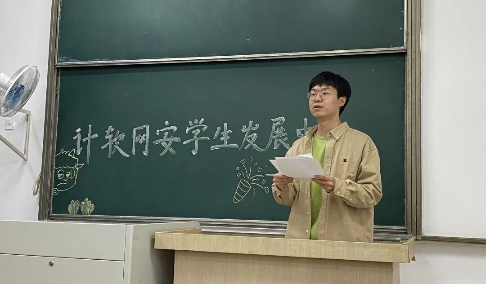
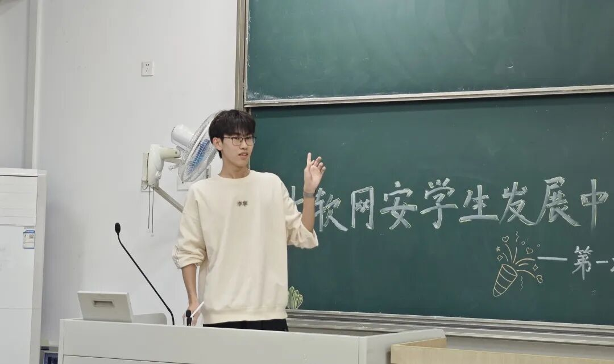
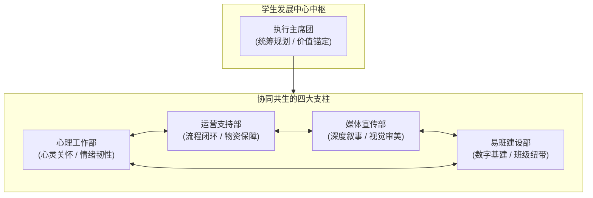
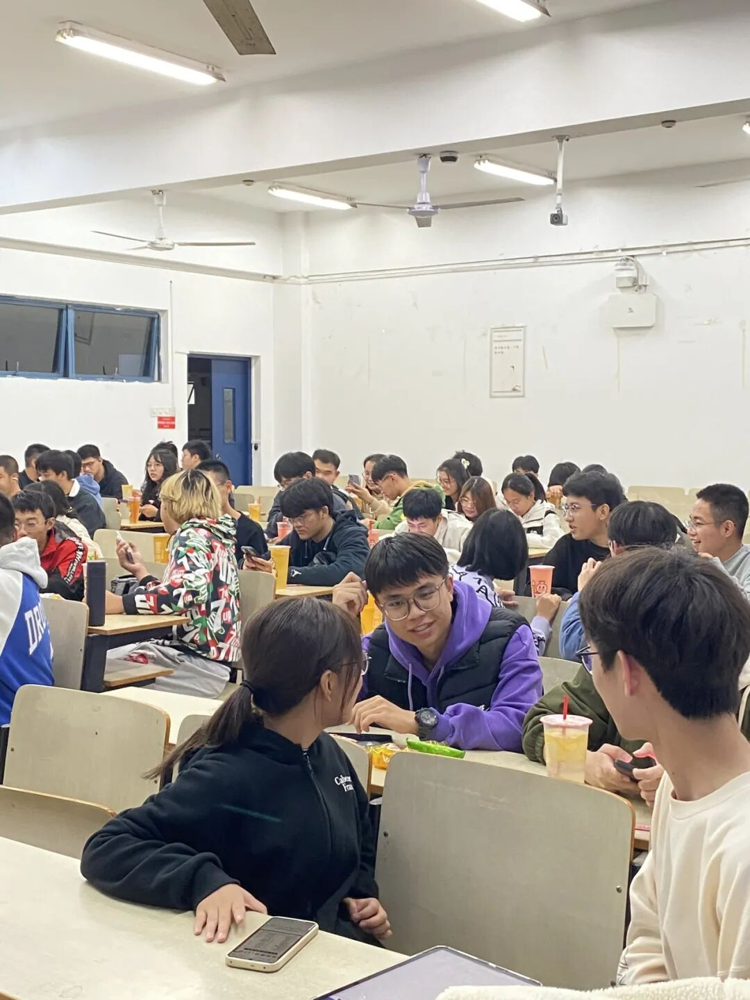
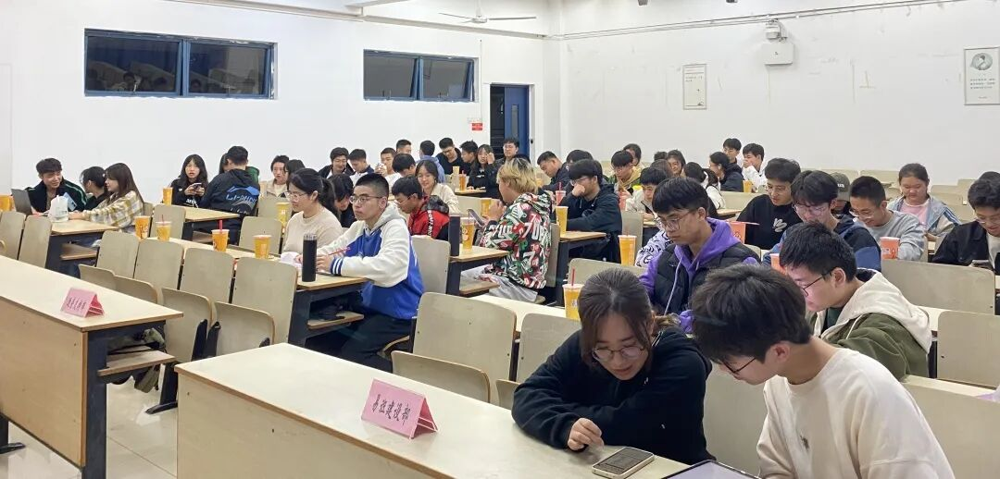
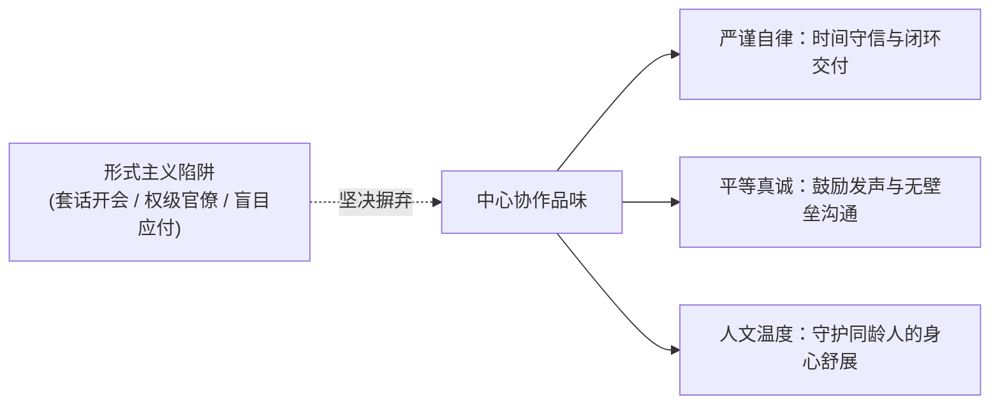
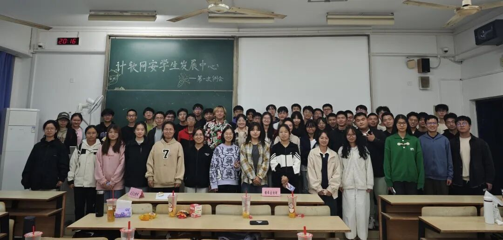

## 序章 · 告别虚浮的形式主义

在许多大学校园里，谈起“学生组织开会”，不少人的第一反应往往带着些许无奈：

空旷沉闷的阶梯教室、台上冗长乏味的套话宣讲、台下低头刷手机的疲惫身影；会议结束之后，大家甚至记不清具体讨论了什么，只留下一堆没有责任人、没有截止日期的模糊要求。

这种被形式主义绑架的“开会文化”，是消耗年轻人体温与热情的最大元凶。

*图注：自习室里的灯光与屏幕。真实的组织凝聚力，从一次拒绝套话、聚焦行动的集体审视开始。*

2024 年 11 月 11 日傍晚，南京邮电大学计软网安学生发展中心在自习室里举行了新学年的第一次集中学习会议。

没有居高临下的训话，没有花哨浮夸的口号。当几十名新老成员拉开椅子、围坐在明亮的自习室长桌前时，这里呈现出的是一种截然不同的精神质感：**严谨、平等、务实，以及对每一个交付细节的由衷尊重**。

---

## 01 · 蓝图与时钟：让每一个目标落地有声

一场高效会议的第一步，是对所有人时间的敬畏。

会议准时开始，运营支持部分管主席**赵思逸**走上讲台主持流程。她没有讲一句客套的开场白，而是清晰直白地向大家交代了当晚的议程逻辑与时间切片，迅速将整场会议带入专注的共振状态。

*图注：赵思逸把控会议流程。优秀的主持者不仅把控节奏，更在无形中营造出专注、平等的对话场域。*

随后，执行主席**周正**走到白板前，投影幕布上展开了中心新学年的全景时间轴与工作蓝图。

*图注：周正展开中心年度规划。将长期的愿景解耦为每一个具体、可量化、有明确节点的行动坐标。*

在周正的梳理中，你听不到任何假大空的空谈，取而代之的是严密的时间坐标与责任链路：

- **阶段推进清晰**：从新学期的招新破冰、小班辅导，到 320 健康周、525 心理游园会，全年的核心里程碑被拆解得层次分明；
- **交付标准明确**：每一项活动谁来统筹、谁来落地、需要联动哪些资源、前置准备期是多久，全部在白板上一目了然；
- **拒绝信息孤岛**：打破高层与基层的层级壁垒，让每一位刚加入的大一新部员，都能清楚看到自己的日常工作在整个宏观版图中的位置与价值。

这正是成熟学生组织的核心素养：==在混沌中建立清晰的秩序，让每一个参与其中的人都不再是盲目的“执行螺丝钉”，而是对全局有深刻理解的共同创造者==。

---

## 02 · 亚克力席卡背后的四维拼图

在长桌的中心，整齐摆放着四张蓝色字体的亚克力席卡：**心理工作部**、**运营支持部**、**媒体宣传部**、**易班建设部**。

*图注：长桌上的四部门席卡。清晰的职能边界与深度互信，构成了学生发展中心的稳固地基。*

这四张席卡代表的，绝不是冷冰冰的行政权力切块，而是守护全院同学健康发展的**四维有机拼图**：

- **心理工作部**：专注于同龄人情绪的感知与抚慰。从 320 健康周的草坪手写明信片，到 525 嘉年华的树洞信箱，他们是为高压学习生活提供缓冲垫的“心灵护林员”；
- **运营支持部**：掌控每一次活动的物资流转、场地审批与安全预案。在幕后默默值守，确保每一个大型项目平稳落地；
- **媒体宣传部**：负责摄影采写、视觉设计与深度随笔。他们用有温度的文字与影像，记录下校园里最动人的青春切片；
- **易班建设部**：深耕校园数字化工具与基层班级网络，搭建高效的信息互通桥梁，沉淀组织的数字资产。

没有高低贵贱，没有部门壁垒。当四个部门在长桌前围坐在一起时，每一项决议都建立在充分的协商与互信之上。

---

## 03 · 研讨长桌上的平等激辩：从倾听到共识

在随后的分组研讨环节，自习室的气氛迅速热烈起来。

长桌被自然划分为几个讨论组，新老部员们挤在一起。草稿纸上被画满了草图，笔记本电脑屏幕上的推文提纲被逐段批注。有人在提出尖锐的疑问，有人在白板上飞快修改方案。

*图注：围坐长桌前的新老成员研讨。在这里，没有年级和职务的高低，只有对方案细节的真诚推敲。*

*图注：细节的碰撞与共识的达成。优秀的方案从来不是拍脑袋决定的，而是在坦诚的讨论中打磨成型。*

在学生发展中心，始终流传着一条不成文的约定：**鼓励最年轻的成员提出不同意见**。

大一的新生并不是来“打杂跑腿”的，他们刚刚走过高考，对新生的困惑与需求有着最敏锐的第一手直觉。一个海报的色调是否吸引人、一个活动的规则是否让人感到繁琐、一段宣传文案是否让人产生反感，新生的视角往往最真实。

> [!NOTE]
> **关于平等协作的共识**  
> 好的学生组织绝不应当模仿成人世界的官僚做派。在这里，尊重不是来自于职位的尊卑，而是来自于你对交付物是否有敬畏心、对同伴是否有同理心。

而在讨论桌的一角，摄影记录者**倪心舟**与**雷桐**静静端着相机，捕捉着每一个低头思索、仰头欢笑的瞬间。真实的影像留痕，不仅是为了发布推文，更是为了让团队在日后的每一次复盘中，都能看清自己走过的足迹。

---

## 04 · 什么样的组织，才配称为“学生发展中心”？

在这个充满各种竞争和考评的大学环境里，我们为什么还需要一个学生组织？

如果加入一个社团，仅仅是为了学会在社交软件上回复“收到”、学会写假大空的总结套话，那这样的经历非但不能促进成长，反而是一种精神退化。

学生发展中心的集中学习，向每一位成员传递了这样一个朴素的答案：

**“学生发展”的真谛，是让每一个来到这里的普通同学，都获得向内生长的力量**。

1. **在这里，学会对一件事负责到底**：无论是一张席卡的打印摆放，还是一篇推文的标点校对，认真做好一件具体的小事，是战胜浮躁的最好方式；
2. **在这里，学会平视与倾听**：不把自己的意志强加于人，在团队协作中学会理解差异、化解分歧；
3. **在这里，找到志同道合的同伴**：在紧绷的专业课之外，有一群可以一起搬桌子、一起改文案、一起吃夜宵的朋友，让大学四年的底色不再孤单。

---

## 尾声 · 离开长桌之后

夜色渐深，自习室外的走廊吹来清凉的秋风。

集中学习进入尾声，全体成员在讲台前站定，摄影机的闪光灯定格下了那一双双清澈、专注而充满朝气的眼睛。

*图注：全体成员大合照。年轻的脸庞上没有疲惫与世故，只有真诚、踏实而笃定的前行力量。*

会议散场，桌椅被细心归位，灯光熄灭。大家三三两两推开门，走向宿舍、图书馆与操场。

长桌前的讨论总会散去，但那一晚在灯光下达成的默契与共识，却会深深印在每一个人的心底。

当一个学生组织不再沉迷于虚张声势的排场，而是将目光投向真实的同学、具体的事务与真诚的陪伴，它才真正拥有了穿透时间的力量。这，就是自习室长桌上留给青春的最美印记。
