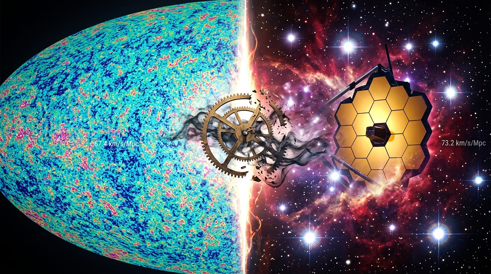
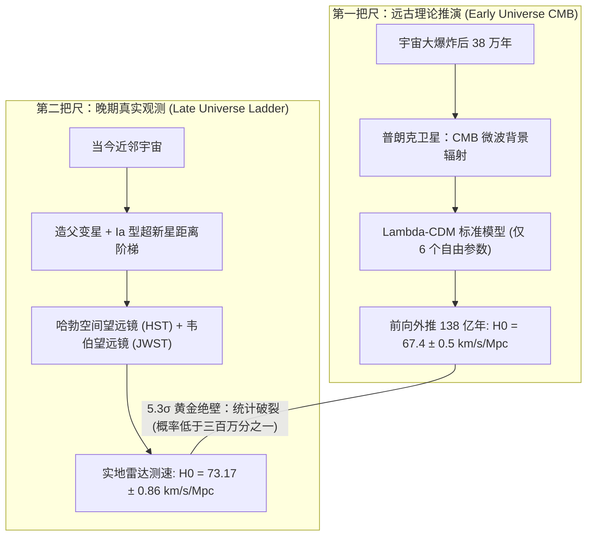
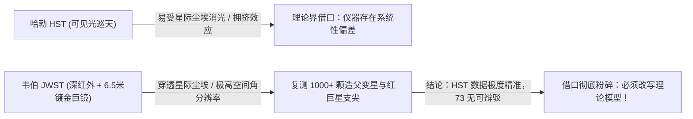

> “宇宙最不可理解的地方，在于它是可以被理解的。但当两组最精密的观测数据从地基深处撕开一道深渊，宇宙正在残酷地提醒我们：它从没有任何义务，去迎合低维碳基大脑对方程对称与极简的数学洁癖。”  
> —— 《思维对撞机》第二期



---

## 一、 永恒的幻觉与深夜的裂痕

当你今晚仰望繁星点点的夜空时，那种亘古未变的宁静极易让人产生一种近乎宗教式的错觉：宇宙是一台精密而永恒的发条钟表，星体按部就班地沿着引力轨道运转，万事万物皆可被写在一张纸上的几行场方程所穷尽。

然而，在过去几年的现代天体物理学界，这栋被视为人类最高理性丰碑的物理学大厦，却从地基深处直接崩裂开了一条深不见底的鸿沟。

全球顶尖的宇宙学家与天文学家们正处于一种前所未有的焦虑与亢奋之中。这场被称为==“哈勃张力”（Hubble Tension）==的危机，并非物理学边缘脱落了几块无关紧要的砖瓦，而是直击了现代科学最根本的命题：

> [!WARNING]
> **现代宇宙学的终极困境**  
> **我们独立测算出的当今宇宙膨胀速度，彻底对不上了。** 这意味着要么是人类目前最精密的望远镜集体撒谎，要么是统治物理学半个世纪的标准宇宙学模型在底层逻辑上存在致命缺陷。

---

## 二、 两把量天尺：远古胎毛照与近邻灯塔

要理解这场危机为何让物理学家彻夜难眠，必须首先拆解人类衡量宇宙膨胀率时所动用的两把截然不同的量天尺。



### 1. 第一把尺：普朗克卫星与婴儿宇宙的“胎毛照”
第一把尺子属于理论学界引以为傲的理性杰作。欧洲航天局的普朗克卫星（Planck Satellite）以惊人的微角秒精度，扫描了宇宙大爆炸后仅 38 万年留下的**宇宙微波背景辐射（Cosmic Microwave Background, CMB）**。

在现行的标准宇宙学模型——**$\Lambda\text{CDM}$（包含宇宙学常数暗能量 $\Lambda$ 与冷暗物质 CDM）**框架下，物理学家只需调节仅仅 ==6 个自由自由参数==（重子密度 $\omega_b$、冷暗物质密度 $\omega_c$、声学视界角尺度 $\theta_{\text{MC}}$、光学深度 $\tau$、标量振幅 $A_s$ 与谱指数 $n_s$），就能像旋动收音机旋钮一样，完美拟合出整个宇宙百亿年来的演化大势。

顺着爱因斯坦广义相对论的弗里德曼方程一路推演到今天，理论给出的当今哈勃常数极度确定：

```math
H_0 = 67.4 \pm 0.5 \text{ km/s/Mpc}
```

这意味着，在相隔一百万秒差距（约 326 万光年）的宇宙尺度上，空间每秒膨胀 67.4 公里。

### 2. 第二把尺：诺奖团队与近邻宇宙的“测速雷达”
然而，以 2011 年诺贝尔物理学奖得主亚当·里斯（Adam Riess）领导的 SH0ES 团队为代表的观测天文学家，走了一条完全不依赖早期宇宙理论外推的实证路线。

他们不看百亿年前的婴儿照，而是直接把目光投向“家门口”的近邻宇宙。他们利用**造父变星（Cepheid Variables）**周光关系作为标准烛光，层层校准直至 Ia 型超新星，构建起了一条坚不可摧的==宇宙距离阶梯（Cosmic Distance Ladder）==。这相当于直接在宇宙的高速公路上架设测速雷达，实地测量星系退行速度。

观测团队给出的冰冷铁证是：

```math
H_0 = 73.17 \pm 0.86 \text{ km/s/Mpc}
```

### 3. $5.3\sigma$ 的残酷判决：三百万分之一的死刑

> [!IMPORTANT]
> **黄金判决线：$5.3\sigma$ 置信度**  
> $67.4$ 与 $73.17$，中间相差了整整 **8%**。在天文学与高能物理学中，这一鸿沟对应的统计偏差已达到 ==$5.3\sigma$==。  
> 这意味着，纯粹由于仪器的随机涨落或统计巧合导致这一差异的概率**低于三百万分之一（$p < 3 \times 10^{-7}$）**。

这不是普通的测量误差，这是物理学底层大厦裂开的丧钟。

---

## 三、 望远镜没有撒谎：韦伯（JWST）掀翻理论界退路

面对这道鸿沟，理论界在最初几年曾抱有一种集体侥幸心理——他们试图把责任推给哈勃空间望远镜（HST）。

理论家们辩称：哈勃望远镜工作在可见光波段，当它观测遥远星系中的造父变星时，光线极易被浓厚的星际尘埃消光遮挡；加之深空恒星极为密集，多颗恒星的光斑可能重叠在一起（所谓“光学拥挤效应”），导致天文学家高估了星系亮度，从而人为拔高了膨胀率。

**理论界曾把最后的救命稻草，寄托在价值百亿美元的詹姆斯·韦伯太空望远镜（JWST）上。他们期望韦伯的高清镜头能“纠正”哈勃的错误，让实测值回跌到 67.4。**

然而，韦伯望远镜传回的数据，直接掀翻了理论界的退路。



韦伯望远镜配备了巨大的 6.5 米镀金六边形主镜，更关键的是它在**深红外波段**巡天。红外线的长波长物理特性，使其能够像手术刀切开晨雾一样，毫无阻碍地穿透厚重的星际尘埃。

在里斯团队利用 JWST 对超过 1,000 颗造父变星及关键锚星星系的重新复核中，结果以令人窒息的一致性表明：**哈勃望远镜过去数十年的测定毫无系统偏差，望远镜的镜片没有撒谎，==73 这个数字就是真实晚期宇宙的膨胀率！==**

仪器的“黑锅”被彻底砸碎，理论界被逼到了退无可退的墙角。

---

## 四、 现代“以太”与“本轮”：面对崩溃时的理性自欺

为了保住濒临崩塌的 $\Lambda\text{CDM}$ 标准模型，理论物理学界近期提出了一系列极其激进的修补方案，其中最受追捧的补丁被称为==早期暗能量（Early Dark Energy, EDE）==。

这种假说设想：在宇宙大爆炸后仅数万年（物质-辐射相等期前后），空间中突然神秘地涌现出一股占据总能量约 8% 的未知斥力标量场。这股能量短暂地暴推了空间的膨胀，强行把早期宇宙的声学视界尺度（Sound Horizon $r_s$）压缩了约 5%：

```math
r_s = \int_{z_*}^{\infty} \frac{c_s(z)}{H(z)} \mathrm{d}z
```

当作为尺子基准的 $r_s$ 被人为缩短后，推导到今天的哈勃常数自然就被强行拔高到了 73。

但这恰恰引发了科学哲学上的极度不适：

> [!CAUTION]
> **认识论警告：科学史的反面教材正在复现**  
> 为了不破坏晚期宇宙已确立的所有成熟观测，这股早期的神秘暗能量必须具备一种近乎荒诞的特异功能：**它必须在完成推高膨胀率的任务后，在极短时间内像幽灵一样迅速衰减、彻底消失，假装自己从未存在过。**
> - **它像极了古希腊托勒密为了捍卫“地心说”，在行星轨道上层层叠加的==“本轮”（Epicycles）==**：只要我画的圆圈足够多，总能把数据勉强凑齐；
> - **它更像极了十九世纪末物理学天空中的那朵乌云——为了修补经典力学而虚构出的==“以太”（Luminiferous Aether）==**。

当一门科学必须依赖呼之即来、挥之即去的“参数微调补丁”来维持生命时，它的范式危机往往已经无可挽回。

---

## 五、 黑暗账本与第三裁判：宇宙学的下一次日出

我们究竟在抗拒什么？

理论物理学家之所以如此痛苦地抗拒放弃标准模型，是因为承认证伪的代价过于沉重。回顾人类引以为傲的现代宇宙学“黑暗账本”：

```text
全宇宙质能成分分解账本：
├── 普通重子原子物质 (麦克风、地球、银河系所有发光恒星与生命) : 5%
├── 暗物质 (完全未知，仅表现出冷引力束缚效应)                     : 27%
└── 暗能量 (完全未知，表现为驱动空间加速膨胀的均匀负压)             : 68%
```

**我们自诩理解了宇宙，但事实上，我们能用望远镜看清、用手触摸到的物质，仅仅占了宇宙总能量的 ==5%==。**

剩下的 95%，我们完全不知道它们是什么。我们仅仅是用两个优雅的学术名词——“暗物质”与“暗能量”，礼貌地包装了人类不可遏制的无知。这与中世纪的炼金术士把未知燃烧现象命名为“燃素”（Phlogiston），本质上有何区别？

更震撼的变革已经在地平线上酝酿。天文界正在引入完全独立于前两者的**第三方裁判**：
1. **时间延迟宇宙学（Time-Delay Cosmography）**：通过观测强引力透镜系统（如 J1721+0212 类星体的多个爱因斯坦重影），纯粹利用光线在弯曲时空中传播的纯几何时间差，独立给出 $H_0$ 的第三种测定；
2. **暗能量动力学演化**：2024~2026 年暗能量光谱巡天（DESI）的最新数百万星系重子声学振荡（BAO）分析初步揭示，暗能量的状态方程参数可能并非恒定的 $-1$：

```math
w(a) = w_0 + w_a (1 - a)
```

暗能量或许根本不是一个温和静止的宇宙学常数，而是一场在时空中随时间澎湃演化的未知狂潮！

---

## 六、 结语：科学在泥泞中重生

哈勃常数的大撕裂，绝非科学的末日。恰恰相反，它是敲响在人类理性傲慢上的一记清脆警钟。

> [!TIP]
> **终极洞见**  
> 真正的科学探索，从来不是在温室的黑板上做那种永远对称完美的算术题；它恰恰是在旧范式崩塌的瓦砾堆中，在直面无可调和的观测冲突中浴火重生的。

宇宙浩瀚，星河璀璨。在那些我们自以为读懂的引力方程背后，正孕育着人类认知的下一次大爆炸。
