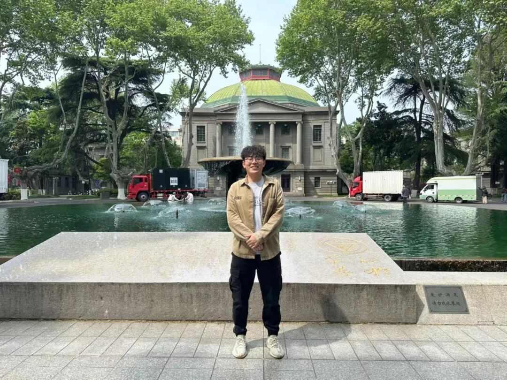
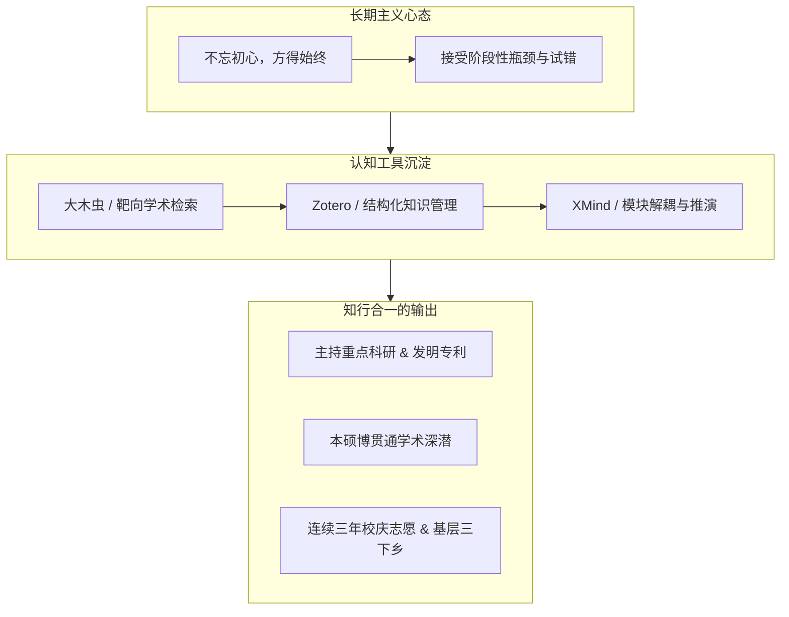
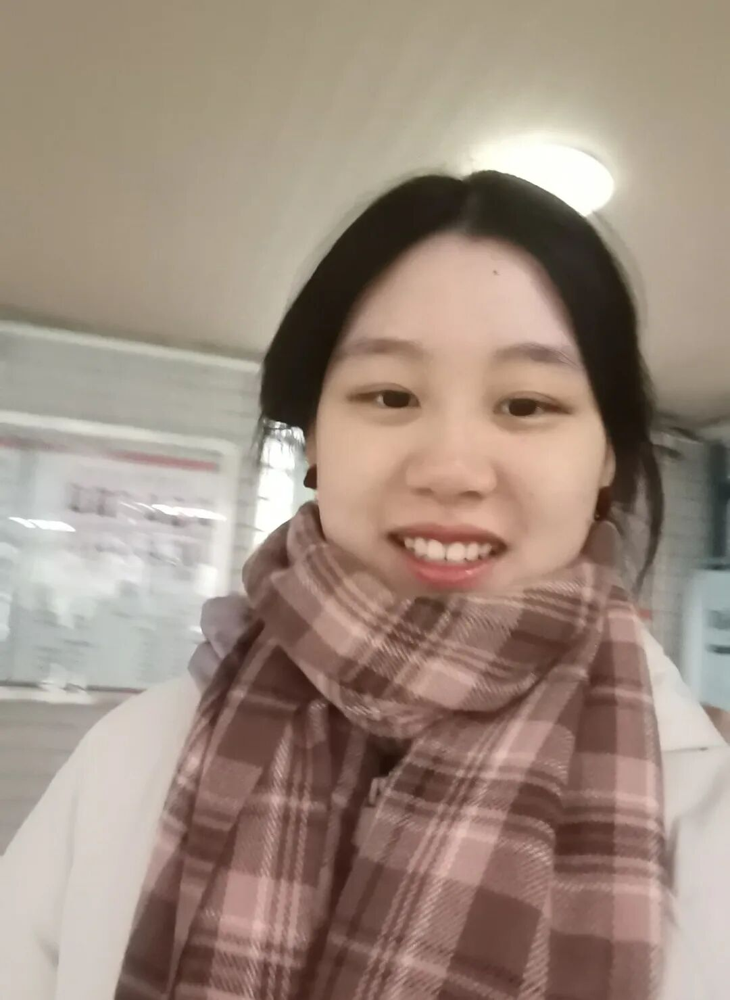
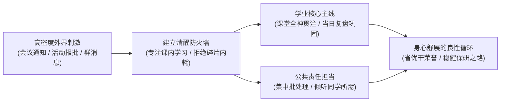
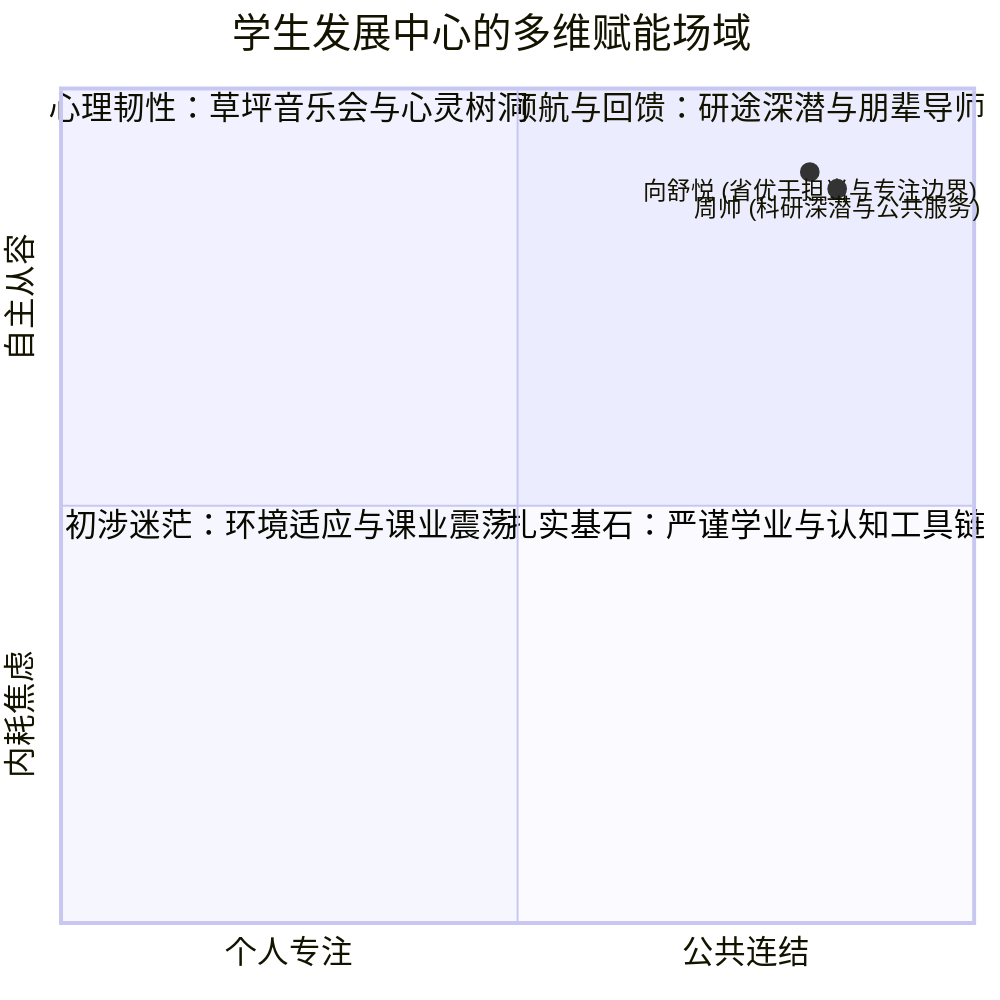

## 序幕 · 大学生活的双重引力

在大学的漫长航程中，许多人常常在两极之间摇摆：

一极是极其纯粹的“个人通道”——把所有时间紧密压缩在绩点、排位、考级与个人履历中，对走廊之外的公共生活保持克制甚至漠然；另一极则是容易让人迷失的“事务泥潭”——在各种会议通知、活动表格和繁杂沟通中疲于奔命，直到某个夜晚突然发现，自己的专业基石已被冲刷得斑驳零落。

走在这两种极端之间，人很容易陷入深层的倦怠与意义感的虚脱。

*图注：走廊展板前驻足的身影。四年时间，他们在学术深潜与公共服务之间，锚定了属于自己的航向。*

然而，在南京邮电大学计算机学院、软件学院、网络空间安全学院学生发展中心（StuDev）的走廊里，站着两位给出不同答案的毕业生：

一个是担任**院学生发展中心执行主席**的**周帅**，以专业前 15% 的扎实成绩斩获本硕博贯通培养保研资格，主持校级重点科研项目，以第一学生发明人公开发明专利；另一个是担任**学生发展中心主席**的**向舒悦**，获评江苏省优秀学生干部、校三好学生与优秀共青团干部，带领党支部与中心团队统筹开展数十场全院品牌活动，同样以优异表现保研本校。

他们不是不知疲倦的超人。面对同样的二十四小时，他们是如何在繁重的学业科研与沉甸甸的组织责任之间，找到那份从容的秩序与温度的？

---

## 01 · 周帅：在混沌的学术与事务中建构个人工具箱

大一入学时，周帅拿到的也是一份寻常的新生答卷。他从班级的宣传委员做起，一点点熟悉大学生活的节奏。

但与许多随波逐流的同学不同，他很早就意识到了一点：**大学里的混乱感，往往来自于缺乏对信息的结构化管理**。

*图注：周帅。在学术科研与庞杂的学生工作中，他靠的是一套清晰的认知框架与长期主义定力。*

从大二挑起学生发展中心的大梁，到大三主导校级重点科研项目，周帅面对的是成倍膨胀的任务流：一边是需要反复推敲的学术论文、实验数据与专利申报书，另一边是全院性活动的方案审批、场地调度与各部门协同。

“如果把所有琐碎的事情都塞在大脑的临时记忆里，人很快就会崩溃。”在面向学弟学妹的经验分享中，周帅没有空谈大道理，而是拿出了三样极其具体的“武器”：

1. **大木虫学术导航**：建立高效、干净的文献获取路径，跳过信息噪音，直达核心学术资源；
2. **Zotero 文献管理系统**：彻底告别“文献随手丢在桌面文件夹”的习惯，为每一篇研读过的论文打上标签、批注心得，建立网状知识库；
3. **XMind 思维导图**：在承接任何一项科研课题或组织工作时，先在画布上理清结构主线、明确先后依赖，再落地为具体动作。

这套井井有条的习惯，支撑着他走过了科研最艰难的攻坚期。他主持的校级重点 STITP 创新训练项目最终以“良好”结项，并作为第一学生发明人成功公开发明专利一项。

但更难能可贵的是，卓越的个人成果并没有让他走向精致的利己主义。在校期间，他连续三年穿上红马甲参与校庆志愿服务；暑期里，他主动报名深入基层社区参与三下乡社会实践，获评优秀青年志愿者与社会实践先进个人。

> [!NOTE]
> **周帅的毕业寄语**  
> “不忘初心，方得始终。毕业之际，愿我们都能怀揣梦想，勇往直前，发光发热，贡献社会。前程似锦，未来可期！”

---

## 02 · 向舒悦：在喧嚣与琐碎中守住清醒的边界

如果说周帅展现的是理工男沉静深邃的架构力，那么向舒悦呈现的，则是一种在千头万绪中守住本心的从容气度。

作为学院学生发展中心主席、2020 级第三党支部副书记与班级团支书，向舒悦的大学日程表几乎被各种各样的公共事务填满：策划草坪音乐周、协调心理嘉年华物资、推进基层团支部建设、协助招生就业处进行答疑……

任何一个初入大学的人，面对这种高密度的沟通，都很容易产生“被事务推着走”的窒息感。

*图注：向舒悦。作为学生发展中心主席，她学会在繁琐事务中建立清醒的边界，守护核心学业。*

然而，当评选结果揭晓时，人们惊讶地发现：她不仅在社会工作上斩获“江苏省优秀学生干部”、“校优秀共青团干部”，在专业学业上也始终名列前茅，斩获科技竞赛省奖，稳稳获得保研资格。

她是怎样化解这种多重角色冲突的？

向舒悦的心得朴素得近乎古典：**“无论你的职务是什么，课内学习永远是大学最根本的地基。”**

她给自己立下了极其严格的“时间防火墙”：

- **课堂内百分之百专注**：课堂时间绝对不碰手机上的社团事务，紧跟老师的板书与推导节奏，把困惑在当堂彻底吃透；
- **当日事当日清**：课后第一时间复盘笔记、完成习题，绝不把学业欠账拖延到考试周；
- **批处理公共事务**：将学生发展中心的文案审核、场地协调等零散工作，集中安排在特定时间段内高效完成，避免思维被碎片化打断。

“很多人之所以觉得累，是因为在学习的时候想着工作没做完，在做工作的时候又为没有复习而焦虑。”向舒悦说。唯有在每一个当下做到纯粹的沉浸，生活才能拥有呼吸感。

> [!TIP]
> **向舒悦的学业与成长手记**  
> “在课内学习之余，逐渐找寻自己的兴趣，多学新的技能，提升自己。提前为自己做好规划，有目标地去做事情，技多不压身。毕业不是终点，而是新旅程的起点。愿我们珍惜大学生活中遇到的人和事，勇敢地追逐梦想，无论路途多么艰难，都保持初心不改。”

---

## 03 · 学生发展中心到底要“发展”什么？

在毕业答辩与交接仪式结束的那个黄昏，两位主席在中心办公室里收拾整理四年留存的档案。

翻看着一沓沓关于 320 健康周、525 心理游园会、小班辅导交流会、朋辈导师手记的活动记录，一个被反复问起的问题再次浮现：

**在这个充满竞争与焦虑的大学环境里，学生发展中心到底要“发展”什么？**

它绝不是为了制造更多浮夸的汇报 PPT，更不是为了用繁琐的打卡机制把同学们束缚在框架里。

在周帅和向舒悦看来，学生发展中心的真正意义，在于**为身处迷茫中的同龄人，撑起一把可以遮风避雨的伞**：

- **发展一种免于内耗的心理韧性**：让那些在绩点和人际关系中感到压抑的同学，能在草坪音乐会里坐下来吹吹晚风，在树洞信箱里倾吐心声，找回最纯粹的生命力；
- **发展一种脚踏实地的学业定力**：不迷信捷径，不制造焦虑，通过朋辈导师的一对一陪伴、优秀笔记与工具的真诚共享，让大一新生平稳度过从中学到大学的震荡期；
- **发展一种走出自我的公共情怀**：让技术人员不仅会埋头打磨个人能力，更懂得如何走入社区、走上乡村讲台，在关怀他人的过程中确认自己的生命价值。

---

## 尾声 · 远航者的交接

走廊的展板终会被下一届新生的面孔所更替，但沉淀在岁月里的心智火种却会一直流传。

站在四年航程的终点，周帅即将进入本硕博贯通的学术深水区，向舒悦也将在南邮校园开启全新的研究生征途。他们留给学生发展中心的，不仅是厚厚的规章手记与品牌项目，更是这样一种鲜活的证明：

你可以在追求学术卓越的同时，保持对同伴的温暖与关怀；  
你也可以在承担公共责任的同时，守护好自己内心的宁静与专注。

大学四年，从来没有唯一的标准答案。只要心中有航向，脚下有根基，每一个人都能在这片浩瀚的校园里，生长出属于自己的从容力量。
