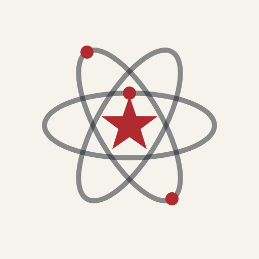
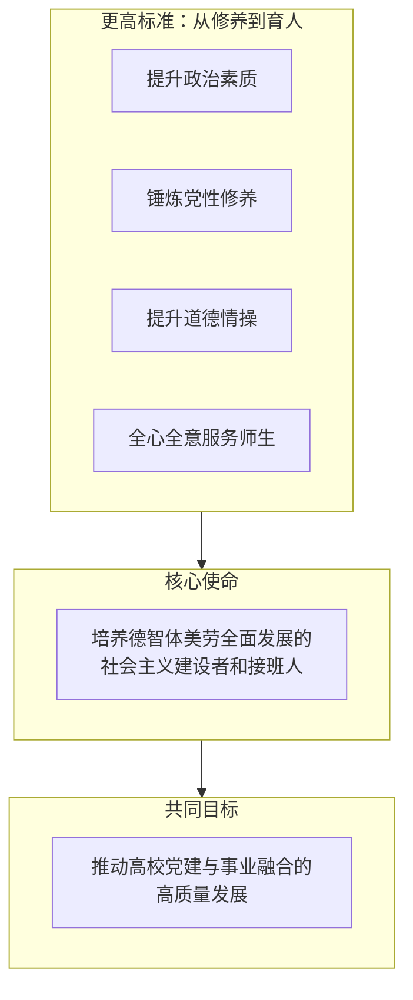
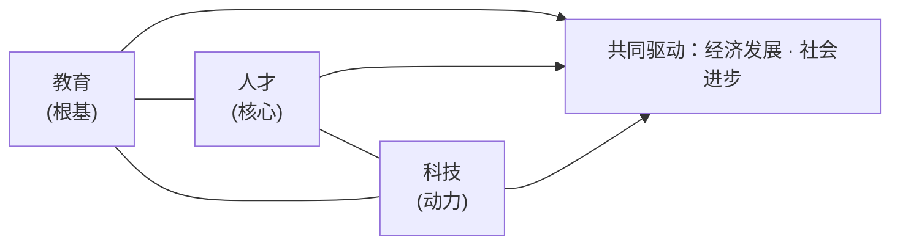
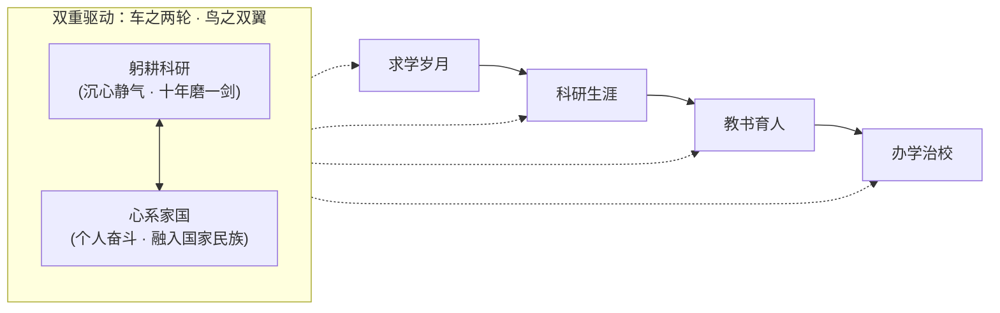
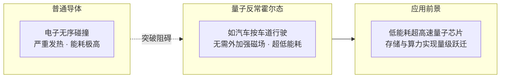
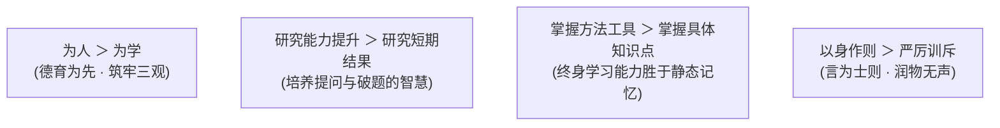
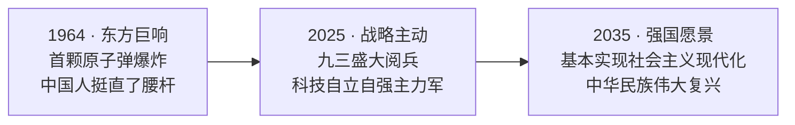

> “作为一名科学家，我深知科学无国界，但科学家有祖国；作为一名共产党员，更要把毕生精力献给党和人民的科技与教育事业。生命不息，奋斗不止。”  
> —— 薛其坤 · 中国科学院院士 · 南方科技大学校长 · 2023年度国家最高科学技术奖获得者

---

## 序章 · 追求卓越，矢志报国

在新征程的时代坐标下，高校党建工作与立德树人根本任务紧密交织。面对教育、科技、人才一体推进的历史契机，高校师生党员应当如何确立精神坐标、找准发力方向？

本次党课以**“追求卓越 · 矢志报国”**为主题拉开序幕。主讲人薛其坤院士希望以这次党课为契机，同广大高校师生党员展开深度的**思想交流与知识碰撞**，进一步**坚定信仰、携手奋进**，由此切入主题讲授。

高校党课的开场核心要点在于：==以更高的标准担当作为，推动高校党建与事业融合的高质量发展==。

> [!NOTE]
> **逻辑主线与传导机制**  
> 讲话将**自身修养要求**与**服务师生**并列提出，二者共同指向立德树人的根本使命，最终落脚于党建与事业深度融合发展。整体逻辑主线呈现出由“**更高标准**”向“**高质量发展**”逐层传导的内在机制。

---

## 第一部分 · 时代方位与党员标准

新征程上，教育、科技、人才一体支撑；高校师生党员重任在肩。

### 1. 一体支撑：教育 · 科技 · 人才

生逢其时，重任在肩——当前我们正奋进在全面建设社会主义现代化国家、全面推进中华民族伟大复兴的新征程上，首先要**找准时代坐标**。

党的二十大报告明确指出，教育、科技、人才是全面建设社会主义现代化国家的**基础性、战略性支撑**，必须坚持：
* **科技是第一生产力**
* **人才是第一资源**
* **创新是第一动力**

三者之间构成了辩证统一的有机整体，相互支撑、相互推进：

从战略演进的脉络来看，党中央对三者的部署层层递进、逻辑严密：
1. **党的二十大报告**：确立教育、科技、人才是全面建设社会主义现代化国家的基础性、战略性支撑；
2. **二十届三中全会**：强调统筹推进**体制机制一体改革**，健全新型举国体制，提升国家创新体系整体效能；
3. **2024 全国教育大会**：要求统筹实施科教兴国、人才强国、创新驱动发展战略，**一体推进**教育发展、科技创新、人才培养。

> [!IMPORTANT]
> **战略洞察**  
> 这三份战略部署同指一处：教育、科技、人才不是彼此孤立、简单并列的三件事，而是**协同一体的高效循环**——这正是新时代高校被寄予厚望的根本原因。

### 2. 大学何为：一体改革的桥头堡

强国建设，教育何为？兼具教育、科技、人才三重使命的高校，正是统筹推进三者体制机制一体改革和发展的**桥头堡**。

一所杰出的研究型大学，由四个支点共同支撑：
* **卓越的教育**
* **一流的科研**
* **优秀的师资**
* **优秀的学生**

这四大支点共同构成大学的内在品格与显性特征。多年改革实践清晰表明：高水平研究型大学是**基础研究、科学发现、技术发明的主要阵地**，更是**培养拔尖创新人才的摇篮**。强国建设使命在召唤，任务艰巨，但**正当其时**。

### 3. 重温党章：党员标准与先锋义务

回归本源，深刻理解共产党员的身份内涵——**始终走在时代前列**，是马克思主义政党先进性和历史自觉的鲜明体现。

> “中国共产党党员是中国工人阶级的有共产主义觉悟的先锋战士，必须全心全意为人民服务，不惜牺牲个人的一切，为实现共产主义奋斗终生。”  
> —— 《中国共产党章程》

同时必须牢记：党员永远是**劳动人民的普通一员**，所有党员都**不得谋求任何私利和特权**。党章规定的八项义务构成了逻辑严密的有机整体：
1. **学习与本领**：深入学习马克思列宁主义、毛泽东思想、邓小平理论、“三个代表”重要思想、科学发展观、习近平新时代中国特色社会主义思想，学习党的路线方针政策、基本知识和历史，学习科学文化法律业务知识，提高为人民服务的过硬本领；
2. **先锋模范作用**：增强“四个意识”、坚定“四个自信”、做到“两个维护”，在生产、工作、学习和社会生活中切实发挥先锋模范作用；
3. **吃苦在前、享受在后**：坚持党和人民利益高于一切，克己奉公；
4. **遵守纪律与团结**：自觉遵守党的纪律，维护党的团结统一；
5. **批评与自我批评**：切实开展批评和自我批评，勇于揭露和纠正工作中的缺点错误；
6. **密切联系群众**：向群众宣传党的主张，遇事同群众商量，维护群众的正当利益；
7. **发扬新风尚**：带头实践社会主义核心价值观，发扬社会主义新风尚；
8. **捍卫党和人民利益**：发扬斗争精神，在困难和危险时刻挺身而出。

党章义务是对党忠诚、对人民负责的集中体现，是保持先进性的内在要求，更是每一位党员不容推卸的**政治责任**。

### 4. 尺子与镜子：从合格到优秀

衡量一名共产党员是否合格、优秀，有一把清晰的尺子：==讲政治、有信念，讲规矩、有纪律，讲道德、有品行，讲奉献、有作为==。它不仅要求在政治上、思想上过硬，在作风和行动上更要达标，并不断向更高的标准看齐。

精神底色的升华一脉相承：
* **2017 专题组织生活会**：强调做“脱离了低级趣味的人、高尚的人”，以张思德、白求恩、焦裕禄等先进模范为镜；
* **2021 “七一勋章”颁授仪式**：凝练出“坚定信念、践行宗旨、拼搏奉献、廉洁奉公”的高尚品质与崇高精神。

### 5. 一面旗帜，一眼看得出来

> “只要每个基层党组织和每一个共产党员，都有强烈的宗旨意识和责任意识，都能发挥战斗堡垒作用、先锋模范作用，我们党就会很有力量……执政基础就能坚如磐石。”  
> —— 习近平总书记

每一名党员就是一面旗帜。深入贯彻中央八项规定精神学习教育，正是对党员忠诚与信仰的深刻检验。

开国上将萧克曾回忆战争年代的岁月：“**是不是共产党员，一眼就能看得出来**——那些作战勇敢的准是共产党员。”在和平建设时期，“看得出来”更多转化为各自本职岗位上的**担当作为与服务奉献精神**。新时代高校师生党员的一言一行，必须让人民群众看到与革命年代同根同源、与模范人物同向同行的先锋本色。

---

## 第二部分 · 躬耕科研 · 心系家国

党课第二部分紧密围绕“求学、科研、育人、治校”四个发展阶段依次展开。

### 1. 双重驱动：车之两轮，鸟之双翼

党员科学家的前行之路，离不开双重驱动的紧密咬合：
* **躬耕科研**：沉心静气、精益求精，具有水滴石穿、十年磨一剑的专注与坚守；
* **心系家国**：把个人奋斗自觉融入国家和民族的壮阔事业，让科研成果切实哺育人民福祉与国家强盛。

### 2. 求学与报国之路：一颗红心向党

从沂蒙革命老区的农家子弟，到成长为国家战略科学家，薛其坤院士的个人成长轨迹是一代代知识分子将个人理想同国家命运相连的生动缩影：

| 时间节点 | 关键历程与时代印记 |
| :--- | :--- |
| **1980 年** | 乘恢复高考的时代东风，从**沂蒙山区**的农家子弟考上大学，亲历并全程见证改革开放的伟大历史转折。 |
| **1984 年** | 大学毕业，分配至**曲阜师范大学**工作三年。 |
| **1987 年** | 历经**三次考研**的挫折与坚持，成功考入**中国科学院物理研究所**进京深造。 |
| **1992 年** | 邓小平发表南方谈话同年，经导师推荐赴**日本东北大学（仙台）**金属材料研究所留学；其后赴美国**北卡罗来纳州立大学**从事博士后研究约 5 年。 |
| **2000 年** | 已在国际凝聚态物理领域崭露头角；获得国家自然科学基金委资助，祖国的呼唤成为人生重大转折点：**毅然全职归国**，并于同年光荣加入中国共产党。 |
| **回国第 5 年** | 年仅 40 岁出头当选**中国科学院院士**，自此开启对“如何做一名合格院士”的持续思考与实践。 |
| **2013 年** | 出任**清华大学**党委常委、副校长，成为一名高校党员领导干部。 |
| **2018 年** | 赴**中央党校**脱产参加系统理论学习四个半月，锤炼党性修养。 |
| **2020 年** | 深圳经济特区建立 40 周年之际，南下出任**南方科技大学**党委副书记、校长。 |

回望来路，铸就“学成报国、向党靠拢”坚定决心的有四大支柱：
1. **沂蒙红色精神**的早期熏陶，孕育了质朴深厚的报国理想；
2. **改革开放**的伟大时代实践，提供了跨越阶层的成长机遇；
3. **海外留学**的切身体验与对比，强化了振兴中华的使命感；
4. **国内外顶尖科研**的实战历练，锤炼了服务国家重大需求的专业本领。

回国当年入党，是薛其坤院士人生中无比激动的时刻：“从此，**我不仅是一名科学家，更是一名共产党员**。”党员身份赋予了科学探索全新的崇高使命与更高的责任担当。

### 3. 精神灯塔：钱学森先生的“三次激动”

在成长道路上，**钱学森先生**始终是党员科学家与红色科学家的光辉典范。

1955 年，钱学森冲破美方重重封锁，经**深圳罗湖口岸**罗湖桥归国。当年的一片泥泞农田，如今已跃升为繁华现代的大都市。罗湖桥不仅记录了他归国的坚毅步伐，更见证了中华民族从积贫积弱走向繁荣昌盛。

钱老晚年曾深情总结自己一辈子中**三次非常激动的时刻**：
1. **1955 年获准回国告别恩师冯·卡门时**：导师感慨“你在学术上已经超过了我”，钱老听到这句话激动极了；
2. **建国十周年被接纳加入中国共产党时**：正式确立共产主义信仰，心情格外激动；
3. **读到《史来贺传》的序言时**：看到雷锋、焦裕禄、王进喜、史来贺与钱学森并列为党在群众中享有崇高威望的优秀共产党员代表，钱老感慨：“**我现在是劳动人民的一份子，而且跟劳动人民最先进的分子连在一起了。**”

三次人生激动的时刻中，有两次与共产党员的身份直接相关。钱学森、钱三强、程开甲、于敏、王大珩、南仁东等老一辈党员科学家淡泊名利、科技报国的赤子之心，正是今天青年科研人员前行路上的镜子与灯塔。

### 4. 两弹一星：精神丰碑与新时代的时代召唤

1964 年 10 月 16 日，我国自行研制的第一颗原子弹爆炸成功——**“这一声巨响让中国人真正挺直了腰杆”**。

在全面封锁与核讹诈的严峻年代，老一辈科学家依靠自力更生，先后进行了 **45 次核试验**，完全掌握了核裂变、热核武器及中子弹核心技术。正如邓小平同志所指出的：如果六十年代以来中国没有原子弹、氢弹，没有发射卫星，中国就不能叫有重要影响的大国，就没有现在这样的国际地位。

1966 年国庆，周恩来总理特意邀请钱学森、邓稼先、朱光亚等登上天安门城楼观礼。跨越近 60 年，在 2025 年 9 月 3 日阅兵观礼团中，薛其坤院士与**朱光亚、钱学森、邓稼先三位功勋之子**在天安门再次同框，历史的接力在这一刻激荡共鸣。

> [!NOTE]
> **“两弹一星”精神与新时代使命**  
> **热爱祖国、无私奉献、自力更生、艰苦奋斗、大力协同、勇于登攀**。  
> 那么，新时代的“两弹一星”究竟是什么？**通用量子计算机、通用人工智能（AGI）、受控核聚变**等终极前沿科技领域，正是大国必争的战略制高点。无论新一轮科技革命由哪项技术主导，中国科研力量必须成为主力军！

### 5. 郭永怀烈士：心有大我，以身许国

在 23 位“两弹一星”元勋中，**郭永怀先生**是唯一一位烈士：
* 1945 年获加州理工学院博士学位，成为近代力学的重要奠基人之一；
* 1956 年毅然回国投身国防科研，1961 年在艰苦岁月郑重入党；
* **1968 年 12 月**，郭永怀在从试验基地返京途中遭遇飞机失事。在飞机坠毁爆炸的生死关头，郭永怀与警卫员紧紧抱在一起，用自己的血肉之躯死死夹住了装有**热核导弹绝密试验数据**的公文包。救援人员赶到现场时，两人身体已被大火烧焦，但绝密文件完整无损。

郭永怀先生的夫人**李佩先生**，长期深耕中国科技大学研究生院和中国科学院大学，被称为“中科院最美的玫瑰”，培育了大批院士学者，她同时也是薛其坤院士研究生时期的英语老师。老一辈科学家“心有大我、以身许国”的壮烈牺牲与奉献精神，叩问着每一名后来者的初心。

---

## 第三部分 · 科研生涯的三个体会

围绕数十年的学术探索与攻关历程，薛其坤院士凝练出科学研究的三个核心体会：==不负时代勇担使命 · 追求极致永无止境 · 抓住关键勇攀高峰==。

### 体会一 · 不负时代，勇担使命（最重要）

这是三个体会中最核心的一条。回国第五年（40岁出头）当选院士后，薛其坤始终在思索如何更大程度发挥党员科学家的先锋作用。

2021 年 5 月，习近平总书记在两院院士大会上对广大院士提出殷切期望，明确指出了新时代科学家必须做好的**“四个表率”**：
1. **做胸怀祖国、服务人民的表率**；
2. **做追求真理、勇攀高峰的表率**；
3. **做坚守学术道德、严谨治学的表率**；
4. **做甘为人梯、奖掖后学的表率**。

“四个表率”是新时代科学家精神的集中体现，也是广大师生党员开展学术创新的根本遵循。

### 体会二 · 追求极致，永无止境

追求极致既包含质的严苛要求，也包含量的不懈沉淀：
* **质的极致**：对仪器性能了如指掌，对底层机理洞若观火，将每一个实验的每一个细节推向能力的极限；
* **量的积累**：吃苦耐劳、甘于寂寞。**每天工作超过 12 小时，每月工作超过 26 天，每年工作超过 330 天，近 30 年持之以恒**。

以实验物理中核心的扫描探针显微镜（STM）针尖为例，针尖的制备存在三重技术境界：
* **一般水平**：针尖过长，极其不稳定；
* **高水平**：针尖较短且专业，具备基本稳定性；
* **最高水平**：==针尖顶部仅保留一个单原子，结构极其稳定==。

为了彻底吃透“单原子针尖”的核心工艺，薛其坤曾亲手制作过 **1000 根以上**的探针针尖。“只要敢于不断追求极致，配合异于常人的勤奋，一个人就能在专业领域变得无坚不摧。”

### 体会三 · 抓住关键，勇攀高峰

科学研究必须瞄准最关键、最前沿、最具挑战性的核心问题。凝聚态物理领域的世界级难题——**量子反常霍尔效应**（Quantum Anomalous Hall Effect），正是这样一座科学险峰。

自 1879 年霍尔效应被发现以来，整整 130 多年间，物理学家先后发现了量子霍尔效应（需强磁场）与量子自旋霍尔效应，但唯独无需外加强磁场的“量子反常霍尔效应”一直未能被实验证实。

清华大学与中科院物理所联合团队历时 **4 年攻坚**，制备并测试了**上千个拓扑样品**，最终锁定了**磁性掺杂拓扑绝缘体薄膜**这一特殊体系。**2013 年 4 月**，团队在国际上首次在实验中精准观测到量子反常霍尔效应，被著名物理学家杨振宁先生高度评价为**“中国实验室里发表的第一次诺贝尔奖级的物理学论文”**。

在长达十年的攻坚过程中，**党支部充分发挥了战斗堡垒作用**：核心骨干带领 20 多名研究生（绝大多数为党员或入党积极分子），将实验室当成了践行初心使命的无声战场。面对上千次实验失败与瓶颈，学生党员带头值守，成功攻克难关。同时，团队自主研发出国际首台**“超高真空扫描隧道显微镜—角分辨光电子能谱联合系统”**，以自主高端仪器筑牢了科研竞争力的底座。

> [!TIP]
> **政治局集体学习与战略视野**  
> 2020 年 10 月 16 日，十九届中央政治局就量子科技研究和应用前景举行第二十四次集体学习，薛其坤院士受邀为党和国家领导人作讲解。这次经历带来深刻感悟：一是党中央虚心向学、科学决策，广大党员更应时时处处保持如饥似渴的学习状态；二是感受到沉甸甸的国家信任；三是系统性备课极大磨炼了学术战略视野与前瞻布局能力。

### 科学攻坚的二十年满意答卷

从 2005 年当选院士至今的 20 年间，薛其坤带领团队交出了一份沉甸甸的答卷：
* **2018 年**：量子反常霍尔效应成果荣获**国家自然科学一等奖**；
* **2020 年**：荣获国际低温物理领域最高奖**菲列兹·伦敦奖**（Fritz London Memorial Prize），成为该奖设立近 70 年来**首位中国籍获奖学者**；
* **2023 年度**：荣获**国家最高科学技术奖**，习近平总书记亲自颁发证书奖章；
* **美国物理学会重大表彰**：成为该奖项设立以来的首位中国籍获奖科学家；
* **2025 年全新重磅突破**：带领南科大青年攻坚团队，依托自主创新的强氧化原子逐层外延技术，在**常压环境**下成功实现了镍氧化物材料的高温超导电性，打破了此前国际学术界认为镍基高温超导必须依赖 10 万个大气压以上极端条件的固有认知；
* **人才培育**：团队累计培养毕业博士 **156 人**，约 **30%** 成功入选国家级高层次人才计划，已有七八十名弟子任职于各高校科研一线。

两项最重大的原始创新成果（量子反常霍尔效应、常压镍基高温超导）均诞生于当选院士之后，生动践行了“生命不息、攀登不止”的科学家誓言。

---

## 第四部分 · 教书育人 · 办学治校

为党育人、为国育才；以高质量党建引领中国特色世界一流大学治理。

### 1. 根本遵循：中国特有的教育家精神

2023 年教师节前夕，习近平总书记致信全国优秀教师代表，首次提出并阐述了**中国特有的教育家精神**：心有大我、至诚报国的理想信念，言为士则、行为世范的道德情操，启智润心、因材施教的育人智慧，勤学笃行、求是创新的躬耕态度，乐教爱生、甘于奉献的仁爱之心，胸怀天下、以文化人的弘道追求。

在实验室与育人一线，薛其坤院士将教育家精神具象化为培养学生**“以德为先、能力为重、清廉为魂”**的品格，帮助学生树立将人民幸福、国家富强融入学业追求的家国情怀。

### 2. 实验室规矩：严管即厚爱

严格的管理制度背后，是对国家科研经费的严谨负责，更是对严密科学精神的崇尚：
1. **全英文制度，每年迭代**：实验室各项规章制度每年更新，并全英文撰写，潜移默化提升学生的专业英语素养；
2. **精力高度专注**：到实验室必须全情投入，严禁沉迷电脑游戏；
3. **两份例行报告**：每位研究生每月必须按时提交一份**阅读报告**（Reading Report）与一份**工作报告**（Work Report），格式命名均有极其严格的标准；
4. **铁律第十一条**：==任何情况下绝不允许公款私用，没有任何例外==。这是检验学术诚信与廉洁底线的防火墙；
5. **原始数据真实可溯**：每台精密仪器必须有翔实的使用记录，实验数据必须完整、可重复、绝对真实。

陶行知先生曾说：“真教育是心心相印的活动，唯有从心里发出来，才能打动心灵的深处。”党员导师既要严格立规矩，更要用真心守护学生成长，**绝不轻易放弃任何一个学生**。

### 3. 学术品味：积跬步以至千里

高超的学术品味并非凭空而来，而是源于最扎实的日积月累：
* **多读文献**：不仅要读懂，更要汲取文献中最闪光的思维内核并转化为己用；
* **虚心请教**：不耻下问，向所有走在前面的同行请教交流；
* **多听学术报告**：关注不同学科前沿的交叉火花，在博采众长中拓宽认知边界。

### 4. 导师的四个注重与育人的四个更重要

合格的导师必须在研究生培养中抓住四大着力点：
* **注重实验技能**：让学生掌握攻克科研硬骨头的“独门绝技”；
* **注重发现能力**：通过系统学术训练提升敏锐的学术品味；
* **注重科学精神**：既保持对未知世界的酷爱，又坚守严谨求实；
* **注重团队精神**：在集体协作中发挥 $1+1 > 2$ 的协同攻关效能。

在育人哲学上，始终坚持“四个更重要”的价值排序：

> [!TIP]
> **教育的真谛是超越**  
> 一位优秀学者的最大荣耀，在于学生在学术上青出于蓝而胜于蓝。薛其坤院士鼓励广大高校党员教师：把**“让我的学生超过我”**作为人才培养的最高目标与毕生追求。

### 5. 党建引领办学：南方科技大学的创新探索

2018 年上半年，在清华大学副校长任上，薛其坤赴中央党校脱产学习四个半月，深刻领悟到：**坚持党的全面领导是中国高校行稳致远的灵魂所在与根本保证**。大学治理的关键，在于将党的政治优势与组织优势转化为高校的治理效能与发展动能。

南方科技大学肩负着探索“**具有中国特色的现代大学制度**”与“**拔尖创新人才培养模式**”的双重国家使命。学校凝练发布八字校训与办学理念：
* **明德 · 树人**
* **求是 · 致远**
* **日新 · 立校**
* **自强 · 报国**

在基层党建中，南科大注重政治引领、事业支持与情感关怀，积极在高层次海归专家、优秀青年科学家中发展党员，汇聚了一大批心系家国的战略人才。

---

## 第五部分 · 接力奋斗 · 共创未来

站在历史交汇点上，全体高校师生党员必须协同发力、接续奋斗。

### 1. 教师党员：争做四大标杆角色

高校教师是立德树人的直接施行者。教师党员更应在师德与学识上树立四座丰碑：

| 标杆角色 | 核心内涵 | 时代精神榜样 |
| :--- | :--- | :--- |
| **立德树人的大先生** | 传共产党人之道、授科学方法论、解人生与认知之惑。 | **黄大年**：“振兴中华，乃我辈之责。” |
| **师德师风的领航者** | 课堂内外知行合一，坚守学术底线与清廉底色，潜移默化立德树人。 | **张桂梅**：“如果说我有动力，那就是党和人民。” |
| **科研创新的攀登者** | 聚焦关键核心技术“卡脖子”领域，十年磨一剑坐冷板凳，以高水平科研反哺教学。 | **黄旭华**：“干惊天动地事，做隐姓埋名人。” |
| **服务社会的领头雁** | 打通产学研一体化链路，投身智库政策咨询、乡村振兴与前沿科学普及。 | **李保国**：把论文写在祖国广袤大地上。 |

### 2. 学生党员：践行四个先锋方向

习近平总书记强调：“平常时候看得出来，关键时刻站得出来，危急关头豁得出来。”青年学生党员必须在日常学习生活中勇当先锋：
1. **坚定信念的先锋**：深学党的创新理论，用青年朋辈语言传递正能量，面对不良思潮敢于发声亮剑；
2. **勤学向上的时代先锋**：立足主责主业，搞好学业传帮带，在高端学科竞赛与科技创新中磨砺本领；
3. **勇于担当的实干先锋**：敢于进入国家急需的战略攻关前沿“挑重担”，把论文写在科技自立自强的答卷上；
4. **服务奉献的行动者**：热心解决同学们的急难愁盼，投身志愿支教与社会实践，毕业后主动奔赴祖国最需要、最艰苦的基层一线建功立业。

### 3. 从 1964 到 2035：历史接力棒与时代答卷

2025 年 9 月 3 日，在纪念中国人民抗日战争暨世界反法西斯战争胜利 80 周年阅兵现场，**东风-5C** 液体洲际战略核导弹等大国重器威武受阅，展示着战略博弈的强大底气。

抚今追昔，当前世界百年未有之大变局加速演进，科研攻坚与民族复兴之路面临着“风高浪急甚至惊涛骇浪”的严峻考验。站在深圳遥望伶仃洋，文天祥“人生自古谁无死，留取丹心照汗青”的丹心气节依旧在海天回荡。

从当年的奋力追赶，到如今牢牢把握战略主动，历史的接力棒已经郑重交到了我们这一代高校党员和科技工作者手中。全体党员必须不忘初心、接力奋斗，以追求卓越的科研定力与矢志报国的赤诚情怀，为 2035 年基本实现社会主义现代化、为中华民族伟大复兴的中国梦贡献全部的智慧与力量！
