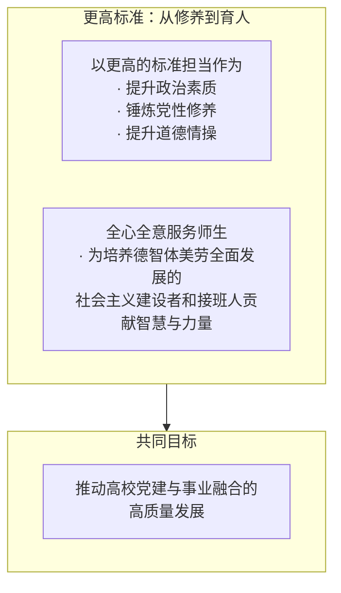
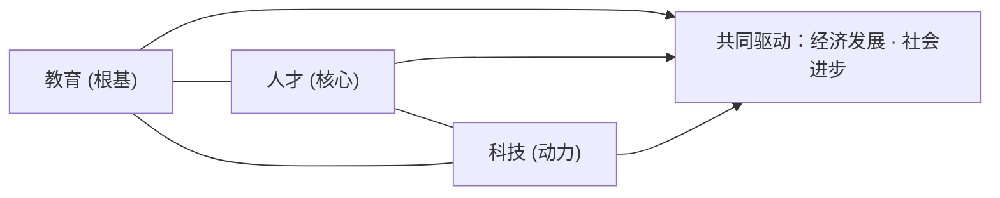
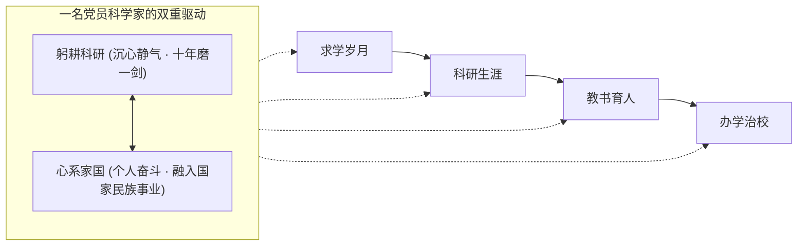

> **党课纪要 · 躬耕科研 心系家国**  
> **党员科学家的使命与担当**  
> 薛其坤院士面向高校师生党员的党课 · 2025年 · 全稿整理  
> **主讲人**：薛其坤 · 中国科学院院士 · 南方科技大学校长 · 2023年度国家最高科学技术奖获得者

---

## 开篇 · 追求卓越，矢志报国

> **高校党课开场要点：以更高标准担当作为，推动党建与事业融合发展。**

### 一、 党课主题
* **新征程**
* **追求卓越 · 矢志报国**

讲话者希望以这次党课展开**思想交流、知识碰撞**，进一步**坚定信仰、携手奋进**，并由此进入主题讲授。

### 二、 更高标准：从修养到育人
* **以更高的标准担当作为**：
  * 提升政治素质
  * 锤炼党性修养
  * 提升道德情操
* **全心全意服务师生**：
  * 为培养德智体美劳全面发展的社会主义建设者和接班人贡献智慧与力量
* **共同目标**：
  * 推动高校党建与事业融合的高质量发展

> [!NOTE]
> **结构理解提示**  
> 讲话将**自身修养要求**与**服务师生**并列提出，二者共同指向人才培养使命，最终落脚于党建与事业融合发展。可能的理解提示：主线是由“更高标准”向“高质量发展”逐层传导。

---

## 01 · 时代方位与党员标准

新征程上，教育科技人才一体支撑；高校师生党员重任在肩。

### 一体支撑：教育·科技·人才

生逢其时，重任在肩——当前我们正奋进在全面建设社会主义现代化国家、全面推进中华民族伟大复兴的新征程上，首先要**找准时代坐标**。

党的二十大报告指出，教育、科技、人才是全面建设社会主义现代化国家的**基础性、战略性支撑**，必须坚持**科技是第一生产力、人才是第一资源、创新是第一动力**。

#### 三者的辩证统一关系（相互支撑 · 相互推进）
* **教育**：根基
* **人才**：核心
* **科技**：动力
* **共同驱动**：经济发展 · 社会进步

#### 一体部署脉络
* **党的二十大报告**：教育、科技、人才是全面建设社会主义现代化国家的基础性、战略性支撑 →
* **二十届三中全会**：统筹推进体制机制一体改革，健全新型举国体制，提升国家创新体系整体效能 →
* **2024 全国教育大会**：统筹实施科教兴国、人才强国、创新驱动发展战略，一体推进教育发展、科技创新、人才培养。

这些部署对高校提出更高要求：深刻把握三者协同一体的内在逻辑，畅通教育、科技、人才的**高效循环**。

> [!IMPORTANT]
> **洞察**  
> 三份部署同指一处：三者不是并列的三件事，而是**协同一体的循环**——这正是高校被寄予厚望的原因。

### 大学何为：一体改革桥头堡

强国建设，教育何为？兼具教育、科技、人才担当使命的大学，是统筹推进三者体制机制一体改革和发展的**桥头堡**。

#### 研究型大学的四个支点
* **卓越的教育**
* **一流的科研**
* **优秀的师资**
* **优秀的学生**
* **共同构成大学的内在品格与显性特征**

多年改革实践已经清晰表明：杰出研究型大学是**基础研究、科学发现、技术发明的主要阵地**，是培养拔尖创新人才的**摇篮**。强国建设的使命在召唤——任务艰巨，但**正当其时**。

### 重温党章：党员标准与义务

回归本源，理解共产党员的身份内涵——**始终走在时代前列**，是马克思主义政党先进性和历史自觉的深刻体现。

> “中国共产党党员是中国工人阶级的有共产主义觉悟的先锋战士，必须全心全意为人民服务，不惜牺牲个人的一切，为实现共产主义奋斗终生。”  
> —— 《中国共产党章程》

同时要牢牢记住：党员永远是**劳动人民的普通一员**，所有党员都**不得谋求任何私利和特权**。

#### 八项义务：一个逻辑严密的整体
* **① 学习与本领**：学习马克思列宁主义、毛泽东思想、邓小平理论、"三个代表"重要思想、科学发展观、习近平新时代中国特色社会主义思想，学习党的路线方针政策、党的基本知识和历史，学习科学文化法律业务知识，提高为人民服务的本领
* **② 先锋模范作用**：增强"四个意识"、坚定"四个自信"、做到"两个维护"，在生产、工作、学习和社会生活中起先锋模范作用
* **其余义务 · 涵盖**：
  * 党和人民利益高于一切，吃苦在前、享受在后
  * 自觉遵守党的纪律，维护团结统一
  * 切实开展批评和自我批评
  * 密切联系群众
  * 发扬社会主义新风尚
  * ……

党章义务是对党忠诚、对人民负责的集中体现，是保持先进性的内在要求，也是每一位党员不容推卸的**政治责任**。

### 尺子与镜子：从合格到优秀

先做一名合格的党员。合格与否、优秀与否，有把尺子——**讲政治、有信念，讲规矩、有纪律，讲道德、有品行，讲奉献、有作为**。

它要求不仅政治上、思想上过硬，作风上、行动上也要达标，还应向更高的标准看齐。

#### 榜样的力量：精神底色的一脉相承
* **2017 · 专题组织生活会**：做脱离了低级趣味的人、高尚的人；以张思德、白求恩、焦裕禄等先进典型为镜 →
* **2021 · 七一勋章颁授仪式**：坚定信念、践行宗旨、拼搏奉献、廉洁奉公的高尚品质和崇高精神 →
* **精神底色**：重要论述一脉相承、不断深化，共产党人必须永葆。

### 一面旗帜，一眼看得出来

> “只要每个基层党组织和每一个共产党员，都有强烈的宗旨意识和责任意识，都能发挥战斗堡垒作用、先锋模范作用，我们党就会很有力量……执政基础就能坚如磐石。”  
> —— 习近平总书记

**每一名党员就是一面旗帜**，汇聚起来就是无坚不摧的磅礴力量。全党开展深入贯彻**中央八项规定精神**学习教育，正是对党员忠诚与信仰的深刻检验——锲而不舍落实，才能锻造党性纯洁、纪律严明的队伍。

#### "一眼看得出来的共产党员"
* **战争年代**："是不是共产党员，一眼就能看得出来"——那些作战勇敢的准是共产党员。（开国上将萧克回忆）
* ⇢ **和平时期**："看得出来"更多转化为各自岗位上的担当作为与服务精神。

新时代高校师生党员，就是让人民群众在一言一行中，看到与革命年代**同根同源**、与先进模范**同向同行**的先锋本色。

---

## 02 · 躬耕科研 · 心系家国

党课第二部分的主线：求学、科研、育人、治校四个阶段，将依次展开。

### 车之两轮，鸟之双翼
* **躬耕科研**：沉心静气、精益求精，有水滴石穿、十年磨一剑的坚持；
* **心系家国**：把个人奋斗融入国家和民族的事业，让科研成果哺育人民福祉与国家强盛。

四个彼此衔接的阶段，既是个人成长经历，也是一代代知识分子把个人理想与国家命运相连的**小小缩影**。

### 求学之路，一颗红心向党（求学与报国之路）

* **1980**：乘恢复高考的时代东风，从沂蒙山区的农村孩子成为令人羡慕的大学生——抓住了机遇，也全程见证、亲身经历了改革开放的巨变
* **1984**：大学毕业，在曲阜师范大学工作三年
* **1987**：历经三次考研，考入中国科学院物理研究所，进京求学
* **1992**：邓小平南方谈话同年，经导师推荐赴日本东北大学（仙台）留学；后在美国北卡罗来纳州立大学从事博士后研究约5年
* **2000**：已成为国际上初露头角的青年科学家；获国家自然科学基金委项目资助——来自祖国的认可与呼唤，成为人生转折点：**毅然全职回国**；同年光荣加入中国共产党
* **回国第五年**：40岁出头当选中国科学院院士，自此反复思考"如何当一名合格的院士"
* **2013**：任清华大学党委常委、副校长，成为一名党员干部
* **2018**：赴中央党校系统学习四个半月
* **2020**：深圳经济特区建立40周年之际，南下出任南方科技大学党委副书记、校长，肩负更大的责任

回望来路：是沂蒙红色精神的早期熏陶培育了朴素的**报国理想**，是改革开放的伟大实践给了**成长机遇**，是海外留学的所见所感强化了**振兴中华的使命**，是国内外科研历练提升了**服务国家的能力**——共同铸就"学成报国、向党靠拢"的坚定决心。

回国当年入党，"这是我人生中无比激动的时刻"。从此，**不仅是一个科学家，还是一名共产党员**——党员身份为科研实践赋予了新使命、更高的要求。对个人而言，使命体现在科学研究和立德树人的实践之中；指引方向、赋予力量的，正是党的创新理论和宏伟蓝图。

### 精神灯塔：钱学森

成长路上始终矗立着一座精神灯塔——**钱学森**：党员科学家、红色科学家的典范。

1955年，钱学森冲破重重阻挠，经**深圳罗湖口岸**归国——当年那里还是一片农田，如今已是高楼林立的现代化大都市。罗湖桥记录了他归国的坚定步伐，也无声见证着祖国从积贫积弱到繁荣昌盛的巨变。

#### 钱学森自述：一辈子三次非常激动的时刻
* **壹 · 1955 · 获准回国**：向恩师告别，先生很有感慨："现在在学术上已经超过了我。" "我一听他这句话，激动极了。"
* **贰 · 建国十年 · 被接纳为中国共产党党员**："我心情是非常激动的。"
* **叁 · 读《史来贺传》的序**：雷锋、焦裕禄、王进喜、史来贺跟钱学森，作为40年来在群众中享有崇高威望的共产党员优秀代表——"我现在是劳动人民的一份子，而且跟劳动人民最先进的分子连在一起了。"

三次激动，两次与党员身份直接相关。

"科研不顺利、调整方向、遇到困惑的时候，钱先生常常浮现在脑海中。"像钱学森这样淡泊名利、专注科研、无私奉献的党员科学家还有**钱三强、程开甲、于敏、王大珩、南仁东**等——他们的科学精神与家国情怀，如同一面镜子，时刻映照着一名共产党员的科研与人生。

### 两弹一星：丰碑与召唤

两弹一星事业是新中国建设成就的重要象征。1964年10月16日首颗原子弹爆炸成功——**"这一声巨响让中国人挺直了腰杆"**。

#### 关键历史节点
* **1964.10.16**：自行研制的第一颗原子弹爆炸成功，中国成为世界第五个拥有核武器的国家
* **其后**：在美国全面封锁和核讹诈的年代依靠自己的力量，先后以塔爆、地面、空中、地下等方式共进行45次核试验，掌握中子弹技术
* **1996.7.30**：中国政府宣布暂停核试验
* **1999**：建国50周年之际，向23位科学家授予"两弹一星"功勋奖章

> “如果60年代以来中国没有原子弹、氢弹，没有发射卫星，中国就不能叫有重要影响的大国，就没有现在这样的国际地位。”  
> —— 邓小平

在清华工作期间，讲者曾与一些功勋直接接触、亲聆教诲。1966年国庆，周恩来总理特意邀请钱学森、邓稼先、朱光亚登上天安门城楼观礼；今年9月3日，观礼团中有十几位两弹一星功勋后代，讲者与**朱光亚、钱学森、邓稼先先生之子**同框——跨越近60年的"天安门重逢"，弥足珍贵。科研不顺利、迷茫走不下去的时候，他总会重温展现功勋们**矢志报国、舍身为国**精神的影片片段。

两弹一星精神——**热爱祖国、无私奉献、自力更生、艰苦奋斗、大力协同、勇于登攀**——是新一代攻坚克难的强大动力。新时代的"两弹一星"是什么？**通用量子计算机、通用人工智能、受控核聚变**等终极前沿，是必争的战略领域：无论新一轮科技革命由哪项技术主导，中国人必须成为**主力军**。作为党员科学家，要立志成为、并培养出胜任新时代两弹一星事业的科学家和人才。

### 郭永怀：以身许国（两弹一星功勋中唯一的烈士）

* **1945**：获加州理工学院博士学位，后成为中国近代力学事业的奠基人
* **1947**：与钱学森同框导师冯·卡门的合影流传至今
* **1956**：毅然回国，承担多项国防科研项目
* **1961**：在困难岁月向党组织提出入党申请，成为光荣的共产党员
* **1968.12**：出差返京途中飞机失事，以身殉国，不满60岁——最后时刻与警卫员用身体护住装有热核导弹研究资料的公文包，身体被大火烧焦，绝密文件完整保留

生命危机之时，他首先想到的是国家的绝密文件——用生命诠释了优秀党员科学家**"心有大我、以身许国"**的崇高信仰与使命担当。

> [!NOTE]
> **叩问**  
> 如果生命遇到极大威胁，我们能否像郭永怀先生一样做出这样的选择？——值得每个人认真思考。

夫人**李佩**长期在中国科大研究生院、中国科学院大学任教，是杰出的英语教育家，培养出大批院士与优秀人才——她也是讲者研究生阶段的英语老师。"我想用一张老照片，怀念敬爱的李佩老师。"

---

## 03 · 科研生涯的三个体会

> **不负时代勇担使命 · 追求极致永无止境 · 抓住关键勇攀高峰。**

### 体会一 · 不负时代，勇担使命

三个体会中**最重要**的一个。两弹一星精神一直鼓舞着他——2023年全国两会"代表通道"上，他特别强调：**"生命不息、奋斗不止，把毕生精力献给国家的科技和教育事业。"**

回国第五年、40岁出头就当选院士时，他深深思考：得了这么高的荣誉，如何发挥党员科学家**更大的作用**？2021年5月，习近平总书记在两院院士大会上对广大院士提出希望——**四个表率**：
* **① 做胸怀祖国、服务人民的表率**
* **② 做追求真理、勇攀高峰的表率**
* **③ 做坚守学术道德、严谨治学的表率**
* **④ 做甘为人梯、奖掖后学的表率**

四个表率：新时代科学家精神的重要内容，也是"不负时代、勇担使命"的根本遵循。

### 体会二 · 追求极致，永无止境

质的要求——对实验仪器掌握到位、对技术了如指掌，把**每个实验的每个细节**做到自己能力的极致；量的要求——**吃苦耐劳、异于常人**。
* **＞12 小时**：每天工作
* **＞26 天**：每月工作
* **＞330 天**：每年工作
* **近 30 年**：持之以恒

#### 针尖的三重境界
* **一般水平**：尖部很长 · 不稳定
* **高水平**：顶部专业 · 较短 · 稳定
* **最高水平**：顶部仅一个原子 · 极稳定

以实验中常用的扫描探针显微镜为例：为掌握"单原子针尖"的诀窍，他做过**1000根以上**的针尖——这项技术全世界掌握的人并不多。"只要不断追求极致，任何人都能把事情做得很好；再配上异于常人的勤奋，人就会变得**非常强大**。"

### 体会三 · 抓住关键，勇攀高峰

抓住最关键的科学问题。团队把目标锁定在**量子反常霍尔效应**——凝聚态物理中重要而基本的量子效应之一，也是公认的世界难题。

#### 从"乱撞"到"按道行驶"
* **普通导体**：电子乱撞 · 发热 · 有能耗
* **量子反常霍尔态**：如汽车按道行驶 · 无需强磁场 · 低能耗
* **应用前景：低能耗高速电子器件与芯片**：电脑更快、更小、几乎不发热 · 存储或从几 G 迈向几 T

130多年来，从霍尔效应到需强磁场的量子霍尔效应（1980年发现），再到无需强磁场即可无能耗运动的量子反常霍尔效应——物理学家预言的家族成员就此在实验上补齐。

清华大学、中科院物理所联合团队耗时**4年**、试验**上千个样品**，找到**磁性拓扑绝缘体薄膜**这一特殊材料；2013年4月，我国科学家首次从实验中观测到量子反常霍尔效应——被杨振宁称为**"中国实验室里发表的第一次诺贝尔奖级的物理学论文"**。

历时十年的攻坚中，**党支部发挥了战斗堡垒作用**：核心工作班子带领20多名研究生（大多为中共党员或入党积极分子），把实验室当作"践行初心使命的战场"，累计制作超过**1000个样品**。困难面前部分同学也曾胆怯，学生党员带头顶上，最终渡过难关。

#### 工欲善其事，必先利其器
* **上世纪60年代**：一穷二白、设备简陋，科研人员**自力更生**打造仪器，照样完成科研任务。
* ⇢ **今天**：国家强力支持下，自主研制**国际首台**扫描隧道显微镜—角分辨光电子能谱联合系统——正是这台利器，帮助团队从实验上观测到量子反常霍尔效应。

变的是科研条件，不变的是党的引领下艰苦奋斗的精神。

#### 两点感受
* **科学层面**：扎实的基础理论＋精密的实验技术＋攀登未知高峰的勇气＋吃苦耐劳异于常人的作风；
* **精神层面**：迎难而上、艰苦奋斗的党员本色，以及党中央统筹协调优势资源、以集体智慧攻克重大科学难题的**组织优势**。前者是抓住关键的基础，后者是勇攀高峰的精神支柱。

### 从集体学习到新的突破

2020年10月16日，十九届中央政治局就量子科技举行第二十四次集体学习，他受邀为党和国家领导人作讲解。

三点感悟：
1. 中央政治局带头学习、虚心向学，充分保障决策科学性——党员更应**时时处处学习**，这是"抓住关键"的必然要求；
2. 登台讲解来自党中央的**高度信任**，更加坚定了为祖国量子科技事业奋斗的信心；
3. 备课极大拓展了知识的广度深度，提升了战略把握与战术执行能力——这也是一次磨练。

#### 荣誉与突破
* **回国第五年**：40岁出头当选**中国科学院院士**
* **2018**：量子反常霍尔成果获**国家自然科学一等奖**
* **2020**：获**菲列兹·伦敦奖**（该奖首位中国学者）
* **2023年度**：获**国家最高科学技术奖**，习近平总书记亲自颁发证书奖章——"和当年入党一样，都是人生非常激动的时刻"
* **2025**：联合团队实现**常压环境下镍氧化物材料的高温超导电性**

今年年初，依托自主研发的**强氧化原子逐层外延技术**，他带领南科大青年科学家团队取得重要突破：在**常压环境**下实现镍氧化物材料的高温超导电性——此前镍基材料需超过**10万大气压**的极端高压才能超导，这一成果为高温超导研究开辟了新路径。"身份在变，攀登科学高峰的追求没有变——生命不息、奋斗不止。"

国际认可还包括美国物理学会的一项大奖——他成为该奖**首位中国籍获奖科学家**。"所有崇高的荣誉都得益于党和人民的培养，得益于国家战略科技力量与经济社会的高度发展——没有这些，科学家往往'巧妇难为无米之炊'。"

团队毕业博士约**156人**，绝大部分活跃在教育科技界，约**30%**入选各类国家人才计划——"看到学生学有所成，非常欣慰。"今年是他当选院士后的第20年：回望当年的思考，他交上了一份自己觉得还**满意的答卷**——最重要的两项成果（量子反常霍尔、常压高温超导）都产生于当选院士之后。

---

## 04 · 教书育人 · 办学治校

> **为党育人、为国育才；党建引领大学治理。**

### 根本遵循：教育家精神

高校教育工作者肩负**为党育人、为国育才**的神圣使命。2023年教师节前夕，习近平总书记致信全国优秀教师代表，首次提出并深刻阐释**中国特有的教育家精神**，为党员教育工作者标注了崇高的精神标杆。

他始终以教育家精神为根本遵循，融入育人全过程——培养学生**以德为先、能力为重、清廉为魂**，铭记人民幸福、国家富强、民族复兴的家国情怀，成长为德智体美劳全面发展的社会主义建设者和接班人。

### 实验室规矩：严管即厚爱

实验室成立之初即制定严格管理制度、**每年更新**，并用**英文**制定——顺便锻炼学生的英语。"在遵守制度方面，我的要求非常严格。"
* **到实验室就集中精力**，严禁沉迷电脑游戏——互联网刚兴起时，不少同学因此荒废学业；
* **每人每月两份报告**：阅读报告（reading report）＋工作报告（work report），连文件名都有规范要求——"后来发现这个要求非常重要"；
* **制度第十一条**：**任何情况下不得公款私用，没有例外**——这是党员廉洁自律的直接体现，也是对人性弱点的约束；
* **每台仪器有专门记录**，数据必须**完整、可重复、真实**。

一份2019级新生的实验记录：周日深夜23点多记录完仪器状态才离开，周一早8点半又到岗，一直忙到接近午夜。"看似严苛的制度背后，是对科学精神的提倡、对科学事业和国家财政负责，也是一名党员最基本的职业操守。"

党员要走在前、作表率——不仅科研上言传身教，更要**不放弃任何一个学生**。正如陶行知所说："真教育是心心相印的活动，唯有从心里发出来，才能打动心灵的深处。"

### 学术品味：积跬步以至千里

提高学术品味、瞄准并发现关键科学问题，靠**一点一滴**的积累：
* **多读文献**——每一篇都有可学之处，不止看懂，还要学到其中最值得学习的精华，融入自己的脑袋；
* **多请教**——逮住一个人就向他请教，只要自己不知道就问；
* **多听学术报告**——每一个报告都有创新之处，都有值得学习的地方。

> “不积跬步，无以至千里；不积小流，无以成江海。”  
> —— 《荀子 · 劝学》

日积月累、水到渠成，学术品味会稳步提升——前辈先生们的高品味，同样是这样一点点积累出来的。

### 导师的四个注重

"只要你是一个老师，特别是研究生的老师，你就代表着一个实验室。"

#### 专业培养的四个着力点
* **① 实验技能**：让学生掌握探索未知世界的"独门绝技"
* **② 发现能力**：通过大量阅读与学术训练，提升学术品味
* **③ 科学精神**：既保持对科学事业的酷爱，又坚守严谨求实的治学态度
* **④ 团队精神**：产生 1+1＞2 的协同效应，在集体奋斗中成长

他注重长期指导、持续关心已毕业学生的发展——学生中已有**七八十位**在大学任教。"衡量导师最重要的，是培养出什么样的学生。"有学者曾对导师说：学问上我没超过您，但**我的学生超过了您的学生**——教育的真谛在于**传承与超越**。给党员教师一个建议：把**"让我的学生超过我"**作为人才培养的目标。

### 育人原则：四个更重要

#### 四组取舍
* **为人 ＞ 为学**：不仅是学业导师，更要抓人生价值，引导树立正确的世界观、人生观、价值观
* **研究能力提高 ＞ 研究结果**：注重提出问题的勇气、分析问题的能力、解决问题的智慧，而非只看眼前成果
* **掌握工具方法 ＞ 掌握知识点**：知识快速迭代，更要培养获取知识的方法与终身学习的能力
* **以身作则 ＞ 严厉训斥**：要求自己首先做到"言为士则、行为世范"，用行动影响学生

### 党建引领：办一所什么样的大学

2018年上半年，在清华副校长任上赴**中央党校**系统学习四个半月——"一次深刻的党性锤炼与思想升华"。

通过学习，进一步增强"四个意识"、坚定"四个自信"、做到"两个维护"，深刻把握**坚持党的领导是中国高校发展的灵魂所在、根本保证**——要把政治优势、组织优势转化为大学的**治理效能与发展动能**。

南方科技大学2012年经教育部批准成立，肩负两大历史使命：探索**具有中国特色的现代大学制度**、探索**创新人才培养模式**。围绕校训校风学风这些"大学灵魂"的百年之问，全校热烈讨论后公布校训——

#### 八字校训 → 四个理念
* **明德 · 树人**
* **求是 · 致远**
* **日新 · 立校**
* **自强 · 报国**

内化于心、外化于行——转化为育人、治学、管理全过程的制度安排，成为全校师生的精神标识。

立德树人上，坚持用**红色精神**滋养师生情怀、坚定报国理想；组织上，通过**政治引领、事业支持、情感关怀**，注重在高层次人才、优秀青年中发展党员，把优秀人才团结在党组织周围——一批院士、优秀学者入党，生动体现了党组织的向心力与凝聚力。

---

## 05 · 接力奋斗 · 共创未来

> **理解为何而出发、明确身在何处，教师党员与学生党员协同发力。**

### 教师党员：四大标杆角色

立德树人是教育的根本任务，教师是最重要的执行者；作为先进分子，教师党员的言行直接关系下一代的价值塑造——必须以更高标准，做四大角色的**标杆与典范**。

#### 四重角色 · 各有榜样
* **① 立德树人的大先生**
  * 传道——传共产党人之道，用党的创新理论铸魂育人，筑牢爱国情怀与社会责任；
  * 授业——传授知识更传授方法论，培养批判性思维与独立探索能力；
  * 解惑——解思想之惑、认识之惑、情感之惑、交往之惑。
  * **榜样 · 黄大年**："振兴中华，乃我辈之责"
* **② 师德师风的领航者**
  * 精湛业务是基础，高尚师德是根本保障：课堂内外为人师表、知行合一；
  * 遵规守纪、清正从教，在学术、师生交往、社会服务上坚守底线；
  * 以人格魅力潜移默化化人，营造风清气正的育人生态。
  * **榜样 · 张桂梅**："如果说我有动力，那就是党和人民"
* **③ 科研创新的攀登者**
  * 瞄准方向——服务国家战略需求，聚焦"卡脖子"问题；
  * 以十年磨一剑的定力追求原始创新，敢坐冷板凳；
  * 薪火相传——以科研反哺教学，带领学生参与前沿课题、传承科学精神。
  * **榜样 · 黄旭华**："干惊天动地事，做隐姓埋名人"
* **④ 服务社会的领头雁**
  * 推动产学研融合，打通从实验室到生产线的通道；
  * 深入社会一线调研，参与政策咨询与制度建设，提供学理支撑；
  * 勇担社会责任，投身科学普及、乡村振兴、文化建设。
  * **榜样 · 李保国**：把论文写在祖国大地上

### 学生党员：四个先锋方向

> “平常时候看得出来，关键时刻站得出来，危急关头豁得出来。”  
> —— 习近平总书记

教师有四个角色，学生党员是青年中的先锋，同样要**率先垂范**——从思想到行动：
* **① 坚定信念的先锋**：深学党的创新理论，夯实信仰之基；在党团活动和日常交流中，用青年自己的语言传递正能量；面对错误思潮敢于发声亮剑，澄清模糊认识、坚守政治立场。
* **② 勤学向上的时代先锋**：主责主业是学习：以学为本、互助共进，组织学业帮扶课堂，带动身边同学；积极投身高水平学科竞赛与创新赛事，挑战自我、勇创佳绩。
* **③ 勇于担当的实干先锋**：对接国家急需的关键领域，在科研攻关一线挑重担；勇于探索学术前沿，以高质量原创成果服务科技自立自强。
* **④ 服务奉献的行动者**：服务同学，真心实意解决急难愁盼；在支教、社区服务中了解国情、服务人民；毕业后主动到重点领域、基层一线甚至艰苦地方建功立业，让青春在奉献中焕发光彩。

### 从1964到2035

2025年9月3日，纪念中国人民抗日战争暨世界反法西斯战争胜利80周年，习近平总书记向全世界庄严宣告：**中华民族伟大复兴势不可当**。讲者在现场观礼、心潮澎湃——这是新征程上的首次阅兵：对历史的深切缅怀、对英烈的崇高致敬，更是对和平的坚定守护、对未来的庄严宣誓。

抚今追昔：前进道路并非坦途，当前面临**风高浪急甚至惊涛骇浪**的重大考验；蓝图已经绘就，机遇极其难得，艰巨性和复杂性也前所未有——党员干部必须请缨担当、冲锋在前。

> “人生自古谁无死，留取丹心照汗青。”  
> —— 文天祥《过零丁洋》

在深圳遥望伶仃洋，古人的忠贞气节至今令人肃然起敬——古人尚且如此，何况我辈：把赤胆忠心毫无保留地献给党和人民的事业，把个人奋斗融入国家和民族命运。

#### 精神接力，走向2035
* **1964 · 东方巨响**：自行研制的第一颗原子弹爆炸成功，中国人挺直了腰杆 →
* **2025 · 九三阅兵**：陆海空钢铁长城屹立，东风-5C 液体洲际战略核导弹受阅 →
* **2035 · 展望**：社会主义现代化目标圆满实现

从奋力追赶到战略主动——历史的接力棒，已经传到我们这一代。

**不忘初心、接力奋斗——为2035年社会主义现代化目标的圆满实现、为中华民族伟大复兴，贡献这一代人的全部智慧和力量。**
