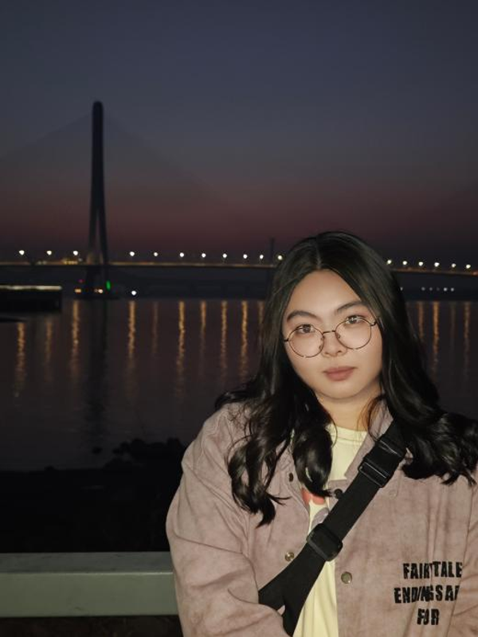
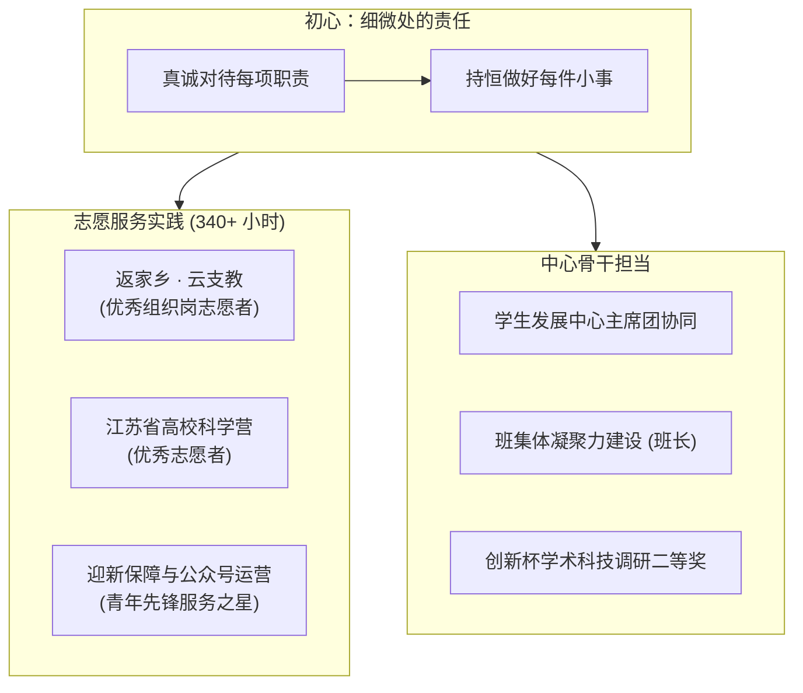
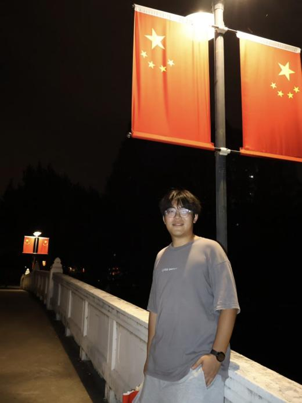
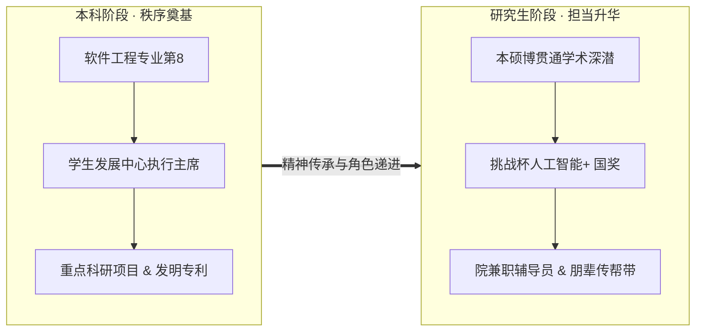
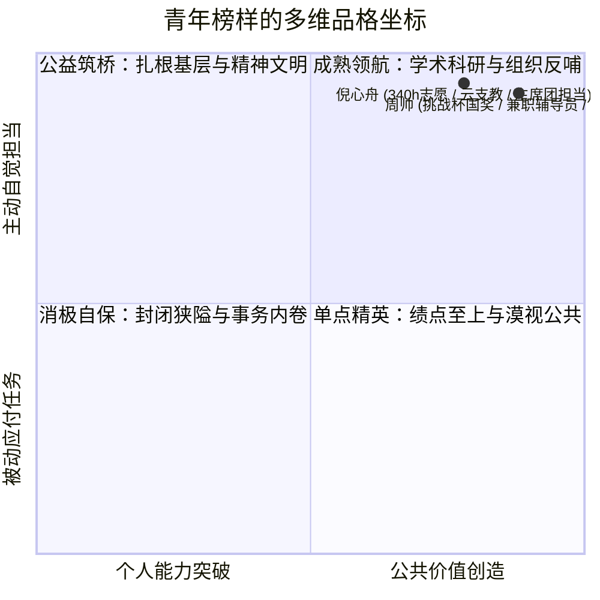

## 序章 · 击碎单向度的标签

在大学的各类荣誉评选中，人们习惯于仰望那些被光环环绕的名字：

奖学金证书、高含金量的竞赛奖杯、各大榜单的位次……仿佛只要把这些标签整齐地罗列在 PPT 或宣传展板上，一个年轻人的大学四年就得到了完满的注脚。

然而，在这种日益程式化的宏大叙事里，很多最本质的东西往往被悄然隐去了：**当脱离了功利主义的刻度尺，一个青年究竟在凭借什么与他人建立连结？在孤独的书桌和冷冰冰的数字指标之外，他的内心还保留着多少对真实世界的温热与关切？**

*图注：倪心舟。计软网安院学生发展中心主席团成员、2023级计算机科学与技术专业班长，累计志愿时长超 340 小时。*

在第十届“计软新力量，网安好青年”的评选名单里，学生发展中心（StuDev）的两位骨干——**倪心舟**与**周帅**，分别站在了“精神文明类”与“学生骨干类”的台前。

翻开他们的成长履历，最动人的地方恰恰不是那些耀眼的头衔，而是他们在荣誉背后所展现出的精神重力：一种拒绝浮躁内卷、甘于在细微处深耕的笃定与从容。

---

## 01 · 倪心舟：340 小时的云端筑桥与微光力量

在课业负担极其繁重的计算机科学与技术专业，很多同学感叹光是应付日常的专业课、大作业与期末考核就已捉襟见肘。

然而，身为 B230402 班班长、学生发展中心主席团成员的倪心舟，却在自己的大学日程表里，凿出了一个令人惊叹的数字：**累计志愿服务时长超过 340 小时**。

这不是一次性的突击打卡，而是一场持久而深情的投入：

- 在团中央开展的全国大学生“返家乡”一起云支教中，他担任核心组织岗志愿者，荣获“优秀组织岗志愿者”表彰；
- 在江苏省青少年高校科学营中，他顶着烈日奔波在各个实验楼之间，被评为“优秀志愿者”；
- 在南京邮电大学第 26 届“创新杯”红色专项与第 27 届课外学术科技作品竞赛中，他带领团队深入调研，分别斩获院一等奖与校二等奖；
- 先后获评南京邮电大学“优秀青年志愿者”、“优秀共青团员”、“优秀学生社团干部”以及学院“青年先锋服务之星”。

在很多人眼里，志愿者往往被看作是站在聚光灯边缘的“背景板”。但在倪心舟看来，每一次志愿服务都是一次走出自我封闭、触摸真实社会的宝贵契机。

在“云支教”的过程中，面对屏幕另一端大山深处渴望知识的孩子们，他不仅认真备好每一堂课，更悉心倾听孩子们的烦恼与梦想。“那些隔着网线传来的真挚眼神，会让你突然明白，自己所学的东西绝不仅仅是为了换取一份高薪offer，而是要成为连接他人、照亮他人的桥梁。”

在学生发展中心内部，倪心舟同样是那个最靠谱的守护者。从微信公众号的文案排版、活动推文的反复校对，到大型心理活动现场的物料搬运与秩序引导，他始终保持着低调而专注的状态。

> [!NOTE]
> **倪心舟的追梦宣言**  
> “以真诚之心对待每项职责，以持恒之责做好每件小事，于细微处践行担当。我愿始终如一，发一分光，添一分热，以实际行动诠释青年价值。”

---

## 02 · 周帅：跨越本硕的责任接力与大将风范

如果说倪心舟展现的是青年骨干温润如水的奉献品格，那么周帅呈现的，则是一种在学术深潜与团队责任之间无缝穿梭的沉稳大将之气。

*图注：周帅。曾任学院学生发展中心执行主席，现任兼职辅导员、班长，在挑战杯“人工智能+”专项赛斩获国家三等奖。*

对于很多工科学生而言，保研上岸往往意味着“任务完成”，很多人会选择彻底卸下所有的学生工作，专心沉浸在个人的研究生课题中。

但在本科毕业、顺利进入南京邮电大学本硕博贯通培养之后，周帅做出了一个出乎许多人意料的决定：**受聘担任学院兼职辅导员，继续留在服务同学的第一线**。

回望他的四年轨迹，这种对集体的长情投入是一以贯之的：

- **在学术与竞赛上**：本科以专业前 15% 的优异表现保研，主持校级重点创新项目结项，以第一学生发明人公开发明专利；进入研究生阶段后，荣获研究生一等学业奖学金，并作为主力队员在**挑战杯“人工智能+”专项赛**中一举斩获**国家三等奖**；
- **在社会工作与集体担当上**：曾任学院学生发展中心执行主席、辅导员助理，现任兼职辅导员与班长，多次成功统筹大型院校活动；
- **在志愿服务上**：连续参与五四志愿活动、母校返校宣讲、校庆志愿服务与暑期“三下乡”社会实践，屡获“抗疫先进个人”、“暑期社会实践先进个人”等表彰。

“很多人问我，又要搞科研攻关，又要管这么多学生工作，时间到底够不够用？”周帅坦言。

他的回答始终极其平静：“学术科研需要耐得住寂寞的深度专注，而学生工作需要体察人心的同理心。两者不仅不矛盾，反而是彼此最好的互补。在实验室坐久了，推开门去跟学弟学妹聊聊天，了解大家的实际困难，帮中心把一场活动办扎实，这种充实感是单纯看文献替代不了的。”

作为从学生发展中心一步步走出来的老骨干，他在兼职辅导员的岗位上，成为了连接学院、中心与普通同学之间最坚固的纽带。当新一届的中心骨干在策划活动或团队协作中遇到迷茫时，他总能站在学长与辅导员的双重视角，给出最中肯、最落地的建议。

---

## 03 · 榜样的力量：学生发展中心拒绝同质化

在许多大学校园里，“学生骨干”这个词有时容易招致一些刻板偏见：有人觉得他们忙于杂务、荒废学业，也有人觉得日常工作容易流于形式、缺乏温度。

但倪心舟与周帅的实践，为身边的同学们给出了截然不同的范本：

他们之所以能在“计软新力量，网安好青年”的评选中脱颖而出，不是因为他们迎合了某种标准模板，而是因为他们身上具备了三种极为珍贵的青年品格：

1. **不跟风的自我定力**：不被外界浮躁的功利评价所绑架，明白自己想要什么，并在选定的道路上持之以恒；
2. **接地气的同理体温**：无论是面对大山深处的支教儿童，还是面对初入大学感到迷茫的学弟学妹，始终保持平视与真诚；
3. **知行合一的责任自律**：不把口号挂在嘴边，而是把担当化作 340 个小时的志愿打卡、化作一篇篇实验报告与每一次活动的默默值守。

---

## 终章 · 属于你的青年坐标

校园的道路两旁，梧桐树叶随风沙沙作响。

在学生发展中心的活动室里，新的方案正在白板上热烈讨论，新的海报正在显示屏上反复微调。倪心舟与周帅的身影穿梭其中，平静而坚定。

他们用自己的脚步证明了：**大学最动人的成长，从来不是把自己雕琢成一件精致而冰冷的展品，而是在热气腾腾的生活里，主动成为照亮他人的一束光**。

当你不再被单向度的标签所束缚，当你愿意伸出双手去拥抱身边具体的人与事，属于你的硬核坐标，便已在这片土地上深深扎根。
